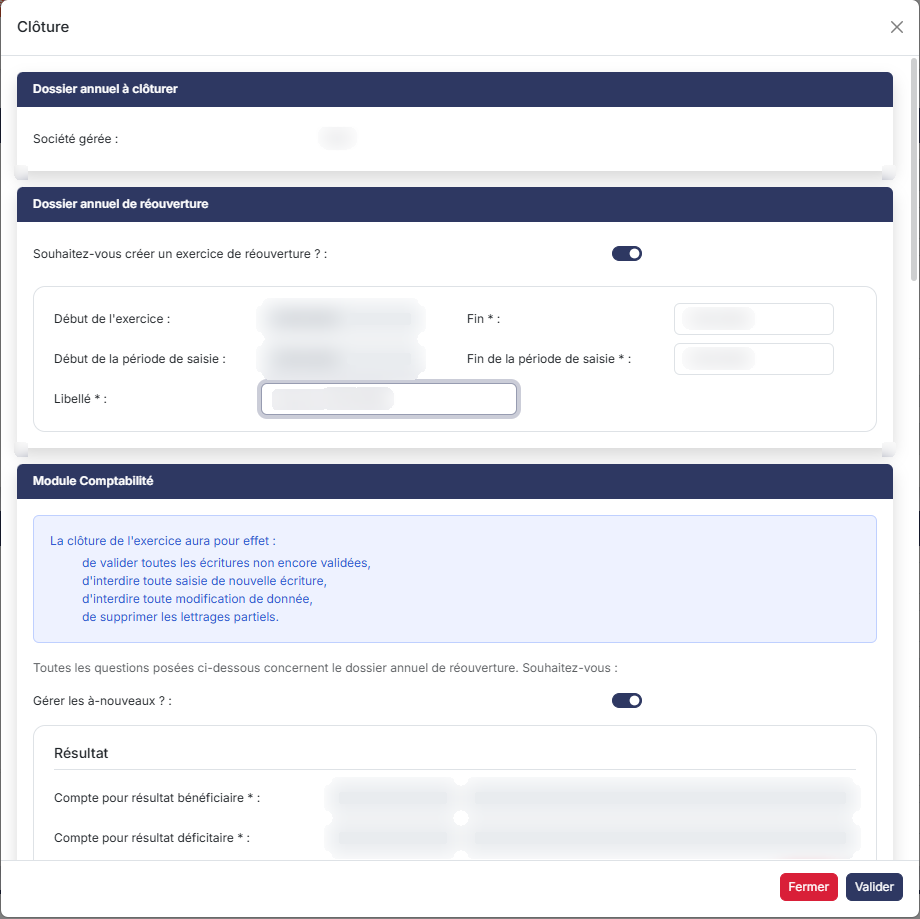
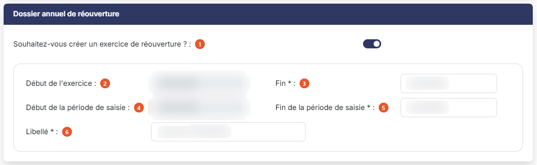
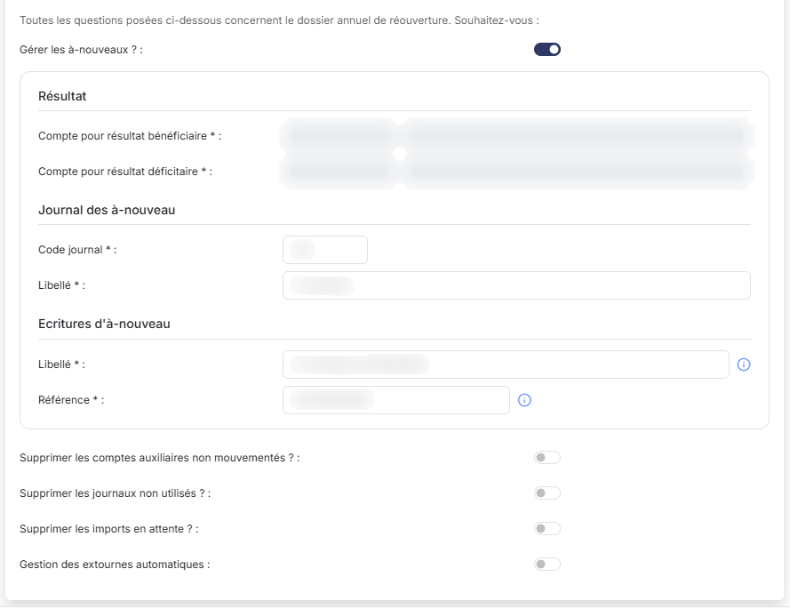
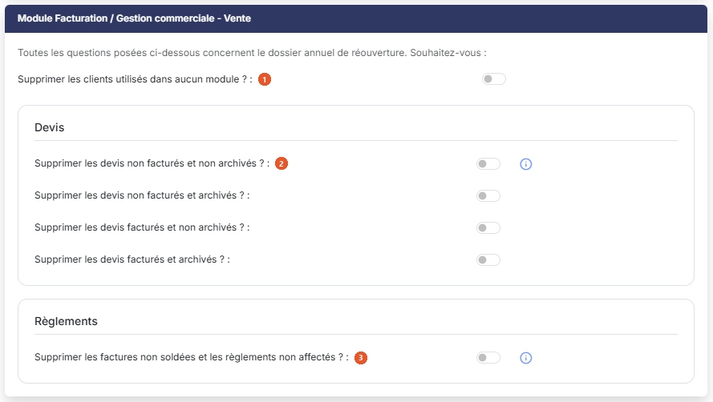
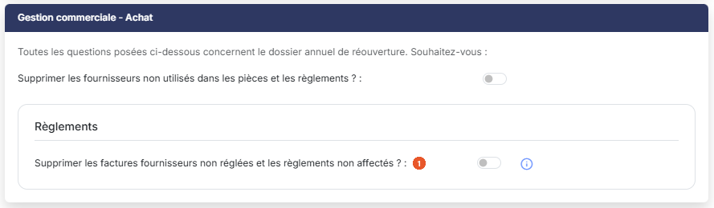
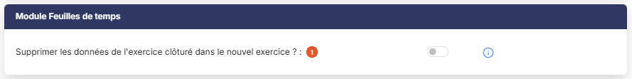
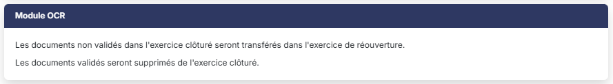
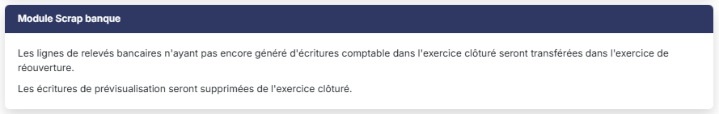
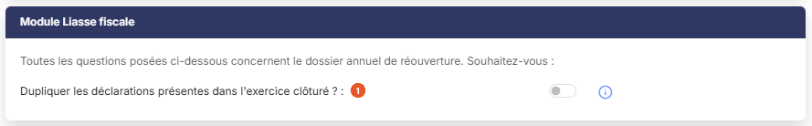
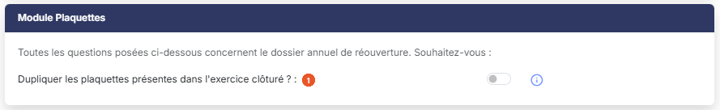

# Clôture avec réouverture


**En bref** — La clôture avec réouverture fige le dossier annuel et crée l'exercice suivant, en y reprenant les données nécessaires selon les réponses données, rubrique par rubrique, dans la fenêtre « Clôture ».

* Pour clôturer en créant l'exercice suivant : laissez « Oui » à « Souhaitez-vous créer un exercice de réouverture ? », vérifiez chaque rubrique, puis bouton \[Valider].
* Pour renoncer à la clôture : bouton \[Fermer].


Vous obtenez cette forme de clôture en répondant "Oui" à la première question de la fenêtre "Clôture", "Souhaitez-vous créer un exercice de réouverture ?". C'est la réponse proposée par défaut à l'ouverture de la fenêtre.

<figure><figcaption>
Écran « Clôture avec réouverture » de la nouvelle interface
</figcaption></figure>

La procédure fonctionne de la manière suivante : elle duplique tout d'abord l'exercice à clôturer dans l'exercice de réouverture, puis effectue diverses opérations dans les deux exercices.

Si vous aviez étendu la période de saisie de l'exercice que vous clôturez, toutes les données postérieures à la date de clôture se retrouveront dans l'exercice de réouverture.

Les rubriques décrites ci-dessous s'affichent dans l'ordre où vous les rencontrez dans la fenêtre. Certaines questions ne sont posées que si votre dossier contient les données concernées.

La fenêtre s'ouvre sur une rubrique « Dossier annuel à clôturer », qui rappelle la **Société gérée :** à laquelle appartient le dossier annuel que vous clôturez et, le cas échéant, sous le libellé **Résultat de l'exercice à clôturer :**, le résultat de cet exercice. Cette rubrique ne comporte aucune question.

## Rubrique « Dossier annuel de réouverture »

<figure><figcaption>
Rubrique « Dossier annuel de réouverture »
</figcaption></figure>

| Champ                                                    | Ce qu'il faut savoir                                                                                                                                                                                                                                                                              |
| -------------------------------------------------------- | ------------------------------------------------------------------------------------------------------------------------------------------------------------------------------------------------------------------------------------------------------------------------------------------------- |
| 1. **Souhaitez-vous créer un exercice de réouverture ?** | C'est cet interrupteur qui commande tout le contenu de la fenêtre. Répondez "Non" pour une clôture sans réouverture (voir la sous-option correspondante).                                                                                                                                         |
| 2. **Début de l'exercice**                               | Lors de la procédure de clôture, le logiciel ouvre automatiquement un dossier annuel de réouverture. La date de début de cet exercice est obligatoirement le lendemain de la date de fin de l'exercice que vous clôturez ; vous ne pouvez donc pas la modifier.                                   |
| 3. **Fin**                                               | Champ obligatoire. La date de fin qui est proposée, correspondant à un dossier annuel d'un an, est modifiable.                                                                                                                                                                                    |
| 4. **Début de la période de saisie**                     | Non modifiable ; le logiciel reprend la date de début de l'exercice de réouverture.                                                                                                                                                                                                               |
| 5. **Fin de la période de saisie**                       | Champ obligatoire. La date proposée est modifiable ; c'est par elle que vous étendez, si vous le souhaitez, la période de saisie au-delà de la fin de l'exercice de réouverture. Les mêmes contrôles s'appliquent que si vous renseigniez cette date directement dans la fiche du dossier annuel. |
| 6. **Libellé**                                           | Champ obligatoire, prérempli par le logiciel à partir de la date de fin de l'exercice de réouverture. C'est ce libellé qui est repris dans le sélecteur de dossiers annuels dans le bandeau du haut de l'écran.                                                                                   |

## Rubrique « Module Comptabilité »

<figure><figcaption>
Rubrique « Module Comptabilité »
</figcaption></figure>

<figure><figcaption>
Rubrique « Module Comptabilité »
</figcaption></figure>

Le logiciel rappelle en tête de rubrique les effets de la clôture sur la comptabilité de l'exercice clôturé : validation de toutes les écritures non encore validées, interdiction de toute nouvelle saisie, interdiction de toute modification de donnée, et suppression des lettrages partiels.

Toutes les questions qui suivent concernent, elles, le dossier annuel de réouverture.

**Gérer les à-nouveaux ?**

Le fait de ne pas générer d'à-nouveaux est utile, par exemple, si vous souhaitez clôturer un dossier annuel que vous avez importé et qui avait déjà été clôturé dans un ancien système. Votre dossier ne sera plus modifiable et la clôture n'aura généré aucune écriture de résultat ni aucun à-nouveau.

Si vous répondez "Non", le logiciel masque les trois blocs de champs qui suivent. Si vous répondez "Oui", vous devez renseigner tous les éléments nécessaires :

| Champ                                                          | Ce qu'il faut savoir                                                                                                                                                                                                                                                                                                                                                                                                                                                                                                                                                                                                                                                                                                                                                                                                                                                                                                                                                                                                                                                                                                                                                                                                                                                                                                                                                                                                                                                                                   |
| -------------------------------------------------------------- | ------------------------------------------------------------------------------------------------------------------------------------------------------------------------------------------------------------------------------------------------------------------------------------------------------------------------------------------------------------------------------------------------------------------------------------------------------------------------------------------------------------------------------------------------------------------------------------------------------------------------------------------------------------------------------------------------------------------------------------------------------------------------------------------------------------------------------------------------------------------------------------------------------------------------------------------------------------------------------------------------------------------------------------------------------------------------------------------------------------------------------------------------------------------------------------------------------------------------------------------------------------------------------------------------------------------------------------------------------------------------------------------------------------------------------------------------------------------------------------------------------ |
| **Résultat**                                                   | Les champs **Compte pour résultat bénéficiaire** et **Compte pour résultat déficitaire** sont obligatoires et s'affichent en lecture seule. Le logiciel reprend les comptes que vous avez indiqués dans le module "Comptabilité", option "Paramètres", sous-option "Paramètres généraux". L'écriture de résultat sera générée dans l'exercice de réouverture.                                                                                                                                                                                                                                                                                                                                                                                                                                                                                                                                                                                                                                                                                                                                                                                                                                                                                                                                                                                                                                                                                                                                          |
| **Journal des à-nouveau**                                      | Les champs **Code journal** et **Libellé** sont obligatoires. Ils désignent le journal qui sera créé dans l'exercice de réouverture (par défaut le logiciel propose les valeurs "AN" et "A-nouveau"). Ce journal ne comprendra qu'un seul mois de saisie possible, correspondant au premier jour du dossier annuel de réouverture.                                                                                                                                                                                                                                                                                                                                                                                                                                                                                                                                                                                                                                                                                                                                                                                                                                                                                                                                                                                                                                                                                                                                                                     |
| **Ecritures d'à-nouveau**                                      | Les champs **Libellé** et **Référence** sont obligatoires. Ils seront portés par toutes les écritures d'à-nouveau générées dans l'exercice de réouverture. Cependant, si pour certains comptes vous avez précisé que vous souhaitiez conserver le détail en réouverture, alors les libellés et les références des écritures de ces comptes de l'exercice clôturé seront conservés dans l'exercice de réouverture.                                                                                                                                                                                                                                                                                                                                                                                                                                                                                                                                                                                                                                                                                                                                                                                                                                                                                                                                                                                                                                                                                      |
| **Cas des comptes de banque**                                  | 
Pour chaque compte de banque, le logiciel vérifie l'existence de rapprochements bancaires ; s'ils sont présents, toutes les écritures de banque non rapprochées seront reprises en détail dans l'exercice de réouverture ; s'il n'y a pas de rapprochement bancaire, une seule ligne de solde sera générée dans l'exercice de réouverture. <strong>Supprimer les comptes auxiliaires non mouvementés ?</strong> Si vous répondez "Oui", tous les comptes auxiliaires qui n'auront pas été mouvementés dans l'exercice clôturé ne seront pas reportés dans l'exercice de réouverture. <strong>Supprimer les journaux non utilisés ?</strong> Si vous répondez "Oui", les journaux qui n'ont été mouvementés par aucune écriture ne sont pas repris dans l'exercice de réouverture. Un journal ainsi supprimé est également retiré de tous les paramétrages qui l'utilisaient. <strong>Supprimer les imports en attente ?</strong> Si des imports d'écritures sont encore en attente de traitement dans l'exercice que vous clôturez, ils sont normalement reportés dans l'exercice de réouverture pour que vous puissiez les traiter. Répondez "Oui" si vous préférez les abandonner. <strong>Gestion des extournes automatiques</strong> Si vous avez passé des provisions dans l'exercice clôturé, vous avez la possibilité de les extourner automatiquement dans l'exercice de réouverture. Si vous répondez "Oui", le logiciel affiche deux champs à renseigner :
 |
| **Journal d'extournes automatiques**                           | Le champ **Journal** est obligatoire. Choisissez dans la liste le journal où se trouvent les écritures de provision à extourner ; le logiciel le positionne d'après le paramétrage du module "Comptabilité", option "Paramètres", sous-option "Paramètres généraux", rubrique "Extournes lors de la clôture". Seules les écritures passées à la date du dernier jour de l'exercice seront extournées.                                                                                                                                                                                                                                                                                                                                                                                                                                                                                                                                                                                                                                                                                                                                                                                                                                                                                                                                                                                                                                                                                                  |
| **Journal de destination**                                     | 
Le champ <strong>Journal</strong> est obligatoire. Il désigne le journal dans lequel seront générées les écritures d'extourne, datées du premier jour du dossier annuel de réouverture. Ces écritures d'extourne resteront modifiables. <strong>Ecritures de simulation</strong> Ces deux questions ne vous sont posées que si votre dossier contient des écritures de simulation ; le logiciel vous le rappelle par un texte au-dessus d'elles. Si vous conservez ces écritures, elles pourront continuer à être intégrées dans les éditions que vous ferez dans l'exercice clôturé, mais elles ne seront pas exportées lors de la génération d'un fichier FEC. <strong>Voulez-vous conserver les écritures de simulation liées à un dossier de révision de situation ? :</strong> ne concerne que les écritures issues d'un dossier de révision de type "Situation".
                                                                                                                                                                                                                                                                                                                                                                                                                                                                                                                                                                                                              |
| **Voulez-vous conserver les autres écritures de simulation ?** | Concerne toutes les autres écritures de simulation du dossier.                                                                                                                                                                                                                                                                                                                                                                                                                                                                                                                                                                                                                                                                                                                                                                                                                                                                                                                                                                                                                                                                                                                                                                                                                                                                                                                                                                                                                                         |

## Rubrique « Module Immobilisations »

<figure><figcaption>
Rubrique « Module Immobilisations »
</figcaption></figure>

**Supprimer les immobilisations sorties lors de l'exercice précédent ?** : si vous répondez "Non", les fiches des immobilisations sorties seront conservées dans le nouvel exercice, et toutes les données présentes dans l'exercice clôturé sont intégralement copiées dans l'exercice de réouverture. Si vous répondez "Oui", toutes les fiches sorties lors de l'exercice clôturé sont supprimées dans le nouvel exercice.

Dans les deux cas, les opérations suivantes sont effectuées dans l'exercice clôturé :

* suppression de toutes les immobilisations créées postérieurement à la date de clôture (qui étaient dues à la période étendue) ;
* suppression de toutes les actions de dépréciation et de reprise de dépréciation créées postérieurement à la date de clôture ;
* suppression de toutes les sorties effectuées postérieurement à la date de clôture ;
* recalcul de toutes les fiches à la date de clôture.

## Rubrique « Module Facturation / Gestion commerciale - Vente »

<figure><figcaption>
Rubrique « Module Facturation / Gestion commerciale - Vente »
</figcaption></figure>

En préambule, si certaines pièces clients dont la date est comprise dans le dossier annuel clôturé n'ont pas été validées, le logiciel vous en indique le nombre. Si vous ne quittez pas la procédure de clôture pour aller les valider, ces pièces ne seront pas transférées dans l'exercice de réouverture : elles resteront dans l'exercice clôturé sans possibilité de modification, ni a fortiori de validation.

Toutes les questions qui suivent concernent le dossier annuel de réouverture.

| Champ                                                                      | Ce qu'il faut savoir                                                                                                                                                                                                                                                                                                                                   |
| -------------------------------------------------------------------------- | ------------------------------------------------------------------------------------------------------------------------------------------------------------------------------------------------------------------------------------------------------------------------------------------------------------------------------------------------------ |
| 1. **Supprimer les clients utilisés dans aucun module ?**                  | Si vous répondez "Oui", tous les clients qui n'ont été utilisés dans aucun module de l'exercice clôturé sont supprimés du nouvel exercice.                                                                                                                                                                                                             |
| 2. **Supprimer les devis non facturés et non archivés ?**                  | 
Les éventuels devis servant de modèle à des abonnements ne seront pas supprimés, quel que soit leur statut. <strong>Supprimer les devis non facturés et archivés ?</strong> <strong>Supprimer les devis facturés et non archivés ?</strong> <strong>Supprimer les devis facturés et archivés ?</strong> <strong>Règlements</strong>
 |
| 3. **Supprimer les factures non soldées et les règlements non affectés ?** | Si vous répondez "Non", toutes les factures non soldées ainsi que les règlements existant et non encore totalement affectés seront transférés dans le nouvel exercice. Si vous répondez "Oui", aucun règlement non encore totalement affecté ni aucune facture non soldée de l'exercice clôturé ne seront transférés dans le nouvel exercice.          |
| **Devis**                                                                  | Quatre questions vous permettent de choisir, cas par cas, ce qui est repris dans le nouvel exercice.                                                                                                                                                                                                                                                   |

Dans l'exercice clôturé, les pièces dont la date est postérieure à la date de clôture — celles qui étaient dues à la période étendue — sont supprimées.

## Rubrique « Gestion commerciale - Achat »

<figure><figcaption>
Rubrique « Gestion commerciale - Achat »
</figcaption></figure>

Le module "Gestion commerciale" comprend le module "Facturation" plus la gestion des achats fournisseurs et les stocks : tout ce qui concerne le module "Facturation" concerne donc aussi le module "Gestion commerciale". Les questions sur les fournisseurs fonctionnent exactement de la même manière que celles sur les clients.

**Supprimer les fournisseurs non utilisés dans les pièces et les règlements ?**

**Règlements**

**Supprimer les factures fournisseurs non réglées et les règlements non affectés ?** : si vous répondez "Non", toutes les factures non soldées ainsi que les règlements existant et non encore totalement affectés seront transférés dans le nouvel exercice. Si vous répondez "Oui", aucun d'entre eux ne sera transféré.

## Rubrique « Module Feuilles de temps »

<figure><figcaption>
Rubrique « Module Feuilles de temps »
</figcaption></figure>

**Supprimer les données de l'exercice clôturé dans le nouvel exercice ?** : si vous répondez "Non", les données de l'exercice clôturé seront reportées dans le nouvel exercice. Si vous répondez "Oui", les actions suivantes sont effectuées dans le nouvel exercice :

* suppression des lignes de temps antérieures à la date de début du nouvel exercice.

Si vous répondez "Oui", l'opération suivante est effectuée dans l'exercice clôturé :

* suppression des lignes de temps postérieures à la date de clôture (qui étaient dues à la période étendue).

Pour ce qui concerne les demandes d'absences, elles sont conservées uniquement dans l'exercice dans lequel elles débutent et supprimées de l'autre.

## Rubrique « Module OCR »

<figure><figcaption>
Rubrique « Module OCR »
</figcaption></figure>

Cette rubrique ne comporte aucune question : elle vous informe de ce que la clôture va faire.

Les documents non validés dans l'exercice clôturé seront transférés dans l'exercice de réouverture. Les documents validés seront supprimés de l'exercice clôturé.

## Rubrique « Module Scrap banque »

<figure><figcaption>
Rubrique « Module Scrap banque »
</figcaption></figure>

Cette rubrique ne comporte aucune question : elle vous informe de ce que la clôture va faire.

Les lignes de relevés bancaires n'ayant pas encore généré d'écriture comptable dans l'exercice clôturé seront transférées dans l'exercice de réouverture. Les écritures de prévisualisation seront supprimées de l'exercice clôturé.

## Rubrique « Module Liasse fiscale »

<figure><figcaption>
Rubrique « Module Liasse fiscale »
</figcaption></figure>

**Dupliquer les déclarations présentes dans l'exercice clôturé ?** : ces déclarations n'auront qu'un intérêt consultatif.

## Rubrique « Module Plaquettes »

<figure><figcaption>
Rubrique « Module Plaquettes »
</figcaption></figure>

**Dupliquer les plaquettes présentes dans l'exercice clôturé ?** : ces plaquettes n'auront qu'un intérêt consultatif.

## Boutons de la fenêtre

bouton **\[Valider]**

Il déclenche la clôture. L'opération peut demander un certain temps ; une barre de progression vous en indique l'avancement.

À la fin de la procédure, un message s'affiche.

bouton **\[Fermer]**

Il referme la fenêtre sans rien clôturer.
