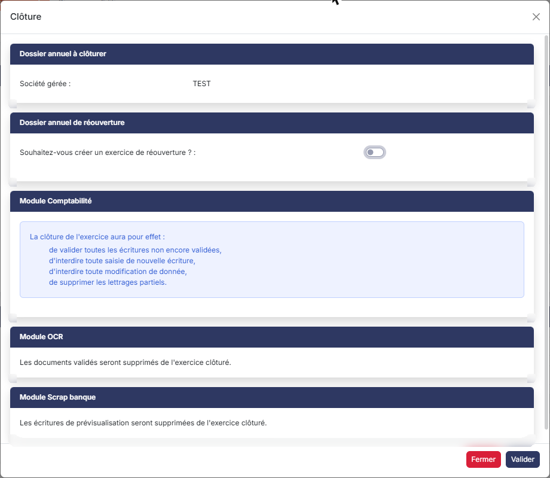
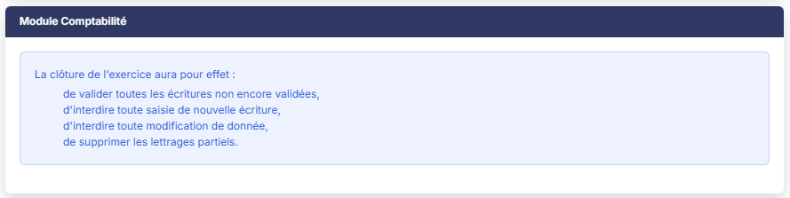
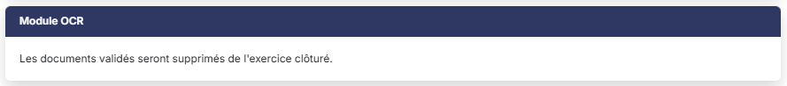
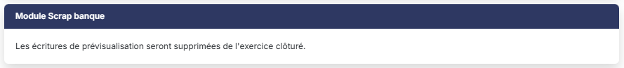

# Clôture sans réouverture


**En bref** — La clôture sans réouverture fige le dossier annuel sans créer d'exercice suivant. Elle sert notamment à reprendre des exercices déjà clôturés dans un ancien logiciel.

* Pour clôturer sans réouverture : bouton \[Clôturer] sur la fiche du dossier annuel, répondez « Non » à « Souhaitez-vous créer un exercice de réouverture ? », puis bouton \[Valider].
* Pour renoncer à la clôture : bouton \[Fermer].


La clôture sans réouverture est la clôture d'un dossier annuel qui ne crée aucun exercice suivant. Elle est notamment utilisée lors de la migration depuis un autre logiciel de comptabilité de plusieurs exercices successifs qui ont donc déjà été clôturés dans un ancien logiciel.

<figure><figcaption>
Écran « Clôture sans réouverture » de la nouvelle interface
</figcaption></figure>

Les traitements effectués dans l'exercice clôturé sont les mêmes que dans la clôture avec réouverture ; ce sont les questions relatives au nouvel exercice qui disparaissent, puisqu'il n'y a pas de nouvel exercice.

## Accès à la clôture

Ouvrez la fiche du dossier annuel à clôturer depuis le menu « Dossiers annuels », puis cliquez sur bouton **\[Clôturer]** en bas de la fiche. Le logiciel ouvre la fenêtre « Clôture », qui rappelle en tête la société gérée concernée.

Ce bouton n'est présent que sur un dossier annuel non clôturé : sur un dossier déjà clos, la fiche ne conserve que bouton **\[Enregistrer]** ; pour revenir à la liste, utilisez la flèche « Revenir en arrière » placée à gauche du fil d'Ariane.

## Rubrique « Dossier annuel de réouverture »

<figure><figcaption>
Rubrique « Dossier annuel de réouverture »
</figcaption></figure>

**Souhaitez-vous créer un exercice de réouverture ?** : cette question est positionnée sur « Oui » par défaut. Répondez « Non » pour une clôture sans réouverture.

Dès que vous répondez « Non », la fenêtre se réduit : la rubrique ne contient plus que cette question, et toutes les zones de saisie du nouvel exercice (dates d'exercice, dates de la période de saisie, libellé) disparaissent.

## Rubrique « Module Comptabilité »

<figure><figcaption>
Rubrique « Module Comptabilité »
</figcaption></figure>

La rubrique ne contient plus aucune question : elle se limite au rappel des effets de la clôture sur l'exercice clôturé.

La clôture de l'exercice aura pour effet :

* de valider toutes les écritures non encore validées,
* d'interdire toute saisie de nouvelle écriture,
* d'interdire toute modification de donnée,
* de supprimer les lettrages partiels.

Aucune écriture d'à-nouveau, aucune écriture de résultat et aucune écriture d'extourne n'est générée, puisqu'il n'existe pas d'exercice pour les recevoir. Il n'y a donc plus ni compte de résultat à indiquer, ni journal d'à-nouveaux à créer, ni gestion des extournes automatiques.

## Rubrique « Module OCR »

<figure><figcaption>
Rubrique « Module OCR »
</figcaption></figure>

Cette rubrique ne comporte aucune question, seulement une phrase d'information : les documents validés seront supprimés de l'exercice clôturé.

La phrase annonçant le transfert des documents non validés vers l'exercice de réouverture n'est plus affichée : il n'y a pas d'exercice pour les recevoir.

## Rubrique « Module Scrap banque »

<figure><figcaption>
Rubrique « Module Scrap banque »
</figcaption></figure>

Cette rubrique ne comporte aucune question, seulement une phrase d'information : les écritures de prévisualisation seront supprimées de l'exercice clôturé.

Là encore, la phrase annonçant le transfert des lignes de relevés bancaires non encore comptabilisées n'est plus affichée.

## Les rubriques qui disparaissent

Tant que la réponse est « Oui », la fenêtre présente onze rubriques. En répondant « Non », il n'en reste que cinq : « Dossier annuel à clôturer », « Dossier annuel de réouverture », « Module Comptabilité », « Module OCR » et « Module Scrap banque ».

Les rubriques suivantes ne sont plus affichées du tout : « Module Immobilisations », « Module Facturation / Gestion commerciale - Vente », « Gestion commerciale - Achat », « Module Feuilles de temps », « Module Liasse fiscale » et « Module Plaquettes ». Toutes leurs questions portaient sur ce qui devait être repris ou supprimé dans le nouvel exercice.

## Le cas de la période de saisie étendue

Si vous aviez étendu la période de saisie au-delà de la date de fin d'exercice et que des écritures ont été passées sur cette extension, ces écritures n'ont nulle part où aller : dans une clôture avec réouverture, elles seraient transférées dans le nouvel exercice.

Le logiciel vous en avertit et vous demande de confirmer avant de poursuivre : sans exercice de réouverture, ces écritures sont perdues.

La clôture ramène ensuite la période de saisie du dossier annuel sur les seules dates de l'exercice.

## Le cas de l'analytique incomplète

Si des lignes d'écriture contenant de l'analytique ne sont pas ventilées à 100 %, le logiciel vous le signale et vous renvoie, pour le détail de ces lignes, vers le module « Comptabilité », menu « Traitements », option « Diagnostic ».

Sans exercice de réouverture, ces manques n'ont pas de conséquence sur un exercice suivant : le logiciel vous propose donc de forcer la clôture, quels que soient les comptes concernés. Dans une clôture avec réouverture, cette possibilité n'est offerte que si seuls des comptes de résultat sont en cause.

## Validation

bouton **\[Valider]** : lance la clôture.

bouton **\[Fermer]** : referme la fenêtre sans rien clôturer. La croix en haut à droite de la fenêtre a le même effet.

Une fois le dossier annuel clôturé, sa fiche évolue : la rubrique « Dates » se complète des zones **Date de clôture :** et **Clôturé par :**, les dates ne sont plus modifiables, et les boutons de clôture et de fusion ne sont plus proposés.

Le dossier clôturé cesse d'être le dossier annuel en cours. Comme aucun exercice n'est créé pour prendre la suite, pensez à désigner le dossier annuel sur lequel vos utilisateurs doivent être positionnés par défaut.

## Ne pas confondre avec la clôture sans traitement

La fiche d'un dossier annuel non clôturé propose aussi bouton **\[Clôturer sans traitement]**, qui ouvre une fenêtre différente et beaucoup plus courte, sans aucune rubrique ni aucune question.

La clôture sans réouverture est une vraie clôture : elle valide les écritures, supprime les lettrages partiels et purge ce qui doit l'être. La clôture sans traitement, elle, se contente de passer le dossier en dossier clos sans effectuer aucune opération. Elle est décrite dans l'aide du menu « Dossiers annuels ».
