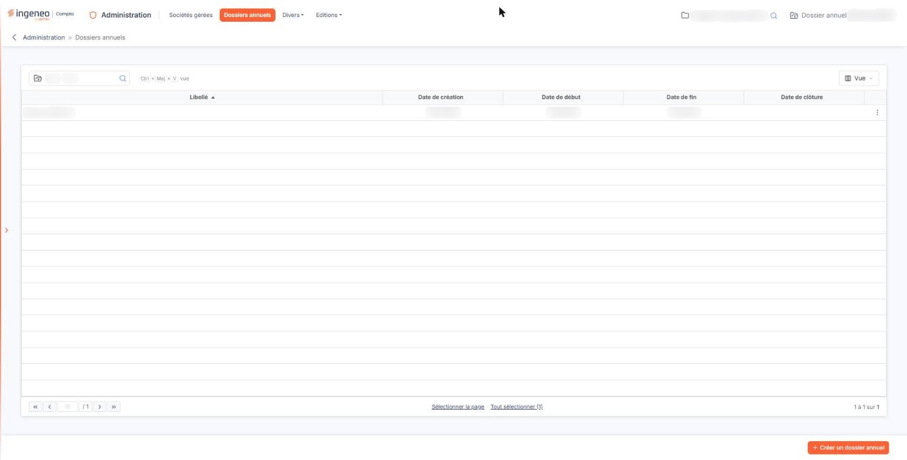
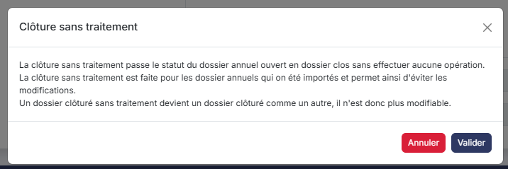
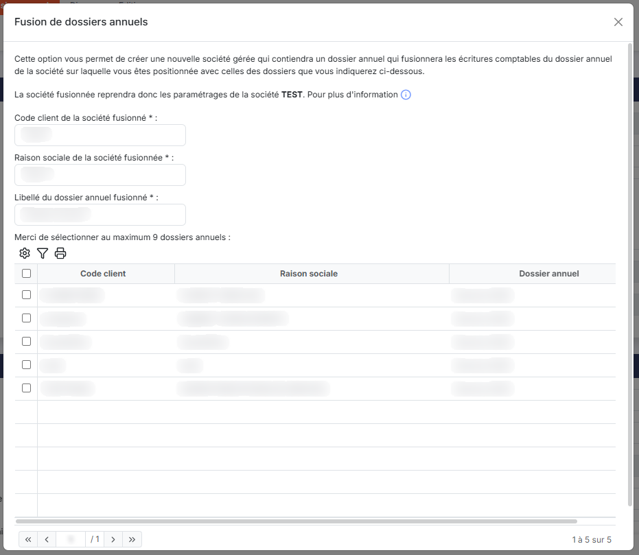
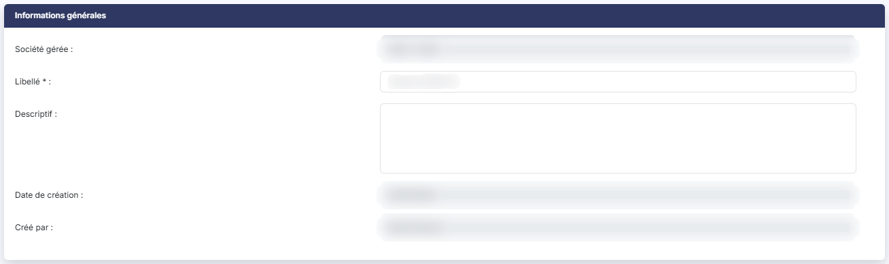
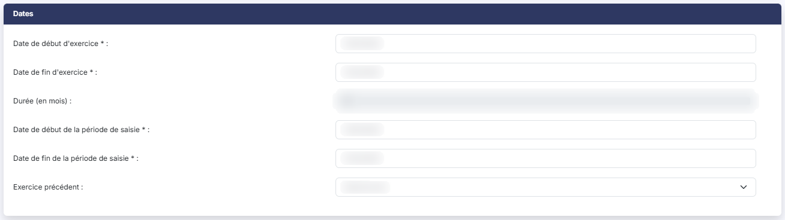
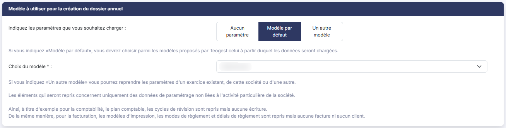

# Clôture d'un dossier annuel — présentation


**En bref** — La clôture d'un dossier annuel est une opération irréversible, avec ou sans réouverture de l'exercice suivant. Elle se déclenche depuis la fiche du dossier annuel, et non depuis la liste.

* Pour clôturer : menu « Dossiers annuels », choisissez la société gérée, ouvrez le dossier en modification, puis bouton \[Clôturer].
* Pour clore un dossier importé sans aucun traitement : bouton \[Clôturer sans traitement] sur la fiche du dossier annuel.


La clôture d'un dossier annuel est une opération irréversible qui a plusieurs effets en fonction des modules du logiciel et du type de clôture que vous choisissez.

<figure><figcaption>
Écran « Dossiers annuels » de la nouvelle interface
</figcaption></figure>

La clôture d'un dossier annuel n'a aucune action sur les modules qui n'utilisent pas les dossiers annuels tels que les modules "GED" ou "Dossier permanent".

Ce chapitre décrit les deux formes de la clôture : la clôture avec réouverture, qui crée l'exercice suivant, et la clôture sans réouverture, qui se contente de figer l'exercice. Reportez-vous à la sous-option correspondante pour le détail de chacune.

## Par où débuter la clôture

<figure><figcaption>
Bouton [Clôturer sans traitement]
</figcaption></figure>

<figure><figcaption>
Bouton [Fusion]
</figcaption></figure>

La clôture ne dispose pas d'option de menu qui lui soit propre et ne se déclenche pas depuis la liste des dossiers annuels.

Pour débuter la procédure, allez dans le menu "Dossiers annuels", indiquez la société gérée concernée, puis ouvrez en modification le dossier annuel que vous souhaitez clôturer. Deux des boutons proposés en bas de la fiche déclenchent une clôture : le bouton **\[Clôturer]** et le bouton **\[Clôturer sans traitement]**.

bouton **\[Clôturer]**

Il ouvre la fenêtre "Clôture", dans laquelle vous précisez, rubrique par rubrique, les paramètres de la clôture. Ces paramètres ont une incidence importante sur les données des deux exercices.

La première question de cette fenêtre, "Souhaitez-vous créer un exercice de réouverture ?", commande tout le reste : le logiciel affiche des rubriques différentes selon que vous répondez "Oui" ou "Non". Il n'y a donc pas deux fenêtres distinctes ni d'assistant en plusieurs étapes, mais une seule fenêtre dont le contenu s'adapte à votre réponse.

La réponse proposée par défaut est "Oui".

bouton **\[Clôturer sans traitement]**

Il ouvre une fenêtre distincte, sans aucun paramètre à renseigner. Cette clôture fait passer le dossier annuel à l'état clos sans effectuer aucune opération ; elle est prévue pour les dossiers annuels qui ont été importés. Elle est décrite dans l'option "Dossiers annuels" de la présente aide.

Ces trois commandes — le bouton **\[Clôturer]**, le bouton **\[Clôturer sans traitement]** et le bouton **\[Fusion]** — ne sont présents que sur la fiche d'un dossier annuel qui n'est pas encore clôturé. Dès qu'un dossier annuel est clôturé, sa fiche ne propose plus que le bouton **\[Enregistrer]** ; pour revenir à la liste, utilisez la flèche "Revenir en arrière" placée à gauche du fil d'Ariane.

## Ce que le logiciel vérifie avant de clôturer

Pour éviter les erreurs, le logiciel vous rappelle le résultat de l'exercice.

Il est à noter que la clôture ne pourra pas être effectuée si le solde des comptes hors bilan n'est pas égal à 0.

Si des ventilations analytiques sont manquantes, mais qu'elles ne concernent que des comptes de résultat, le logiciel vous prévient et vous demande si vous souhaitez forcer la clôture malgré ces manques.

## Déroulement de l'opération

Selon le volume de données du dossier annuel, la clôture peut demander un certain temps. Le logiciel affiche une barre de progression pendant toute l'opération : ne quittez pas la fenêtre tant qu'elle n'est pas terminée.

La clôture est menée d'un seul tenant : si une erreur survient en cours de route, l'ensemble de l'opération est annulé et rien n'est conservé, y compris l'exercice de réouverture qui aurait déjà été amorcé. Vous retrouvez donc votre dossier annuel dans l'état où il était avant de cliquer sur le bouton **\[Valider]**.

À la fin de la clôture, un message vous indique que la procédure s'est correctement déroulée.

## Autres vues de l'écran

<figure><figcaption>
Informations générales
</figcaption></figure>

<figure><figcaption>
Dates
</figcaption></figure>

<figure><figcaption>
Propriétés
</figcaption></figure>

<figure><figcaption>
Modèle à utiliser pour la création du dossier annuel
</figcaption></figure>
