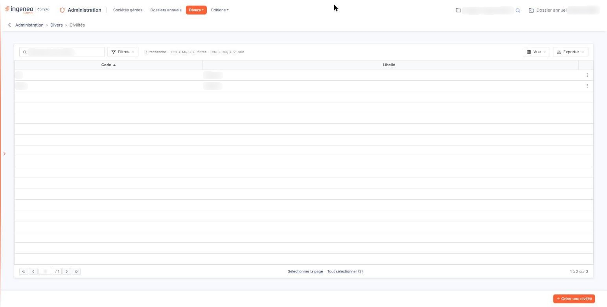
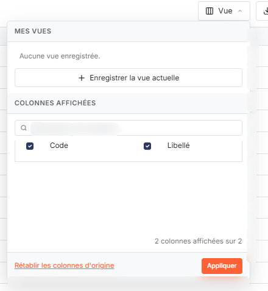
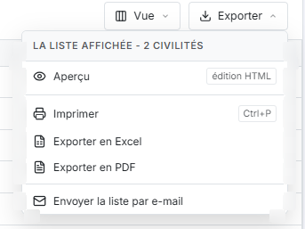
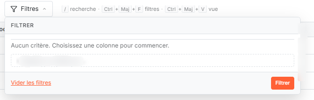
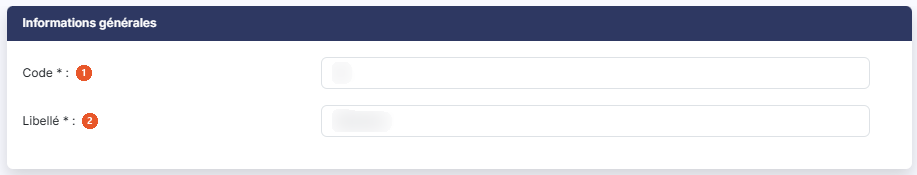

# Civilités


**Où le trouver :** Menu **Divers › Civilités**



**En bref** — Cet écran gère les civilités proposées dans tous les fichiers de contacts. Le fichier est commun à tout votre abonnement : une civilité créée ici sert dans toutes vos sociétés gérées.

* Pour ajouter une civilité : bouton \[Créer une civilité], saisissez le Code et le Libellé, puis bouton \[Enregistrer].
* Pour modifier une civilité : pictogramme « Crayon » de sa ligne, corrigez la fiche, puis bouton \[Enregistrer].
* Pour retrouver une civilité : saisissez son libellé dans la zone « Rechercher une civilité… », ou bouton \[Filtres] pour poser des critères.


Les civilités sont utilisées par tous les fichiers qui gèrent des contacts. Le code abrégé et le libellé sont obligatoires.

<figure><figcaption>
Écran « Civilités » de la nouvelle interface
</figcaption></figure>

Le fichier est commun à tout votre abonnement : une civilité créée ici est disponible dans toutes vos sociétés gérées.

## La grille des civilités

<figure><figcaption>
Bouton [Vue]
</figcaption></figure>

<figure><figcaption>
Bouton [Exporter]
</figcaption></figure>

L'écran s'ouvre directement sur la liste des civilités existantes.

La grille comporte deux colonnes, l'une et l'autre triables : **Code**, sur laquelle le tri est fait par défaut, et **Libellé**.

Un clic sur une ligne la sélectionne. Au survol d'une ligne apparaissent, à son extrémité droite, le pictogramme « Crayon » (infobulle « Modifier »), qui ouvre la fiche, et le pictogramme « Autres actions », dont le menu propose « Supprimer ». Il n'y a pas de commande de duplication.

Les commandes d'ouverture et de suppression n'apparaissent que si votre profil vous en donne le droit ; il en va de même du bouton de création.

Au-dessus de la grille, une barre d'outils s'applique à la liste entière. Des raccourcis clavier y sont rappelés : « / » pour la recherche, Ctrl + Maj + F pour les filtres, Ctrl + Maj + V pour la vue.

La zone « Rechercher une civilité… » restreint la liste dès la saisie. Elle porte sur le libellé : saisir un code seul, « Mme » par exemple, ne ramène aucune ligne. La recherche saisie reste appliquée quand vous revenez sur l'écran ; ce comportement, commun à toutes les listes, est décrit dans la page « Les listes ».

bouton **\[Filtres]** : ouvre le volet de critères décrit au paragraphe b). Une fois un filtre appliqué, le bouton affiche le nombre de critères actifs ; chaque critère est rappelé à sa droite sous forme d'étiquette, qu'une croix retire, et le lien « Tout effacer » les retire tous.

bouton **\[Vue]** : rassemble, sous « Mes vues », l'enregistrement de l'état de la liste sous un nom (« Enregistrer la vue actuelle ») et, sous « Colonnes affichées », le choix des colonnes à afficher, avec « Rétablir les colonnes d'origine » et « Appliquer ». Une vue enregistrée retient les colonnes affichées et les critères de filtre en cours : c'est par elle que vous conservez une combinaison de critères pour la réutiliser plus tard.

bouton **\[Exporter]** : rappelle l'étendue concernée (« La liste affichée », suivie du nombre de civilités) et propose « Aperçu » (édition HTML), « Imprimer », « Exporter en Excel », « Exporter en PDF » et « Envoyer la liste par e-mail ». « Aperçu » et « Exporter en PDF » présentent d'abord leurs options, puis « Lancer l'édition » : « Tronquer les libellés trop longs » pour l'aperçu ; « Masquer les entêtes et pieds de page », l'orientation (Portrait ou Paysage) et la largeur (Ajustée ou Fixe) pour le PDF.

Sous la grille, vous trouvez à gauche le pager (première et précédente page, zone où saisir directement un numéro de page, nombre total de pages, suivante et dernière page), à droite le rappel du nombre de lignes affichées sur le nombre total, et au centre deux liens de sélection : « Sélectionner la page » sélectionne toutes les lignes de la page affichée, et « Tout sélectionner » étend la sélection à toutes les pages en rappelant entre parenthèses le nombre total d'éléments. Une fois la sélection faite, le lien correspondant devient « Désélectionner la page » ou « Tout désélectionner », ce dernier gardant entre parenthèses le nombre total d'éléments.

## Volet « Filtres »

<figure><figcaption>
Bouton [Filtres]
</figcaption></figure>

Le bouton \[Filtres] déroule un volet intitulé « Filtrer », vide à l'ouverture : « Aucun critère. Choisissez une colonne pour commencer. » La liste « + Ajouter un critère sur… » propose les colonnes **Code** et **Libellé** ; une colonne déjà retenue n'y est plus proposée.

Chaque critère occupe une ligne : la colonne, un opérateur, une valeur, et une croix qui retire le critère. Avec l'opérateur « Égal », la valeur se choisit dans la liste de celles présentes dans la colonne ; avec « Contient », elle se saisit. Deux critères sont reliés par une bascule « ET », retenue par défaut, qu'un clic fait passer à « OU ».

Les opérateurs proposés sont : « Égal », retenu par défaut, « Est vide », « N'est pas vide », « Différent », « Contient », « Ne contient pas », « Commence par », « Termine par », « Est avant », « Est avant ou égal », « Est après » et « Est après ou égal ». Les quatre derniers sont destinés aux colonnes de date ; ils sont sans usage sur les deux colonnes de cet écran, qui contiennent du texte.

bouton **\[Filtrer]** : applique les critères saisis à la grille et referme le volet.

bouton **\[Vider les filtres]** : efface tous les critères saisis.

## Rubrique « Informations générales » de la fiche

<figure><figcaption>
Rubrique « Informations générales »
</figcaption></figure>

La fiche est la même en création et en modification, et elle ne comporte que cette seule rubrique. Elle ne conserve ni date ni auteur de création ou de modification.

| Champ          | Ce qu'il faut savoir                                                                                                                                           |
| -------------- | -------------------------------------------------------------------------------------------------------------------------------------------------------------- |
| 1. **Code**    | Champ obligatoire, cinq caractères au maximum. C'est le code abrégé qui s'affiche dans les listes déroulantes de civilité. Il reste modifiable après création. |
| 2. **Libellé** | Champ obligatoire, quinze caractères au maximum.                                                                                                               |

Le code et le libellé doivent être uniques : si le code que vous indiquez est déjà utilisé, le logiciel vous demande d'en choisir un autre, et il en va de même pour le libellé.

bouton **\[Enregistrer]** : enregistre la civilité et vous ramène à la grille.

Pour revenir à la grille sans enregistrer, cliquez sur la flèche placée à gauche du fil d'Ariane, en haut de l'écran.

## Créer et supprimer depuis la grille

bouton **\[Créer une civilité]** : ouvre une fiche vierge.

bouton **\[Supprimer]** : dès qu'au moins une ligne est sélectionnée, un bandeau apparaît en bas de l'écran ; il indique le nombre de civilités sélectionnées, complété de la mention « toutes les pages » quand la sélection a été faite par « Tout sélectionner ». Pour une sélection faite ligne par ligne, il propose le lien « Tout désélectionner ». Il porte le bouton \[Supprimer], qui supprime en une fois toutes les civilités sélectionnées.

## Les civilités que vous n'avez pas créées

Vous pouvez voir apparaître dans cette liste des civilités que personne n'a saisies : lorsqu'une donnée importée ou rapatriée porte une civilité inconnue, le logiciel la crée pour ne pas perdre l'information. C'est le cas de la lecture du numéro de SIREN d'une société et de la reprise des intervenants du dossier permanent.

Le logiciel rapproche d'abord la valeur reçue des civilités déjà présentes, en reconnaissant les formes courantes du masculin et du féminin ; il n'en crée une nouvelle que s'il ne trouve aucune correspondance.
