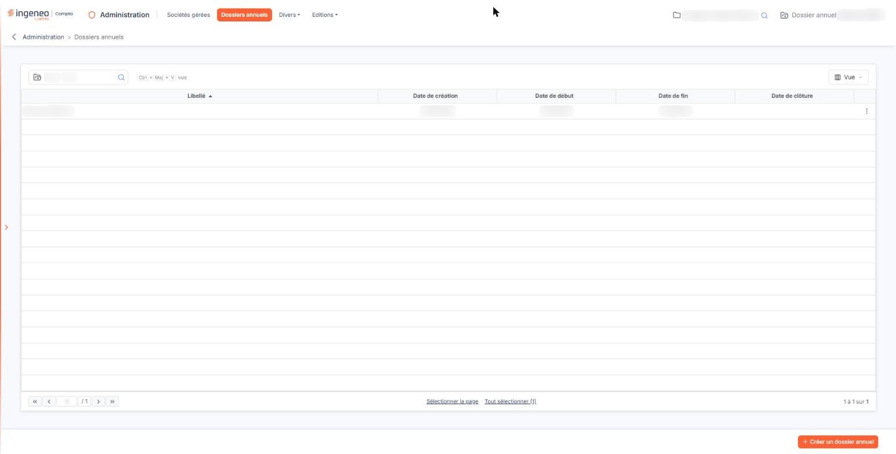
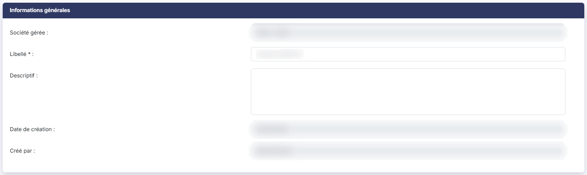
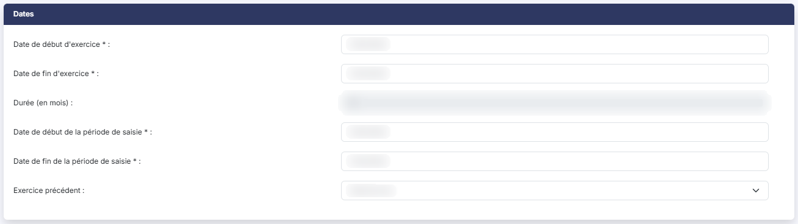
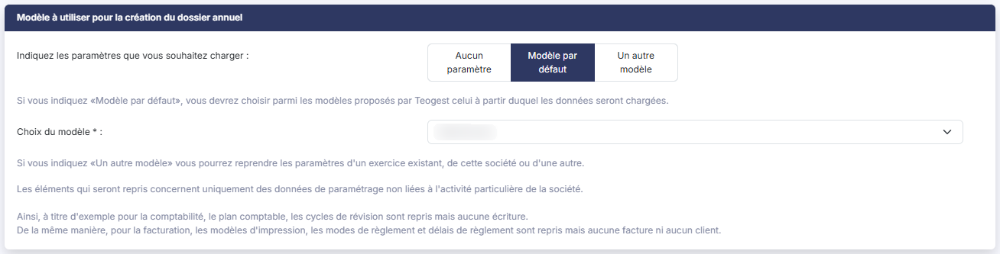
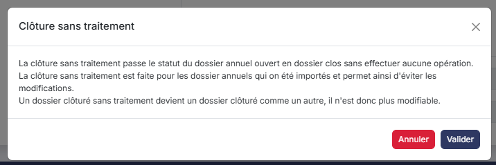
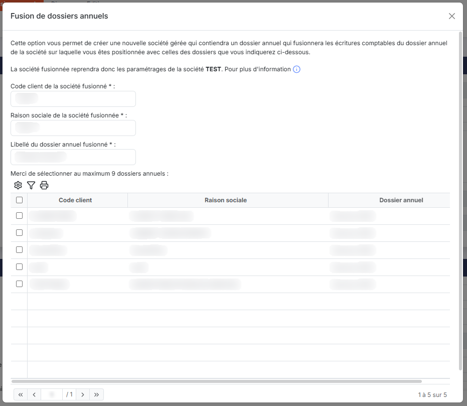

# Dossiers annuels


**Où le trouver :** Menu **Dossiers annuels**



**En bref** — Cet écran présente les dossiers annuels (exercices comptables) d'une société gérée à la fois : création, dates d'exercice et de période de saisie, enchaînement des exercices.

* Pour afficher les dossiers d'une société : saisissez les premières lettres de son code ou de sa raison sociale dans la zone « Rechercher une société… », puis cliquez sur la société.
* Pour créer un dossier annuel : bouton \[Créer un dossier annuel], puis désignez la Société gérée et renseignez le Libellé et les dates.
* Pour clôturer un dossier annuel : ouvrez-le en modification par le pictogramme « Modifier », puis bouton \[Clôturer].


## Choix de la société gérée

<figure><figcaption>
Écran « Dossiers annuels » de la nouvelle interface
</figcaption></figure>

Tant que vous n'avez pas indiqué de société gérée, la liste affiche ses titres de colonnes et la mention "Aucun élément à afficher.".

Pour choisir la société, tapez les premières lettres de son code ou de sa raison sociale dans la zone "Rechercher une société…", placée en haut à gauche de la liste : le logiciel vous propose les sociétés correspondantes, cliquez sur celle qui vous intéresse.

Vous pouvez aussi utiliser le pictogramme "Loupe" placé à droite de cette zone. La fenêtre "Recherche" qui s'ouvre contient une zone de recherche "Contenu recherché" et présente les sociétés avec leur code client, leur raison sociale et l'indication d'un éventuel accès par mot de passe. Cliquez sur une ligne pour la sélectionner.

Une fois la société choisie, son libellé s'inscrit dans la zone et la liste se remplit. Pour consulter les dossiers annuels d'une autre société, choisissez-la de la même manière.

## La liste des dossiers annuels

Elle présente, pour la société choisie, le libellé de chaque dossier annuel, sa date de création, ses dates de début et de fin d'exercice et sa date de clôture.

Il n'y a pas de colonne indiquant l'état du dossier : un dossier annuel est clôturé si, et seulement si, sa date de clôture est renseignée.

Le bouton **\[Vue]**, placé en haut à droite de la liste, ouvre un menu qui vous permet de choisir les colonnes affichées (partie "Colonnes affichées", avec le bouton **\[Rétablir les colonnes d'origine]** et le bouton **\[Appliquer]**) et d'enregistrer la présentation de la liste (partie "Mes vues", bouton **\[Enregistrer la vue actuelle]**).

Les commandes d'une ligne apparaissent à son extrémité droite lorsque vous la survolez : le pictogramme "Modifier", le pictogramme "Dupliquer" et le pictogramme "Autres actions" (trois points verticaux), qui déroule la commande "Supprimer". La commande "Supprimer" n'est pas proposée sur le dossier annuel déclaré comme dossier par défaut, c'est-à-dire celui dont la rubrique "Propriétés" répond "Oui" à "Dossier par défaut sur lequel positionner l'utilisateur" : pour le supprimer, désignez d'abord un autre dossier annuel comme dossier par défaut.

La clôture ne se déclenche pas depuis cette liste : il n'y a pas de pictogramme de clôture. Ouvrez le dossier annuel en modification (voir le chapitre "Clôture d'un dossier annuel").

## Rubrique « Informations générales »

<figure><figcaption>
Rubrique « Informations générales »
</figcaption></figure>

| Champ                | Ce qu'il faut savoir                                                                                                                                                                                                                          |
| -------------------- | --------------------------------------------------------------------------------------------------------------------------------------------------------------------------------------------------------------------------------------------- |
| 1. **Société gérée** | Lors de la création d'un dossier annuel, ce champ est obligatoire et vous devez y désigner la société gérée concernée. En modification, il n'est qu'un rappel de la société à laquelle appartient le dossier annuel et n'est plus modifiable. |
| 2. **Libellé**       | Champ obligatoire. C'est ce libellé qui est repris dans le sélecteur de dossiers annuels dans le bandeau du haut de l'écran.                                                                                                                  |
| 3. **Descriptif**    | Champ facultatif.                                                                                                                                                                                                                             |

**Date de création** et **Créé par :** renseignés par le logiciel, non modifiables.

**Date de modification** et **Modifié par :** ces deux champs ne sont présents que sur un dossier annuel qui a déjà été modifié.

## Rubrique « Dates »

<figure><figcaption>
Rubrique « Dates »
</figcaption></figure>

**Date de début d'exercice** et **Date de fin d'exercice :** champs obligatoires. La période comprise entre les deux doit toujours être comprise entre 1 jour et 23 mois.

Une fois enregistrées, ces dates restent modifiables, mais seulement sous certaines conditions dépendant des informations saisies entre la création et la modification.

| Champ                     | Ce qu'il faut savoir                                                                                                                                                                                                                                                                                                                                                                                                                                                                                                                                                                                                                                                                                                                                                                                                                                                                                                                                                                                 |
| ------------------------- | ---------------------------------------------------------------------------------------------------------------------------------------------------------------------------------------------------------------------------------------------------------------------------------------------------------------------------------------------------------------------------------------------------------------------------------------------------------------------------------------------------------------------------------------------------------------------------------------------------------------------------------------------------------------------------------------------------------------------------------------------------------------------------------------------------------------------------------------------------------------------------------------------------------------------------------------------------------------------------------------------------- |
| 1. **Durée (en mois)**    | 
Elle est calculée automatiquement par le logiciel et n'est pas modifiable. C'est une information reprise dans le module "Plaquettes". <strong>Date de début de la période de saisie</strong> et <strong>Date de fin de la période de saisie :</strong> champs obligatoires. Toutes les écritures saisies par les utilisateurs devront être comprises dans la période de saisie. Le fait de restreindre la période de saisie permet d'éviter des saisies intempestives sur une partie de l'exercice annuel. La date de début de la période de saisie ne peut pas être antérieure à la date de début du dossier annuel, mais la date de fin de la période de saisie peut être postérieure à la date de fin du dossier annuel. La durée totale de la période de saisie ne peut pas excéder 35 mois. Vous ne pouvez pas raccourcir la période de saisie s'il existe déjà des écritures postérieures à la nouvelle date de fin choisie ; le logiciel vous en avertit en rouge sous le champ.
 |
| 2. **Exercice précédent** | Si la constitution de vos différents dossiers annuels s'est faite par l'import de données, ou si vous avez dupliqué des dossiers annuels pour effectuer des tests ou des simulations, il est nécessaire de définir les enchaînements d'exercices pour garantir les comparaisons entre dossiers annuels (n, n-1, n-2, etc.). Pour chaîner les exercices entre eux, il suffit d'indiquer dans un dossier annuel le libellé du dossier annuel précédent ; le sélecteur propose les autres dossiers annuels de la société.                                                                                                                                                                                                                                                                                                                                                                                                                                                                               |

Le logiciel vérifie à l'enregistrement que la date de début du dossier annuel est bien le lendemain de la date de fin du dossier annuel choisi.

Ce choix n'entraîne aucun changement dans les données des exercices chaînés et il peut être modifié à tout moment. Un chaînage ne peut pas se faire entre deux dossiers annuels ouverts.

**Date de clôture** et **Clôturé par :** ces deux champs ne sont présents que si le dossier annuel a été clôturé. Ils ne sont pas modifiables.

## Rubrique « Propriétés »

<figure><figcaption>
Rubrique « Propriétés »
</figcaption></figure>

**Dossier par défaut sur lequel positionner l'utilisateur** : si vous répondez "Oui", c'est sur ce dossier annuel que seront positionnés par défaut les utilisateurs. Le fait de l'activer pour un dossier annuel le désactive automatiquement pour le dossier annuel où il l'était éventuellement, de sorte de n'avoir qu'un seul dossier annuel par défaut.

## Modèle à utiliser pour la création du dossier annuel

<figure><figcaption>
Rubrique « Modèle à utiliser pour la création du dossier annuel »
</figcaption></figure>

Cette rubrique n'est proposée que lors de la création d'un dossier annuel, par le bouton **\[Créer un dossier annuel]**, en bas à droite de l'écran. Elle contient la question "Indiquez les paramètres que vous souhaitez charger :", qui vous laisse trois possibilités, "Aucun paramètre", "Modèle par défaut" et "Un autre modèle" :

* "Aucun paramètre" : le dossier annuel est totalement vierge, aucune table ne sera préremplie ;
* "Modèle par défaut" : vous devrez alors choisir, dans le sélecteur "Choix du modèle", parmi les modèles proposés par Ingeneo Compta, celui à partir duquel les données seront chargées. ;
* "Un autre modèle" : vous partez d'un dossier annuel de votre choix existant parmi ceux de toutes vos sociétés gérées. Dans ce cas, vous devrez indiquer la société et le dossier annuel choisis.

## Duplication d'un dossier annuel

La duplication d'un dossier annuel permet d'effectuer une "sauvegarde interne" si vous souhaitez, par exemple, effectuer des essais de nouvelles fonctionnalités pour en voir le résultat sans risquer d'altérer vos données originales.

En cliquant sur le pictogramme "Dupliquer" du dossier annuel à dupliquer, le logiciel crée un nouveau dossier annuel avec les mêmes caractéristiques et contenant les mêmes données que l'original. Vous devez impérativement donner un libellé différent de l'original.

Lors de la duplication d'un dossier annuel, au moment de la validation (enregistrement du nouveau dossier), vous avez la possibilité de dévalider les écritures dans le dossier dupliqué.

## Suppression d'un dossier annuel

La suppression d'un dossier annuel est définitive et entraîne la suppression de toutes les données contenues dans le dossier annuel considéré. C'est pourquoi une confirmation vous est demandée.

Vous pouvez supprimer un dossier annuel par la commande "Supprimer" du pictogramme "Autres actions" de sa ligne, ou plusieurs à la fois : sélectionnez-les en cliquant sur leurs lignes (ou par "Sélectionner la page" et "Tout sélectionner", sous la liste), puis utilisez le bouton **\[Supprimer]** de la barre qui apparaît alors en bas de l'écran et rappelle le nombre de dossiers annuels sélectionnés.

## Bouton \[Clôturer sans traitement]

<figure><figcaption>
Bouton [Clôturer sans traitement]
</figcaption></figure>

<figure><figcaption>
Bouton [Clôturer sans traitement]
</figcaption></figure>

Ce bouton n'est présent que sur un dossier annuel qui n'est pas encore clôturé. Il ouvre une fenêtre qui ne contient aucun champ à renseigner, seulement un texte et le bouton **\[Valider]** et le bouton **\[Annuler]**.

La clôture sans traitement fait passer le dossier annuel ouvert à l'état clos sans effectuer aucune opération. Elle est prévue pour les dossiers annuels qui ont été importés et permet ainsi d'éviter les modifications. Un dossier clôturé sans traitement devient un dossier clôturé comme un autre : il n'est donc plus modifiable.

Ne confondez pas ce bouton avec le bouton **\[Clôturer]**, qui déclenche la véritable procédure de clôture et fait l'objet du chapitre "Clôture d'un dossier annuel".

## Bouton \[Fusion]

<figure><figcaption>
Bouton [Fusion]
</figcaption></figure>

<figure><figcaption>
Bouton [Fusion]
</figcaption></figure>

Ce bouton n'est présent que sur un dossier annuel qui n'est pas encore clôturé.

Il permet de fusionner les écritures comptables de plusieurs dossiers annuels appartenant à différentes sociétés gérées dans une nouvelle société.

La nouvelle société disposera des paramétrages de la société à laquelle appartient le dossier annuel d'où vous lancez la fusion.

Vous devez indiquer le code client de la société fusionnée, sa raison sociale ainsi que le libellé du dossier annuel qui contiendra les données fusionnées.

Vous devez ensuite sélectionner dans le tableau tous les dossiers que vous souhaitez fusionner. Sont présents dans la liste tous les dossiers dont les dates de début et de fin sont identiques à celles du dossier annuel depuis lequel vous lancez la fusion, qu'ils soient clôturés ou non, et quelle que soit la société gérée à laquelle ils appartiennent.

Les plans comptables généraux et auxiliaires seront également fusionnés. Si des plans comptables ont des longueurs de comptes différentes, ce sera la plus longue qui sera retenue.

Les fichiers "Journaux", "Codes TVA" et "Devises" seront également fusionnés.

La fenêtre de fusion invite à sélectionner au maximum 9 dossiers annuels.

La fusion est déclenchée lorsque vous cliquez sur le bouton **\[Valider]**.


Notez que :


* les écritures du dossier de destination auront toutes un statut dévalidé.
