# Sociétés gérées


**Où le trouver :** Menu **Sociétés gérées**



**En bref** — Cet écran liste et décrit les sociétés gérées par votre abonnement. Chaque société gérée dispose de sa propre base de données, indépendante des autres.

* Pour créer une société gérée : bouton \[Ajouter une société], puis renseignez au moins le Code client et la Raison sociale, champs obligatoires.
* Pour compléter la fiche depuis l'annuaire public : saisissez le N° de siren, puis bouton \[Lire Siren].
* Pour adresser un même courrier à plusieurs sociétés : cochez-les dans la liste, puis « Envois groupés de courriers » dans le bandeau du bas.


## La liste des sociétés gérées

<figure>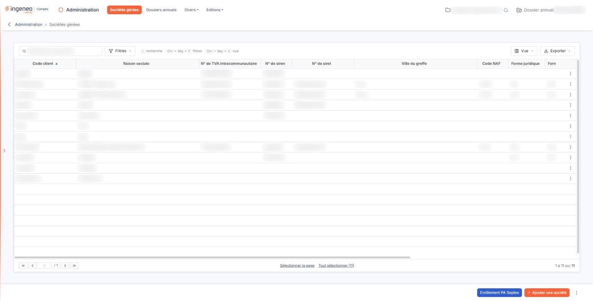<figcaption>
Écran « Sociétés gérées » de la nouvelle interface
</figcaption></figure>

<figure>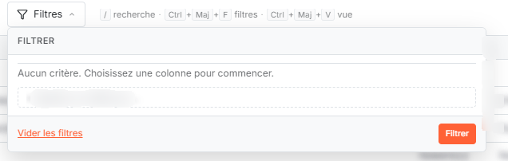<figcaption>
Bouton [Filtres]
</figcaption></figure>

<figure>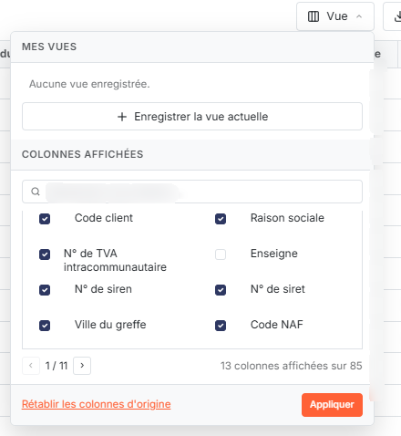<figcaption>
Bouton [Vue]
</figcaption></figure>

<figure>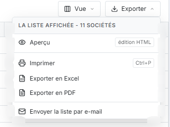<figcaption>
Bouton [Exporter]
</figcaption></figure>

La zone "Rechercher une société…" placée au-dessus de la liste vous permet de retrouver une société : elle restreint la liste dès la saisie, d'après tout ou partie de la raison sociale. Un code client saisi seul ne ramène aucune ligne.

La liste présente le code client et la raison sociale de chaque société, ses identifiants (numéro de TVA intracommunautaire, numéro de Siren, numéro de Siret), sa ville du greffe, son code NAF, sa forme juridique, sa forme juridique usuelle, sa catégorie juridique, ainsi que son statut sur la plateforme agréée de facturation électronique et, le cas échéant, le motif du rejet de son inscription. Au-dessus de la liste, le bouton **\[Vue]** vous permet de choisir les colonnes affichées, d'en retirer et d'en ajouter beaucoup d'autres, et d'enregistrer la présentation obtenue sous un nom ; le bouton **\[Filtres]** vous permet de filtrer ; le bouton **\[Exporter]** propose l'aperçu, l'impression, l'export en Excel ou en PDF et l'envoi de la liste par e-mail. Des raccourcis clavier y sont rappelés : « / » pour la recherche, Ctrl + Maj + F pour les filtres, Ctrl + Maj + V pour la vue.

Au survol d'une ligne, trois pictogrammes sont proposés : "Modifier", "Dupliquer" et "Envoi d'un courrier au client", suivis du pictogramme "Autres actions", dont le menu propose "Supprimer". Un clic sur la ligne la sélectionne.

"Supprimer" n'est pas proposé sur la société "LeCabinet" : la société du cabinet lui-même ne peut pas être supprimée.

Sous la liste, les liens "Sélectionner la page" et "Tout sélectionner" sélectionnent toutes les lignes de la page affichée ou de toutes les pages. Dès qu'au moins une société est sélectionnée, un bandeau apparaît en bas de l'écran : il indique le nombre de sociétés sélectionnées et propose "Tout désélectionner", "Envois groupés de courriers" et le bouton **\[Supprimer]**. "Envois groupés de courriers" vous permet d'adresser le même courrier à plusieurs sociétés sélectionnées. La fenêtre d'envoi est celle du module "Facturation" : choix du modèle de courrier, envoi éventuel en fichier .zip, destinataires supplémentaires, copie à vous-même, objet prérempli et éditeur de message.

bouton **\[Ajouter une société]**

Il ouvre la fiche de création d'une société gérée.

bouton **\[Champs dynamiques]**

Il se trouve dans le menu du pictogramme "Autres actions", à droite des boutons du bas de l'écran. Il vous permet d'ajouter vos propres champs à la fiche société. Reportez-vous au chapitre "Généralités", option "Fonctionnement général", sous-option "Champs dynamiques".

bouton **\[Enrôlement PA Septeo]**

Il vous permet d'inscrire en une seule fois plusieurs sociétés à la plateforme agréée, sans passer par la fiche de chacune.

bouton **\[Supprimer]**

Il apparaît dans le bandeau de sélection, en bas de l'écran, et supprime les sociétés que vous avez sélectionnées dans la liste. Voir le paragraphe consacré à la suppression en fin de page.

## Rubrique « Identification »

<figure>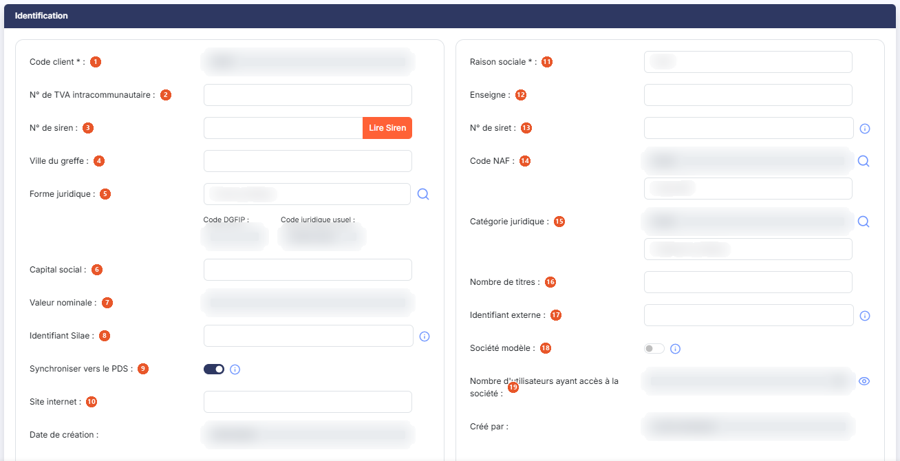<figcaption>
Rubrique « Identification »
</figcaption></figure>

<figure>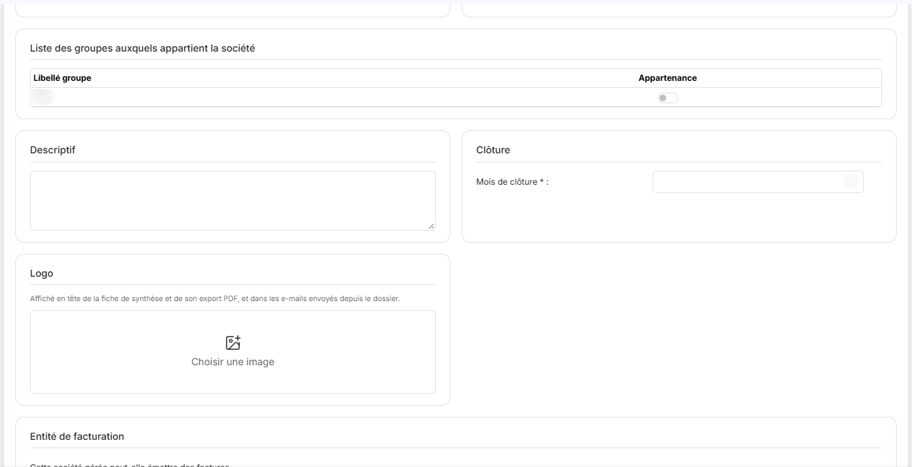<figcaption>
Rubrique « Identification »
</figcaption></figure>

<figure>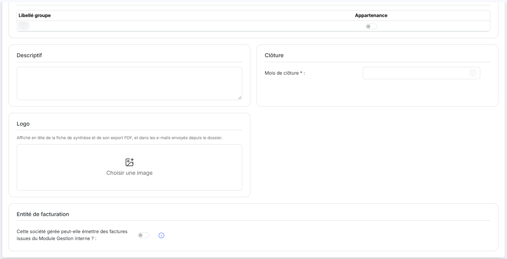<figcaption>
Rubrique « Identification »
</figcaption></figure>

| Champ                                                  | Ce qu'il faut savoir                                                                                                                                                                                                                                                                                                                                                                                                                                                                                                                                                                                                                                     |
| ------------------------------------------------------ | -------------------------------------------------------------------------------------------------------------------------------------------------------------------------------------------------------------------------------------------------------------------------------------------------------------------------------------------------------------------------------------------------------------------------------------------------------------------------------------------------------------------------------------------------------------------------------------------------------------------------------------------------------- |
| 1. **Code client**                                     | Champ obligatoire, limité à 20 caractères, sans espace ni caractère spécial. Le code est un des deux champs, avec la raison sociale, utilisé pour les recherches à de multiples endroits du logiciel. Une fois la fiche enregistrée, le code n'est plus modifiable.                                                                                                                                                                                                                                                                                                                                                                                      |
| 2. **N° de TVA intracommunautaire**                    | Champ facultatif, limité à 15 caractères.                                                                                                                                                                                                                                                                                                                                                                                                                                                                                                                                                                                                                |
| 3. **N° de siren**                                     | 
Il comporte 9 caractères. Le premier caractère peut être une lettre majuscule pour les associés de SEL en BNC ; les autres sont des chiffres. Vous pouvez créer deux sociétés avec des numéros de Siren identiques pourvu que les numéros de Siret soient différents. À droite du numéro, le bouton <strong>[Lire Siren]</strong> interroge un annuaire public et récupère les informations dont dispose l'administration sur la société, dont l'adresse de son siège social, qu'il crée automatiquement dans la liste des adresses. Si une adresse active existe déjà, le logiciel vous demande d'abord si vous souhaitez la mettre à jour.
   |
| 4. **Ville du greffe**                                 | Champ facultatif.                                                                                                                                                                                                                                                                                                                                                                                                                                                                                                                                                                                                                                        |
| 5. **Forme juridique**                                 | La forme juridique est normée car elle est utilisée dans les télédéclarations. Saisissez le libellé, ou utilisez le pictogramme "Loupe" pour ouvrir le panneau « Sélection d'une forme juridique », qui se manie comme celui du code NAF.                                                                                                                                                                                                                                                                                                                                                                                                                |
| 6. **Capital social**                                  | Champ facultatif. Ce champ est disponible pour la composition des plaquettes, qui à l'impression reprendront donc ce montant.                                                                                                                                                                                                                                                                                                                                                                                                                                                                                                                            |
| 7. **Valeur nominale**                                 | Calculée par le logiciel à partir du capital social et du nombre de titres ; elle n'est pas modifiable.                                                                                                                                                                                                                                                                                                                                                                                                                                                                                                                                                  |
| 8. **Identifiant Silae**                               | Ce champ permet de redéfinir le code abonné utilisé par l'API Silae. S'il n'est pas renseigné, l'API utilise le code client de la fiche de la société gérée.                                                                                                                                                                                                                                                                                                                                                                                                                                                                                             |
| 9. **Synchroniser vers le PDS**                        | Si l'interrupteur est activé, la société est créée dans le portail de services à la prochaine synchronisation, ou y reste si elle y est déjà. S'il est désactivé, elle est exclue de la synchronisation et, si elle est présente dans le portail de services, elle y est supprimée à la prochaine synchronisation, avec les données qu'elle y contient ; si vous la synchronisez de nouveau plus tard, elle y sera recréée. Ce choix ne prend effet qu'au lancement d'une synchronisation. Ce champ, et la colonne du même nom de la liste des sociétés gérées, ne sont proposés que si votre abonnement dispose d'un connecteur au portail de services. |
| 10. **Site internet**                                  | Champ facultatif.                                                                                                                                                                                                                                                                                                                                                                                                                                                                                                                                                                                                                                        |
| 11. **Raison sociale**                                 | Champ obligatoire, limité à 50 caractères.                                                                                                                                                                                                                                                                                                                                                                                                                                                                                                                                                                                                               |
| 12. **Enseigne**                                       | Champ facultatif, limité à 30 caractères.                                                                                                                                                                                                                                                                                                                                                                                                                                                                                                                                                                                                                |
| 13. **N° de siret**                                    | Il comporte 14 caractères. Les 9 premiers sont ceux du Siren ; les 5 derniers peuvent être des chiffres ou des lettres majuscules. Ce champ est obligatoire pour télétransmettre les déclarations à l'aide des modules "Comptabilité" et "Liasse fiscale".                                                                                                                                                                                                                                                                                                                                                                                               |
| 14. **Code NAF**                                       | Le code NAF est normé, le champ n'est donc pas saisissable directement : utilisez le pictogramme "Loupe" pour ouvrir le panneau « Sélection d'un code NAF », qui s'affiche à droite de l'écran. Cliquez sur la ligne voulue pour la retenir (le pied du panneau indique alors « Ligne retenue : » suivi du code), puis cliquez sur le bouton **\[Sélectionner]** ou appuyez sur Entrée ; la croix du panneau le referme sans rien reporter. Le libellé du code choisi s'affiche en dessous.                                                                                                                                                              |
| 15. **Catégorie juridique**                            | 
Le code n'est pas saisissable directement ; utilisez le pictogramme "Loupe" pour ouvrir le panneau « Sélection d'une catégorie juridique », qui se manie comme celui du code NAF. Le libellé de la catégorie choisie s'affiche en dessous. <strong>Code DGFIP</strong> et <strong>Code juridique usuel</strong> : ils découlent de la catégorie juridique choisie et ne sont pas modifiables.
                                                                                                                                                                                                                                                  |
| 16. **Nombre de titres**                               | Champ facultatif. Ce champ est disponible pour la composition des plaquettes.                                                                                                                                                                                                                                                                                                                                                                                                                                                                                                                                                                            |
| 17. **Identifiant externe**                            | Ce champ n'est utile que pour les abonnés utilisant un annuaire externe et réalisant des mises à jour via l'API.                                                                                                                                                                                                                                                                                                                                                                                                                                                                                                                                         |
| 18. **Société modèle**                                 | Répondez "Oui" pour que cette société puisse servir de modèle lors de la création d'une nouvelle société gérée. Pour ce faire, lors de la création d'une société, à la question "Indiquez les paramètres que vous souhaitez charger", choisissez « Un autre modèle » : vous pourrez alors faire votre sélection parmi toutes les sociétés définies comme modèles.                                                                                                                                                                                                                                                                                        |
| 19. **Nombre d'utilisateurs ayant accès à la société** | Ce champ n'est présent que lors de la modification d'une fiche société et n'est pas modifiable. En cliquant sur le pictogramme "Œil" à sa droite, vous visualisez la liste des utilisateurs ayant accès à la société ; cette liste dispose de ses propres pictogrammes de personnalisation des colonnes et d'impression.                                                                                                                                                                                                                                                                                                                                 |
| **Descriptif**                                         | Champ facultatif. Il permet de mémoriser des informations diverses sur la société gérée.                                                                                                                                                                                                                                                                                                                                                                                                                                                                                                                                                                 |

**Date de création** et **Créé par** : renseignés par le logiciel, non modifiables.

## Rubrique « Adresses »

<figure>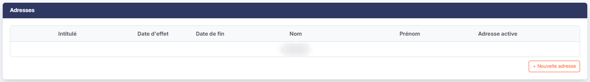<figcaption>
Rubrique « Adresses »
</figcaption></figure>

Une fiche société peut contenir plusieurs adresses distinctes, différenciées par leur intitulé. La liste vous en présente l'intitulé, les dates d'effet et de fin, le nom et le prénom du contact, et si l'adresse est active. Le bouton **\[+ Nouvelle adresse]** sous la liste en ajoute une ; les pictogrammes "Modifier", "Supprimer" et "Dupliquer" agissent sur la ligne.

Chaque adresse comprend une date d'effet et une date de fin qui correspondent à la période à laquelle l'adresse était effective. Cette période est essentielle, s'il y a eu des changements, pour choisir la bonne adresse lors de l'établissement de la liasse fiscale.

Vous ne pouvez donc pas saisir des adresses avec des périodes qui se chevauchent. Une date d'effet vide signifie que cette adresse est effective depuis la création de la société, et une date de fin vide signifie qu'elle est toujours valide.

## Rubrique « Adresses personnelles »

<figure>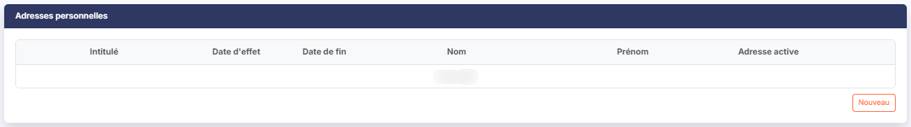<figcaption>
Rubrique « Adresses personnelles »
</figcaption></figure>

Cette liste est composée comme la précédente et se gère de la même manière ; son bouton d'ajout est le bouton **\[+ Nouvelle adresse personnelle]**.

L'adresse personnelle du dirigeant est nécessaire dans les liasses BNC ; c'est donc ici qu'il faut la renseigner pour qu'elle soit reprise.

## Rubrique « Coordonnées bancaires »

<figure>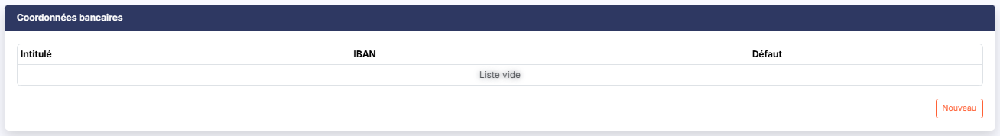<figcaption>
Rubrique « Coordonnées bancaires »
</figcaption></figure>

Cette rubrique recense les comptes bancaires de la société gérée, avec leur intitulé, leur IBAN et l'indication du compte utilisé par défaut. Le bouton **\[+ Nouvelle coordonnée bancaire]** en ajoute un.

## « Liste des groupes auxquels appartient la société », dans la rubrique « Identification »

Les groupes de travail sont définis dans le module "Mon compte". Ce bloc, placé en bas de la rubrique « Identification », vous présente la liste de tous les groupes existants ; l'interrupteur "Appartenance" de chaque ligne vous permet de visualiser et de modifier l'appartenance de la société en cours à chacun d'eux.

Un groupe déclaré comme ayant accès à toutes les futures sociétés apparaît automatiquement avec l'appartenance "Oui".

## Rubrique « Création du premier dossier annuel »

<figure>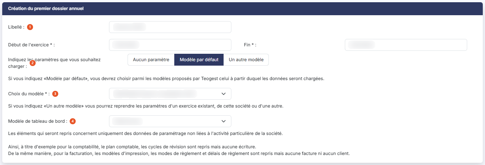<figcaption>
Rubrique « Création du premier dossier annuel »
</figcaption></figure>

Cette rubrique n'apparaît que lors de la création d'une société gérée : le logiciel crée en même temps la société et son premier dossier annuel. Elle prend la place du bloc « Clôture » de la rubrique « Identification » et de la rubrique « e-mails génériques », qui ne sont proposés qu'en modification.

| Champ                                                     | Ce qu'il faut savoir                                                                                                                                                                                                             |
| --------------------------------------------------------- | -------------------------------------------------------------------------------------------------------------------------------------------------------------------------------------------------------------------------------- |
| 1. **Libellé**                                            | 
Libellé du premier dossier annuel. <strong>Début de l'exercice</strong> et <strong>Fin :</strong> champs obligatoires. Ils délimitent le premier exercice comptable de la société.
                                     |
| 2. **Indiquez les paramètres que vous souhaitez charger** | Trois choix vous sont proposés, « Aucun paramètre », « Modèle par défaut » et « Un autre modèle ». Ils fonctionnent comme à la création d'un dossier annuel : reportez-vous à l'option « Dossiers annuels » de la présente aide. |
| 3. **Choix du modèle**                                    | Champ obligatoire ; il désigne le modèle à partir duquel les paramétrages seront chargés.                                                                                                                                        |
| 4. **Modèle de tableau de bord**                          | Sélecteur permettant de choisir le modèle de tableau de bord repris pour la nouvelle société.                                                                                                                                    |

## « Clôture », dans la rubrique « Identification »

Ce bloc de la rubrique « Identification » contient uniquement le **Mois de clôture**, champ obligatoire, utile pour le calcul de certaines échéances des télédéclarations.

## Rubrique « e-mails génériques »

<figure>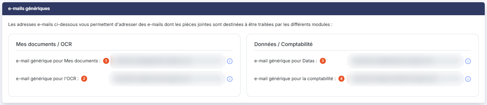<figcaption>
Rubrique « e-mails génériques »
</figcaption></figure>

Cette rubrique n'apparaît pas lors de la création d'une société gérée, mais seulement lors de la modification.

Elle contient les adresses e-mails spécifiques à la société, générées par le logiciel et non modifiables, auxquelles vous pourrez envoyer des e-mails avec des données en pièces jointes pour qu'elles soient intégrées au logiciel.

| Champ                                        | Ce qu'il faut savoir                                                                                                                                                   |
| -------------------------------------------- | ---------------------------------------------------------------------------------------------------------------------------------------------------------------------- |
| 1. **e-mail générique pour Mes documents**   | Toutes les pièces jointes seront traitées comme de nouveaux documents qui seront placés dans la bannette société en vue d'un classement ultérieur.                     |
| 2. **e-mail générique pour l'OCR**           | Toutes les pièces jointes seront considérées comme des documents à océriser.                                                                                           |
| 3. **e-mail générique pour Datas**           | Les e-mails destinés à cette adresse ne doivent contenir qu'un seul fichier d'écritures comptables.                                                                    |
| 4. **e-mail générique pour la comptabilité** | Les e-mails destinés à cette adresse ne doivent contenir qu'un seul fichier d'écritures comptables, qui seront intégrées dans l'option "Import" du menu "Traitements". |

## « Logo », dans la rubrique « Identification »

Le logo de la société est facultatif. L'encadré « Logo » précise qu'il est affiché en tête de la fiche de synthèse et de son export PDF, et dans les e-mails envoyés depuis le dossier. Tant qu'aucun logo n'est enregistré, l'encadré propose « Choisir une image ».

Cliquez sur l'image (ou sur « Choisir une image ») : la fenêtre « Logo de la société » s'ouvre, avec la raison sociale en rappel. Elle montre le « Logo actuel » (« Aucun logo » s'il n'y en a pas) et une zone « Glissez votre image ou cliquez-ici » pour choisir le fichier sur votre ordinateur. Un format est conseillé : un logo en PNG sur fond transparent, sans marge autour, de 1200 px au plus sur son plus grand côté.

Une fois l'image choisie, cliquez sur le bouton **\[Appliquer]** pour la retenir. L'image est utilisée en entier ; si besoin, une fenêtre permet de la recadrer : le recadrage est facultatif, il n'est plus imposé avant la validation.

Pour remplacer le logo, choisissez une nouvelle image. Pour le retirer sans le remplacer, utilisez la croix d'infobulle « Retirer le logo » de la fenêtre, qui n'est proposée que lorsqu'un logo existe.

Depuis une fiche existante, le logo est enregistré dès que vous cliquez sur \[Appliquer], sans passer par le bouton \[Enregistrer] de la fiche. À la création d'une société, le même encadré est présent ; l'image est alors enregistrée avec la société.

## Rubrique « Établissement déclarant »

<figure>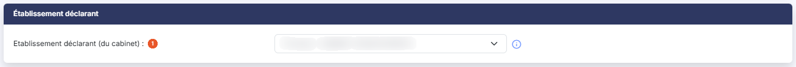<figcaption>
Rubrique « Établissement déclarant »
</figcaption></figure>

**Etablissement déclarant (du cabinet)** : il s'agit de l'établissement du cabinet qui effectue les télédéclarations, et donc généralement celui en charge du dossier. Si le cabinet dispose de plusieurs établissements qui effectuent des télédéclarations, ils sont tous proposés dans le sélecteur.

## « Entité de facturation », dans la rubrique « Identification »

**Cette société gérée peut-elle émettre des factures issues du Module Gestion interne ?** : ce paramètre permet d'indiquer si la société gérée en cours est susceptible d'émettre des factures depuis le module "Gestion interne". Il n'est donc à activer que pour les sociétés faisant partie du groupe de l'abonné. Si vous répondez "Oui", lors de la création d'une mission en gestion interne, vous pourrez générer les factures de la mission depuis cette société.

À la création d'une société gérée, ce paramètre est positionné sur "Non".

Si vous êtes positionné sur la société gérée "LeCabinet", il est forcé à "Oui" et grisé (non modifiable) : par définition, LeCabinet doit obligatoirement pouvoir facturer depuis la gestion interne, ce qui garantit qu'il y a toujours au moins une entité capable de facturer.

## Rubrique « Facture électronique »

<figure>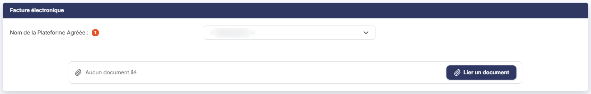<figcaption>
Rubrique « Facture électronique »
</figcaption></figure>

Cette rubrique permet d'inscrire la société sur une Plateforme Agréée (PA) de facturation électronique, et de conserver les documents que cette inscription exige.

| Champ                              | Ce qu'il faut savoir                                                                                                                                                                                                                                                                                                                                                                  |
| ---------------------------------- | ------------------------------------------------------------------------------------------------------------------------------------------------------------------------------------------------------------------------------------------------------------------------------------------------------------------------------------------------------------------------------------- |
| 1. **Nom de la Plateforme Agréée** | 
Choisissez dans le sélecteur le nom de votre plateforme. Si elle n'apparaît pas, reportez-vous à l'aide du module "Supervision datas" pour l'activation du connecteur à la plateforme. Le statut et le formulaire d'inscription ne s'affichent que lorsque la plateforme choisie est la plateforme agréée de Septeo ; la liste des documents de la société n'en dépend pas.
 |
| **Statut**                         | Renseigné par le logiciel, non modifiable. Il vous indique où en est l'inscription de la société. Ce statut, ainsi que le motif d'un éventuel rejet, sont également disponibles en colonnes de la liste des sociétés gérées.                                                                                                                                                          |

**Inscription sur la plateforme agréée**

Le logiciel affiche une liste de champs préremplis, à vérifier : le **Code** attribué à la société, non modifiable, la **Raison sociale** (obligatoire) et le numéro de **TVA Intra.**, puis, sous le sous-titre "Adresse", l'**Email**, le **Téléphone**, la **Rue**, le **Code postal**, la **Ville**, la **Région**, le **Code pays** et le **SIREN**. Tous sont obligatoires sauf le téléphone. Ces données proviennent de l'adresse principale de la société, le logiciel vous le rappelle.

Pensez à utiliser le bouton **\[Lire Siren]** de la rubrique "Identification" pour récupérer le maximum d'informations sur la société avant de vous inscrire.

Une fois les champs vérifiés et éventuellement modifiés, cliquez sur le bouton **\[Inscrire la société à la PA]**.

**Les documents de la société**

La liste qui suit conserve les documents nécessaires à l'inscription. Elle vous en présente la description, le nom du fichier, la date et l'auteur ; les pictogrammes "Modifier", "Visualiser" et "Supprimer" agissent sur la ligne.

Il s'agit notamment du mandat que le client a signé pour le cabinet.

Le bouton **\[Lier un document]** vous permet d'alimenter cette liste : il ouvre un volet où vous choisissez la source du document, "Depuis mon poste" ou "Depuis l'OCR", puis déposez ou sélectionnez le fichier et cliquez sur le bouton **\[Lier le document]**. Tous les formats sont acceptés, sauf .exe, .bat, .cmd et .sh, et le nom du fichier est limité à 100 caractères.

Si vous ne disposez pas des documents immédiatement, vous pouvez enregistrer la fiche et reprendre cette opération ultérieurement.

**Après l'inscription**

La mise à jour de l'annuaire par l'administration peut nécessiter un délai variant de quelques heures à quelques jours.

Pour vérifier que votre inscription a bien été prise en compte par l'administration fiscale, vous pouvez consulter l'annuaire de la facturation électronique à l'adresse suivante : [https://facturation.chorus-pro.gouv.fr/annuaire/](https://facturation.chorus-pro.gouv.fr/annuaire/)

* Entrez le SIREN ou la dénomination sociale de votre société.
* Pour vous assurer que l'inscription a bien été prise en compte, le champ "Plateforme(s) agréée(s) rattachée(s)" situé au-dessus du tableau doit indiquer "Oui".


Notez que le champ "Adresse de facturation active" indiquera systématiquement "Non" avant la date d'entrée en vigueur qui a été indiquée lors de l'inscription de la société.


## Rubrique « Champs dynamiques »

<figure>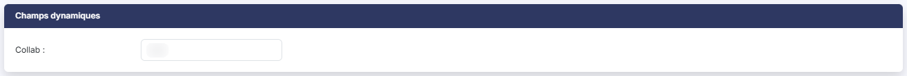<figcaption>
Rubrique « Champs dynamiques »
</figcaption></figure>

Si vous avez ajouté de nouveaux champs à la fiche société, c'est dans cette rubrique qu'ils sont saisis. Elle n'apparaît pas si aucun champ dynamique n'a été paramétré.

Reportez-vous au chapitre introductif de la présente aide en ligne pour plus d'information sur les champs dynamiques (chapitre "Généralités", option "Fonctionnement général", sous-option "Champs dynamiques").

## Entrée « Accès par mot de passe » du menu « Autres actions »

Vous avez la possibilité de protéger l'accès à certaines sociétés gérées par un mot de passe. Cette entrée du menu « Autres actions » (les trois points, à droite du pied de la fiche) ouvre la fenêtre « Accès par mot de passe ». Elle demande d'abord de confirmer votre identité : saisissez votre propre mot de passe de connexion dans le champ « Votre mot de passe : », puis cliquez sur le bouton **\[Confirmer]** ; la croix de la fenêtre la referme sans rien changer. Une fois votre identité confirmée, vous pouvez implanter, modifier ou supprimer le mot de passe de la société en cours de modification. Le mot de passe est demandé à l'utilisateur à chaque fois qu'il sélectionne la société dans le bandeau du haut de l'écran pour s'y connecter.

## Duplication d'une société gérée

Tous les dossiers annuels de la société sont dupliqués.

Tous les utilisateurs qui avaient accès à la société source auront également accès à la société dupliquée.

## Suppression d'une société gérée

La suppression d'une société gérée est définitive et entraîne la suppression de toutes les données de tous les dossiers annuels. C'est pourquoi le logiciel vous demande de confirmer en recopiant le code de la société suivi du mot "Suppression". Cette confirmation garantit qu'il ne s'agit pas d'une erreur de manipulation, par exemple d'un clic sur la mauvaise ligne de la liste.

Chaque dossier annuel supprimé avec la société est mémorisé dans un fichier que vous pouvez éditer avec le générateur d'états.

## Entrée « Infos stats » et bouton \[Mandat à signer]

**Entrée « Infos stats »** du menu « Autres actions » : elle ouvre, en consultation, un panneau à droite de l'écran qui présente le dernier calcul de statistiques de la société. On le referme par la croix de son en-tête : il ne porte pas de bouton \[Fermer]. Cette entrée n'est proposée que depuis le module Administration et si votre profil en donne le droit.

bouton **\[Mandat à signer]** : il est proposé aux collaborateurs du cabinet tant que la demande d'inscription à la plateforme agréée de Septeo n'a pas été envoyée pour la société. Il ouvre la fenêtre « Mandat Cabinet Plateforme Agréée », qui imprime en PDF le mandat établi avec le courrier « Cabinet - Mandat PA », modèle imposé ; si le cabinet n'a aucun modèle de type « Courrier Client », un message l'indique à la place.
