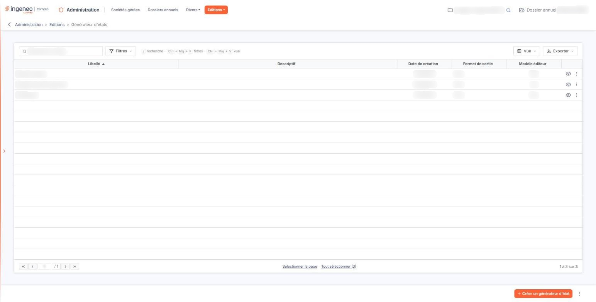
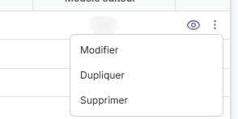
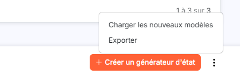
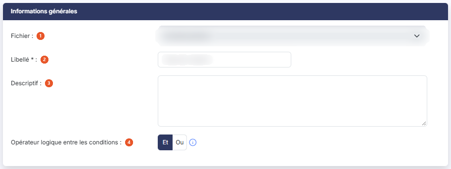
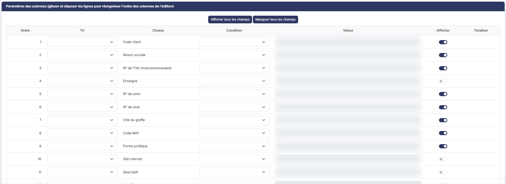
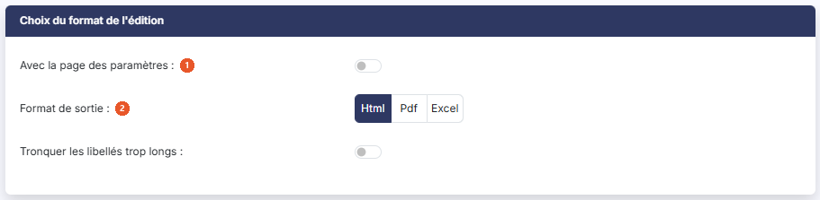
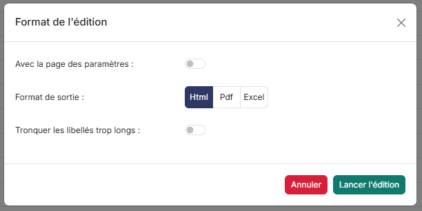

# Générateur d'états


**Où le trouver :** Menu **Editions › Générateur d'états**



**En bref** — Le générateur d'états vous permet de composer, de mémoriser et de relancer vos propres éditions de listes, à partir des fichiers de référence de l'administration.

* Pour créer un état : bouton \[Créer un générateur d'état], choisissez le Fichier, les champs à afficher et les conditions, puis bouton \[Enregistrer].
* Pour relancer un état : pictogramme « Œil » de sa ligne, vérifiez le format, puis bouton \[Lancer l'édition].
* Pour récupérer les états livrés avec le logiciel : bouton \[Charger les nouveaux modèles], cochez ceux qui vous intéressent.


Le générateur d'états d'édition vous permet de composer, de mémoriser et de relancer vos propres éditions de listes, établies à partir des fichiers de référence gérés dans l'administration de votre logiciel.

<figure><figcaption>
Écran « Générateur d'états » de la nouvelle interface
</figcaption></figure>

Vous choisissez le fichier à éditer, les colonnes à y faire figurer et leur ordre, les conditions de sélection des lignes, puis le format du document produit. L'état ainsi défini est enregistré : vous le relancez ensuite d'un seul clic, sans avoir à le redéfinir.

Les états déjà créés apparaissent dans la grille. Si aucun état n'est présent, cliquez sur le bouton **\[Créer un générateur d'état]** pour créer votre premier état.

Les boutons et les commandes décrits ci-dessous dépendent de vos droits : ceux qui ne vous sont pas accordés n'apparaissent pas à l'écran.

## La grille des états

La grille présente cinq colonnes, toutes triables par un clic sur leur en-tête :

| Champ                | Ce qu'il faut savoir                                                                                                                                        |
| -------------------- | ----------------------------------------------------------------------------------------------------------------------------------------------------------- |
| **Libellé**          | Le nom que vous avez donné à l'état.                                                                                                                        |
| **Descriptif**       | Le commentaire libre que vous lui avez éventuellement associé.                                                                                              |
| **Date de création** | La date à laquelle l'état a été créé. Ne confondez pas cet en-tête de colonne avec le libellé d'un état, qui peut lui aussi s'appeler « Date de création ». |
| **Format de sortie** | Le format du document que produit l'état, « Html », « Pdf » ou « Excel ».                                                                                   |
| **Modèle éditeur**   | Indique si l'état a été livré avec le logiciel. Un tel état n'est modifiable que par l'abonné éditeur ; voir le paragraphe i.                               |

Le bas de la grille porte la pagination habituelle et le nombre d'états trouvés.

## Les commandes de chaque ligne

<figure><figcaption>
Rubrique « Les commandes de chaque ligne »
</figcaption></figure>

Les commandes proposées sur chaque ligne sont les suivantes.

Le pictogramme « Crayon », infobulle « Modifier », ouvre la fiche de l'état pour la modifier.

Le pictogramme « Œil » porte l'infobulle « Afficher l'aperçu », mais il ne consulte pas l'état : **il lance l'édition**. Le logiciel ouvre la fenêtre « Format de l'édition » décrite au paragraphe h.

Le pictogramme « Autres actions » (trois points) donne accès à la commande « Supprimer », qui supprime l'état.

Le pictogramme « Case avec flèche », infobulle « Dupliquer », duplique l'état : le logiciel en crée une copie, que vous pouvez ensuite modifier librement.

## Les commandes situées au-dessus de la grille

<figure><figcaption>
Bouton [Charger les nouveaux modèles]
</figcaption></figure>

Au-dessus de la grille, l'écran propose les boutons « Filtres », « Vue » et « Exporter », ainsi que les liens « Sélectionner la page » et « Tout sélectionner ».

bouton **\[Créer un générateur d'état]**

Il ouvre une fiche vierge pour créer un nouvel état.

bouton **\[Charger les nouveaux modèles]**

Le logiciel est livré avec des états déjà composés, adaptés à votre type d'abonnement et au module en cours. Ce bouton ouvre la fenêtre « Nouveaux modèles », qui présente ceux dont vous ne disposez pas encore : cochez ceux qui vous intéressent, et le logiciel les ajoute à votre liste. Il ne remplace jamais un état que vous possédez déjà.

Si vous les avez tous, la fenêtre vous répond « Ce dossier contient déjà tous les modèles disponibles. » ; s'il n'en existe aucun pour votre abonnement, « Il n'existe aucun modèle disponible. ». Le bouton **\[OK]** referme la fenêtre.

bouton **\[Exporter]**

Si vous gérez plusieurs sociétés, vous pouvez recopier dans les autres les états que vous avez composés dans l'une d'elles.

Cochez dans la grille les états à recopier, puis cliquez sur ce bouton. Le logiciel ouvre la fenêtre « Exporter », qui vous rappelle le nombre d'enregistrements sélectionnés et vous demande d'indiquer les sociétés vers lesquelles les données seront copiées :

* « Toutes les sociétés » : les états sélectionnés sont exportés vers toutes les sociétés auxquelles vous avez accès ;
* « Autres » : ils ne sont exportés que vers les sociétés que vous choisissez dans la liste proposée en dessous, où vous retrouvez le code client, la raison sociale et l'indication de votre accès. La zone **Société :** et le bouton **\[Afficher]** vous permettent de retrouver une société par son nom.

Le bouton **\[Valider]** lance la recopie, le bouton **\[Fermer]** referme la fenêtre sans rien copier.

**La recopie n'est pas immédiate** : le logiciel vous en avertit dans la fenêtre. Elle se fera lors de la prochaine utilisation de la société gérée concernée, par exemple lorsque vous la sélectionnerez dans le menu, ou lors de la connexion d'un utilisateur. Ne vous étonnez donc pas de ne pas voir tout de suite vos états dans les sociétés destinataires.

bouton **\[Supprimer]**

Il supprime tous les états cochés dans la grille. Le logiciel vous demande de confirmer l'opération.

La fiche d'un état, que vous l'ouvriez en création ou en modification, se compose de trois rubriques présentées l'une sous l'autre.

## Rubrique « Informations générales »

<figure><figcaption>
Rubrique « Informations générales »
</figcaption></figure>

| Champ                                                      | Ce qu'il faut savoir                                                                                                                                                                                                                                                                                                                                                                                                                                                                                                                                                                                                                                                                                                                                                                                                                                                                                                     |
| ---------------------------------------------------------- | ------------------------------------------------------------------------------------------------------------------------------------------------------------------------------------------------------------------------------------------------------------------------------------------------------------------------------------------------------------------------------------------------------------------------------------------------------------------------------------------------------------------------------------------------------------------------------------------------------------------------------------------------------------------------------------------------------------------------------------------------------------------------------------------------------------------------------------------------------------------------------------------------------------------------ |
| 1. **Fichier**                                             | 
Le fichier sur lequel porte l'édition. Le sélecteur propose « Civilité », « Dossiers annuels », « Dossiers annuels supprimées », « Pays », « Sociétés gérées » et « Statistiques historiques ». C'est le champ qui commande toute la fiche : dès que vous choisissez un fichier, le logiciel recharge entièrement le tableau de la rubrique suivante avec la liste des champs de ce fichier. Cette liste est très différente d'un fichier à l'autre, de deux champs pour « Civilité » à quatre-vingts pour « Sociétés gérées ». Tant qu'aucun fichier n'est choisi, le tableau affiche le message « Aucun filtre n'est disponible. ». Le fichier est obligatoire à la création. En revanche, <strong>il ne se change plus une fois l'état enregistré</strong> : à l'ouverture d'un état existant, le sélecteur est présenté mais n'est plus modifiable. Pour éditer un autre fichier, créez un nouvel état.
 |
| 
2. <strong>Libellé</strong> <em>Obligatoire</em>
 | Le nom de l'état, obligatoire, limité à vingt-deux caractères. C'est lui qui apparaît dans la grille et en tête du document produit.                                                                                                                                                                                                                                                                                                                                                                                                                                                                                                                                                                                                                                                                                                                                                                                     |
| 3. **Descriptif**                                          | Un commentaire libre, facultatif.                                                                                                                                                                                                                                                                                                                                                                                                                                                                                                                                                                                                                                                                                                                                                                                                                                                                                        |
| 4. **Opérateur logique entre les conditions**              | 
Dans la rubrique des paramètres de colonnes, vous pouvez poser des conditions pour ne retenir qu'une partie des lignes. Si vous en posez plusieurs, ce paramètre indique comment le logiciel les combine : • le « Et » impose que toutes les conditions soient respectées, • le « Ou » impose qu'une condition au moins soit respectée.
                                                                                                                                                                                                                                                                                                                                                                                                                                                                                                                                                                     |

## Rubrique « Paramètres des colonnes »

<figure><figcaption>
Rubrique « Paramètres des colonnes »
</figcaption></figure>

Cette rubrique porte la liste des champs du fichier choisi. Chaque ligne correspond à une colonne possible de l'édition. Vous réorganisez l'ordre des colonnes en **déplaçant les lignes à la souris, par glisser-déposer** : le titre de la rubrique vous le rappelle.

Le bouton **\[Afficher tous les champs]** et le bouton **\[Masquer tous les champs]**, placés au-dessus du tableau, basculent en une fois la colonne « Afficher » de toutes les lignes, sans demande de confirmation.

Le tableau comporte les colonnes suivantes :

| Champ         | Ce qu'il faut savoir                                                                                                                                                                                                                                                                                                                                                                                                                                                                                                                                                                                                                                  |
| ------------- | ----------------------------------------------------------------------------------------------------------------------------------------------------------------------------------------------------------------------------------------------------------------------------------------------------------------------------------------------------------------------------------------------------------------------------------------------------------------------------------------------------------------------------------------------------------------------------------------------------------------------------------------------------- |
| **Ordre**     | La position du champ dans l'édition. Ce numéro se met à jour lorsque vous déplacez une ligne.                                                                                                                                                                                                                                                                                                                                                                                                                                                                                                                                                         |
| **Tri**       | Indiquez « Ascendant » ou « Descendant » si l'édition doit être triée sur ce champ. Laissez la case vide sinon.                                                                                                                                                                                                                                                                                                                                                                                                                                                                                                                                       |
| **Champ**     | Le nom du champ, qui deviendra le titre de la colonne dans l'édition. Il n'est pas modifiable.                                                                                                                                                                                                                                                                                                                                                                                                                                                                                                                                                        |
| **Condition** | 
L'opérateur de sélection à appliquer à ce champ. Les opérateurs proposés dépendent de la nature du champ : • pour un champ de texte : « Est égal à », « Est différent de », « Commence par », « Contient », « Se termine par », « Est vide », « N'est pas vide », « Supérieur à », « Supérieur ou égal à », « Inférieur à », « Inférieur ou égal à » ; • pour un champ numérique ou une date : les mêmes, à l'exception de « Commence par », « Contient » et « Se termine par » ; • pour un champ qui se répond par oui ou par non, dont le libellé se termine par un point d'interrogation : « Est vrai » et « Est faux » seulement.
 |
| **Valeur**    | 
La valeur à comparer. La zone reste grisée tant que vous n'avez pas choisi de condition, et elle le reste pour les opérateurs qui n'attendent pas de valeur, comme « Est vide ». Dès qu'une condition en attend une, la zone s'encadre de rouge : la valeur devient obligatoire. Pour un champ date, un calendrier vous est proposé. Par exemple, sur le fichier « Sociétés gérées », pour n'éditer que les sociétés dont la raison sociale commence par A, choisissez la condition « Commence par » sur la ligne « Raison sociale » et saisissez « A » dans la zone « Valeur ».
                                                            |
| **Afficher**  | Indiquez si le champ doit figurer en colonne dans l'édition. Vous pouvez tout à fait poser une condition sur un champ que vous avez décidé de ne pas afficher. La valeur proposée au départ n'est pas la même pour tous les champs : certains arrivent à « Non ».                                                                                                                                                                                                                                                                                                                                                                                     |
| **Totaliser** | Demandez le total des valeurs de la colonne. Cette bascule n'est proposée que sur les lignes des champs numériques ; la cellule reste vide pour les autres.                                                                                                                                                                                                                                                                                                                                                                                                                                                                                           |

## Rubrique « Choix du format de l'édition »

<figure><figcaption>
Rubrique « Choix du format de l'édition »
</figcaption></figure>

| Champ                              | Ce qu'il faut savoir                                                                                                                                                                                                                                                                                                                                                                                                                                                                                                                                                                |
| ---------------------------------- | ----------------------------------------------------------------------------------------------------------------------------------------------------------------------------------------------------------------------------------------------------------------------------------------------------------------------------------------------------------------------------------------------------------------------------------------------------------------------------------------------------------------------------------------------------------------------------------- |
| 1. **Avec la page des paramètres** | À « Oui », l'édition au format Html fait précéder le tableau d'une page de paramètres qui récapitule la façon dont elle a été composée : le format retenu et ses options, les conditions posées et l'opérateur qui les relie, la liste des colonnes affichées, le tri et les totalisations demandés.                                                                                                                                                                                                                                                                                |
| 2. **Format de sortie**            | 
Choisissez « Html », « Pdf » ou « Excel ». <strong>Les options proposées en dessous changent selon le format retenu</strong> : • « Html » : l'option <strong>Tronquer les libellés trop longs :</strong> raccourcit les libellés qui feraient exploser la largeur des colonnes ; • « Pdf » : les options <strong>Masquer les entêtes et pieds de page :</strong> et <strong>Orientation :</strong>, cette dernière vous laissant choisir entre « Portrait » et « Paysage » ; • « Excel » : la seule option <strong>Masquer les entêtes et pieds de page :</strong>.
 |

À la création d'un état, le format proposé est « Html » et l'orientation « Portrait ».

## Boutons de la fiche

Les trois boutons de la fiche restent visibles quel que soit votre défilement dans l'écran.

Le bouton **\[Enregistrer]** mémorise l'état avec tous ses paramètres, en vue d'une utilisation ultérieure.

Le bouton **\[Lancer l'édition]** produit le document au format choisi.

Le bouton **\[Retour]** vous ramène à la grille des états.

## Lancer une édition depuis la grille

<figure><figcaption>
Rubrique « Lancer une édition depuis la grille »
</figcaption></figure>

Le pictogramme « Œil » d'une ligne ouvre la fenêtre « Format de l'édition ». Elle vous propose exactement les mêmes options que la rubrique « Choix du format de l'édition » de la fiche, avec la même dépendance au format retenu, renseignées telles qu'elles sont enregistrées sur l'état. Vous pouvez les modifier pour ce seul lancement, sans toucher à l'état lui-même, à une exception près : l'option « Avec la page des paramètres » n'est pas prise en compte depuis cette fenêtre, où seule la valeur enregistrée sur l'état s'applique.

Le bouton **\[Lancer l'édition]** produit le document ; le bouton **\[Annuler]**, comme le pictogramme « Croix » du bandeau, referme la fenêtre sans rien produire.

Au format « Html », le document s'ouvre dans un nouvel onglet de votre navigateur, sans vous faire quitter l'écran des états. L'onglet s'intitule du libellé de l'état suivi de la date du jour ; le document lui-même reprend le libellé de l'état en titre, présente les colonnes dont la bascule « Afficher » vaut « Oui » dans l'ordre que vous avez défini, et se termine par le nombre de lignes éditées. Les colonnes pour lesquelles vous avez demandé une totalisation sont récapitulées en fin de document. Un bouton **\[Actualiser l'édition]**, présent en haut et en bas du document, relance le calcul sur les données du moment.

Aux formats « Pdf » et « Excel », le logiciel ne vous ouvre pas d'onglet : il produit un fichier, nommé d'après le libellé de l'édition, le code de la société gérée, la date et l'heure, de façon que vous puissiez l'enregistrer sans avoir à le renommer.

Si aucun champ de l'état n'est en « Afficher », le logiciel refuse de produire le document et vous répond « Vous devez afficher au moins un champ. ».

## Les états livrés avec le logiciel

Les états dont la colonne « Modèle éditeur » vaut « Oui » sont livrés avec le logiciel : ils ne sont **modifiables que par l'abonné éditeur**.

Pour disposer d'un état de ce type adapté à votre besoin, dupliquez-le par la commande « Dupliquer » : la copie obtenue est un état ordinaire, que vous modifiez librement.
