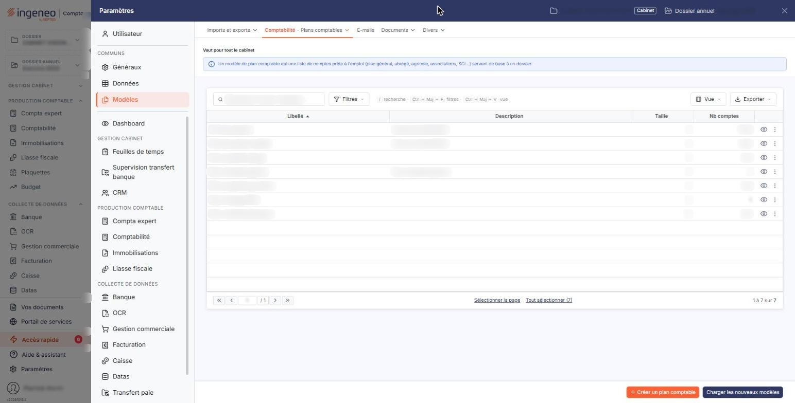
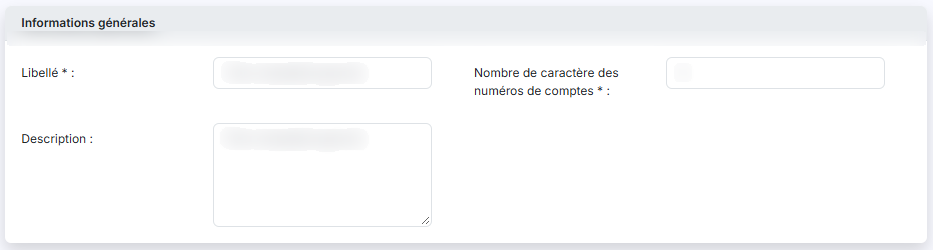
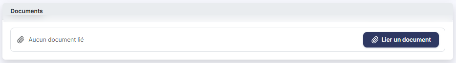
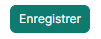
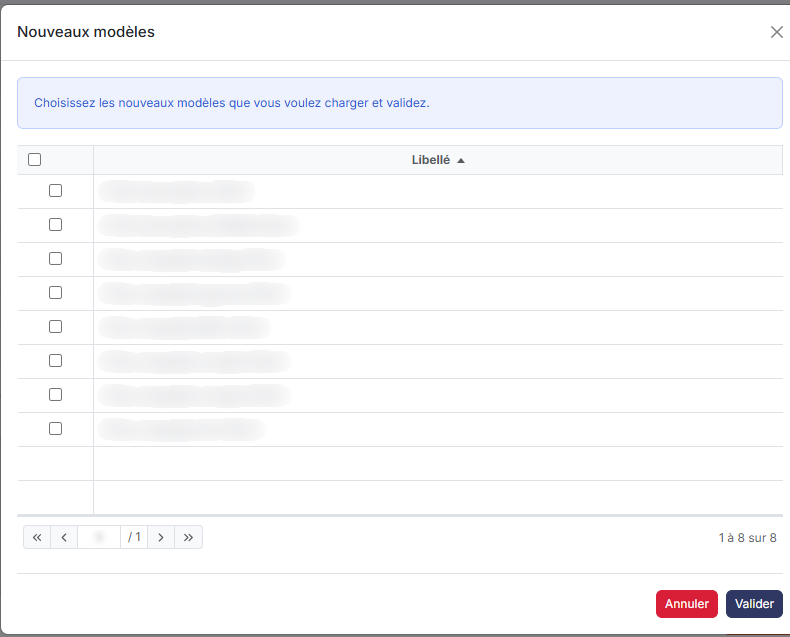
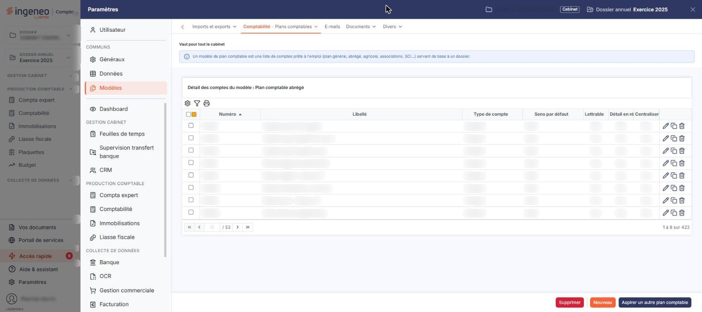
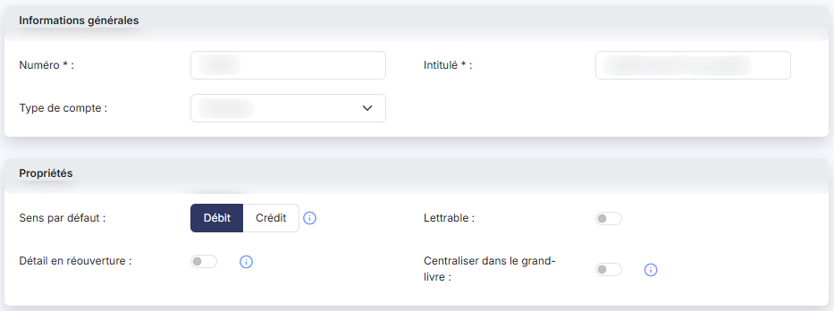
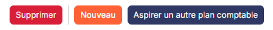
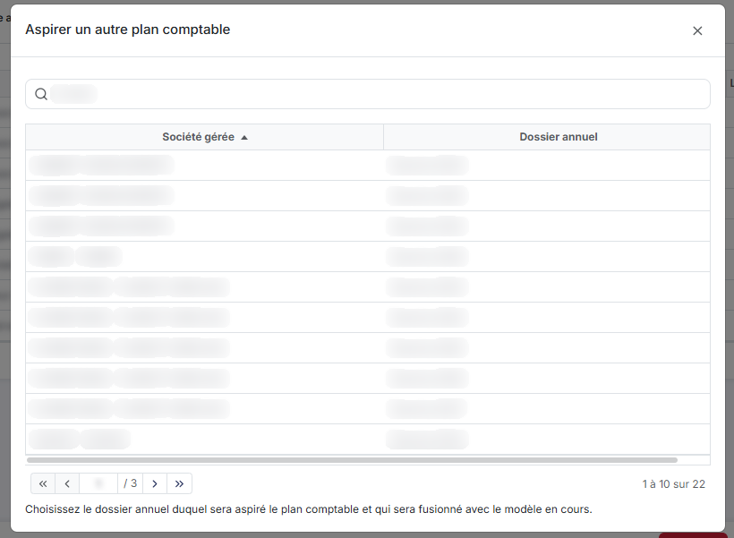

# Plans comptables


**Où le trouver :** Panneau **Paramètres** › **Modèles** › **Comptabilité** › **Plans comptables**



**En bref** — Cet écran gère les modèles de plans comptables, plans types indépendants de toute société, qui servent à monter le plan comptable d'un dossier annuel sans le saisir compte par compte.

* Pour créer votre propre modèle à partir d'un modèle existant : pictogramme « Dupliquer » de sa ligne, changez le Libellé, puis bouton \[Enregistrer].
* Pour consulter ou modifier les comptes d'un modèle : pictogramme « Œil » de sa ligne.
* Pour récupérer les modèles nouveaux ou mis à jour par Ingeneo Compta : bouton \[Charger les nouveaux modèles], cochez-les, puis bouton \[Valider].


Un modèle de plan comptable est un plan comptable type, indépendant de toute société : il sert à monter le plan comptable d'un dossier annuel sans le saisir compte par compte.

<figure><figcaption>
Écran « Plans comptables » de la nouvelle interface
</figcaption></figure>

Ingeneo Compta fournit un ensemble de modèles, tenus à jour par l'éditeur. Vous pouvez créer vos propres modèles ex nihilo (cela risque de vous prendre beaucoup de temps) ou dupliquer un modèle existant puis le modifier.

Les modèles de plans comptables seront accessibles, pour être chargés, dans toutes les sociétés gérées et dans tous leurs dossiers annuels. Le chargement d'un modèle se fait dans l'onglet d'administration du plan comptable de la société considérée.

Cet écran enchaîne quatre pages : la liste des modèles, la fiche d'un modèle, le détail de ses comptes et la fiche d'un compte. Pour consulter et modifier les caractéristiques d'un modèle, utilisez le pictogramme « Crayon » ; pour consulter et modifier les comptes qu'il contient, utilisez le pictogramme « Œil ».

## La liste des modèles

<figure><figcaption>
Bouton [Nouveau]
</figcaption></figure>

La liste s'affiche d'emblée, sans filtre ni zone de recherche. Quatre colonnes sont présentées :

* **Libellé** : le nom du modèle. C'est le tri par défaut.
* **Description** : le commentaire libre saisi sur la fiche ; les modèles de l'éditeur y portent en général leur date de version.
* **Taille** : le nombre de caractères des numéros de comptes du modèle.
* **Nb comptes** : le nombre de comptes que contient le modèle. Cette colonne n'est pas triable.

Deux colonnes supplémentaires existent mais ne sont pas affichées par défaut : **Modèle éditeur** et **Dernière modification**. Vous les ajoutez par le pictogramme « Engrenages » de personnalisation des colonnes. La première est le moyen de reconnaître les modèles fournis par Ingeneo Compta.

À la différence des autres grilles du logiciel, celle-ci n'offre **ni** pictogramme « Entonnoir » de filtres, **ni** pictogramme « Imprimante ». L'en-tête ne propose que la case à cocher de sélection de la page, le pictogramme « Carré jaune » de sélection multipage et le pictogramme « Engrenages ».

Sur chaque ligne, quatre pictogrammes : « Crayon » ouvre la fiche du modèle, « Œil » ouvre le détail de ses comptes, « Dupliquer » le duplique, et « Supprimer » le supprime.

Ces commandes n'apparaissent que si votre profil vous en donne le droit ; la modification, la suppression et la duplication relèvent de trois droits distincts.

bouton **\[Nouveau]** : ouvre une fiche de modèle vierge.

bouton **\[Supprimer]** : supprime en une fois tous les modèles cochés dans la grille.

## Création et modification d'un modèle

<figure><figcaption>
Rubrique « Informations générales »
</figcaption></figure>

<figure><figcaption>
Rubrique « Documents »
</figcaption></figure>

<figure><figcaption>
Bouton [Enregistrer]
</figcaption></figure>

La création d'un modèle se fait en deux étapes : les informations générales du modèle, puis les comptes eux-mêmes par le pictogramme « Œil » (voir ci-dessous). La fiche est identique en création et en modification, et comporte deux rubriques.

**Rubrique « Informations générales »**

| Champ                                          | Ce qu'il faut savoir                                                                                                                                                                                                                                                                                                                                                                 |
| ---------------------------------------------- | ------------------------------------------------------------------------------------------------------------------------------------------------------------------------------------------------------------------------------------------------------------------------------------------------------------------------------------------------------------------------------------ |
| **Libellé**                                    | Champ obligatoire, trente caractères au maximum. Il doit être différent de celui de tous vos autres modèles ; sinon le logiciel vous demande d'en choisir un autre.                                                                                                                                                                                                                  |
| **Description**                                | —                                                                                                                                                                                                                                                                                                                                                                                    |
| **Nombre de caractère des numéros de comptes** | Champ obligatoire, compris entre 6 et 12. Tous les numéros de comptes doivent avoir la même longueur : les chiffres non significatifs seront comblés avec des 0. Vous pouvez agrandir cette taille par la suite, mais pas la réduire en deçà de la longueur des comptes déjà présents dans le modèle : le logiciel répond alors que le nombre de caractères spécifié est trop court. |

**Rubrique « Documents »**

Elle permet de joindre au modèle, par exemple, les référentiels normatifs sur lesquels il a été conçu. Le tableau affiche **Description**, **Nom du fichier**, **Date** et **Créé par** ; tant qu'aucune pièce n'est jointe, il n'apparaît pas et la rubrique affiche seulement « Aucun document lié ».

bouton **\[Lier un document]** : joint un fichier pris sur votre ordinateur.

bouton **\[Enregistrer]** : enregistre le modèle.

Le pictogramme « Retour », placé à gauche des onglets du panneau « Paramètres », revient à la liste sans enregistrer.

La fiche ne conserve ni date ni auteur de création ou de modification.

## Duplication d'un modèle

Pour dupliquer un modèle de plan comptable, utilisez le pictogramme « Dupliquer » de sa ligne, puis saisissez les informations générales du nouveau modèle. Vous devez impérativement changer le libellé pour différencier le nouveau modèle.

Toute modification effectuée dans un modèle de plan comptable n'entraîne aucune modification dans les dossiers annuels où il a déjà été chargé.

## Bouton \[Charger les nouveaux modèles]

<figure><figcaption>
Bouton [Charger les nouveaux modèles]
</figcaption></figure>

Ce bouton, en bas de la liste, permet de charger les nouveaux modèles proposés par Ingeneo Compta et de mettre à jour ceux que vous possédez déjà mais qu'Ingeneo Compta a fait évoluer.

Le logiciel ouvre une fenêtre « Nouveaux modèles » qui vous invite à choisir les nouveaux modèles que vous voulez charger, et à valider. Elle présente, dans une grille à colonne unique **Libellé** avec une case à cocher par ligne, les seuls modèles qui vous manquent et ceux dont la version de l'éditeur a changé depuis votre dernier chargement ; leur libellé y est encadré d'astérisques. Les modèles proposés dépendent de votre type d'abonnement.

Cochez ceux qui vous intéressent puis cliquez sur bouton **\[Valider]** ; bouton **\[Annuler]** et la croix en haut à droite referment la fenêtre sans rien charger : le logiciel vous indique en réponse le nombre de modèles chargés et le nombre de modèles mis à jour.

Si vous êtes déjà à jour, la fenêtre ne s'ouvre pas et le logiciel vous répond que vous possédez déjà tous les modèles disponibles.

## Administration des comptes d'un modèle

<figure><figcaption>
Rubrique « Administration des comptes d'un modèle »
</figcaption></figure>

Pour administrer les comptes d'un modèle, utilisez le pictogramme « Œil » de sa ligne. Le logiciel affiche la liste de tous les comptes du modèle, sous le titre « Détail des comptes du modèle » suivi du libellé du modèle.

Cette grille-ci dispose, contrairement à la liste des modèles, du pictogramme « Entonnoir » de filtres et du pictogramme « Imprimante ». Sept colonnes sont présentées, toutes triables : **Numéro**, **Libellé**, **Type de compte**, **Sens par défaut**, **Lettrable**, **Détail en réouverture** et **Centraliser dans le grand-livre**. Les trois dernières prennent la valeur « Oui » ou « Non ».

Sur chaque ligne, une case à cocher, le pictogramme « Crayon » qui ouvre la fiche du compte, le pictogramme « Dupliquer » qui le duplique et le pictogramme « Supprimer » qui le supprime.

bouton **\[Nouveau]** : ouvre une fiche de compte vierge.

bouton **\[Supprimer]** : supprime en une fois tous les comptes cochés.

Le pictogramme « Retour », à gauche des onglets du panneau « Paramètres », revient à la liste des modèles.

Pour plus d'information concernant le plan comptable, reportez-vous à l'aide du module « Comptabilité », onglet « Fichiers - Plan comptable ».

Il y a cependant quelques particularités dans la gestion des modèles par rapport à un plan comptable dans l'exercice d'une société gérée :

* le formulaire ne contient pas toutes les informations d'un compte de société gérée, car certaines sont liées à d'autres paramètres tels que la TVA ou les cycles de révision,
* la suppression d'un compte est effectuée sans vérification de son utilisation dans un fichier d'écritures, puisqu'aucun n'est lié au modèle.

Les informations renseignées dans le formulaire d'un modèle, hormis le numéro de compte, seront modifiables une fois que le modèle de plan sera utilisé dans l'une des sociétés gérées.

## Fiche d'un compte du modèle

<figure><figcaption>
Rubrique « Propriétés »
</figcaption></figure>

La fiche comporte deux rubriques.

**Rubrique « Informations générales »**

| Champ                               | Ce qu'il faut savoir                                                                                                                                                                                                                                                                                                                                                                                                                            |
| ----------------------------------- | ----------------------------------------------------------------------------------------------------------------------------------------------------------------------------------------------------------------------------------------------------------------------------------------------------------------------------------------------------------------------------------------------------------------------------------------------- |
| **Numéro**                          | Champ obligatoire. Sa longueur est celle définie sur la fiche du modèle. Le numéro doit être unique dans le modèle, et respecter la forme d'un numéro de compte : de un à trois chiffres, éventuellement suivis d'autres chiffres ou de lettres majuscules. Sinon le logiciel répond que le format du numéro de compte est incorrect.                                                                                                           |
| **Intitulé**                        | Champ obligatoire, quatre-vingts caractères au maximum, unique lui aussi dans le modèle.                                                                                                                                                                                                                                                                                                                                                        |
| **Type de compte**                  | 
Liste à deux valeurs, « Standard » ou « Collectif ». <strong>Rubrique « Propriétés »</strong> Cette rubrique n'apparaît que pour un compte de type « Standard ». Dès que vous choisissez « Collectif », elle disparaît en entier et la fiche se limite au numéro, à l'intitulé et au type. Trois de ses quatre champs sont accompagnés d'un pictogramme d'aide, qui affiche l'explication au survol ; « Lettrable » n'en a pas.
 |
| **Sens par défaut**                 | « Débit » ou « Crédit ». Ce choix permettra, lors de la saisie d'écritures, de positionner directement le curseur sur la cellule définie.                                                                                                                                                                                                                                                                                                       |
| **Lettrable**                       | Indique si le compte pourra être lettré.                                                                                                                                                                                                                                                                                                                                                                                                        |
| **Détail en réouverture**           | Si cette option est activée, les à-nouveaux du compte seront repris en détail lors de la réouverture, et non regroupés en une seule ligne de solde.                                                                                                                                                                                                                                                                                             |
| **Centraliser dans le grand-livre** | Si cette option est activée, seul le solde du compte par journal apparaîtra lors de l'édition du grand-livre.                                                                                                                                                                                                                                                                                                                                   |

bouton **\[Enregistrer]** : enregistre le compte.

Le pictogramme « Retour », à gauche des onglets du panneau « Paramètres », revient au détail des comptes.

## Bouton \[Aspirer un autre plan comptable]

<figure><figcaption>
Bouton [Aspirer un autre plan comptable]
</figcaption></figure>

<figure><figcaption>
Bouton [Aspirer un autre plan comptable]
</figcaption></figure>

Ce bouton se trouve en bas du détail des comptes d'un modèle. Il reprend, dans le modèle en cours, les comptes d'un plan comptable existant plutôt que de les ressaisir.

Le logiciel ouvre une fenêtre intitulée « Aspirer un autre plan comptable », qui liste les dossiers annuels de vos sociétés gérées auxquels vous avez accès, avec la société et le libellé du dossier annuel. Les deux colonnes s'intitulent **Société gérée** et **Dossier annuel**. Une zone de recherche « Société », suivie du bouton **\[Afficher]**, vous permet de filtrer la liste sur le code client ou la raison sociale. Le pied de la fenêtre rappelle : choisissez le dossier annuel duquel sera aspiré le plan comptable et qui sera fusionné avec le modèle en cours.

Choisissez une ligne : l'aspiration ne démarre pas au simple clic, le logiciel vous demande d'abord de confirmer l'opération.

Si votre modèle contient déjà des comptes, ceux du plan comptable aspiré sont simplement ajoutés. Un compte dont le numéro ou l'intitulé existe déjà dans le modèle n'est pas créé en doublon.

Si les comptes aspirés ont un numéro dont le nombre de caractères est inférieur à celui du modèle, ils seront comblés avec des 0.

À l'inverse, si certains comptes aspirés ont un numéro contenant plus de caractères significatifs (hors zéros terminaux) que la taille définie dans le modèle, le logiciel vous demande de confirmer : pour intégrer ces comptes, vous devez autoriser l'augmentation de la taille de tous les numéros de comptes de votre modèle. Si vous refusez, aucun compte n'est importé.

## Les modèles fournis par l'éditeur

Un modèle marqué « Modèle éditeur » n'est pas modifiable dans son contenu : le détail de ses comptes se consulte sans pouvoir en ajouter, en modifier ni en supprimer, et les boutons de création, d'aspiration et de suppression n'y figurent pas.

C'est ce qui garantit qu'un modèle fourni par Ingeneo Compta reste conforme au référentiel dont il est issu, et qu'il puisse être mis à jour par bouton **\[Charger les nouveaux modèles]**. Pour partir d'un modèle de l'éditeur et l'adapter à vos besoins, dupliquez-le : la copie vous appartient et devient librement modifiable.
