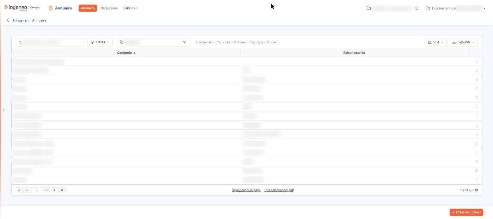

# Annuaire


**Où le trouver :** Menu **Annuaire**



**En bref** — Cet écran rassemble les coordonnées des interlocuteurs extérieurs de votre dossier (banques, notaires, organismes sociaux, administrations…), chacun rattaché à une catégorie qui indique sa nature.

* Pour n'afficher qu'une famille de contacts : choisissez-la dans la liste déroulante « Catégorie », la liste se met à jour seule ; le lien « Tout effacer » vous rend l'ensemble des contacts.
* Pour ajouter un contact : bouton \[Créer un contact], dans la barre du bas ; la catégorie choisie dans le critère est reprise dans la fiche.
* Pour modifier un contact : survolez sa ligne, pictogramme « Autres actions », puis « Modifier ».


L'annuaire rassemble les coordonnées des interlocuteurs extérieurs de votre dossier : banques, notaires, organismes sociaux, administrations… Chaque contact y est rattaché à une catégorie, qui indique la nature de l'interlocuteur.

<figure><figcaption>
Écran « Annuaire » de la nouvelle interface
</figcaption></figure>

C'est l'écran d'accueil du module : lorsque vous ouvrez l'annuaire, le logiciel vous y amène directement.

## Le critère de recherche

Au-dessus de la liste, la barre « Rechercher un contact… » vous permet de restreindre la liste : ce que vous saisissez devient un critère « \<colonne> Contient \<texte> » qui reste appliqué tant que vous ne l'avez pas retiré. À côté, le bouton **\[Filtres]** ouvre le volet de filtres, le bouton **\[Vue]** permet d'enregistrer ou de retrouver une présentation de la liste, d'afficher ou de masquer des colonnes (Tva intracommunautaire, Siren, Siret et Date de naissance sont proposées en plus des deux colonnes affichées d'origine) et de rétablir les colonnes d'origine, et le bouton **\[Exporter]** ouvre le menu des éditions de la liste (aperçu, impression, export Excel ou PDF, envoi par e-mail). Un critère est en outre proposé en liste déroulante, à droite du bouton \[Filtres].

**Catégorie** : liste déroulante qui reprend les catégories de l'annuaire, celles livrées avec le logiciel comme celles que votre cabinet a créées. Tant que vous n'avez rien choisi, la liste affiche « Catégorie » et tous vos contacts sont présentés.

Le logiciel mettra la liste à jour dès que vous aurez choisi une catégorie : vous n'avez aucun bouton à actionner. Le lien « Tout effacer » apparaît alors à droite du critère ; il remet celui-ci à vide et vous présente à nouveau l'ensemble de vos contacts.

## La liste des contacts

<figure><figcaption>
Bouton [Supprimer]
</figcaption></figure>

La liste présente un contact par ligne, avec deux colonnes : **Catégorie**, qui reprend le libellé de la catégorie du contact, et **Raison sociale**, qui porte son nom.

Un clic sur une ligne la sélectionne. Dès qu'une ligne est sélectionnée, un bandeau en bas de l'écran indique le nombre de contacts sélectionnés et porte le lien « Tout désélectionner » ainsi que le bouton **\[Supprimer]** ; sous la liste, « Sélectionner la page » et « Tout sélectionner » complètent la sélection. Les autres commandes habituelles des grilles du logiciel sont décrites à la rubrique « Fonctionnement d'une grille » des généralités.

Au survol d'une ligne, le pictogramme « Autres actions » (trois points verticaux, en dernière colonne) ouvre un petit menu de deux entrées : « Modifier » ouvre la fiche du contact, où vous consultez et modifiez ses coordonnées ; « Supprimer » supprime le contact.

## Les actions

bouton **\[Créer un contact]**

Ce bouton, placé dans la barre du bas de l'écran, ouvre la fiche d'un nouveau contact. Si vous aviez choisi une catégorie dans le critère de recherche, le logiciel la reprend dans la fiche : vous n'avez pas à la saisir de nouveau.

bouton **\[Supprimer]**

Ce bouton n'apparaît que dans le bandeau de sélection : il supprime les contacts que vous avez sélectionnés dans la liste.
