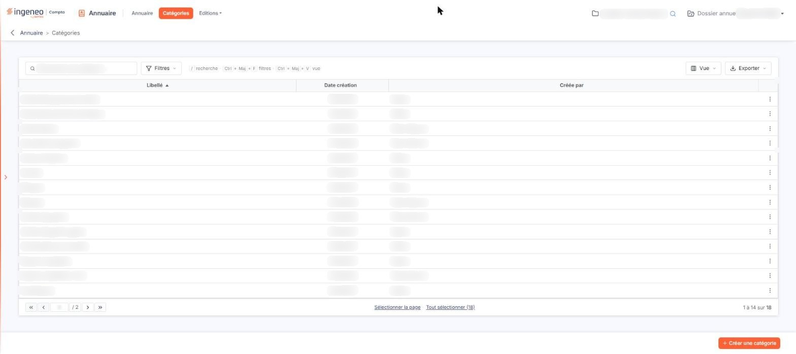
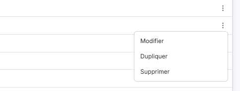

# Catégories


**Où le trouver :** Menu **Catégories**



**En bref** — Cet écran présente les catégories de l'annuaire, qui décrivent la nature d'un interlocuteur : celles livrées avec le logiciel et celles que votre cabinet a créées.

* Pour créer une catégorie : bouton \[Créer une catégorie], dans la barre du bas, en lui donnant un libellé qui n'existe pas déjà.
* Pour partir d'une catégorie livrée avec le logiciel : survolez sa ligne, pictogramme « Autres actions », puis « Dupliquer ».
* Pour supprimer des catégories : sélectionnez leurs lignes d'un clic, puis bouton \[Supprimer] du bandeau ; une catégorie utilisée par un contact ne peut pas être supprimée.


Cette option présente les catégories de l'annuaire. Une catégorie décrit la nature d'un interlocuteur — banque, notaire, organisme social… — et c'est elle qui vous permet de retrouver vos contacts par famille dans l'option « Annuaire ».

<figure><figcaption>
Écran « Catégories » de la nouvelle interface
</figcaption></figure>

Deux origines cohabitent dans cette liste : les catégories livrées avec le logiciel, créées en même temps que votre abonnement, et celles que votre cabinet a créées lui-même.

## La liste des catégories

<figure><figcaption>
Bouton [Supprimer]
</figcaption></figure>

Au-dessus de la liste, la barre « Rechercher une catégorie… » vous permet de restreindre la liste : ce que vous saisissez devient un critère « \<colonne> Contient \<texte> » qui reste appliqué tant que vous ne l'avez pas retiré. À côté, le bouton **\[Filtres]** ouvre le volet de filtres, le bouton **\[Vue]** permet d'enregistrer ou de retrouver une présentation de la liste et de rétablir les colonnes d'origine, et le bouton **\[Exporter]** ouvre le menu des éditions de la liste (aperçu, impression, export Excel ou PDF, envoi par e-mail).

La liste présente une catégorie par ligne, avec trois colonnes, toutes triables :

| Champ             | Ce qu'il faut savoir                                                                                                                                                  |
| ----------------- | --------------------------------------------------------------------------------------------------------------------------------------------------------------------- |
| **Libellé**       | Le nom de la catégorie. C'est lui, et lui seul, qui vous est présenté dans l'annuaire et dans son critère de recherche.                                               |
| **Date création** | La date à laquelle la catégorie a été créée.                                                                                                                          |
| **Créée par**     | L'origine de la catégorie. La mention « Editeur » désigne une catégorie livrée avec le logiciel ; un nom d'utilisateur désigne une catégorie créée par votre cabinet. |

Le libellé d'une catégorie doit être unique : si vous en reprenez un qui existe déjà, le logiciel refuse l'enregistrement et vous répond « Le libellé doit être unique. ». La casse n'entre pas en compte — « Banques » et « banques » sont pour lui le même libellé.

Un clic sur une ligne la sélectionne. Dès qu'une ligne est sélectionnée, un bandeau en bas de l'écran indique le nombre de catégories sélectionnées et porte le lien « Tout désélectionner » ainsi que le bouton **\[Supprimer]** ; sous la liste, « Sélectionner la page » et « Tout sélectionner » complètent la sélection. Les autres commandes habituelles des grilles du logiciel sont décrites à la rubrique « Fonctionnement d'une grille » des généralités.

## Les commandes d'une ligne

<figure><figcaption>
Rubrique « Les commandes d'une ligne »
</figcaption></figure>

Au survol d'une ligne, le pictogramme « Autres actions » (trois points verticaux, en dernière colonne) ouvre un petit menu : « Modifier » ouvre la fiche de la catégorie et « Dupliquer » la duplique. La duplication vous ouvre la fiche d'une nouvelle catégorie déjà renseignée des valeurs de celle que vous avez choisie : c'est le moyen de partir d'une catégorie livrée avec le logiciel pour en créer une qui vous soit propre.

L'entrée « Supprimer » de ce menu, elle, n'est pas proposée sur toutes les lignes : aucune catégorie livrée avec le logiciel ne la porte, et certaines catégories créées par le cabinet ne la portent pas non plus.

## Les actions

bouton **\[Créer une catégorie]**

Ce bouton, placé dans la barre du bas de l'écran, ouvre la fiche d'une nouvelle catégorie.

bouton **\[Supprimer]**

Ce bouton n'apparaît que dans le bandeau de sélection : il supprime les catégories que vous avez sélectionnées dans la liste.

Une catégorie utilisée par au moins un contact ne peut pas être supprimée : le logiciel refuse et vous l'indique en la nommant. Videz-la d'abord de ses contacts, ou rattachez-les à une autre catégorie.

Le logiciel traite les catégories sélectionnées l'une après l'autre et s'arrête à la première qu'il ne peut pas supprimer : celles qui la suivent dans votre sélection ne sont alors pas traitées. Après un refus, vérifiez donc ce qui reste dans la liste avant de recommencer.
