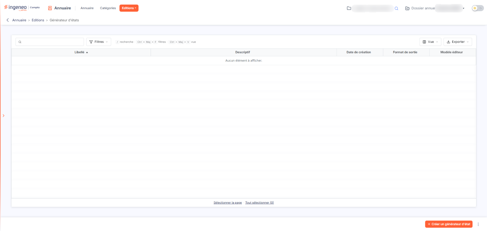
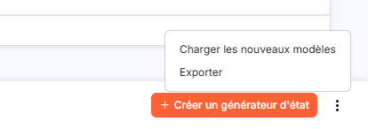
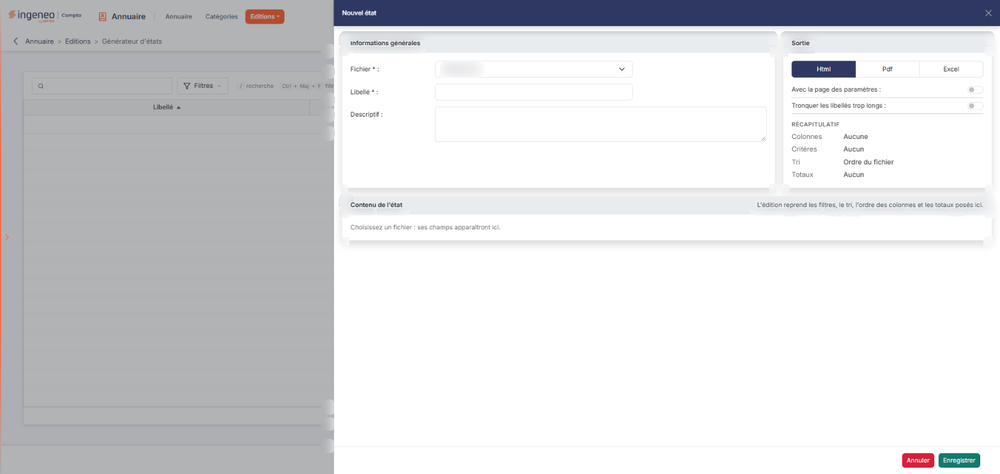
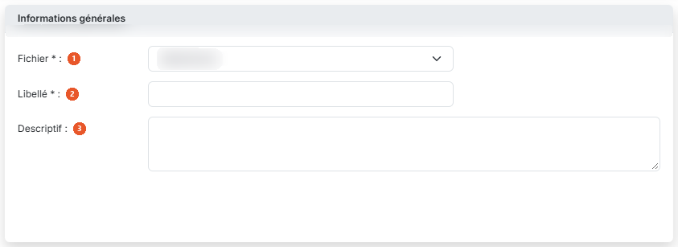
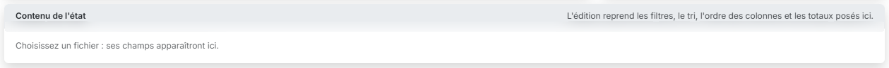
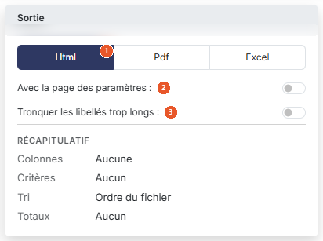
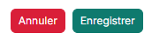

# Générateur d'états


**Où le trouver :** Menu **Editions › Générateur d'états**



**En bref** — Le générateur d'états vous permet de composer vos propres éditions sur les données de l'annuaire : données à éditer, colonnes et leur ordre, puis format du fichier produit.

* Pour composer un état : bouton \[Créer un générateur d'état], renseignez « Fichier » et « Libellé » dans le panneau « Nouvel état », choisissez le « Format de sortie », puis bouton \[Enregistrer].
* Pour supprimer des états : cochez-les dans la liste, puis bouton \[Supprimer].
* Pour ajouter les modèles livrés avec le logiciel : menu « Autres actions » (trois points verticaux), commande \[Charger les nouveaux modèles], choisissez les modèles, puis validez.


Le générateur d'états vous permet de composer vos propres éditions sur les données de l'annuaire : vous choisissez les données à éditer, les colonnes à faire figurer et leur ordre, puis le format du fichier produit.

<figure><figcaption>
Écran « Générateur d'états » de la nouvelle interface
</figcaption></figure>

L'écran présente la liste des états que vous avez déjà composés.

## La liste des états

La liste présente un état par ligne, avec cinq colonnes : **Libellé**, **Descriptif**, **Date de création**, **Format de sortie** et **Modèle éditeur**, cette dernière distinguant les états livrés avec le logiciel de ceux que vous avez composés vous-même. Un état livré avec le logiciel ne peut pas être modifié.

Tant que vous n'avez composé aucun état, la liste affiche « Aucun élément à afficher. ».

## Les actions

<figure><figcaption>
Bouton [Créer un générateur d'état]
</figcaption></figure>

<figure><figcaption>
Bouton [Exporter]
</figcaption></figure>

bouton **\[Créer un générateur d'état]**

Placé en bas à droite de l'écran, ce bouton ouvre à droite le panneau « Nouvel état », qui est la fiche d'un nouvel état, décrite ci-dessous.

bouton **\[Charger les nouveaux modèles]**

Cette commande se trouve dans le menu « Autres actions » (trois points verticaux), à droite de \[Créer un générateur d'état]. Elle ouvre la fenêtre « Nouveaux modèles » : vous y choisissez les modèles que vous voulez charger, puis vous validez. Ils viennent alors s'ajouter à votre liste. Lorsqu'aucun modèle n'est disponible, la fenêtre vous l'indique par le message « Il n'existe aucun modèle disponible. » et vous la fermez par le bouton **\[OK]**.

bouton **\[Exporter]**

Cette commande se trouve dans le même menu « Autres actions », avec \[Charger les nouveaux modèles]. Elle copie les états que vous avez sélectionnés vers d'autres sociétés gérées.

bouton **\[Supprimer]**

Ce bouton supprime les états que vous avez cochés dans la liste.

## La fiche d'un état

<figure><figcaption>
Rubrique « c) La fiche d'un état »
</figcaption></figure>

La fiche s'ouvre dans un panneau à droite de l'écran, intitulé « Nouvel état », et se compose de trois cartes : « Informations générales », « Sortie » et « Contenu de l'état ».

## Informations générales

<figure><figcaption>
Rubrique « Informations générales »
</figcaption></figure>

| Champ             | Ce qu'il faut savoir                                                                                                                                                                                                 |
| ----------------- | -------------------------------------------------------------------------------------------------------------------------------------------------------------------------------------------------------------------- |
| 1. **Fichier**    | Champ obligatoire. Vous y désignez les données de l'annuaire sur lesquelles l'état est bâti. C'est ce choix qui commande la suite de la fiche : tant qu'il n'est pas renseigné, aucune colonne ne vous est proposée. |
| 2. **Libellé**    | Champ obligatoire. Le nom sous lequel l'état apparaîtra dans la liste.                                                                                                                                               |
| 3. **Descriptif** | Un commentaire libre.                                                                                                                                                                                                |

## Contenu de l'état

<figure><figcaption>
Rubrique « Contenu de l'état »
</figcaption></figure>

Cette carte porte les colonnes de l'édition : une phrase en tête de carte rappelle que l'édition reprend les filtres, le tri, l'ordre des colonnes et les totaux posés ici. Tant qu'aucun fichier n'est choisi, elle affiche « Choisissez un fichier : ses champs apparaîtront ici. ». Une fois un fichier choisi, elle propose deux menus : le bouton **\[Filtres]**, où l'on pose des critères et où se règle « Combiner les critères » (« Tous (ET) » ou « Au moins un (OU) »), et le bouton **\[Colonnes]**, qui liste les champs avec leur affichage, leur tri et leur total.

## Sortie

<figure><figcaption>
Rubrique « Sortie »
</figcaption></figure>

<figure><figcaption>
Bouton [Annuler]
</figcaption></figure>

<figure><figcaption>
Bouton [Enregistrer]
</figcaption></figure>

| Champ                                   | Ce qu'il faut savoir                                                                                                       |
| --------------------------------------- | -------------------------------------------------------------------------------------------------------------------------- |
| 1. **Format de sortie**                 | « Html », « Pdf » ou « Excel », en trois boutons juxtaposés placés en tête de la carte. « Html » est retenu à l'ouverture. |
| 2. **Avec la page des paramètres**      | Interrupteur, désactivé à l'ouverture.                                                                                     |
| 3. **Tronquer les libellés trop longs** | Interrupteur, désactivé à l'ouverture.                                                                                     |

Un « Récapitulatif » résume l'état en cours de composition : colonnes, critères, tri et totaux.

Le pied du panneau porte deux boutons : bouton **\[Annuler]**, qui referme le panneau sans rien enregistrer, et bouton **\[Enregistrer]**.
