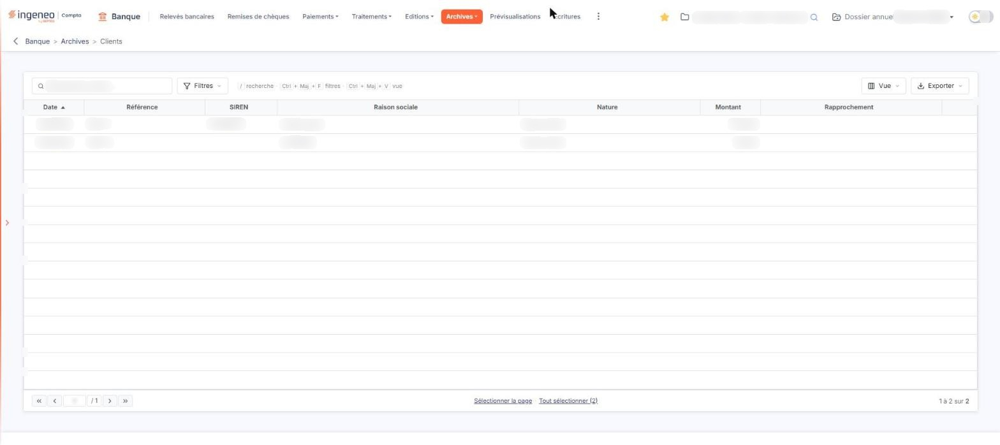

# Événements clients archivés


**Où le trouver :** Menu **Archives › Clients**



**En bref** — Cet écran conserve les événements clients archivés (factures, avoirs) : ils ne sont plus proposés au rapprochement mais restent consultables.

* Pour retrouver un événement : saisissez un tiers dans « Rechercher un tiers… » ou utilisez le bouton \[Filtres].
* Pour consulter la pièce d'origine : icône « Télécharger » de la ligne.
* Pour imprimer ou exporter la liste : bouton \[Exporter].


Cet écran conserve les événements clients qui ont été archivés. Un événement client est une pièce commerciale — une facture, un avoir — que le logiciel rapproche des lignes de vos relevés bancaires pour identifier le règlement correspondant. Une fois archivé, l'événement n'est plus proposé au rapprochement : il reste consultable ici, et vous pouvez l'en faire ressortir.

<figure><figcaption>
Écran « Clients » de la nouvelle interface
</figcaption></figure>

Ne confondez pas cette option avec l'option « Clients » du menu « Evénements », qui porte le même libellé mais présente les événements **actifs**. Seul le menu dont vous partez les distingue. Depuis cet écran, le menu « Evénements » se trouve dans le menu ⋮ « Plus d'entrées » de la barre de menus.

**Les colonnes de la liste**

L'écran est une liste pleine page, sans onglet. Elle est triée par défaut sur la date, de la plus ancienne à la plus récente, et chacune de ses colonnes est triable et redimensionnable :

| Champ              | Ce qu'il faut savoir                                                                  |
| ------------------ | ------------------------------------------------------------------------------------- |
| **Date**           | La date de la pièce.                                                                  |
| **Référence**      | La référence de la pièce, telle qu'elle a été transmise au module.                    |
| **SIREN**          | Le numéro SIREN du client. Il peut être vide, la donnée n'étant pas toujours fournie. |
| **Raison sociale** | Le nom du client.                                                                     |
| **Nature**         | La nature de la pièce, par exemple « Facture client ».                                |
| **Montant**        | Le montant de la pièce.                                                               |
| **Rapprochement**  | L'information de rapprochement de la pièce avec une ligne de relevé bancaire.         |

Ces sept colonnes sont toutes affichées : il n'y a pas de colonne supplémentaire à faire apparaître. Le bas de la liste porte le pagineur habituel, le rappel du nombre de lignes affichées sur le total et les liens « Sélectionner la page » et « Tout sélectionner » suivi du nombre de lignes.

**La barre au-dessus de la liste**

Au-dessus de la liste figurent un champ de recherche « Rechercher un tiers… » et trois boutons :

* le bouton \[Filtres], dont le menu permet d'ajouter un critère sur une colonne (entrées « Ajouter un critère sur… », « Filtrer », « Vider les filtres » et « Tout effacer »),
* le bouton \[Vue], dont le menu règle l'affichage des colonnes (entrées « Rechercher une colonne », « Rétablir les colonnes d'origine », « Appliquer » et « Enregistrer la vue actuelle »),
* le bouton \[Exporter], dont le menu propose « Aperçu édition HTML », « Imprimer », « Exporter en Excel », « Exporter en PDF » et « Envoyer la liste par e-mail ».

Pour retrouver un événement archivé, vous disposez de la recherche, des filtres, du tri des colonnes et du pagineur ; l'impression et l'export de la liste se font par le bouton \[Exporter].

**Les commandes de chaque ligne**

Chaque ligne porte deux commandes :

* une icône dont l'infobulle est « Télécharger » : elle vous présente le document d'origine de l'événement,
* un bouton ⋮ dont l'infobulle est « Autres actions » ; sur les lignes de cet écran, aucune entrée n'y figure.

**Attention à l'aperçu.** Lorsque le document d'origine n'est plus disponible, le logiciel affiche le message « Impossible de visualiser l'événement. Le document recherché a été supprimé. » — **et il vous dépose sur un autre écran**. En fermant ce message, vous ne revenez pas sur les archives : vous vous retrouvez sur l'option « Clients » du menu « Evénements », qui contient les événements actifs et propose une commande de suppression. Vérifiez donc où vous êtes avant votre action suivante, et revenez par le menu « Archives » si vous vouliez rester sur les archives.

bouton **\[Restaurer]**

Sur la nouvelle interface, ce bouton n'est plus affiché en bas de l'écran : l'écran ne porte plus aucun bouton en pied. La façon de restaurer un événement archivé n'a pas pu être vérifiée ; la description qui suit est celle de l'ancienne interface.

Cochez les lignes voulues — vous pouvez les sélectionner sur plusieurs pages — puis cliquez sur ce bouton : le logiciel désarchive les événements cochés. Ils quittent cette liste et réapparaissent dans l'option « Clients » du menu « Evénements », où ils sont de nouveau proposés au rapprochement avec vos lignes de relevés.

Si vous n'avez coché aucune ligne, rien n'est restauré.

Cet écran ne comporte ni création, ni modification, ni suppression : les événements y arrivent par l'archivage, et n'en sortent que par la restauration.

Les commandes de cet écran dépendent de votre profil : selon les droits qui vous ont été accordés, l'aperçu comme la restauration peuvent ne pas vous être proposés.
