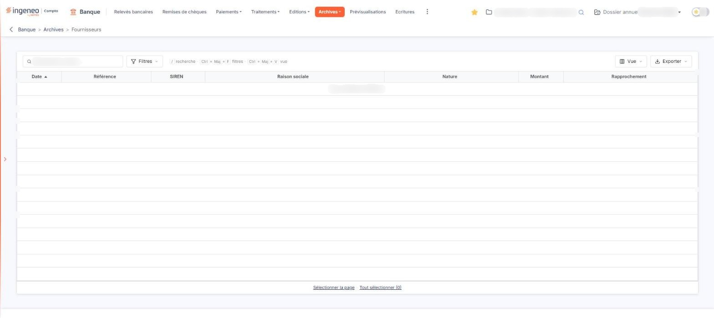

# Événements fournisseurs archivés


**Où le trouver :** Menu **Archives › Fournisseurs**



**En bref** — Cet écran conserve les événements fournisseurs archivés (factures, avoirs) : ils ne sont plus proposés au rapprochement mais restent consultables.

* Pour retrouver un événement : saisissez un tiers dans « Rechercher un tiers… » ou utilisez le bouton \[Filtres].
* Pour choisir les colonnes affichées : bouton \[Vue].
* Pour imprimer ou exporter la liste : bouton \[Exporter].


Cet écran conserve les événements fournisseurs qui ont été archivés. Un événement fournisseur est une pièce commerciale — une facture, un avoir — que le logiciel rapproche des lignes de vos relevés bancaires pour identifier le paiement correspondant. Une fois archivé, l'événement n'est plus proposé au rapprochement : il reste consultable ici.

<figure><figcaption>
Écran « Fournisseurs » de la nouvelle interface
</figcaption></figure>

Ne confondez pas cette option avec l'option « Fournisseurs » du menu « Evénements », qui porte le même libellé mais présente les événements **actifs**. Seul le menu dont vous partez les distingue. Depuis cet écran, le menu « Evénements » se trouve dans le menu ⋮ « Plus d'entrées » de la barre de menus.

L'écran est construit exactement comme l'option « Clients » du même menu « Archives » : mêmes colonnes, même barre au-dessus de la liste. Seule la nature des tiers concernés change.

**Les colonnes de la liste**

L'écran est une liste pleine page, sans onglet. Elle est triée par défaut sur la date, de la plus ancienne à la plus récente, et chacune de ses colonnes est triable :

| Champ              | Ce qu'il faut savoir                                                          |
| ------------------ | ----------------------------------------------------------------------------- |
| **Date**           | La date de la pièce.                                                          |
| **Référence**      | La référence de la pièce, telle qu'elle a été transmise au module.            |
| **SIREN**          | Le numéro SIREN du fournisseur.                                               |
| **Raison sociale** | Le nom du fournisseur.                                                        |
| **Nature**         | La nature de la pièce.                                                        |
| **Montant**        | Le montant de la pièce.                                                       |
| **Rapprochement**  | L'information de rapprochement de la pièce avec une ligne de relevé bancaire. |

Ces sept colonnes sont toutes affichées : il n'y a pas de colonne supplémentaire à faire apparaître.

Lorsque l'écran ne contient aucun événement archivé, le logiciel affiche à la place de la liste la mention « Aucun élément à afficher. », et le bas de la liste ne porte alors ni pagineur ni compteur, mais les liens « Sélectionner la page » et « Tout sélectionner (0) ».

**La barre au-dessus de la liste**

Au-dessus de la liste figurent un champ de recherche « Rechercher un tiers… » et trois boutons :

* le bouton \[Filtres], dont le menu permet d'ajouter un critère sur une colonne (entrées « Ajouter un critère sur… », « Filtrer », « Vider les filtres » et « Tout effacer »),
* le bouton \[Vue], dont le menu règle l'affichage des colonnes (entrées « Rechercher une colonne », « Rétablir les colonnes d'origine », « Appliquer » et « Enregistrer la vue actuelle »),
* le bouton \[Exporter], dont le menu propose « Aperçu édition HTML », « Imprimer », « Exporter en Excel », « Exporter en PDF » et « Envoyer la liste par e-mail ».

Pour retrouver un événement archivé, vous disposez de la recherche, des filtres, du tri des colonnes et du pagineur ; l'impression et l'export de la liste se font par le bouton \[Exporter].

bouton **\[Restaurer]**

Sur la nouvelle interface, ce bouton n'est plus affiché en bas de l'écran : sur la liste vide, l'écran ne porte aucun bouton en pied. La façon de restaurer un événement archivé n'a pas pu être vérifiée.

Les commandes de cet écran dépendent de votre profil : selon les droits qui vous ont été accordés, l'aperçu comme la restauration peuvent ne pas vous être proposés.
