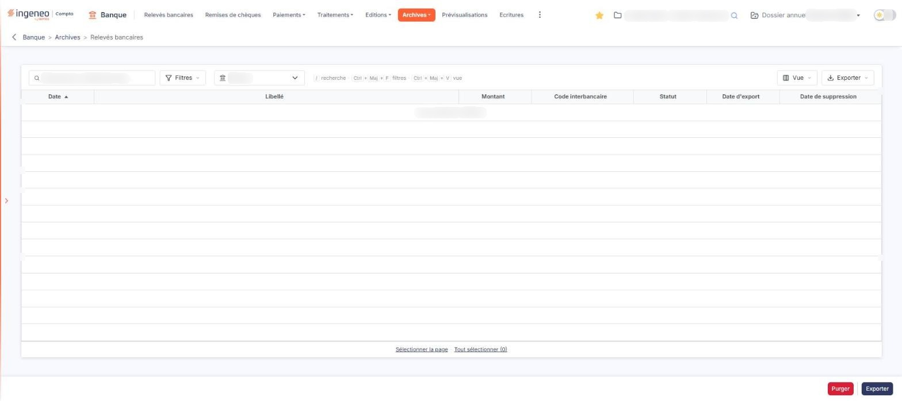

# Relevés bancaires archivés


**Où le trouver :** Menu **Archives › Relevés bancaires**



**En bref** — Cet écran présente les lignes de relevés bancaires archivées, avec un filtre par compte bancaire et des colonnes que vous pouvez faire apparaître ou masquer.

* Pour n'afficher qu'un compte : choisissez-le dans la liste « Banque », au-dessus de la liste.
* Pour faire apparaître les colonnes masquées (« N° de compte banque », « Type de compte », « Banque ») : bouton \[Vue].
* Pour obtenir un fichier CFONB des lignes archivées : bouton \[Exporter] en bas de l'écran.


Cet écran présente les lignes de relevés bancaires archivées. C'est le plus outillé des trois écrans du menu « Archives » : il dispose d'un filtre par compte bancaire, des boutons \[Filtres] et \[Exporter] (filtres, impression et export de la liste), et de colonnes que vous pouvez faire apparaître ou masquer.

<figure><figcaption>
Écran « Relevés bancaires » de la nouvelle interface
</figcaption></figure>

Ne confondez pas cette option avec l'option « Relevés bancaires » de premier niveau, qui porte exactement le même libellé mais présente les lignes **en cours**. Seul le menu dont vous partez les distingue.

**Le filtre au-dessus de la liste**

| Champ                   | Ce qu'il faut savoir                                                                                                                                                                                                                                                                                                                                                                                                                                                                                                                                                                    |
| ----------------------- | --------------------------------------------------------------------------------------------------------------------------------------------------------------------------------------------------------------------------------------------------------------------------------------------------------------------------------------------------------------------------------------------------------------------------------------------------------------------------------------------------------------------------------------------------------------------------------------- |
| **Banque**              | 
Cette liste déroulante vous permet de n'afficher que les lignes archivées d'un compte bancaire donné. Elle reprend les comptes déclarés dans l'option « Banques » du panneau « Paramètres » (Données, catégorie « Dossier et comptabilité »). À l'ouverture de l'écran, elle est positionnée sur « Toutes » et le logiciel affiche donc les lignes de tous vos comptes. <strong>Les colonnes de la liste</strong> La liste est triée par défaut sur la date, de la plus ancienne à la plus récente, et chacune de ses colonnes est triable. Sept colonnes sont affichées :
 |
| **Date**                | La date de l'opération sur le relevé.                                                                                                                                                                                                                                                                                                                                                                                                                                                                                                                                                   |
| **Libellé**             | Le libellé de l'opération, tel que votre banque l'a transmis.                                                                                                                                                                                                                                                                                                                                                                                                                                                                                                                           |
| **Montant**             | Le montant de l'opération.                                                                                                                                                                                                                                                                                                                                                                                                                                                                                                                                                              |
| **Code interbancaire**  | Le code de nature d'opération fourni par votre banque.                                                                                                                                                                                                                                                                                                                                                                                                                                                                                                                                  |
| **Statut**              | L'état de la ligne au moment de son archivage.                                                                                                                                                                                                                                                                                                                                                                                                                                                                                                                                          |
| **Date d'export**       | La date à laquelle la ligne a été exportée.                                                                                                                                                                                                                                                                                                                                                                                                                                                                                                                                             |
| **Date de suppression** | La date à laquelle la ligne a été supprimée.                                                                                                                                                                                                                                                                                                                                                                                                                                                                                                                                            |

Lorsque l'écran ne contient aucune ligne archivée, le logiciel affiche à la place de la liste la mention « Aucun élément à afficher. », et le bas de la liste ne porte alors ni pagineur ni compteur, mais les liens « Sélectionner la page » et « Tout sélectionner (0) ».

**La barre au-dessus de la liste**

Au-dessus de la liste figurent le champ de recherche « Rechercher un libellé de ligne… », la liste déroulante « Banque » décrite plus haut et trois boutons :

* le bouton \[Filtres], dont le menu permet d'ajouter un critère sur une colonne (entrées « Ajouter un critère sur… », « Filtrer », « Vider les filtres » et « Tout effacer »),
* le bouton \[Vue], dont le menu règle l'affichage des colonnes (entrées « Rechercher une colonne », « Rétablir les colonnes d'origine », « Appliquer » et « Enregistrer la vue actuelle »),
* le bouton \[Exporter], dont le menu propose « Aperçu édition HTML », « Imprimer », « Exporter en Excel », « Exporter en PDF » et « Envoyer la liste par e-mail ».

**Le menu \[Filtres]**

Le bouton \[Filtres] ouvre un menu qui remplace l'ancienne fenêtre « Filtres » : « Ajouter un critère sur… » vous permet de choisir une colonne pour y poser un critère ; « Filtrer » applique vos critères à la liste, « Vider les filtres » et « Tout effacer » les retirent.

bouton **\[Restaurer]**

Sur la nouvelle interface, ce bouton n'est plus affiché en bas de l'écran : le pied ne porte plus que \[Purger] et \[Exporter]. La façon de restaurer des lignes archivées n'a pas pu être vérifiée (liste vide).

bouton **\[Exporter]**

Ce bouton, en bas à droite de l'écran, est distinct du bouton \[Exporter] de la barre au-dessus de la liste, dont le menu exporte la liste elle-même (Excel, PDF).

Il vous restitue vos lignes archivées sous forme de fichier au format CFONB, celui-là même que votre banque emploie pour vous transmettre vos relevés. Vous pouvez donc réimporter ce fichier par l'option « Import CFONB » du menu « Traitements ».

Ce bouton ne travaille pas sur votre sélection mais sur le **filtre « Banque »** placé au-dessus de la liste : il exporte les lignes archivées du compte retenu, ou de tous vos comptes si le filtre est resté sur « Toutes ».

bouton **\[Supprimer]**

Sur la nouvelle interface, ce bouton n'est plus affiché en bas de l'écran. S'il existe encore ailleurs (par exemple dans le bandeau qui apparaît quand des lignes sont sélectionnées), cela n'a pas pu être vérifié (liste vide).

bouton **\[Purger]**

**Attention.** Il ne travaille **pas** sur votre sélection : il vide **la totalité de vos archives de relevés bancaires**, sans considération du filtre « Banque » ni des lignes cochées. Le logiciel vous indique ensuite le nombre de lignes supprimées.

C'est la commande la plus lourde de l'écran ; elle est présentée en rouge. N'y recourez qu'après avoir vérifié que plus aucune de ces lignes ne vous est utile — et, si vous souhaitez en garder une trace, après les avoir exportées.

Les deux boutons du pied, \[Purger] et \[Exporter], restent affichés même lorsque la liste est vide.

Les commandes de cet écran dépendent de votre profil : selon les droits qui vous ont été accordés, certaines peuvent ne pas vous être proposées.
