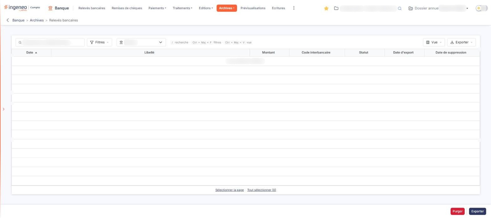

# Relevés bancaires


**Où le trouver :** Menu **Archives › Relevés bancaires**



**En bref** — Cette page présente le menu « Archives », qui regroupe les éléments déjà traités ou supprimés et déploie ses trois sous-options : Clients, Fournisseurs et Relevés bancaires.

* Pour consulter les archives : cliquez sur « Archives », puis choisissez « Clients », « Fournisseurs » ou « Relevés bancaires ».


* **« Clients »** : les événements clients archivés,
* **« Fournisseurs »** : les événements fournisseurs archivés,
* **« Relevés bancaires »** : les lignes de relevés bancaires pour lesquelles les écritures comptables ont été générées, ainsi que les lignes qui avaient été importées puis supprimées.

<figure><figcaption>
Écran « Relevés bancaires » de la nouvelle interface
</figcaption></figure>

Les trois se présentent de la même façon : une liste, avec au-dessus un champ de recherche et les boutons \[Filtres], \[Vue] et \[Exporter].

**Sur la nouvelle interface, le bouton \[Restaurer] n'est plus affiché en bas de ces écrans** : « Clients » et « Fournisseurs » n'ont plus aucun bouton en pied, et « Relevés bancaires » n'a plus que les boutons \[Purger] et \[Exporter]. La façon de restaurer des éléments n'a pas pu être vérifiée (aucune ligne d'archive n'a été sélectionnée).

Chacun des trois écrans a par ailleurs ses propres colonnes. Seul l'écran « Relevés bancaires » comporte la liste déroulante « Banque » dans la barre, ainsi que des boutons en pied (les boutons \[Purger] et \[Exporter]). Reportez-vous à la page d'aide de la sous-option concernée.
