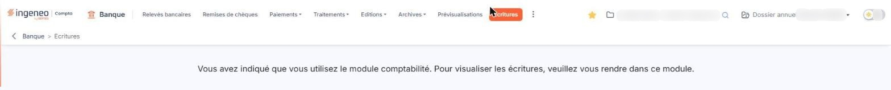

# Ecritures


**Où le trouver :** Menu **Ecritures**



**En bref** — Cet écran rassemble les écritures générées en attente d'export vers un autre logiciel de comptabilité ; il n'a rien à montrer si vos écritures partent directement en comptabilité.

* Pour envoyer les écritures à votre logiciel de comptabilité : bouton \[Exporter], choisissez le modèle d'export et l'origine, puis enregistrez le fichier généré.
* Pour limiter l'affichage : choisissez une valeur dans les sélecteurs « Origine » ou « Journal ».


**Si ce paramètre vaut « Oui »**

<figure><figcaption>
Écran « Ecritures » de la nouvelle interface
</figcaption></figure>

L'écran ne présente ni grille, ni bouton : il affiche une seule phrase, « Vous avez indiqué que vous utilisez le module comptabilité. Pour visualiser les écritures, veuillez vous rendre dans ce module. »

Ce n'est pas une anomalie. Vos écritures bancaires sont directement créées dans votre comptabilité au fur et à mesure : c'est donc dans le module « Comptabilité » qu'il faut les consulter, et cette option n'a rien à vous montrer.

**Si ce paramètre vaut « Non »**

Les écritures générées sont conservées ici, en attente d'export. La grille est commune à tous les modules du logiciel : si des écritures ont été générées par un autre module, la gestion commerciale par exemple, elles y figurent également et sont exportables. Les écritures sont générées au format FEC.

## Sélecteur « Origine »

Il vous permet de filtrer les écritures selon le module qui les a générées. Le choix « Tous » regroupe toutes les écritures en attente d'export.

## Sélecteur « Journal »

Il vous permet de filtrer les écritures par code journal. Le choix « Tous » regroupe toutes les écritures en attente d'export.

## Pictogramme « Œil »

Si une pièce a été associée à une ligne d'écriture, cliquez sur ce pictogramme pour la visualiser.

## Totaux

Les totaux débit, crédit et le solde sont là pour contrôle. Si le solde n'était pas égal à 0, contactez la maintenance Ingeneo Compta.

bouton **\[Exporter]**

Il génère le fichier d'écritures que vous pourrez ensuite importer dans votre logiciel de comptabilité.

Indiquez le modèle d'export sur la base duquel vous souhaitez exporter les écritures, ainsi que l'origine des écritures à exporter : vous pouvez n'exporter que celles générées par le module en cours, ou toutes les écritures présentes.

Si le modèle d'export dont vous avez besoin ne figure pas dans la liste, vous pouvez le créer dans le panneau « Paramètres » : rubrique « Modèles », « Imports et exports », onglet « Ecritures ».

Lorsque le fichier est généré, enregistrez-le sur votre poste pour pouvoir l'adresser ensuite à votre logiciel de comptabilité.
