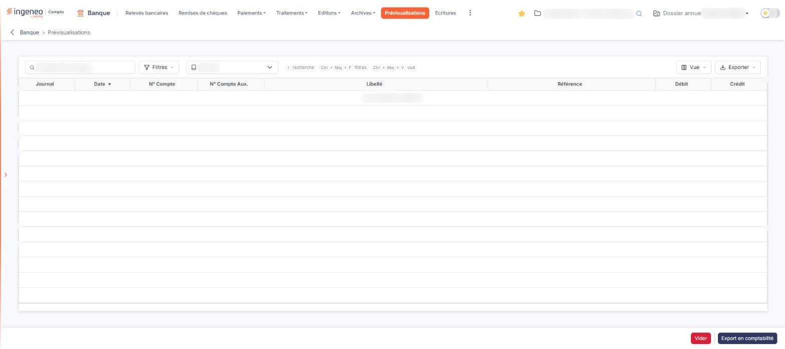

# Prévisualisations


**Où le trouver :** Menu **Prévisualisations**



**En bref** — Cet écran permet de contrôler les écritures générées avant leur export en comptabilité, afin de vérifier l'efficacité de vos règles de traduction.

* Pour envoyer les écritures en comptabilité : choisissez le journal dans la liste « Journal », puis bouton \[Export en comptabilité].
* Pour corriger vos règles et recommencer : bouton \[Vider], modifiez vos règles de traduction, puis relancez la génération depuis « Relevés bancaires ».


## D'où viennent les lignes de cet écran

<figure><figcaption>
Écran « Prévisualisations » de la nouvelle interface
</figcaption></figure>

La liste ne se remplit pas d'elle-même : elle est alimentée par le bouton **\[Génération des écritures]** de l'option « Relevés bancaires ». Tant que vous n'avez lancé aucune génération, le logiciel affiche le message « Aucun élément à afficher. ».

Si la prévisualisation a été activée, la liste contient ensuite toutes les écritures générées et en attente d'export en comptabilité.

Quand la prévisualisation est activée, la génération des écritures comptables n'archive pas les lignes de relevés. Vous pouvez donc supprimer les écritures présentes dans la prévisualisation, modifier une ou plusieurs règles de traduction, puis générer à nouveau les écritures depuis l'option « Relevés bancaires ».

## La liste « Journal »

Dans la barre au-dessus de la liste, la liste « Journal » vous permet de n'afficher que les écritures d'un journal. Sa valeur par défaut, « Journal », n'applique aucun filtre et affiche les écritures de tous les journaux. Les autres valeurs proposées dépendent des journaux paramétrés pour votre société.

## La liste des écritures

La liste comporte huit colonnes, toutes affichées et toutes triables en cliquant sur leur en-tête.

| Champ              | Ce qu'il faut savoir                                |
| ------------------ | --------------------------------------------------- |
| **Journal**        | Code du journal dans lequel l'écriture sera passée. |
| **Date**           | Date de l'écriture.                                 |
| **N° Compte**      | Compte général mouvementé.                          |
| **N° Compte Aux.** | Compte auxiliaire mouvementé.                       |
| **Libellé**        | Libellé de la ligne d'écriture.                     |
| **Référence**      | Référence de la ligne d'écriture.                   |
| **Débit**          | Montant porté au débit.                             |
| **Crédit**         | Montant porté au crédit.                            |

La barre au-dessus de la liste regroupe, de gauche à droite : le champ « Rechercher une ligne… », le bouton \[Filtres], la liste « Journal » et les boutons \[Vue] et \[Exporter]. Une aide rappelle les raccourcis : « / » pour la recherche, Ctrl + Maj + F pour les filtres et Ctrl + Maj + V pour la vue.

* le bouton **\[Filtres]** ouvre un menu « Filtrer » : la liste « + Ajouter un critère sur… » propose un critère par colonne. Le bouton **\[Filtrer]** applique vos critères et le bouton **\[Vider les filtres]** les efface ; le lien « Tout effacer » apparaît à côté du bouton \[Filtres] dès qu'un critère est posé,
* le bouton **\[Vue]** ouvre le menu « Mes vues » (enregistrer la vue actuelle sous un nom), puis « Colonnes affichées » : une case par colonne. Le bouton **\[Appliquer]** valide vos choix et le bouton **\[Rétablir les colonnes d'origine]** rétablit la présentation d'origine,
* le bouton **\[Exporter]** ouvre un menu : « Aperçu édition HTML », « Imprimer » (Ctrl + P), « Exporter en Excel », « Exporter en PDF » et « Envoyer la liste par e-mail ».

Cette liste ne comporte pas de case à cocher : vous ne sélectionnez pas les écritures une à une, et les deux boutons de bas d'écran agissent sur un ensemble d'écritures.

## Les boutons de bas d'écran

bouton **\[Export en comptabilité]**

Si les écritures vous conviennent, ce bouton les exporte en comptabilité. Les lignes de relevés sont alors archivées.

L'export ne porte que sur le journal choisi dans la liste « Journal » ; pour tout exporter en une fois, laissez cette liste sur « Journal ».

Le logiciel vous indique ensuite le nombre de lignes exportées.

bouton **\[Vider]**

Ce bouton supprime les écritures présentes dans la prévisualisation. Les lignes de relevés n'ayant pas été archivées, vous pouvez corriger vos règles de traduction et relancer la génération des écritures.


Attention : contrairement à l'export, ce bouton vide la prévisualisation **en entier**, quel que soit le journal affiché dans la liste « Journal ».


Ces deux boutons restent actifs même lorsque la liste est vide. Ils ne sont proposés qu'aux utilisateurs qui en ont le droit.
