# Relevés bancaires


**Où le trouver :** Menu **Relevés bancaires**



**En bref** — Écran principal du module : il affiche les lignes de relevés récupérées et leur état de reconnaissance, et permet de les corriger, de créer des règles de traduction et de générer les écritures comptables.

* Pour ne voir que les lignes d'un compte : choisissez-le dans la liste « Banque », à côté du bouton \[Filtres].
* Pour corriger plusieurs lignes d'un coup : sélectionnez-les, bouton \[Modification groupée], renseignez les champs voulus, puis bouton \[Valider].
* Pour produire les écritures comptables : sélectionnez les lignes, puis bouton \[Génération des écritures].


## Les onglets, la recherche et le sélecteur « Banque »

<figure>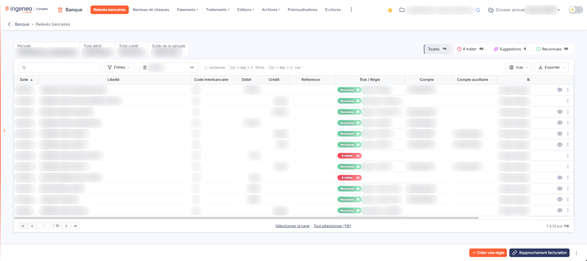<figcaption>
Écran « Relevés bancaires » de la nouvelle interface
</figcaption></figure>

<figure>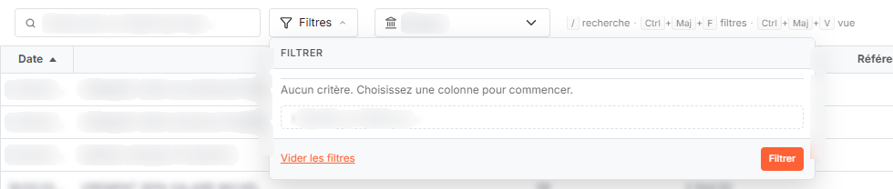<figcaption>
Bouton [Filtres]
</figcaption></figure>

Au-dessus de la liste, un bandeau rappelle la **Période** couverte, le **Total débit**, le **Total crédit** et le **Solde de la période** ; quand vous sélectionnez une ligne, ces chiffres se limitent à la sélection. À droite, quatre onglets comptent et regroupent les lignes : **Toutes**, **À traiter**, **Suggestions** et **Reconnues**, chacun suivi du nombre de lignes concernées.

Le champ « Rechercher un libellé de ligne… » cherche dans le libellé des lignes. La liste « Banque », à côté du bouton \[Filtres], vous permet de n'afficher que les lignes d'un compte bancaire. Sa valeur par défaut, « Banque », n'applique aucun filtre et affiche les lignes de tous les comptes. Les autres valeurs proposées dépendent des comptes bancaires paramétrés pour votre société.

Ce sélecteur n'apparaît que si plusieurs comptes bancaires sont paramétrés : avec un seul compte, il n'aurait rien à filtrer. Dès que vous choisissez un compte, le lien « Tout effacer » apparaît à côté de la liste pour revenir à l'affichage complet.

## La liste des lignes de relevés

<figure>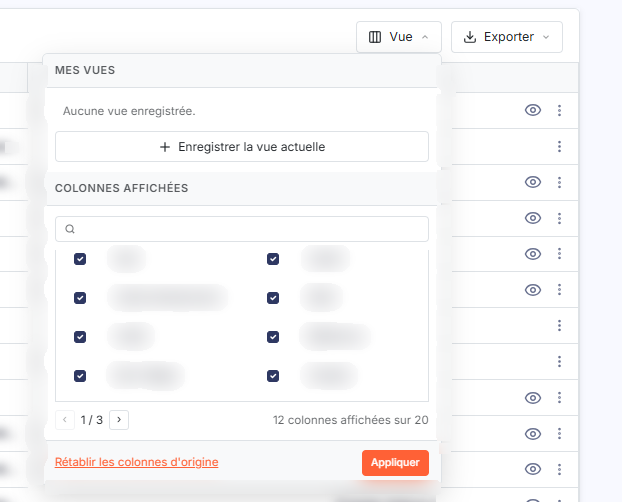<figcaption>
Bouton [Vue]
</figcaption></figure>

La liste présente les lignes de relevés telles qu'elles ont été émises par votre banque, complétées par le résultat de l'analyse des règles de traduction.

Douze colonnes sont affichées par défaut :

| Champ                     | Ce qu'il faut savoir                                                                                                                                                                                                                                                                                                                               |
| ------------------------- | -------------------------------------------------------------------------------------------------------------------------------------------------------------------------------------------------------------------------------------------------------------------------------------------------------------------------------------------------- |
| **Date**                  | Date de l'opération telle que la banque l'a communiquée.                                                                                                                                                                                                                                                                                           |
| **Libellé**               | Libellé de l'opération.                                                                                                                                                                                                                                                                                                                            |
| **Code interbancaire**    | Code de nature de l'opération communiqué par la banque.                                                                                                                                                                                                                                                                                            |
| **Débit**                 | Montant de l'opération lorsqu'elle est portée au débit du compte bancaire.                                                                                                                                                                                                                                                                         |
| **Crédit**                | Montant de l'opération lorsqu'elle est portée au crédit du compte bancaire.                                                                                                                                                                                                                                                                        |
| **Référence**             | Référence de l'opération.                                                                                                                                                                                                                                                                                                                          |
| **État / Règle**          | Une pastille verte « Reconnue » ou rouge « À traiter », chacune accompagnée d'un petit pictogramme, suivie de ce qui a reconnu la ligne : « Règle · » et le libellé de la règle de traduction, « Affectation · » et l'affectation retenue, ou « Événement · » et l'événement client ou fournisseur rapproché ; l'infobulle donne le texte complet. |
| **Compte**                | Compte général de contrepartie retenu pour la ligne.                                                                                                                                                                                                                                                                                               |
| **Compte auxiliaire**     | Compte auxiliaire de contrepartie retenu pour la ligne.                                                                                                                                                                                                                                                                                            |
| **Banque**                | Compte bancaire d'origine de la ligne.                                                                                                                                                                                                                                                                                                             |
| **Origine**               | Origine de la ligne (« Powens » sur toutes les lignes du dossier observé).                                                                                                                                                                                                                                                                         |
| **Date d'import**         | 
Date à laquelle la ligne a été récupérée dans le logiciel. Huit colonnes supplémentaires existent mais ne sont pas affichées par défaut ; vous pouvez les faire apparaître avec le bouton [Vue], rubrique « Colonnes affichées » (voir ci-dessous) :
                                                                                     |
| **Montant**               | Montant de l'opération.                                                                                                                                                                                                                                                                                                                            |
| **Règle reconnue**        | Libellé de la règle de traduction que le logiciel a reconnue sur la ligne.                                                                                                                                                                                                                                                                         |
| **Affectation**           | Affectation retenue pour la ligne.                                                                                                                                                                                                                                                                                                                 |
| **Evénement**             | Événement client ou fournisseur rapproché de la ligne.                                                                                                                                                                                                                                                                                             |
| **Règle abonné reconnue** | Libellé de la règle de traduction reconnue au niveau du cabinet.                                                                                                                                                                                                                                                                                   |
| **Affectation abonné**    | Affectation retenue au niveau du cabinet.                                                                                                                                                                                                                                                                                                          |
| **N° de compte banque**   | Numéro du compte bancaire d'origine de la ligne.                                                                                                                                                                                                                                                                                                   |
| **Type de compte**        | Type du compte bancaire d'origine de la ligne.                                                                                                                                                                                                                                                                                                     |

Toutes les colonnes affichées peuvent être triées en cliquant sur leur en-tête. Les lignes sont triées par date croissante à l'ouverture. Les colonnes masquées « Règle reconnue », « Affectation », « Evénement », « Règle abonné reconnue » et « Affectation abonné » reprennent séparément ce que la colonne « État / Règle » regroupe.

Le nombre de lignes affichées par page est calculé par le logiciel en fonction de la hauteur de votre écran.

## La barre et le pied de la liste

<figure>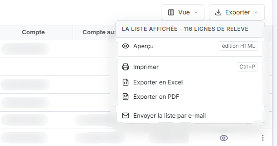<figcaption>
Bouton [Exporter]
</figcaption></figure>

Au-dessus de la liste, la barre regroupe, de gauche à droite : le champ de recherche, le bouton \[Filtres], la liste « Banque » et les boutons \[Vue] et \[Exporter]. Une aide rappelle les raccourcis : « / » pour la recherche, Ctrl + Maj + F pour les filtres et Ctrl + Maj + V pour la vue. La liste ne porte plus de case à cocher ni de pictogrammes en tête de colonne : leurs fonctions sont reprises par ces boutons.

* le bouton **\[Filtres]** ouvre un menu « Filtrer ». Tant qu'aucun critère n'est posé, il indique « Aucun critère. Choisissez une colonne pour commencer. » ; la liste « + Ajouter un critère sur… » propose les colonnes de la liste, affichées ou masquées. Chaque critère se compose d'un opérateur et d'une valeur, que vous pouvez combiner par « Et » ou par « Ou » avec un second couple opérateur / valeur.Le bouton **\[Filtrer]** applique vos critères et le bouton **\[Vider les filtres]** les efface ; le lien « Tout effacer », qui apparaît à côté du bouton \[Filtres] dès qu'un critère est posé, les efface aussi. Les boutons \[Mémoriser les paramètres] et \[Charger les paramètres] n'existent plus,
* le bouton **\[Vue]** ouvre le menu « Mes vues » (enregistrer la vue actuelle sous un nom), puis « Colonnes affichées » : une case par colonne, un champ pour chercher une colonne, et l'indication du nombre de colonnes affichées (douze sur vingt par défaut). Le bouton **\[Appliquer]** valide vos choix et le bouton **\[Rétablir les colonnes d'origine]** rétablit la présentation d'origine,
* le bouton **\[Exporter]** ouvre un menu : « Aperçu édition HTML », « Imprimer » (Ctrl + P), « Exporter en Excel », « Exporter en PDF » et « Envoyer la liste par e-mail » ; il remplace le pictogramme « Imprimante ».

Sous la liste, les liens « Sélectionner la page » et « Tout sélectionner » (suivi du nombre total de lignes) sélectionnent les lignes ; la pagination et le compteur « 1 à 14 sur 116 » se trouvent au même endroit.

## Les commandes de chaque ligne

<figure>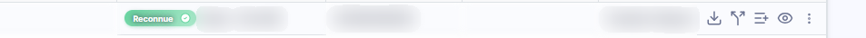<figcaption>
Rubrique « d) Les commandes de chaque ligne »
</figcaption></figure>

Au survol d'une ligne apparaissent ses commandes, à droite de la ligne. Toutes les lignes portent « Éclater la ligne », « Créer une règle à partir de la ligne » et le menu à trois points « Autres actions » (« Modifier » et « Appeler une remise de chèques » sur toutes les lignes ; « Remplacer le justificatif… » et « Détacher » sur les lignes auxquelles un document est lié). Il n'y a plus de commande « Sélectionner » : un double-clic sur une ligne la sélectionne et ouvre sa fiche. Les commandes de document dépendent de l'état de la ligne : une ligne à laquelle aucun document n'est encore lié porte la seule commande « Lier » ; une ligne à laquelle un document est déjà lié porte « Télécharger » et « Afficher l'aperçu » lorsque ce document est un PDF, et « Visualiser » dans le cas contraire ; dans les deux cas, « Détacher » se trouve dans le menu « Autres actions ».

| Champ                                    | Ce qu'il faut savoir                                                                                       |
| ---------------------------------------- | ---------------------------------------------------------------------------------------------------------- |
| **Éclater la ligne**                     | Commande visible au survol de chaque ligne.                                                                |
| **Créer une règle à partir de la ligne** | Commande visible au survol de chaque ligne.                                                                |
| **Modifier**                             | Entrée du menu « Autres actions » ; ouvre le tiroir « Ligne de relevé bancaire », décrit au paragraphe f). |
| **Remplacer le justificatif…**           | Entrée du menu « Autres actions », proposée sur les lignes auxquelles un document est lié.                 |
| **Appeler une remise de chèques**        | Entrée du menu « Autres actions ».                                                                         |
| **Lier**                                 | Ouvre le volet « Lier un document », décrit au paragraphe h).                                              |
| **Détacher**                             | Entrée du menu « Autres actions » ; retire de la ligne le document qui lui est lié.                        |
| **Afficher l'aperçu**                    | Affiche le document lié à la ligne.                                                                        |
| **Télécharger**                          | Récupère sur votre poste le document lié à la ligne.                                                       |
| **Visualiser**                           | Récupère sur votre poste le document lié à la ligne, lorsque ce document n'est pas un PDF.                 |

## Les boutons de bas d'écran

<figure><figcaption>
Bouton [Créer une règle]
</figcaption></figure>

<figure>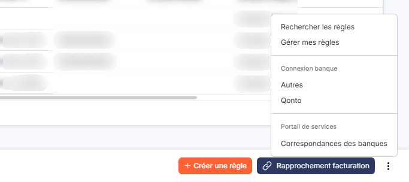<figcaption>
Rubrique « Menu « Autres actions », rubrique « Connexion banque » »
</figcaption></figure>

<figure><figcaption>
Rubrique « Menu « Autres actions », entrée « Rechercher les règles » »
</figcaption></figure>

Tant qu'aucune ligne n'est sélectionnée, le bas de l'écran ne porte que les boutons \[Créer une règle] et \[Rapprochement facturation], et le menu à trois points « Autres actions », qui regroupe notamment « Rechercher les règles » (voir ci-dessous). Dès que vous sélectionnez une ligne, un bandeau de sélection remplace ces boutons : il indique « 1 ligne de relevé sélectionnée », propose « Tout désélectionner » et porte les boutons \[Supprimer], \[Extraire vers OCR], \[Modification groupée], \[Génération des écritures] et \[Rapprochement facturation]. Les boutons qui agissent sur une sélection ne sont donc visibles qu'une fois une ligne sélectionnée.

Chaque bouton est soumis à un droit : selon votre profil, vous n'en voyez qu'une partie.

**Menu « Autres actions », entrée « Rechercher les règles »**

Le logiciel passe les lignes de relevés au crible des règles de traduction et renseigne les colonnes « Règle reconnue », « Affectation », « Règle abonné reconnue » et « Affectation abonné ».

Le traitement se fait en deux passes : d'abord les règles définies au niveau du cabinet, puis celles définies pour le dossier.

Seules les lignes qui ne portent encore ni règle, ni affectation, ni événement sont examinées : une ligne déjà renseignée n'est jamais écrasée par une nouvelle recherche. De même, une règle dont les pourcentages de contrepartie ne totalisent pas 100 % n'est pas appliquée.

bouton **\[Génération des écritures]**

Le logiciel génère les écritures comptables correspondant aux lignes de relevés. Toutes les lignes sont obligatoirement traitées.

Si une ligne ne correspond à aucune règle de traduction, la contrepartie du compte de banque est ventilée dans le compte d'attente que vous avez paramétré dans la fiche de la banque concernée (panneau « Paramètres », « Données », catégorie « Dossier et comptabilité », « Banques »).

Les écritures sont générées :

* soit dans l'option « Prévisualisations », si la fonction a été activée dans le panneau « Paramètres », rubrique « Banque », onglet « Configuration »,
* soit directement dans le module de comptabilité, si vous l'avez indiqué dans le panneau « Paramètres », rubrique « Banque », onglet « Connexion comptabilité »,
* soit dans l'option « Ecritures », en vue d'un export ultérieur, dans le cas contraire.

La génération des écritures entraîne l'archivage des lignes de relevés, sauf si vous avez activé la prévisualisation.

**Menu « Autres actions », rubrique « Connexion banque »**

Le menu à trois points « Autres actions » du bas de l'écran s'ouvre sur les entrées « Rechercher les règles » et « Gérer mes règles » (selon vos droits ; cette dernière ouvre à droite le tiroir « Règles de traduction »). Il porte ensuite, sous le titre « Connexion banque », deux entrées : « Autres », qui couvre l'ensemble des banques, et « Qonto ». Un dernier titre, « Portail de services », porte l'entrée « Correspondances des banques ». L'entrée « Qonto » n'est utilisable que si votre cabinet a paramétré ce raccordement ; à défaut, elle apparaît inactive.

Vous êtes dirigé vers la page de notre partenaire, où il ne vous reste qu'à suivre les instructions qui vous sont données.

Les codes d'identification à votre banque que vous entrez ici ne sont pas enregistrés sur les serveurs d'Ingeneo Compta.

Pour chaque compte bancaire que vous indiquez ainsi, le logiciel mémorise les informations dans son propre fichier des banques. Vous devez compléter ces informations pour que les écritures comptables puissent être générées : reportez-vous à l'aide en ligne de l'écran « Banques » du panneau « Paramètres » (« Données », catégorie « Dossier et comptabilité »).

Vous pouvez également alimenter la liste à partir d'un fichier remis par votre banque, par le menu « Traitements » et ses sous-options « Import Excel », « Import CFONB » et « Import OFX ».

bouton **\[Importer]**

Ce bouton n'est proposé que si vous avez choisi « Manuellement » dans le champ **Méthode d'import des nouvelles lignes de banque :** du panneau « Paramètres », rubrique « Banque », onglet « Configuration », et si au moins un compte bancaire est déjà connecté. Si vous avez choisi « Automatiquement », les nouvelles lignes vous parviennent sans opération de votre part et le bouton n'a pas lieu d'être.

Pour importer des lignes de relevés, indiquez d'abord dans la liste « Banque » le compte pour lequel vous souhaitez réaliser cet import ; la valeur par défaut « Banque » (tous les comptes) réalise en une seule fois les imports de tous les comptes paramétrés. Cliquez ensuite sur ce bouton.

Les dates des lignes importées doivent être comprises dans la période de saisie du dossier annuel en cours d'utilisation.

A ce stade, les lignes de relevés sont telles qu'elles ont été émises par la banque.

Il arrive que certaines banques produisent des lignes d'un montant nul. Ces lignes ne sont jamais importées.

bouton **\[Modification groupée]**

Ce bouton, qui se trouve dans le bandeau de sélection, reporte une même correction sur toutes les lignes que vous avez sélectionnées.

Le tiroir « Modification groupée des lignes » rappelle en tête le nombre de lignes sélectionnées et leur total, et vous prévient que « Les champs renseignés remplacent les valeurs existantes ; les champs laissés vides ne changent rien. ». Dans la rubrique « Reconnaissance des lignes », un encadré rouge indique, par exemple, « 1 ligne avec une règle. Règles, affectations et événements seront retirés de ces lignes à la validation si un compte de contrepartie est saisi. ». Les boutons « Afficher les lignes » et « Chercher une suggestion » figurent sous la carte de rappel.

Le tiroir comporte les champs suivants :

| Champ         | Ce qu'il faut savoir                                                                                                      |
| ------------- | ------------------------------------------------------------------------------------------------------------------------- |
| **Libellé**   | Libellé qui remplacera celui de chaque ligne sélectionnée ; la zone affiche « Inchangé » tant que vous ne saisissez rien. |
| **Référence** | Référence qui remplacera celle de chaque ligne sélectionnée ; même principe.                                              |

puis, sous la rubrique **Comptes de contrepartie de la ligne :**, les zones **N° de compte :** et **N° de compte auxiliaire :**. Chacune est accompagnée d'un bouton \[+] qui crée le compte, d'une loupe qui le recherche, et d'une zone « Libellé compte » que le logiciel renseigne lui-même.

Le bouton **\[Valider]**, dont le libellé reprend le nombre de lignes concernées (« Valider (1 ligne) »), enregistre votre saisie ; le bouton **\[Annuler]** ferme le tiroir sans rien conserver.

bouton **\[Créer une règle]**

Ce bouton ouvre le tiroir « Nouvelle règle de traduction », décrit au paragraphe g). Les règles de traduction sont gérées dans le panneau « Paramètres » (« Données », catégorie « Intégrations et workflow », « Règles de traduction »), mais vous avez la possibilité d'en créer de nouvelles directement depuis cette option.

bouton **\[Extraire vers OCR]**

Ce bouton transmet les lignes sélectionnées au module de reconnaissance de documents.

bouton **\[Supprimer]**

Ce bouton supprime les lignes de relevés que vous avez sélectionnées.

## Le tiroir « Ligne de relevé bancaire »

<figure>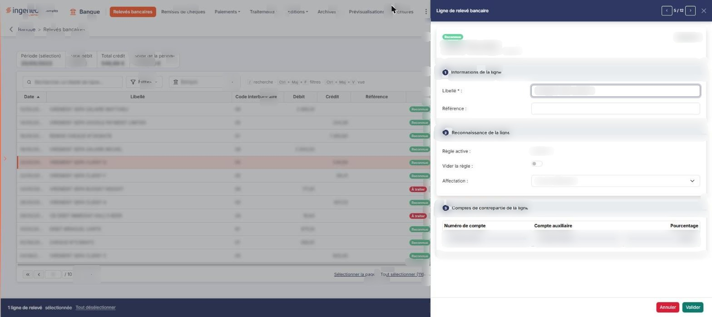<figcaption>
Rubrique « f) Le tiroir « Ligne de relevé bancaire » »
</figcaption></figure>

<figure>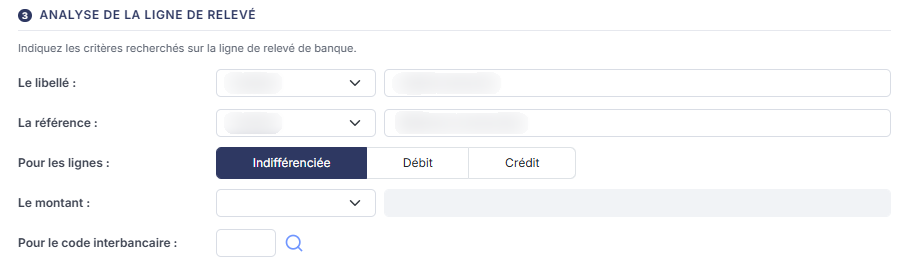<figcaption>
Rubrique « Rubrique « Analyse de la ligne de relevé » »
</figcaption></figure>

Ce tiroir s'ouvre à droite de l'écran par la commande « Modifier » du menu « Autres actions » d'une ligne ; un double-clic sur la ligne l'ouvre aussi. Son en-tête porte le titre, la navigation « 2 / 14 » avec les boutons « Ligne précédente » et « Ligne suivante », et la croix de fermeture. Une carte rappelle l'état de la ligne (« Reconnue » ou « À traiter »), son libellé, sa date, son compte bancaire, son code interbancaire et son montant. Trois rubriques numérotées suivent :

| Champ                                       | Ce qu'il faut savoir                                                                                                                                                                                                                                                                                                                                                                                                                                                                                                                                                                                                                                                                                                                                                                                                                     |
| ------------------------------------------- | ---------------------------------------------------------------------------------------------------------------------------------------------------------------------------------------------------------------------------------------------------------------------------------------------------------------------------------------------------------------------------------------------------------------------------------------------------------------------------------------------------------------------------------------------------------------------------------------------------------------------------------------------------------------------------------------------------------------------------------------------------------------------------------------------------------------------------------------- |
| **1 · Informations de la ligne**            | **Libellé \* :** libellé de la ligne, obligatoire ; **Référence :** référence de la ligne.                                                                                                                                                                                                                                                                                                                                                                                                                                                                                                                                                                                                                                                                                                                                               |
| **2 · Reconnaissance de la ligne**          | 
Son contenu dépend de la ligne. • Sur une ligne qui porte une règle : <strong>Règle active :</strong> la règle de traduction reconnue (information non modifiable) ; <strong>Vider la règle :</strong> activez cet interrupteur pour retirer de la ligne la règle qui lui est associée ; liste <strong>Affectation :</strong>, qui propose « Aucune affectation » puis les affectations. • Sur une ligne qui porte un événement : liste <strong>Règle de traduction :</strong> ; <strong>Evénement actif :</strong> l'événement rapproché de la ligne ; <strong>Vider le(s) événement(s) :</strong> interrupteur. • Sur une ligne qui porte une affectation, ou qui n'est pas reconnue : listes <strong>Règle de traduction :</strong>, qui propose « Aucune règle » puis les règles, et <strong>Affectation :</strong>.
 |
| **3 · Comptes de contrepartie de la ligne** | Sur une ligne qui porte une règle, un tableau en lecture seule à trois colonnes (« Numéro de compte », « Compte auxiliaire » et « Pourcentage ») ; sur une ligne qui porte un événement ou une affectation, les zones **N° de compte :** et **N° de compte auxiliaire :**, grisées, accompagnées du libellé du compte ; sur une ligne non reconnue, ces deux zones, saisissables, accompagnées d'un bouton \[+] qui crée le compte, d'une loupe qui le recherche et d'une zone « Libellé compte » que le logiciel renseigne lui-même.                                                                                                                                                                                                                                                                                                    |

Le bouton **\[Valider]** enregistre votre saisie ; le bouton **\[Annuler]** ferme le tiroir sans rien conserver.

## Le tiroir « Nouvelle règle de traduction »

<figure>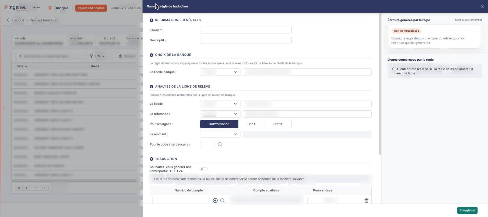<figcaption>
Rubrique « g) Le tiroir « Nouvelle règle de traduction » »
</figcaption></figure>

<figure>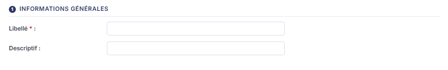<figcaption>
Rubrique « Rubrique « Informations générales » »
</figcaption></figure>

<figure>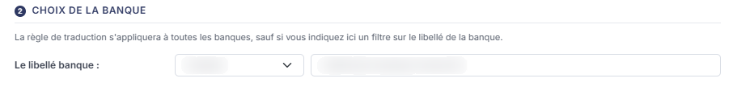<figcaption>
Rubrique « Rubrique « Choix de la banque » »
</figcaption></figure>

<figure>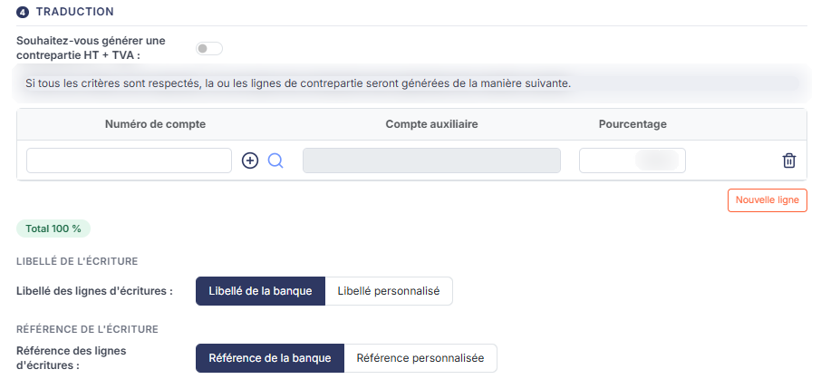<figcaption>
Rubrique « Rubrique « Traduction » »
</figcaption></figure>

<figure>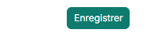<figcaption>
Bouton [Enregistrer]
</figcaption></figure>

Ce tiroir s'ouvre par le bouton **\[Créer une règle]**. Il comporte quatre rubriques. À droite, deux encadrés suivent la saisie : « Écriture générée par la règle » (état « Non comptabilisée » tant que la règle n'est pas ouverte depuis une ligne du relevé) et « Lignes concernées par la règle » (qui indique « Aucun critère n'est saisi : la règle ne s'appliquerait à aucune ligne. » tant qu'aucun critère n'est saisi).

**Rubrique « Informations générales »**

| Champ                                                   | Ce qu'il faut savoir                                                                                                                                                                                                                                                                                                                                                                                                                                                                                                                                                                                                                                                                                                                                                                                                                                                                                                                                                                                                                                                                                           |
| ------------------------------------------------------- | -------------------------------------------------------------------------------------------------------------------------------------------------------------------------------------------------------------------------------------------------------------------------------------------------------------------------------------------------------------------------------------------------------------------------------------------------------------------------------------------------------------------------------------------------------------------------------------------------------------------------------------------------------------------------------------------------------------------------------------------------------------------------------------------------------------------------------------------------------------------------------------------------------------------------------------------------------------------------------------------------------------------------------------------------------------------------------------------------------------- |
| 
<strong>Libellé</strong> <em>Obligatoire</em>
 | Nom de la règle. Ce champ est obligatoire.                                                                                                                                                                                                                                                                                                                                                                                                                                                                                                                                                                                                                                                                                                                                                                                                                                                                                                                                                                                                                                                                     |
| **Descriptif**                                          | 
Texte libre décrivant la règle. <strong>Rubrique « Choix de la banque »</strong> « La règle de traduction s'appliquera à toutes les banques sauf si vous indiquez ici un filtre sur le libellé de la banque ».
                                                                                                                                                                                                                                                                                                                                                                                                                                                                                                                                                                                                                                                                                                                                                                                                                                                                                    |
| **Le libellé banque**                                   | Choisissez « Contient », « Commence par » ou « Finit par ».                                                                                                                                                                                                                                                                                                                                                                                                                                                                                                                                                                                                                                                                                                                                                                                                                                                                                                                                                                                                                                                    |
| **Contenu de comparaison**                              | 
Texte recherché dans le libellé de la banque. <strong>Rubrique « Analyse de la ligne de relevé »</strong> Indiquez ici les critères recherchés sur la ligne de relevé de banque.
                                                                                                                                                                                                                                                                                                                                                                                                                                                                                                                                                                                                                                                                                                                                                                                                                                                                                                                  |
| **Le libellé**                                          | Choisissez « Contient », « Commence par » ou « Finit par ».                                                                                                                                                                                                                                                                                                                                                                                                                                                                                                                                                                                                                                                                                                                                                                                                                                                                                                                                                                                                                                                    |
| **Contenu de comparaison**                              | Texte recherché dans le libellé de la ligne.                                                                                                                                                                                                                                                                                                                                                                                                                                                                                                                                                                                                                                                                                                                                                                                                                                                                                                                                                                                                                                                                   |
| **La référence**                                        | Choisissez « Contient », « Commence par » ou « Finit par ».                                                                                                                                                                                                                                                                                                                                                                                                                                                                                                                                                                                                                                                                                                                                                                                                                                                                                                                                                                                                                                                    |
| **Référence de comparaison**                            | Texte recherché dans la référence de la ligne.                                                                                                                                                                                                                                                                                                                                                                                                                                                                                                                                                                                                                                                                                                                                                                                                                                                                                                                                                                                                                                                                 |
| **Pour les lignes**                                     | Choisissez, sur les trois boutons, « Indifférenciée » (retenu par défaut), « Débit » ou « Crédit ».                                                                                                                                                                                                                                                                                                                                                                                                                                                                                                                                                                                                                                                                                                                                                                                                                                                                                                                                                                                                            |
| **Le montant**                                          | Choisissez « Egal = », « Inférieur ou égal <= », « Supérieur ou égal >= », « Strictement inférieur < » ou « Strictement supérieur > ». Laissez la zone vide si le montant n'entre pas dans les critères.                                                                                                                                                                                                                                                                                                                                                                                                                                                                                                                                                                                                                                                                                                                                                                                                                                                                                                       |
| **Valeur de comparaison**                               | Montant auquel comparer celui de la ligne.                                                                                                                                                                                                                                                                                                                                                                                                                                                                                                                                                                                                                                                                                                                                                                                                                                                                                                                                                                                                                                                                     |
| **Pour le code interbancaire**                          | 
Code recherché, que vous pouvez rechercher avec la loupe. <strong>Rubrique « Traduction »</strong>
                                                                                                                                                                                                                                                                                                                                                                                                                                                                                                                                                                                                                                                                                                                                                                                                                                                                                                                                                                                                   |
| **Souhaitez-vous générer une contrepartie HT + TVA**    | 
Cet interrupteur, désactivé par défaut, commande la présentation du tableau de contrepartie. Dans les deux cas, le logiciel vous indique que « Si tous les critères sont respectés, la ou les lignes de contrepartie seront générées de la manière suivante ». - interrupteur désactivé, le tableau comporte les colonnes « Numéro de compte », « Compte auxiliaire » et « Pourcentage », ce dernier préchargé à 100,00. Le bouton <strong>[Nouvelle ligne]</strong> ajoute une contrepartie, et la corbeille en fin de ligne (infobulle « Supprimer ») la supprime ; un indicateur « Total 100 % » signale que les pourcentages totalisent bien 100, - interrupteur activé, le logiciel affiche la zone <strong>Indiquez le code TVA :</strong>, dont les valeurs dépendent du paramétrage de votre société, et le tableau devient « Type de ligne », « Numéro de compte » et « Pourcentage », avec deux lignes fixes « Ligne de HT » et « Ligne de TVA ». La colonne « Compte auxiliaire » et le bouton d'ajout de ligne ne sont alors pas proposés. La rubrique se termine par deux choix :
 |
| **Libellé des lignes d'écritures**                      | Choisissez « Libellé de la banque » ou « Libellé personnalisé ».                                                                                                                                                                                                                                                                                                                                                                                                                                                                                                                                                                                                                                                                                                                                                                                                                                                                                                                                                                                                                                               |
| **Référence des lignes d'écritures**                    | Choisissez « Référence de la banque » ou « Référence personnalisée ».                                                                                                                                                                                                                                                                                                                                                                                                                                                                                                                                                                                                                                                                                                                                                                                                                                                                                                                                                                                                                                          |

Sur « Libellé personnalisé », comme sur « Référence personnalisée », le logiciel affiche un tableau de composition à trois colonnes, chacune précédée d'une case à cocher :

* « Texte fixe » : une zone de saisie libre,
* « Date d'opération » : la zone **Format :** vous propose « AAAA », « MM-AAAA », « JJ-MM-AAAA », « AAAA-MM-JJ », « AAAA-MM », « AA-MM », « MM-AA » et « AA »,
* « Extraction » : les zones **N° de ligne de relevé :**, **1er caractère :** et **Longueur :** permettent de reprendre une portion du texte d'origine.

La zone **Caractère de séparation :**, sous le tableau, vous propose « Aucun », « Espace », « Tiret (-) » ou « Point » entre les éléments composés.

Le bouton **\[Enregistrer]**, dans le pied du tiroir, enregistre la règle ; la croix de l'en-tête (infobulle « Fermer ») ferme le tiroir sans la créer.

## Le volet « Lier un document »

<figure>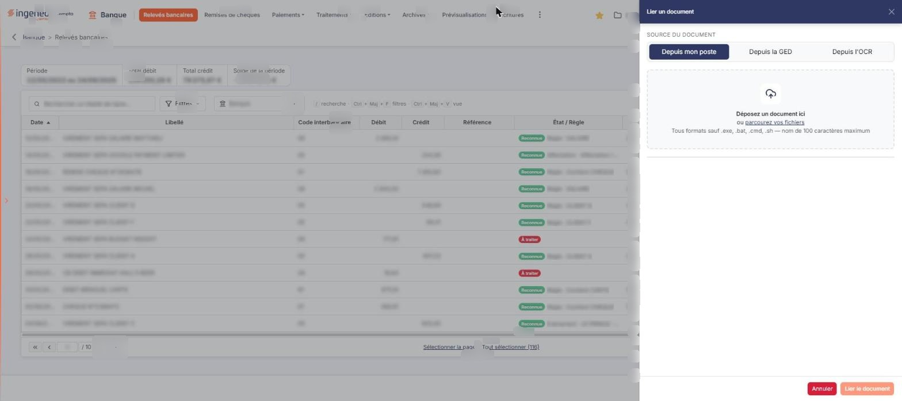<figcaption>
Rubrique « h) Le volet « Lier un document » »
</figcaption></figure>

Ce volet s'ouvre à droite par la commande « Lier » d'une ligne.

**Source du document** : choisissez « Depuis mon poste », proposé par défaut, « Depuis la GED » ou « Depuis l'OCR ». La zone « Déposez un document ici ou parcourez vos fichiers » reçoit le fichier : tous formats sont acceptés sauf .exe, .bat, .cmd et .sh, et le nom du fichier est limité à 100 caractères.

Le bouton **\[Lier le document]** rattache le document à la ligne ; le bouton **\[Annuler]** ferme le volet sans rien lier.
