# Banque — présentation générale


**Où le trouver :** Menu **Relevés bancaires**



**En bref** — Cette page présente le module « Banque » : récupérer vos lignes de relevés pour les transformer en écritures comptables, et générer les fichiers .XML de virements et de prélèvements SEPA.

* Pour démarrer : choisissez vos fonctionnalités dans le panneau « Paramètres », rubrique « Banque », onglet « Configuration ».
* Pour ouvrir les écrans de paramétrage : utilisez la porte « Paramètres » en bas de la barre de gauche.


* il permet de récupérer vos écritures bancaires pour les transformer en écritures comptables et les intégrer à votre logiciel de comptabilité,
* il permet de générer des fichiers .XML à transférer à votre banque pour les virements et les prélèvements SEPA.

<figure>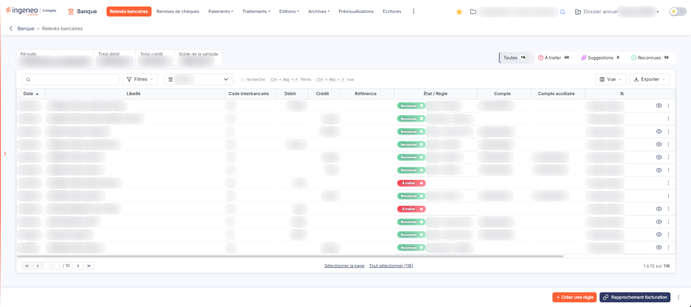<figcaption>
Écran « Relevés bancaires » de la nouvelle interface
</figcaption></figure>

Les lignes de relevés sont d'abord récupérées, soit par une connexion directe à votre banque, soit par l'import d'un fichier fourni par votre banque.

Une fois que les lignes de relevés ont été récupérées, il faut lancer un traitement qui analyse les lignes au regard de règles de traduction que vous devrez paramétrer. Ces règles permettent de déterminer le compte de contrepartie de chaque écriture de banque.

Pour les lignes pour lesquelles aucune règle de traduction n'a pu être identifiée, vous avez la possibilité d'activer la fonction d'annotations. Cette fonction permet de donner un accès au client du cabinet, qui peut indiquer soit directement une affectation, soit à quelle pièce commerciale correspond le règlement de la ligne de banque.

Pour démarrer avec le module « Banque » vous devez réaliser les étapes suivantes :

* choisir les fonctionnalités que vous voulez activer (panneau « Paramètres », rubrique « Banque », onglet « Configuration »),
* indiquer les comptes bancaires dont vous souhaitez récupérer les écritures (menu « Relevés bancaires », bouton « Autres actions » (trois points) du bas de l'écran, rubrique « Connexion banque »),
* compléter les informations des comptes bancaires pour générer les écritures comptables (panneau « Paramètres », « Données », catégorie « Dossier et comptabilité », « Banques »),
* créer des règles de traduction pour générer des écritures les plus précises possibles (panneau « Paramètres », « Données », catégorie « Intégrations et workflow », « Règles de traduction »),
* créer le fichier des affectations si vous avez activé l'option d'annotations manuelles (panneau « Paramètres », « Données », catégorie « Intégrations et workflow », « Affectations »).

Le module ne possède pas d'écran d'accueil : lorsque vous ouvrez le module « Banque », le logiciel affiche directement la liste des relevés bancaires.

Le menu du module comporte les options suivantes :

* « Relevés bancaires », « Remises de chèques », « Prévisualisations » et « Ecritures », qui ouvrent directement un écran,
* « Paiements », « Traitements », « Editions », « Archives » et « Evénements », qui donnent accès à plusieurs sous-options.

Selon l'écran affiché, certaines de ces entrées sont regroupées dans le menu à trois points « Plus d'entrées », à droite de la barre. Les écrans de paramétrage ne sont plus des entrées de ce menu : ils s'ouvrent dans le panneau « Paramètres », par la porte « Paramètres » en bas de la barre de gauche. L'écran « Annotations » n'est plus proposé dans le menu.

## Autres vues de l'écran

<figure><figcaption>
Bouton [Créer une règle]
</figcaption></figure>

<figure>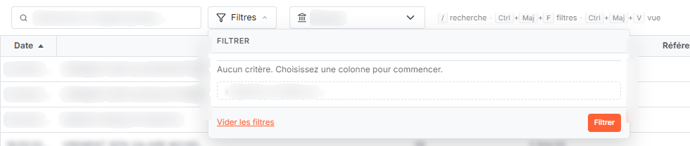<figcaption>
Bouton [Filtres]
</figcaption></figure>

<figure>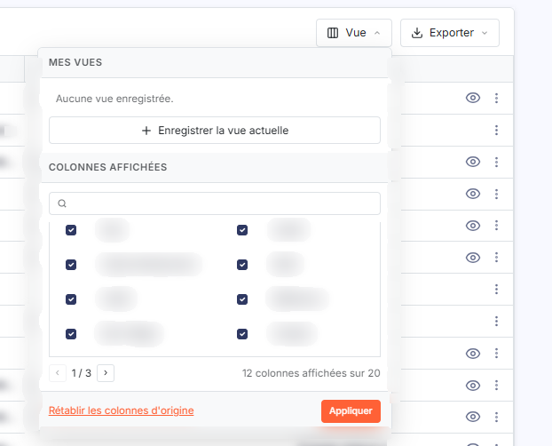<figcaption>
Bouton [Vue]
</figcaption></figure>

<figure>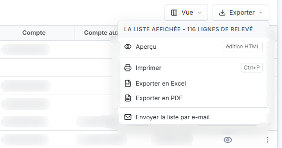<figcaption>
Bouton [Exporter]
</figcaption></figure>

<figure>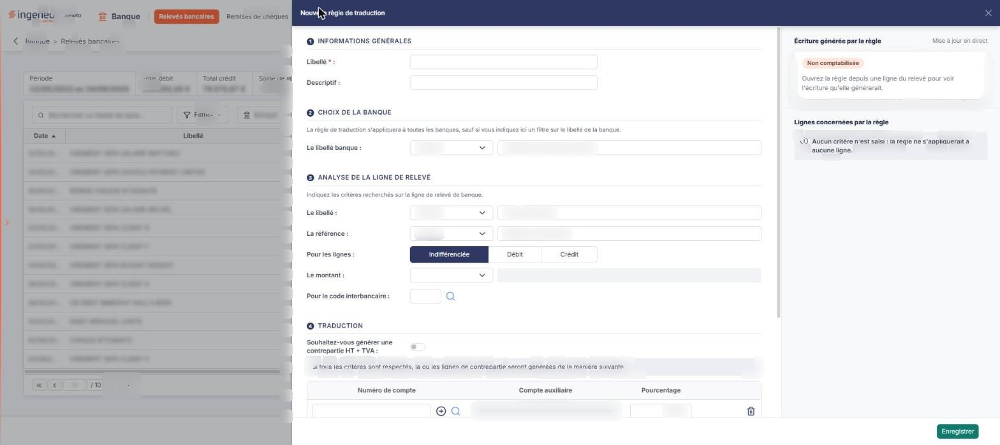<figcaption>
g) Le tiroir « Nouvelle règle de traduction »
</figcaption></figure>

<figure>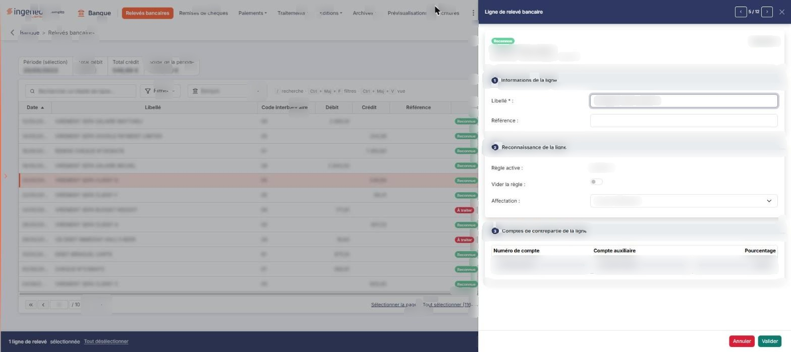<figcaption>
f) Le tiroir « Ligne de relevé bancaire »
</figcaption></figure>

<figure>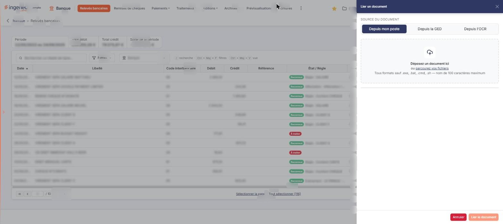<figcaption>
h) Le volet « Lier un document »
</figcaption></figure>

<figure>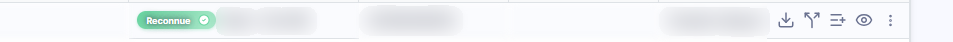<figcaption>
d) Les commandes de chaque ligne
</figcaption></figure>

<figure>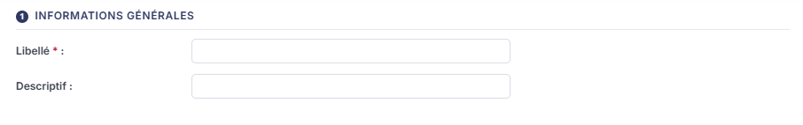<figcaption>
Rubrique « Informations générales »
</figcaption></figure>

<figure>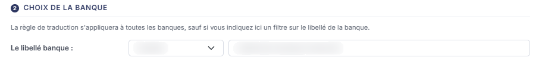<figcaption>
Rubrique « Choix de la banque »
</figcaption></figure>

<figure>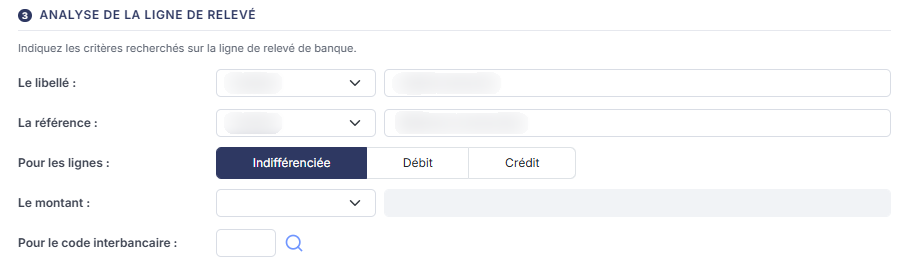<figcaption>
Rubrique « Analyse de la ligne de relevé »
</figcaption></figure>

<figure>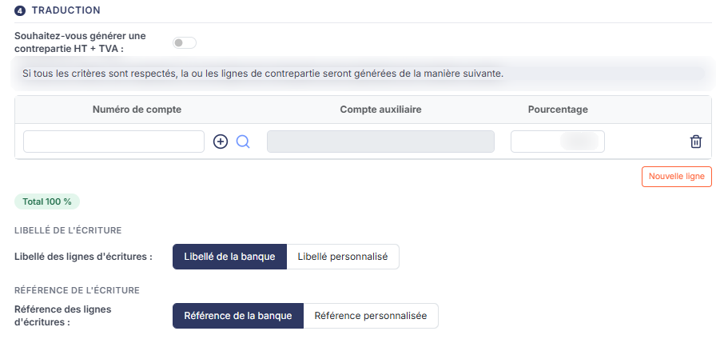<figcaption>
Rubrique « Traduction »
</figcaption></figure>

<figure><figcaption>
Bouton [Enregistrer]
</figcaption></figure>

<figure>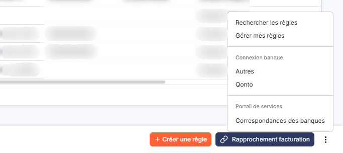<figcaption>
Menu « Autres actions », rubrique « Connexion banque »
</figcaption></figure>

<figure><figcaption>
Menu « Autres actions », entrée « Rechercher les règles »
</figcaption></figure>
