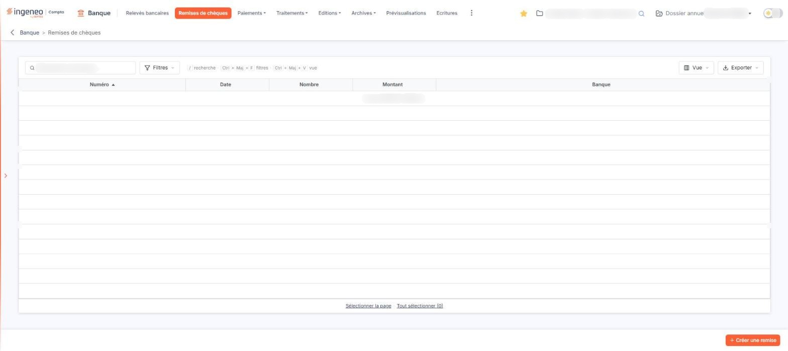
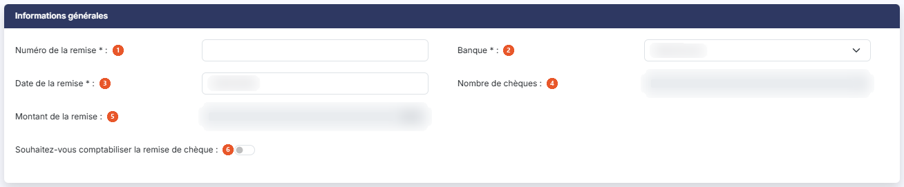
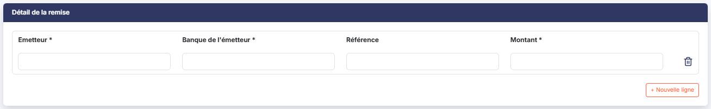

# Remises de chèques


**Où le trouver :** Menu **Remises de chèques**



**En bref** — Cet écran prépare vos remises de chèques : regrouper les chèques déposés ensemble, éditer le bordereau et, si vous le souhaitez, faire comptabiliser la remise.

* Pour créer une remise : bouton \[Créer une remise], renseignez le numéro, la banque et les chèques (bouton \[Nouvelle ligne]), puis bouton \[Enregistrer].
* Pour la faire comptabiliser : activez « Souhaitez-vous comptabiliser la remise de chèque », renseignez journal et compte, puis bouton \[Valider].
* Pour éditer le bordereau : bouton \[Edition].


**a) La liste des remises**

<figure><figcaption>
Écran « Remises de chèques » de la nouvelle interface
</figcaption></figure>

L'écran se réduit à un seul tableau, sans onglet ; une barre de recherche et de commandes le surmonte — voir le paragraphe b).

Les colonnes affichées sont les suivantes :

* **Numéro** : le numéro que vous avez donné à la remise. C'est le tri initial de la liste, par ordre croissant.
* **Date** : la date de la remise.
* **Nombre** : le nombre de chèques que contient la remise.
* **Montant** : le montant total de la remise.
* **Banque** : la banque auprès de laquelle la remise est déposée.

Une colonne supplémentaire existe mais n'est pas affichée par défaut : « Date de validation ». Vous la faites apparaître par le bouton \[Vue] : cochez « Date de validation » dans la liste « Colonnes affichées », puis cliquez sur le bouton \[Appliquer].

Tant qu'aucune remise n'a été créée, le tableau affiche « Aucun élément à afficher. » et le bas de la liste n'affiche que les liens « Sélectionner la page » et « Tout sélectionner (0) ».

**b) La barre au-dessus du tableau et les commandes de la liste**

Au-dessus du tableau, une barre réunit :

* le champ « Rechercher une remise… », pour chercher dans la liste ;
* le bouton \[Filtres], qui ouvre le panneau « Filtrer » — voir le paragraphe c) ci-dessous ;
* le bouton \[Vue], qui ouvre un menu où vous choisissez les colonnes affichées (cases à cocher, puis le bouton \[Appliquer] ; le bouton \[Rétablir les colonnes d'origine] revient à l'état initial) et où vous enregistrez une vue (« Enregistrer la vue actuelle ») ;
* le bouton \[Exporter], dont le menu propose l'aperçu de l'édition en HTML, l'impression, l'export en Excel ou en PDF et l'envoi de la liste par e-mail, avec l'orientation (Portrait, Paysage) et la largeur (Ajustée, Fixe) de l'édition, puis le bouton \[Lancer l'édition].

Chaque ligne du tableau porte par ailleurs ses propres commandes. Il n'y a plus de case à cocher en tête de colonne : en bas de la liste, les liens « Sélectionner la page » et « Tout sélectionner (0) » sélectionnent les remises.

En bas à droite de l'écran, bouton **\[Créer une remise]** ouvre la fiche d'une nouvelle remise. Il n'y a plus de bouton \[Supprimer] au bas de la liste.

**c) Le panneau « Filtres »**

Le bouton \[Filtres] de la barre ouvre un panneau « Filtrer » qui vous permet de restreindre la liste. Il s'ouvre sur « Aucun critère. Choisissez une colonne pour commencer. » : vous ajoutez un critère par la liste « Ajouter un critère sur… ».

Les critères proposés reprennent les cinq colonnes affichées — « Numéro », « Date », « Nombre », « Montant », « Banque » — ainsi que la colonne masquée « Date de validation ».

Les boutons du panneau sont bouton **\[Filtrer]** et bouton **\[Vider les filtres]**.

**d) La fiche d'une remise**

La fiche s'organise en deux rubriques : les informations générales de la remise, puis le détail des chèques qui la composent.

## Rubrique « Informations générales »

<figure><figcaption>
Rubrique « Informations générales »
</figcaption></figure>

| Champ                                                   | Ce qu'il faut savoir                                                                                                                                                                    |
| ------------------------------------------------------- | --------------------------------------------------------------------------------------------------------------------------------------------------------------------------------------- |
| 1. **Numéro de la remise**                              | C'est vous qui le donnez ; le logiciel ne le propose pas.                                                                                                                               |
| 2. **Banque**                                           | Vous la choisissez dans la liste des banques du dossier, celles que vous avez déclarées dans l'écran « Banques » du panneau Paramètres (Données, rubrique « Dossier et comptabilité »). |
| 3. **Date de la remise**                                | Le logiciel propose la date du jour ; vous pouvez la modifier, à la main ou par le calendrier.                                                                                          |
| 4. **Nombre de chèques**                                | Vous ne le saisissez pas. Le logiciel le calcule au fur et à mesure que vous ajoutez ou retirez des lignes dans la rubrique « Détail de la remise ».                                    |
| 5. **Montant de la remise**                             | Vous ne le saisissez pas davantage. Il totalise les montants des chèques du détail.                                                                                                     |
| 6. **Souhaitez-vous comptabiliser la remise de chèque** | Interrupteur sans texte, désactivé à l'ouverture. C'est le seul choix de cet écran qui change les champs affichés — voir le paragraphe e) ci-dessous.                                   |

## Rubrique « Détail de la remise »

<figure><figcaption>
Rubrique « Détail de la remise »
</figcaption></figure>

Vous y saisissez les chèques, un par ligne. Une ligne vide vous attend à l'ouverture, et le bouton **\[Nouvelle ligne]** placé sous le tableau en ajoute une autre. Le pictogramme « Corbeille » à droite de chaque ligne retire la ligne.

Ce tableau n'est pas une liste comme les autres : il ne se trie pas, ne se filtre pas et ne se pagine pas.

Chaque ligne comporte les colonnes suivantes :

* **Emetteur** : obligatoire. Le nom de la personne ou de l'entreprise qui a émis le chèque.
* **Banque de l'émetteur** : obligatoire. La banque sur laquelle le chèque est tiré.
* **Référence** : facultatif. Vous y notez par exemple le numéro du chèque ou celui de la facture réglée.
* **Montant** : obligatoire. Le montant du chèque.

Une cinquième colonne, « Compte de l'émetteur », s'ajoute en tête de ligne lorsque vous demandez la comptabilisation de la remise — voir le paragraphe e).

**e) Faire comptabiliser la remise**

Tant que **Souhaitez-vous comptabiliser la remise de chèque** reste désactivé, la remise est un simple bordereau : vous saisissez vos chèques et vous les éditez.

Dès que vous activez cet interrupteur, **trois éléments apparaissent en même temps** et vous devez tous les renseigner :

* **Code journal** : le journal dans lequel l'écriture sera passée. Vous le choisissez dans la liste, présentée sous la forme « code - libellé ». Seuls les journaux de type « Banque », « Caisse » et « Opérations diverses » du dossier vous sont proposés : c'est pourquoi cette liste est plus courte que la liste complète des journaux.
* **Numéro de compte** : le compte de contrepartie de la remise. Vous saisissez le numéro directement, vous le cherchez par le pictogramme « Loupe », ou vous créez le compte par le bouton portant le signe plus, sans quitter l'écran.
* **Compte de l'émetteur** : nouvelle colonne, en tête de chaque ligne du détail. Vous y indiquez, chèque par chèque, le compte du tiers qui a émis le chèque, avec la même loupe et le même bouton de création que ci-dessus.

Les deux premiers ne restent pas vides : dès que vous avez choisi la **Banque**, le logiciel y reporte le journal et le compte de remise en banque déclarés sur cette banque. Vous pouvez les remplacer.

Désactivez de nouveau l'interrupteur et ces trois éléments disparaissent.

**f) Les boutons de bas d'écran de la fiche**

bouton **\[Enregistrer]**

Il conserve la remise et son détail.

bouton **\[Valider]**

Il valide la remise : le logiciel l'horodate, et la date apparaît dans la colonne « Date de validation » de la liste, que vous faites afficher par le bouton \[Vue].

La validation est le point de non-retour de la remise. Une remise validée ne se retouche plus : la corbeille disparaît des lignes de détail.

C'est également la validation qui déclenche la comptabilisation, lorsque vous l'avez demandée : le logiciel génère alors l'écriture et lui attache l'édition de la remise. **Validez donc en dernier**, une fois tous vos chèques saisis et vérifiés.

bouton **\[Edition]**

Il édite le bordereau de la remise, celui que vous joignez à vos chèques.

**La flèche « Revenir en arrière »**

Située à gauche du fil d'Ariane, en haut de l'écran, elle revient à la liste sans conserver vos saisies.

Les boutons bouton **\[Valider]** et bouton **\[Edition]** sont présents dès la création, avant même que la remise n'ait été enregistrée : commencez par l'enregistrer.

## Autres vues de l'écran

<figure><figcaption>
Bouton [Créer une remise]
</figcaption></figure>
