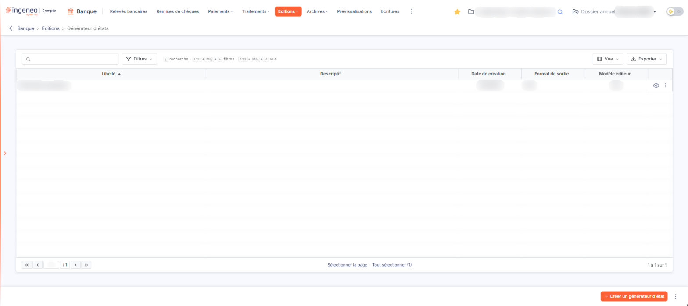
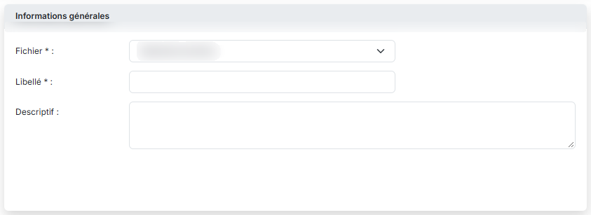
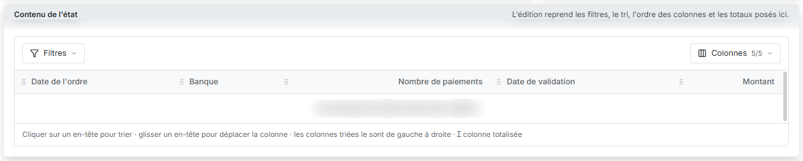
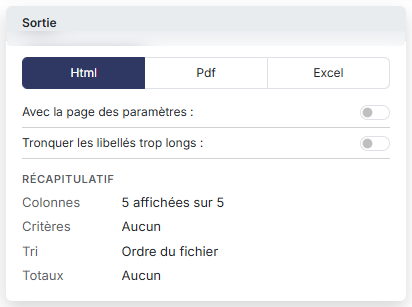
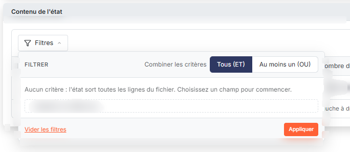
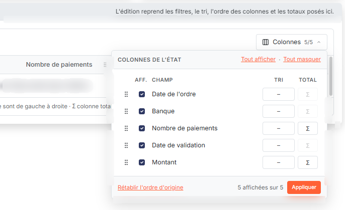

# Générateur d'états


**Où le trouver :** Menu **Editions › Générateur d'états**



**En bref** — Le générateur d'états permet de composer vos propres éditions : fichier à éditer, colonnes, ordre, conditions et format du document (Html, Pdf ou Excel).

* Pour créer un état : bouton \[Créer un générateur d'état], choisissez le « Fichier », saisissez un « Libellé », réglez les colonnes, puis bouton \[Enregistrer].
* Pour régler le document produit : carte « Sortie », choisissez le « Format de sortie » (« Html », « Pdf » ou « Excel »), puis bouton \[Enregistrer].
* Pour récupérer les états livrés avec le logiciel : menu à trois points « Autres actions » du bas de l'écran, entrée « Charger les nouveaux modèles ».


Le **générateur d'états** vous permet de composer vous-même une édition à partir des données du module : vous choisissez le fichier à éditer, les colonnes que l'édition doit présenter, l'ordre dans lequel elles se suivent, les conditions que les lignes doivent remplir pour y figurer, et le format du document produit. Chaque édition ainsi composée est enregistrée sous un libellé et reste disponible dans la liste, pour être relancée, modifiée ou dupliquée.

<figure><figcaption>
Écran « Générateur d'états » de la nouvelle interface
</figcaption></figure>

**a) La liste des états**

L'écran se réduit à un seul tableau : il n'y a pas d'onglet. Au-dessus du tableau, la barre porte le champ « Rechercher un état… » et les boutons \[Filtres], \[Vue] et \[Exporter]. Chaque ligne est un état, c'est-à-dire une édition déjà paramétrée. Tant que vous n'en avez enregistré aucun, la liste affiche « Aucun élément à afficher. ».

Les colonnes affichées sont les suivantes :

* **Libellé** : le nom que porte l'état. C'est le tri initial de la liste, par ordre croissant.
* **Descriptif** : le commentaire libre saisi sur la fiche de l'état. Il peut rester vide.
* **Date de création** : la date à laquelle l'état a été créé.
* **Format de sortie** : le format du document que produit l'état — « Html », « Pdf » ou « Excel ».
* **Modèle éditeur** : « Oui » ou « Non ».

Deux colonnes supplémentaires existent mais ne sont pas affichées par défaut : « Masquer les entêtes » et « Tronquer les libellés ». Vous les faites apparaître par le bouton \[Vue], rubrique « Colonnes affichées » (« 5 colonnes affichées sur 7 » par défaut). Le bas de l'écran porte le bouton \[Créer un générateur d'état] et le menu à trois points « Autres actions » (entrées « Charger les nouveaux modèles » et « Exporter »).

**b) Les commandes du tableau**

Chaque ligne porte, à sa droite, deux commandes :

* l'icône « Afficher l'aperçu » (œil) ;
* le menu à trois points « Autres actions », qui porte « Modifier » — il ouvre la fiche de l'état, voir le paragraphe d) —, « Dupliquer » et « Supprimer », qui ne supprime que l'état de la ligne.

Il n'y a plus de case à cocher : un clic sur une ligne la sélectionne, et un nouveau clic la désélectionne. Un bandeau de sélection apparaît alors au bas de l'écran (« 1 état sélectionné - toutes les pages ») avec le bouton \[Supprimer], qui supprime les états sélectionnés ; sous la liste, les liens deviennent « Désélectionner la page » et « Tout désélectionner (1) ».

**c) Le menu « Filtres »**

Le bouton \[Filtres], à côté du champ de recherche, ouvre un menu « Filtrer » qui restreint la liste. Tant qu'aucun critère n'est posé, il indique « Aucun critère. Choisissez une colonne pour commencer. » ; la liste « + Ajouter un critère sur… » propose les colonnes. Pour chaque critère, vous choisissez un opérateur et une valeur, et vous pouvez combiner deux conditions par « Et » ou par « Ou ».

Les critères proposés reprennent les cinq colonnes affichées ainsi que les deux colonnes masquées. « Format de sortie » se choisit dans une liste déroulante et non en saisie libre, et « Date de création » porte un sélecteur de calendrier.

Le menu porte les boutons bouton **\[Vider les filtres]** et bouton **\[Filtrer]** ; le lien « Tout effacer », qui apparaît à côté du bouton \[Filtres] dès qu'un critère est posé, efface aussi les critères. Les boutons \[Mémoriser les paramètres] et \[Charger les paramètres] n'existent plus.

**d) La fiche d'un état — carte « Informations générales »**

La fiche s'ouvre dans un panneau à droite de l'écran, intitulé « Nouvel état » à la création, et se compose de trois cartes : « Informations générales », « Sortie » et « Contenu de l'état ». La première rassemble ce qui identifie l'état et désigne les données à éditer.

* **Fichier** : les données sur lesquelles porte l'édition. Dans ce module, vous avez le choix entre « Connecteurs », « Paiements à valider », « Paiements archivés » et « Règles de traduction ». Ce choix commande la suite de la fiche : c'est lui qui détermine les champs proposés dans la carte « Contenu de l'état ». Tant que vous n'avez rien retenu, la liste affiche « Sélectionnez », et la carte « Contenu de l'état » affiche « Choisissez un fichier : ses champs apparaîtront ici. ».
* **Libellé** \* : le nom de l'état, tel qu'il apparaîtra dans la liste. Il est obligatoire et ne peut pas dépasser 30 caractères : la zone n'en accepte pas davantage, les caractères saisis au-delà ne s'inscrivent pas.
* **Descriptif** : un commentaire libre, sur plusieurs lignes, destiné à rappeler à quoi sert cet état.

Lorsque vous reprenez un état existant, le champ « Fichier » reste affiché mais ne peut plus être modifié : les données sur lesquelles porte un état se choisissent à sa création et ne se changent plus ensuite. Pour éditer un autre fichier, créez un nouvel état.

**e) Carte « Contenu de l'état »**

Tant qu'aucun fichier n'est retenu, la carte affiche « Choisissez un fichier : ses champs apparaîtront ici. ». Une fois le fichier choisi, elle présente un aperçu des colonnes de l'édition (« Les données de l'état sortent dans l'édition. ») et deux menus :

* le bouton **\[Filtres]**, qui sert à poser des critères sur les champs du fichier ; dans ce menu, « Combiner les critères » se règle sur « Tous (ET) », pour que toutes les conditions soient respectées, ou sur « Au moins un (OU) », pour qu'une condition au moins le soit ; la liste « + Ajouter un critère sur… » propose les champs du fichier ; bouton **\[Vider les filtres]** et bouton **\[Appliquer]** terminent le menu ;
* le bouton **\[Colonnes]**, qui indique le nombre de colonnes affichées (« 5/5 » pour le fichier « Paiements archivés ») et liste les champs avec, pour chacun, une case d'affichage (colonne « Aff. »), un choix de tri (colonne « Tri ») et une totalisation (colonne « Total », signe Σ), ainsi que les liens « Tout afficher » et « Tout masquer », bouton **\[Rétablir l'ordre d'origine]** et bouton **\[Appliquer]**.

Une phrase sous l'aperçu rappelle que l'on clique sur un en-tête pour trier, que l'on glisse un en-tête pour déplacer la colonne, que les colonnes triées le sont de gauche à droite et que le signe Σ marque une colonne totalisée.

Les conditions proposées dépendent du type du champ : tous offrent « Est égal à », « Est différent de », « Est vide », « N'est pas vide » et les quatre comparaisons « Supérieur à », « Supérieur ou égal à », « Inférieur à » et « Inférieur ou égal à » ; un champ de texte y ajoute « Commence par », « Contient » et « Se termine par ».

**f) Carte « Sortie »**

Cette carte, à droite de la fiche, décide de la forme du document produit. Sa composition change avec le format retenu : choisissez d'abord le format de sortie, le logiciel affiche alors les seules options qui s'y appliquent. Un « Récapitulatif » résume l'état en cours de composition : colonnes affichées (« 5 affichées sur 5 »), critères, tri (« Ordre du fichier » tant qu'aucun tri n'est posé) et totaux.

* **Avec la page des paramètres** : proposé pour les trois formats.
* **Format de sortie** : « Html » (retenu à l'ouverture), « Pdf » ou « Excel ».
* **Masquer les entêtes et pieds de page** : proposé pour les formats « Pdf » et « Excel » seulement.
* **Orientation** : « Portrait » (retenu à l'ouverture) ou « Paysage ». Proposé pour le seul format « Pdf ».
* **Tronquer les libellés trop longs** : proposé pour le seul format « Html ».

Les deux dernières options portent, dans le menu \[Vue] de la liste, des noms plus courts : « Masquer les entêtes » et « Tronquer les libellés ». Il s'agit des mêmes paramètres.

**g) Les boutons de la fiche**

bouton **\[Enregistrer]**

Enregistre l'état et son paramétrage.

bouton **\[Annuler]**

Ferme le panneau. Si vous avez modifié la fiche, une fenêtre « Abandon des modifications » vous prévient que « Les modifications non enregistrées de cet état seront perdues. Veuillez confirmer l'abandon. » et vous propose bouton **\[Annuler]** ou bouton **\[Confirmer]**. La croix de l'en-tête du panneau le ferme aussi.

**h) Le message d'erreur du libellé**

Le champ « Libellé » n'accepte que 30 caractères. En saisie, la zone s'arrête d'elle-même à cette longueur : les caractères suivants ne s'inscrivent pas, et le logiciel ne vous affiche aucun message.

## Autres vues de l'écran

<figure><figcaption>
Bouton [Créer un générateur d'état]
</figcaption></figure>

<figure><figcaption>
Informations générales
</figcaption></figure>

<figure><figcaption>
Contenu de l'état
</figcaption></figure>

<figure><figcaption>
Sortie
</figcaption></figure>

<figure><figcaption>
Bouton [Filtres]
</figcaption></figure>

<figure><figcaption>
Bouton [Colonnes]
</figcaption></figure>
