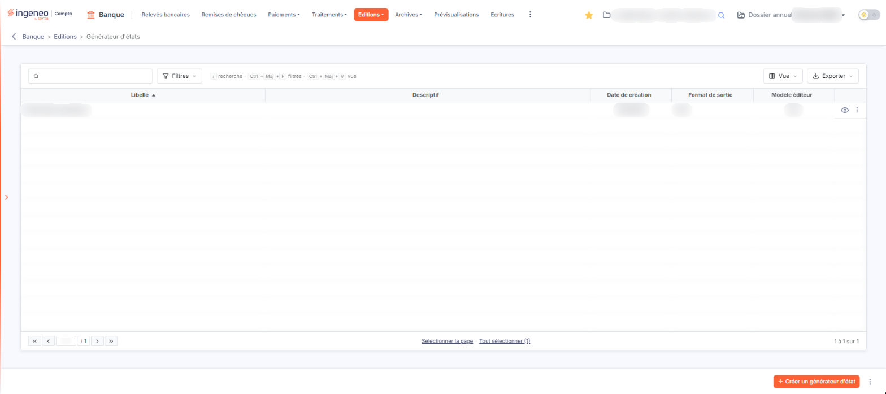
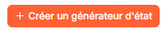
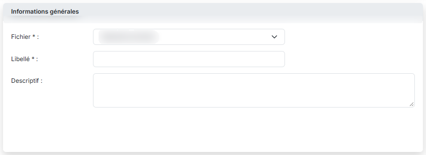
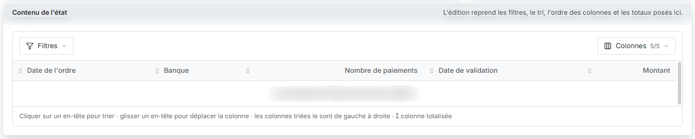
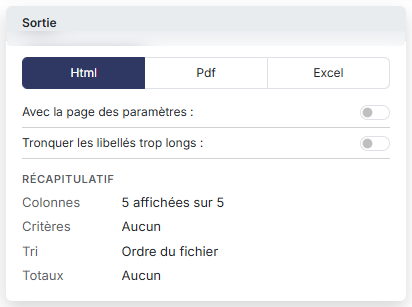
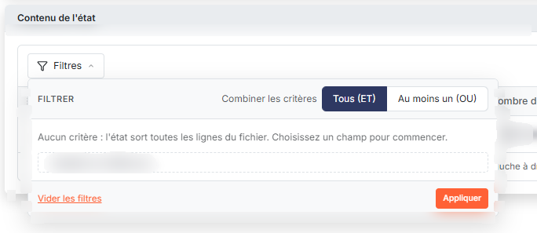
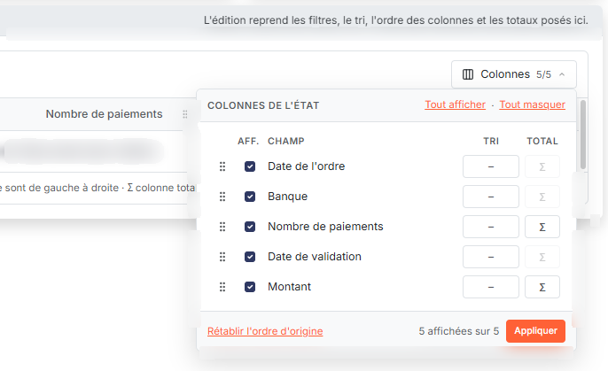

# Éditions — présentation du menu


**Où le trouver :** Menu **Editions › Générateur d'états**



**En bref** — Le menu « Editions » ne donne accès qu'à une sous-option, « Générateur d'états » ; il n'ouvre aucun écran lui-même.

* Pour composer une édition : sélectionnez « Editions », puis « Générateur d'états ».


Le menu « Editions » ne donne accès qu'à une seule sous-option, « Générateur d'états ».

<figure><figcaption>
Écran « Générateur d'états » de la nouvelle interface
</figcaption></figure>

## Autres vues de l'écran

<figure><figcaption>
Bouton [Créer un générateur d'état]
</figcaption></figure>

<figure><figcaption>
Informations générales
</figcaption></figure>

<figure><figcaption>
Contenu de l'état
</figcaption></figure>

<figure><figcaption>
Sortie
</figcaption></figure>

<figure><figcaption>
Bouton [Filtres]
</figcaption></figure>

<figure><figcaption>
Bouton [Colonnes]
</figcaption></figure>
