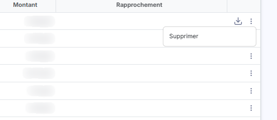

# Événements clients


**Où le trouver :** Menu **Evénements › Clients**



**En bref** — Cet écran liste les événements clients (factures et avoirs validés dans d'autres modules), mis à disposition pour être rapprochés de vos lignes de relevés bancaires.

* Pour récupérer les nouveaux événements : bouton \[Importer].
* Pour écarter des pièces inutiles : sélectionnez-les, puis bouton \[Supprimer].
* Pour consulter la pièce d'origine : pictogramme « Télécharger » de la ligne.


Cet écran est commun aux options « Clients » et « Fournisseurs » du menu « Evénements ».

<figure><figcaption>
Écran « Clients » de la nouvelle interface
</figcaption></figure>

Cette option n'est disponible que si la gestion des annotations manuelles ainsi que la récupération des événements ont été activées dans le panneau « Paramètres », rubrique « Banque », onglet « Configuration ».

La liste affiche toutes les factures et tous les avoirs clients qui ont été validés dans la facturation, la gestion commerciale ou la reconnaissance de documents. Ce sont ces événements que vous rapprochez ensuite de vos lignes de relevés dans l'écran « Relevés bancaires » (la colonne « Etat / Règle » y affiche alors « Événement · … »).

Tous les événements importés correspondent à des pièces qui ont déjà été validées dans d'autres modules ; ces pièces ont donc déjà généré des écritures comptables. C'est la raison pour laquelle vous pouvez les supprimer sans conséquence si vous estimez qu'elles n'ont plus de raison d'être rapprochées, par exemple lorsqu'elles sont antérieures à la mise en place des annotations.

## La liste des événements clients

La liste comporte sept colonnes, toutes affichées et toutes triables en cliquant sur leur en-tête. Elle est présentée par date croissante, l'événement le plus ancien en tête. Au-dessus de la liste figurent un champ de recherche, bouton **\[Filtres]**, bouton **\[Vue]** et bouton **\[Exporter]** (voir plus bas).

| Champ              | Ce qu'il faut savoir                                                                                                                                                 |
| ------------------ | -------------------------------------------------------------------------------------------------------------------------------------------------------------------- |
| **Date**           | Date de la pièce.                                                                                                                                                    |
| **Référence**      | Référence de la pièce dans le module d'origine.                                                                                                                      |
| **SIREN**          | Numéro SIREN du client, lorsqu'il est connu.                                                                                                                         |
| **Raison sociale** | Nom du client.                                                                                                                                                       |
| **Nature**         | Nature de la pièce, par exemple « Facture client » ou « Avoir client ».                                                                                              |
| **Montant**        | Montant de la pièce.                                                                                                                                                 |
| **Rapprochement**  | Le logiciel indique ici le rapprochement dont l'événement a fait l'objet. Cette colonne reste vide tant que l'événement n'a pas été rapproché d'une ligne de relevé. |

La barre placée au-dessus de la liste comporte :

* le champ « Rechercher un tiers… », qui restreint la liste aux événements correspondants,
* le bouton **\[Filtres]**, qui ouvre le volet des critères de la liste,
* le bouton **\[Vue]**, qui ouvre le menu de présentation de la liste (recherche d'une colonne, enregistrement de la vue actuelle, retour aux colonnes d'origine, bouton **\[Appliquer]**), et le bouton **\[Exporter]**, dont le menu offre « Aperçu édition HTML », « Imprimer », « Exporter en Excel », « Exporter en PDF » et « Envoyer la liste par e-mail ».

Il n'y a plus de case à cocher : un clic sur une ligne la sélectionne, et les liens « Sélectionner la page » et « Tout sélectionner (N) », sous la liste, sélectionnent les lignes de la page affichée ou de toute la liste. Pour retrouver un événement, vous disposez de la recherche, des filtres et du tri des colonnes.

## Les commandes de chaque ligne

<figure><figcaption>
Rubrique « b) Les commandes de chaque ligne »
</figcaption></figure>

Toutes les lignes portent les mêmes commandes. Un événement importé ne s'ouvre pas en fiche : vous pouvez seulement le consulter ou le supprimer.

| Champ            | Ce qu'il faut savoir                                                                                                                                                                                                                                                                                        |
| ---------------- | ----------------------------------------------------------------------------------------------------------------------------------------------------------------------------------------------------------------------------------------------------------------------------------------------------------- |
| **Sélectionner** | Un clic sur la ligne la sélectionne, ce qui la fait entrer dans le champ du bouton **\[Supprimer]** du bandeau de sélection.                                                                                                                                                                                |
| **Télécharger**  | Pictogramme (une flèche vers le bas) visible au survol de la ligne ; il télécharge le document d'origine de l'événement. Si ce document n'est plus accessible, le logiciel ouvre une fenêtre « Erreur » portant le message « Impossible de visualiser l'événement. Le document recherché a été supprimé. ». |
| **Supprimer**    | Commande du menu ⋮ « Autres actions » de la ligne, qui retire l'événement de la liste.                                                                                                                                                                                                                      |

## Les boutons de bas d'écran

bouton **\[Importer]**

Si vous avez indiqué « Manuellement » dans le champ **Méthode d'import des événement clients :** du panneau « Paramètres » (rubrique « Banque », onglet « Configuration »), utilisez ce bouton pour enrichir la liste des nouveaux événements. Dans le cas contraire, le logiciel importe les événements de lui-même et vous n'avez rien à faire ici.

Le logiciel reprend alors les factures et les avoirs clients validés depuis le dernier import, puis vous indique le nombre d'événements importés.

bouton **\[Supprimer]**

Ce bouton supprime les événements que vous avez sélectionnés.

Ce bouton ne figure que dans le bandeau de sélection, qui apparaît en bas de l'écran dès qu'une ligne est sélectionnée : il n'est donc proposé qu'avec au moins une ligne sélectionnée.

Le bouton **\[Importer]** est affiché en permanence, en bas à droite de l'écran. Les deux boutons ne sont proposés qu'aux utilisateurs qui en ont le droit.

Les commandes de cet écran dépendent de votre profil : selon les droits qui vous ont été accordés, certaines peuvent ne pas vous être proposées.
