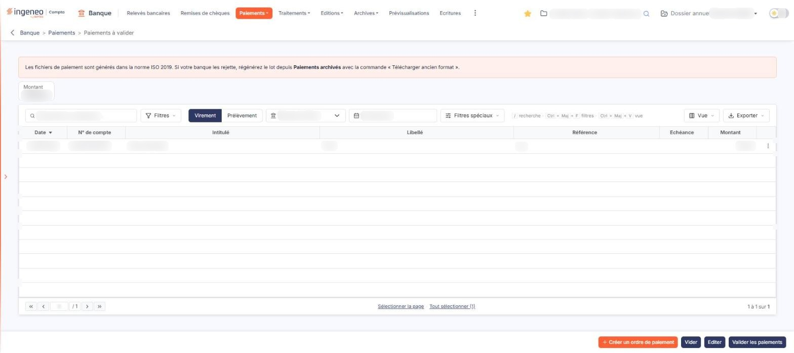
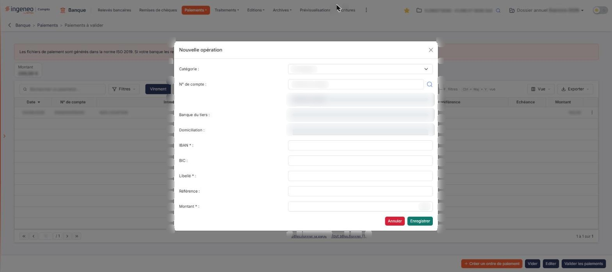

# Paiements à valider


**Où le trouver :** Menu **Paiements › Paiements à valider**



**En bref** — Cet écran prépare vos ordres de virement et de prélèvement SEPA, puis génère le fichier .XML à remettre à votre banque.

* Pour ajouter un paiement : bouton \[Créer un ordre de paiement], renseignez la fenêtre « Nouvelle opération », puis bouton \[Enregistrer].
* Pour générer le fichier : choisissez « Virement » ou « Prélèvement », la « Banque » et la date de l'ordre, puis bouton \[Valider les paiements].
* Pour ne valider que certains paiements : sélectionnez-les, puis bouton \[Valider la sélection].


Cette option permet de préparer vos ordres de virement et de prélèvement SEPA, puis de générer le fichier au format .XML à remettre à votre banque.

<figure><figcaption>
Écran « Paiements à valider » de la nouvelle interface
</figcaption></figure>

La liste peut avoir été préremplie depuis l'option « Paiements » du module de comptabilité. Vous pouvez également y ajouter des opérations une à une.

Un fichier ne contient qu'un seul type d'opération, ne concerne qu'une seule banque, et tous les paiements qu'il contient sont exécutés à la même date. Vous commencez donc par indiquer ces caractéristiques générales en haut de l'écran.

Un bandeau rose, en haut de l'écran, indique que « Les fichiers de paiement sont générés dans la norme ISO 2019 » et, si votre banque les rejette, vous invite à régénérer le lot depuis « Paiements archivés » avec la commande « Télécharger ancien format ». Dans « Paiements archivés », cette commande s'intitule bouton **\[Télécharger la sélection (ancien format)]**.

## Les caractéristiques du fichier de paiements

| Champ                | Ce qu'il faut savoir                                                                                                                                                                                                                                                                                                            |
| -------------------- | ------------------------------------------------------------------------------------------------------------------------------------------------------------------------------------------------------------------------------------------------------------------------------------------------------------------------------- |
| **Type d'opération** | Choisissez « Virement » ou « Prélèvement » avec les deux boutons placés au début de la barre de la liste. Le logiciel affiche « Virement » à l'ouverture de l'écran. Ce choix commande tout le reste : la liste ne montre que les opérations du type retenu, et la fenêtre de saisie s'adapte.                                  |
| **Banque**           | Choisissez le compte bancaire concerné parmi ceux de votre société. Attention, cette liste ne comporte pas d'invite du type « Sélectionnez » : le logiciel en présélectionne un. Vérifiez qu'il s'agit bien du compte voulu avant de valider quoi que ce soit.                                                                  |
| **Recherche**        | Saisissez du texte dans le champ « Rechercher un paiement… » pour restreindre la liste aux opérations correspondantes. Le bouton **\[Filtres]**, à droite du champ, ouvre le volet des critères de la liste : vous y ajoutez un critère sur une colonne, puis vous cliquez sur le bouton **\[Filtrer]**.                        |
| **Date de l'ordre**  | C'est la date d'exécution des paiements, proposée à la date du jour ; le champ n'a pas de libellé au-dessus, « Date de l'ordre » s'y affiche en invite. **C'est le seul champ obligatoire de l'écran** hors fenêtre de saisie.                                                                                                  |
| **Montant**          | Ce n'est pas un critère de recherche mais un **total**, affiché dans un cartouche « Montant » au-dessus de la liste, à gauche : le logiciel y cumule le montant des paiements de la liste, c'est-à-dire ceux que retiennent la recherche et le menu \[Filtres] ; il ne dépend pas de votre sélection. Il n'est pas saisissable. |
| **Filtres spéciaux** | Un bouton déroulant du même nom complète la barre de la liste, à droite de la date de l'ordre.                                                                                                                                                                                                                                  |

Les critères posés dans le volet \[Filtres] se retirent par le bouton **\[Vider les filtres]** de ce volet, ou par le lien « Tout effacer ».

## La liste des opérations en attente

Elle présente les colonnes suivantes : **Date**, **N° de compte**, **Intitulé**, **Libellé**, **Référence**, **Echéance** et **Montant**. Elle est triée par date à l'ouverture, et vous pouvez la trier sur n'importe quelle colonne en cliquant sur son en-tête.

Pour agir sur des opérations, sélectionnez-les : un clic sur une ligne la sélectionne (il n'y a plus de case à cocher). Sous la liste, le lien « Sélectionner la page » sélectionne toutes les lignes de la page affichée et le lien « Tout sélectionner (N) » toutes celles de la liste, quelle que soit la page ; dès qu'une ligne est sélectionnée, un bandeau de sélection apparaît en bas de l'écran.

Le bouton **\[Vue]** de la barre de la liste ouvre le menu de présentation : il permet de rechercher une colonne, d'enregistrer la vue actuelle sous un nom, de rétablir les colonnes d'origine et de valider par le bouton **\[Appliquer]**. Les sept colonnes sont visibles par défaut : il n'y a pas de colonne supplémentaire à révéler.

Le bouton **\[Exporter]**, à droite de la barre de la liste, ouvre un menu : « Aperçu édition HTML », « Imprimer », « Exporter en Excel », « Exporter en PDF » et « Envoyer la liste par e-mail ». Chaque ligne se termine par le menu ⋮ « Autres actions », qui propose « Modifier » et « Supprimer ».

## Ajouter une opération

<figure><figcaption>
Rubrique « c) Ajouter une opération »
</figcaption></figure>

Cliquez sur le bouton **\[Créer un ordre de paiement]**, en orange en bas à droite de l'écran : le logiciel ouvre la fenêtre « Nouvelle opération ». Elle est la même pour un virement et pour un prélèvement, à deux différences près, signalées ci-dessous.

| Champ                                                                   | Ce qu'il faut savoir                                                                                                                                                                                                                                                                                                                                                                                                   |
| ----------------------------------------------------------------------- | ---------------------------------------------------------------------------------------------------------------------------------------------------------------------------------------------------------------------------------------------------------------------------------------------------------------------------------------------------------------------------------------------------------------------- |
| **Catégorie**                                                           | Pour un **virement**, choisissez entre « Fournisseurs » et « Salariés ». Pour un **prélèvement**, la liste ne propose que « Clients ».                                                                                                                                                                                                                                                                                 |
| **N° de compte**                                                        | 
Il s'agit du compte auxiliaire du tiers. Saisissez quelques caractères de son nom ou de son numéro pour que le logiciel vous propose les comptes correspondants, ou cliquez sur le pictogramme « Loupe » pour faire votre choix dans une fenêtre de recherche. Le champ situé à droite du numéro affiche l'<strong>intitulé du compte</strong> retenu ; il n'est pas saisissable et ne porte pas de libellé.
 |
| **Banque du tiers**                                                     | **Domiciliation :** le logiciel les renseigne d'après la fiche du tiers. Vous ne pouvez pas les saisir.                                                                                                                                                                                                                                                                                                                |
| 
<strong>IBAN</strong> <em>Obligatoire</em>
                    | Si le tiers n'a pas de compte bancaire renseigné dans sa fiche, indiquez ici l'IBAN du compte à débiter ou à créditer. Dans le cas contraire, le logiciel vous propose le ou les comptes paramétrés.                                                                                                                                                                                                                   |
| **BIC :attention, ce champ change de statut selon le type d'opération** | Pour un virement, il devient **obligatoire pour un prélèvement**. Rien ne vous en avertit à l'écran, hormis l'astérisque qui apparaît devant les deux-points.                                                                                                                                                                                                                                                          |
| 
<strong>Libellé</strong> <em>Obligatoire</em>
                 | Ce libellé figurera dans la ligne d'écriture, si vous avez demandé la génération des écritures à la validation des paiements.                                                                                                                                                                                                                                                                                          |
| **Référence**                                                           | Cette référence figurera elle aussi dans la ligne d'écriture, dans les mêmes conditions.                                                                                                                                                                                                                                                                                                                               |
| 
<strong>Montant</strong> <em>Obligatoire</em>
                 | Le montant à virer ou à prélever.                                                                                                                                                                                                                                                                                                                                                                                      |

Cliquez sur le bouton **\[Enregistrer]** pour ajouter l'opération à la liste, ou sur le bouton **\[Annuler]** pour renoncer.

bouton **\[Valider les paiements]**

C'est le traitement qui déclenche la validation des opérations et la génération du fichier .XML. Enregistrez ce fichier sur votre poste pour l'adresser ensuite à votre banque.

C'est également à ce moment que le logiciel génère les écritures et les règlements, si vous les avez demandés dans le panneau « Paramètres », rubrique « Banque », onglet « Connexion comptabilité », rubrique « Ecritures ».

Les opérations validées quittent alors cette liste et sont enregistrées dans la sous-option « Paiements archivés ».

bouton **\[Editer]**

Il édite la liste des opérations figurant à l'écran.

bouton **\[Vider]** et bouton **\[Supprimer]**

Ces deux boutons retirent des opérations en attente : \[Vider] retire l'ensemble de celles qui figurent dans la liste, \[Supprimer] celles que vous avez sélectionnées. \[Vider] est un bouton du pied de l'écran, toujours affiché ; \[Supprimer] ne se trouve que dans le bandeau de sélection, qui apparaît dès qu'une ligne est sélectionnée et qui porte aussi le bouton **\[Valider la sélection]**. Ce dernier lance le même traitement que le bouton **\[Valider les paiements]** du pied : si des lignes sont sélectionnées, la validation ne porte que sur elles ; sans sélection, elle porte sur tous les paiements du type d'opération, de la banque et du compte auxiliaire choisis, et le logiciel la refuse tant que des critères de recherche ou de filtre sont appliqués (sélectionnez alors les lignes, ou effacez les critères).

Maniez-les avec précaution. Comme les bouton **\[Editer]** et bouton **\[Valider les paiements]**, \[Vider] est affiché en permanence, et rien à l'écran n'explique la portée de ces boutons : vérifiez toujours le type d'opération, la banque et votre sélection avant de cliquer.
