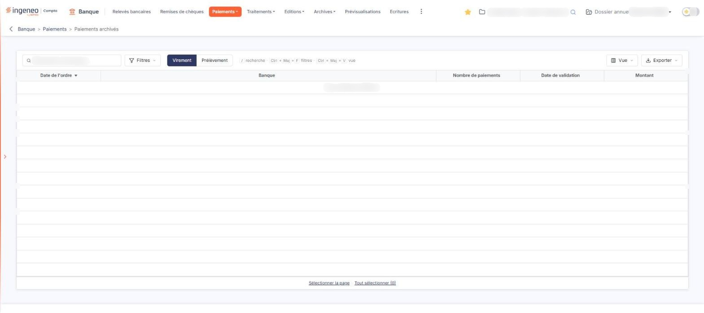

# Paiements archivés


**Où le trouver :** Menu **Paiements › Paiements archivés**



**En bref** — Cet écran conserve les ordres de virement et de prélèvement validés : vous y retrouvez un ordre transmis, retéléchargez son fichier ou supprimez un ordre devenu inutile.

* Pour retélécharger un fichier de paiement : sélectionnez l'ordre, puis bouton \[Télécharger la sélection].
* Si votre banque rejette le fichier : sélectionnez l'ordre, puis bouton \[Télécharger la sélection (ancien format)].
* Pour retirer un ordre erroné : sélectionnez-le, bouton \[Supprimer], puis confirmez.


Cet écran conserve les ordres de virement et de prélèvement que vous avez validés. Vous n'y créez rien et vous n'y saisissez rien : il vous sert à retrouver un ordre déjà transmis à votre banque, à en télécharger de nouveau le fichier, et à supprimer un ordre dont vous n'avez plus l'usage.

<figure><figcaption>
Écran « Paiements archivés » de la nouvelle interface
</figcaption></figure>

**La zone de filtre**

| Champ                   | Ce qu'il faut savoir                                                                                                                                                                                                                                                                                                                                                                     |
| ----------------------- | ---------------------------------------------------------------------------------------------------------------------------------------------------------------------------------------------------------------------------------------------------------------------------------------------------------------------------------------------------------------------------------------- |
| **Type d'opération**    | Deux boutons, « Virement » et « Prélèvement », vous permettent de choisir la nature des ordres affichés. Les deux listes sont distinctes : un ordre de prélèvement n'apparaît jamais dans la liste des virements, et inversement. À l'ouverture de l'écran, le logiciel affiche les **virements**.                                                                                       |
| **Recherche**           | 
Le champ « Rechercher une banque… » restreint la liste aux ordres correspondants. Le bouton <strong>[Filtres]</strong> ouvre le volet des critères de la liste. <strong>Les colonnes de la liste</strong> La liste est triée par défaut sur la date de l'ordre, de la plus récente à la plus ancienne. Vous pouvez la trier sur n'importe laquelle des colonnes suivantes :
 |
| **Date de l'ordre**     | Date à laquelle l'ordre de paiement a été constitué.                                                                                                                                                                                                                                                                                                                                     |
| **Banque**              | Le compte bancaire depuis lequel l'ordre est émis.                                                                                                                                                                                                                                                                                                                                       |
| **Nombre de paiements** | Le nombre de paiements que l'ordre regroupe.                                                                                                                                                                                                                                                                                                                                             |
| **Date de validation**  | Date à laquelle l'ordre a été validé, c'est-à-dire la date à laquelle il est entré dans cette liste.                                                                                                                                                                                                                                                                                     |
| **Montant**             | Le montant total de l'ordre.                                                                                                                                                                                                                                                                                                                                                             |

Ces cinq colonnes sont les seules de l'écran, et elles sont toutes affichées : il n'y a pas de colonne supplémentaire à faire apparaître.

**Les commandes de la liste**

Il n'y a pas de case à cocher : un clic sur une ligne la sélectionne. Deux liens placés sous la liste complètent la sélection, et le bouton « Vue » règle la présentation :

* « Sélectionner la page » sélectionne toutes les lignes de la page affichée,
* « Tout sélectionner (N) » étend la sélection à toutes les lignes de la liste, sur toutes les pages (N est leur nombre),
* le bouton **\[Vue]**, dans la barre de la liste, ouvre le menu de présentation des colonnes.

Le menu « Vue » permet de rechercher une colonne, d'enregistrer la vue actuelle sous un nom, de rétablir les colonnes d'origine et de valider par le bouton **\[Appliquer]**.

La barre de la liste propose aussi le bouton **\[Filtres]**, qui ouvre le volet des critères par colonne, et le bouton **\[Exporter]**, dont le menu offre « Aperçu édition HTML », « Imprimer », « Exporter en Excel », « Exporter en PDF » et « Envoyer la liste par e-mail ». Pour retrouver un ordre ancien, vous disposez aussi du tri des colonnes. Les trois commandes décrites ci-dessous ne sont pas affichées en bas de l'écran en permanence : elles apparaissent dans le bandeau de sélection, dès qu'un ordre est sélectionné.

bouton **\[Télécharger la sélection]**

Sélectionnez les ordres voulus, puis cliquez sur ce bouton : le logiciel vous restitue le fichier de paiement correspondant, dans la version en vigueur de la norme SEPA. C'est le bouton à utiliser dans le cas courant.

bouton **\[Télécharger la sélection (ancien format)]**

Ce bouton produit les mêmes fichiers, mais dans la version antérieure de la norme, ISO pain.001.001.03. Son infobulle, accessible par le pictogramme d'information placé à sa droite, précise : « Télécharger les fichiers de la sélection dans la version antérieure ISO pain.001.001.03 au lieu de la nouvelle version ISO pain.001.001.09. À utiliser en cas de rejet par la banque. »

Ne l'employez donc que si votre banque a refusé le fichier produit par le bouton précédent.

bouton **\[Supprimer]**

Sélectionnez les ordres à retirer de la liste puis cliquez sur ce bouton.

Cette suppression est destinée au cas suivant : vous avez validé un ordre, donc produit son fichier, puis vous vous êtes aperçu d'une erreur **avant de le transmettre à votre banque**. Vous corrigez, vous produisez et validez un nouvel ordre, et vous supprimez ici le premier, devenu inutile.

La suppression est **définitive** : l'ordre disparaît de cette liste et son fichier n'est plus téléchargeable. Elle n'a en revanche **aucun effet auprès de votre banque** : si le fichier lui a déjà été transmis, le supprimer ici n'annule pas les paiements. N'y recourez donc qu'en connaissance de cause.

Cet écran ne comporte ni création, ni modification, ni validation : les ordres y arrivent depuis l'option « Paiements à valider », une fois validés.

Les commandes de cet écran dépendent de votre profil : selon les droits qui vous ont été accordés, certaines peuvent ne pas vous être proposées.
