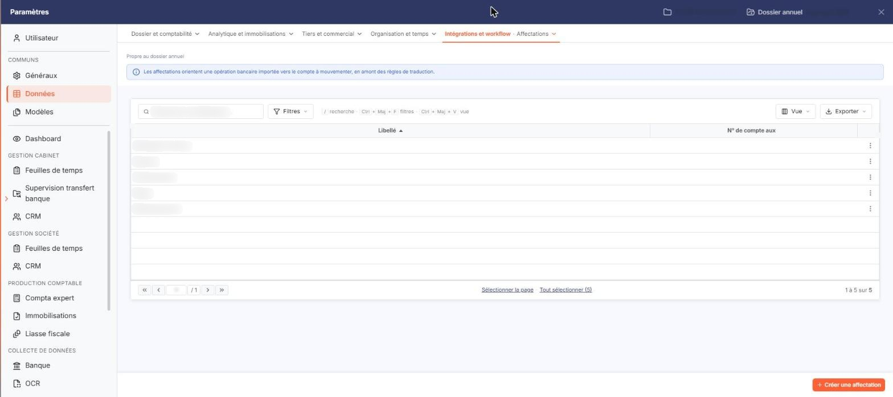
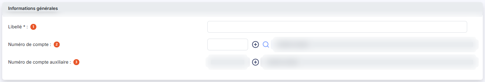

# Affectations


**Où le trouver :** Panneau **Paramètres** › **Données** › **Intégrations et workflow** › **Affectations**



**En bref** — Cet écran constitue la liste des affectations types, qui orientent une ligne de relevé non reconnue vers le compte de contrepartie à mouvementer.

* Pour créer une affectation : bouton \[Créer une affectation], renseignez « Libellé » et « Numéro de compte », puis bouton \[Enregistrer].
* Pour supprimer des affectations : sélectionnez-les, puis bouton \[Supprimer].


Cet écran se trouve dans le panneau « Paramètres » : rubrique « Données », catégorie « Intégrations et workflow », onglet « Affectations ». L'onglet affiche en tête la mention « Propre au dossier annuel » et un encadré qui rappelle que les affectations orientent une opération bancaire importée vers le compte à mouvementer, en amont des règles de traduction.

<figure><figcaption>
Écran « Affectations » de la nouvelle interface
</figcaption></figure>

Le fichier des affectations vous permet de constituer la liste des affectations types. Dans l'écran « Relevés bancaires », la fiche d'une ligne de relevé (menu ⋮ « Autres actions », puis « Modifier ») propose la liste « Affectation » : vous pourrez y associer une affectation à chaque ligne de relevé qui n'aura été associée à aucune règle de traduction : la contrepartie de la ligne de banque sera alors générée dans le compte indiqué dans l'affectation.

L'écran affiche la liste des affectations du dossier, classée par ordre croissant de libellé. Deux colonnes seulement sont présentées : **Libellé** et **N° de compte aux**, qui restitue le compte auxiliaire de l'affectation. Toutes deux peuvent servir de critère de tri : cliquez sur leur en-tête.


Attention : la liste ne montre pas le compte général de l'affectation, seulement son compte auxiliaire. Une affectation dont le compte général est renseigné apparaît donc avec une colonne de compte vide. Ouvrez la fiche pour connaître son paramétrage complet.


Le logiciel crée lui-même une affectation intitulée « Affectation inconnue » : c'est celle qui reçoit les lignes de relevé qu'il n'a pas su reconnaître. Rien ne la distingue des autres dans la liste, et elle vous est proposée avec les mêmes commandes, suppression comprise.

Il n'y a pas de case à cocher : un clic sur une ligne la sélectionne, et les liens « Sélectionner la page » et « Tout sélectionner (N) », sous la liste, sélectionnent toutes les lignes de la page affichée ou de la liste entière. La barre de la liste propose le champ « Rechercher une affectation… » et trois boutons : bouton **\[Filtres]**, qui ouvre le volet des critères, bouton **\[Vue]**, qui règle la présentation des colonnes, et bouton **\[Exporter]**, dont le menu offre « Aperçu édition HTML », « Imprimer », « Exporter en Excel », « Exporter en PDF » et « Envoyer la liste par e-mail ».

Sur chaque ligne, le seul pictogramme est ⋮ « Autres actions », à droite : aucune commande n'apparaît au survol de la ligne. Son menu propose « Modifier », qui ouvre la fiche de l'affectation en modification, et « Supprimer », qui la supprime. Il n'y a pas de commande de duplication.

bouton **\[Créer une affectation]**

Placé en orange en bas à droite du panneau, il ouvre la fiche de création d'une affectation, tous les champs vides.

bouton **\[Supprimer]**

Supprime les affectations que vous avez sélectionnées dans la liste.

La fiche d'une affectation, en création comme en modification, ne comporte qu'une seule rubrique.

## Rubrique « Informations générales »

<figure><figcaption>
Rubrique « Informations générales »
</figcaption></figure>

| Champ                              | Ce qu'il faut savoir                                                                                                                                                                                                                                                                                                                                                                                                       |
| ---------------------------------- | -------------------------------------------------------------------------------------------------------------------------------------------------------------------------------------------------------------------------------------------------------------------------------------------------------------------------------------------------------------------------------------------------------------------------- |
| 1. **Libellé**                     | 
Saisissable à la création seulement. C'est ce libellé qui vous sera proposé dans le sélecteur d'affectations lors de l'annotation des lignes de relevé : choisissez-le explicite. Une fois l'affectation créée, ce libellé n'est plus modifiable : la zone est présentée désactivée sur la fiche, sans message qui l'explique. Pour changer le libellé d'une affectation, vous devez donc en créer une nouvelle.
 |
| 2. **Numéro de compte**            | Indiquez le numéro du compte général qui sera affecté à la ligne de contrepartie. Saisissez-le directement, ou recherchez-le avec le pictogramme « Loupe » (infobulle « Ctrl + Alt + R », le raccourci clavier) ; le bouton « Créer » (un « + », à côté de la zone) ouvre la création d'un compte. Le logiciel restitue à droite l'intitulé du compte, en grisé : cet intitulé ne se saisit pas.                           |
| 3. **Numéro de compte auxiliaire** | Cette zone est présentée désactivée, aussi bien en création qu'en modification, et sa loupe de recherche n'est pas proposée ; seul son bouton « Créer » (un « + ») reste actif. Elle ne se renseigne donc pas dans l'état actuel de l'écran.                                                                                                                                                                               |

bouton **\[Enregistrer]**

Enregistre la fiche de l'affectation.

**Chevron « Retour »**

Placé à gauche de la barre d'onglets du panneau, il quitte la fiche sans enregistrer et vous ramène à la liste.

## Autres vues de l'écran

<figure><figcaption>
Bouton [Créer une affectation]
</figcaption></figure>
