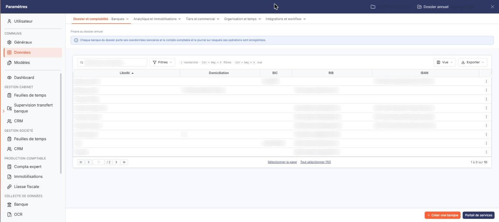
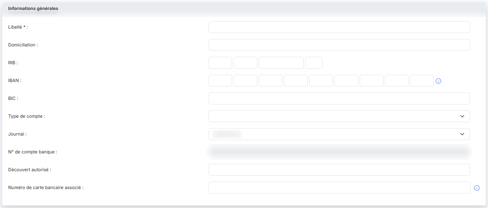
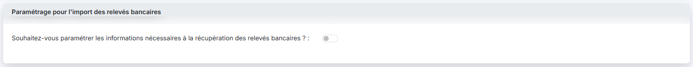
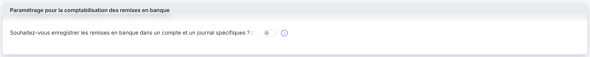

# Banques


**Où le trouver :** Panneau **Paramètres** › **Données** › **Dossier et comptabilité** › **Banques**



**En bref** — Cet écran tient le fichier des banques du dossier, commun à plusieurs modules : comptes bancaires, journal associé, compte d'attente et paramétrage de la récupération des relevés.

* Pour ajouter une banque : bouton \[Nouveau], renseignez « Libellé », l'IBAN et le « Journal », puis bouton \[Enregistrer].
* Pour indiquer le compte des lignes non reconnues : répondez « Oui » à la question sur la récupération des relevés, puis renseignez « Compte d'attente ».
* Pour recommencer un import mal paramétré : bouton \[Réinitialiser les imports], qui supprime tous les relevés de cette banque.


Le fichier des banques recense les comptes bancaires du dossier. Il est **commun à plusieurs modules** du logiciel (Comptabilité, Caisse, Gestion commerciale…) et sert à plusieurs usages : la récupération des relevés bancaires et leur transformation en écritures, les remises en banque, les virements et prélèvements SEPA. Une banque créée ici est donc visible depuis tous les modules qui l'utilisent.

<figure><figcaption>
Écran « Banques » de la nouvelle interface
</figcaption></figure>

Les banques peuvent être créées manuellement dans ce fichier, ou automatiquement lors du paramétrage des comptes dont vous souhaitez récupérer les écritures.

**a) La liste des banques**

Il n'y a ni rubrique ni filtre au-dessus du tableau. Les colonnes affichées sont **Libellé** (tri initial croissant), **Domiciliation**, **BIC**, **RIB** et **IBAN** ; toutes sont triables et peuvent être vides.

L'en-tête de la première colonne, sans intitulé, porte cinq commandes : une case à cocher qui sélectionne toutes les lignes de la page, une seconde case orange qui étend la sélection à toutes les pages, le pictogramme « Engrenage » (personnalisation des colonnes), le pictogramme « Entonnoir » (fenêtre de filtres) et le pictogramme « Imprimante » (impression de la liste).

La fenêtre de filtres permet de chercher aussi bien sur les colonnes affichées que sur des informations qui ne figurent pas dans le tableau : compte banque, journal, compte d'attente, type de compte, découvert autorisé, numéro de carte bancaire, dates de création et de modification, etc.

Chaque ligne porte trois commandes : la **case à cocher** de sélection, le pictogramme « Crayon » pour ouvrir la fiche de la banque, et le pictogramme « Croix verte » pour la supprimer.

En bas de l'écran, le bouton **\[Nouveau]** ouvre une fiche vierge et le bouton **\[Supprimer]** supprime les banques cochées.

**Une banque déjà utilisée ne peut pas être supprimée.** Le logiciel vous répond alors que la banque ne peut être supprimée car elle est utilisée, et il vous énumère précisément où : des remises de chèques, des lignes de relevés bancaires, des lignes de relevés bancaires archivées, des paiements SEPA, des saisies de caisse, les paramètres multimodules, ou des paiements de taxes en cours. Il vous faut traiter ces éléments avant de pouvoir supprimer la fiche.

**b) Création manuelle et création automatique**

Si vous n'utilisez pas la récupération automatique des relevés, vous devez créer vos banques manuellement à l'aide du bouton **\[Nouveau]**.

Lorsque vous paramétrez un nouveau compte pour récupérer les écritures, le logiciel vérifie s'il n'existe pas déjà une banque portant le même RIB. Si c'est le cas, il fait l'association immédiatement. Dans le cas contraire, il crée une nouvelle banque avec les informations qu'il connaît — l'IBAN, par exemple — et il vous reste à compléter les paramétrages manquants, notamment le journal.

**c) Rubrique « Informations générales »**

Si la banque a été créée automatiquement, plusieurs de ses informations sont déjà renseignées.

* **Libellé** : champ obligatoire. C'est le nom sous lequel la banque apparaît partout ailleurs dans le logiciel.
* **Domiciliation** : facultatif.
* **RIB** : il se saisit dans quatre cases accolées, dans l'ordre : code banque, code guichet, numéro de compte, clé.
* **IBAN** : il se saisit dans neuf cases accolées. La première reçoit le code pays et la clé (par exemple _FR76_), les huit suivantes reçoivent le reste de l'IBAN par groupes de quatre caractères ; les dernières cases restent vides si l'IBAN est plus court.
* **BIC** : facultatif.
* **Type de compte** : facultatif. Vous choisissez dans une liste la nature du compte : compte chèque, compte épargne, compte de dépôt, compte joint, compte titres, carte bancaire, emprunt, assurance vie, plan épargne entreprise, plan épargne retraite, article 83, réserve spéciale de participation. Vous pouvez aussi laisser ce champ vide.
* **Journal** : c'est le journal dans lequel toutes les écritures relatives à cette banque seront enregistrées. La liste ne propose que les **journaux de type banque** du dossier annuel en cours.
* **N° de compte banque** : ce champ n'est **pas saisissable**. Le logiciel y affiche automatiquement le compte comptable associé au journal que vous venez de choisir. Tant qu'aucun journal n'est sélectionné, le champ reste inactif. Pour changer le compte bancaire, vous devez donc changer de journal.
* **Découvert autorisé** : facultatif.
* **Date de création**, **Créée par**, **Date de modification**, **Modifiée par** : ces quatre informations sont affichées à titre indicatif et ne sont pas modifiables. Sur les fiches les plus anciennes, la date et l'auteur de création peuvent être vides. Elles ne s'affichent pas du tout lors de la création d'une nouvelle banque.
* **Numéro de carte bancaire associé** : facultatif. Son infobulle précise : _« Ce numéro est notamment utile en cas d'import de fichier OFX. »_

Si le **Découvert autorisé** est renseigné, il peut être utilisé pour déclencher une alerte en cas de dépassement.

**d) Rubrique « Paramétrage pour l'import des relevés bancaires »**

Cette rubrique ne présente d'abord qu'une seule question : **Souhaitez-vous paramétrer les informations nécessaires à la récupération des relevés bancaires ?**. Si ce compte doit alimenter le module, répondez **« Oui »** : quatre informations et un bouton apparaissent alors.

* **Date de début de récupération** : non modifiable. Son infobulle précise : _« Cette date est celle que vous avez indiquée lors du premier import pour cette banque. »_
* **Date de dernière récupération** : non modifiable. Son infobulle précise : _« Date de la dernière récupération d'écriture automatique ou date de la dernière demande d'import manuel. »_
* **Compte d'attente** : champ obligatoire. Entrez le numéro du compte qui sera affecté à toutes les lignes de contrepartie des écritures de banque pour lesquelles aucune règle de traduction n'a été prévue. Les écritures sont ainsi générées malgré tout, et il vous reste à les reclasser en comptabilité. Le bouton **\[+]** placé à côté du champ permet de créer le compte s'il n'existe pas encore, et la loupe de le rechercher.
* **Référence par défaut des écritures** : facultatif. Entrez la référence qui sera affectée à toutes les écritures ventilées dans le compte d'attente.

bouton **\[Réinitialiser les imports]**

🛑 **Ce bouton détruit des données, et il est placé au milieu des champs de saisie de la rubrique** — prenez garde à ne pas le cliquer par mégarde. Son infobulle annonce précisément son effet : _« Si vous cliquez sur ce bouton, tous les relevés bancaires de cette banque seront supprimés. Les dates de dernière récupération seront vidées et vous pourrez lancer, le cas échéant, un nouvel import global. »_

Cette réinitialisation est notamment utile si vous vous êtes trompé lors de la première synchronisation de vos relevés, en n'indiquant pas la bonne date d'antériorité des lignes que vous souhaitiez récupérer.

**e) Rubrique « Paramétrage pour la comptabilisation des remises en banque »**

Là encore, la rubrique ne présente d'abord qu'une seule question : **Souhaitez-vous enregistrer les remises en banque dans un compte et un journal spécifiques ?**. Son infobulle résume les deux cas :

_« Si vous cochez "Non", les remises en banque saisies dans la saisie de caisse et les paiements SEPA seront enregistrées dans le compte et le journal de la banque. Si vous cochez "Oui", veuillez paramétrer le compte comptable et le journal dans lesquels ces opérations seront comptabilisées. »_

Pourquoi choisir « Oui » : si vous récupérez vos relevés bancaires, l'écriture de remise en banque va vous parvenir **une seconde fois** par le relevé. Pour éviter cette double comptabilisation, paramétrez ici un autre compte — un compte de transit — et un autre journal.

Ainsi, à la validation d'une remise en banque, les comptes clients sont crédités et le compte de transit est débité du total. Puis, lorsque l'écriture de remise en banque est récupérée depuis le relevé, sa contrepartie est enregistrée dans ce même compte de transit, qui se solde.

Répondre « Oui » fait apparaître deux champs, **tous deux obligatoires** :

* **N° de compte** : le compte de transit. Le bouton **\[+]** permet de le créer, la loupe de le rechercher.
* **Journal** : le journal dans lequel ces écritures seront comptabilisées. **Attention :** cette liste est **plus large** que celle de la rubrique « Informations générales ». Elle propose les journaux de type banque, mais aussi ceux de type caisse et opérations diverses — elle peut donc contenir des journaux dont l'intitulé évoque tout autre chose. Choisissez-le avec soin : le logiciel ne vous empêche pas de désigner un journal sans rapport avec une remise en banque.

La fiche se termine par les bouton **\[Enregistrer]** et bouton **\[Retour]**.

## Autres vues de l'écran

<figure><figcaption>
Bouton [Nouveau]
</figcaption></figure>

<figure><figcaption>
Informations générales
</figcaption></figure>

<figure><figcaption>
Paramétrage pour l'import des relevés bancaires
</figcaption></figure>

<figure><figcaption>
Paramétrage pour la comptabilisation des remises en banque
</figcaption></figure>
