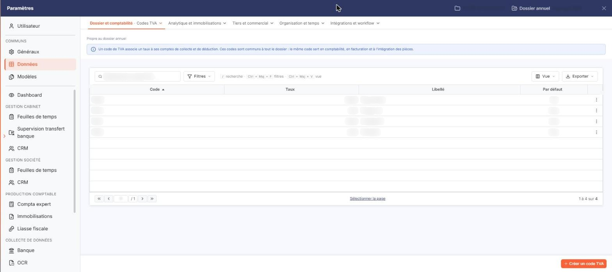
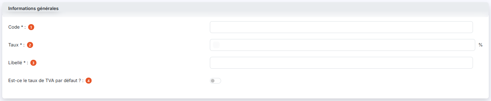
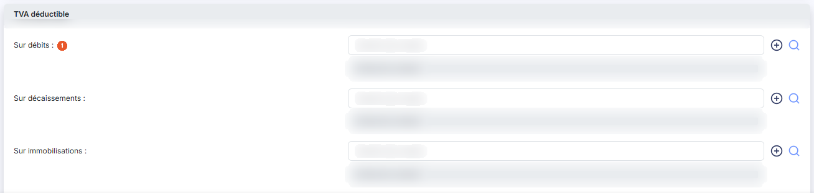
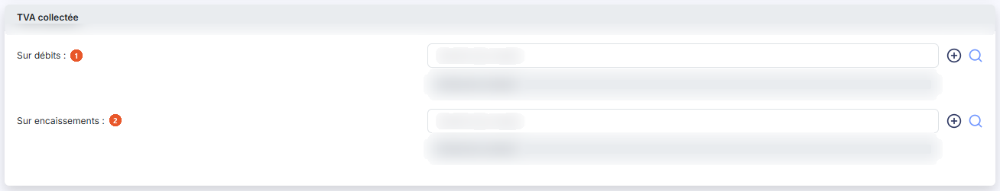

# Codes TVA


**Où le trouver :** Panneau **Paramètres** › **Données** › **Dossier et comptabilité** › **Codes TVA**



**En bref** — Cet écran gère les codes de TVA : un taux associé aux comptes de TVA déductible et collectée utilisés lors de la génération des écritures.

* Pour créer un code : bouton \[Nouveau], renseignez « Code », « Taux » et « Libellé », puis bouton \[Enregistrer].
* Pour définir le code proposé par défaut : répondez « Oui » à « Est-ce le taux de TVA par défaut ? », puis bouton \[Enregistrer].


Cette option vous permet d'administrer les codes de TVA du dossier. Un code de TVA associe un taux aux comptes de TVA qui seront utilisés lors de la génération des écritures.

<figure><figcaption>
Écran « Codes TVA » de la nouvelle interface
</figcaption></figure>

Les taux de TVA sont utilisés par plusieurs modules du logiciel ; toute modification apportée au fichier des taux de TVA depuis un module est donc immédiatement visible dans les autres.

L'écran affiche la liste des codes de TVA du dossier, classée par ordre croissant de code. Quatre colonnes sont présentées : **Code**, **Taux**, **Libellé** et **Par défaut**, cette dernière indiquant par « Oui » le code utilisé par défaut. Chacune peut servir de critère de tri : cliquez sur son en-tête.

En haut de la colonne de gauche, vous disposez d'une case à cocher qui sélectionne toutes les lignes de la page affichée, du pictogramme « Engrenage » qui ouvre la personnalisation des colonnes, du pictogramme « Entonnoir » qui ouvre la fenêtre « Filtres », et du pictogramme « Imprimante » qui lance l'impression de la liste.

Sur chaque ligne, vous disposez d'une case à cocher « Sélectionner », du pictogramme « Crayon » qui ouvre la fiche du code en modification, du pictogramme « Croix » qui le supprime et du pictogramme « Ajout » qui le duplique. La suppression d'un code de TVA ne se fait que par cette commande de ligne : il n'y a pas de bouton de suppression en bas de l'écran, et cocher des lignes n'ouvre donc aucune action.

bouton **\[Nouveau]**

Ouvre la fiche de création d'un code de TVA. C'est le seul bouton de bas d'écran de cette liste.

La fiche d'un code de TVA, en création comme en modification, présente trois rubriques dans cet ordre : « Informations générales », « TVA déductible » et « TVA collectée ».

## Rubrique « Informations générales »

<figure><figcaption>
Rubrique « Informations générales »
</figcaption></figure>

| Champ                                     | Ce qu'il faut savoir                                                                                                                                                                                                          |
| ----------------------------------------- | ----------------------------------------------------------------------------------------------------------------------------------------------------------------------------------------------------------------------------- |
| 1. **Code**                               | À la création, où il est saisissable. Il identifie le code de TVA. Une fois le code créé, il n'est plus modifiable : il s'affiche en grisé sur la fiche.                                                                      |
| 2. **Taux**                               | Saisissez le taux applicable ; le logiciel affiche le symbole « % » à droite de la zone. À la création, la zone est pré-remplie avec la valeur 0.                                                                             |
| 3. **Libellé**                            | C'est sous ce libellé que le code est présenté dans les écrans du logiciel.                                                                                                                                                   |
| 4. **Est-ce le taux de TVA par défaut ?** | Répondez « Oui » pour que ce code soit le code proposé par défaut. Un seul code de TVA porte cette valeur ; c'est celui que la colonne **Par défaut** de la liste signale par « Oui ». À la création, la réponse est « Non ». |

## Rubrique « TVA déductible »

<figure><figcaption>
Rubrique « TVA déductible »
</figcaption></figure>

Indiquez ici les numéros des comptes qui devront être utilisés lors de la génération des écritures liées à ce code de TVA, pour la TVA déductible. Neuf lignes vous sont proposées, chacune facultative :

**Sur débits** : · **Sur décaissements :** · **Sur immobilisations :** · **B2 - Acquisitions intra :** · **A3 - Achats de prestations de services intra :** · **B4 - Achats auprès d'un assujetti non établi en France (Art 283-1 du CGI) :** · **A4 - Importation :** · **A2 - Sous-traitance :** · **A5 - Sortie de régime fiscal suspensif :**

Sur chaque ligne, saisissez le numéro de compte ou recherchez-le avec le pictogramme « Loupe » ; le pictogramme vert « Plus » ouvre la création d'un compte. Le logiciel restitue à droite l'intitulé du compte, en grisé : cet intitulé ne se saisit pas.

Les six dernières lignes — de **B2 - Acquisitions intra** à **A5 - Sortie de régime fiscal suspensif** — présentent en outre, à droite, un second couple **Contrepartie :** où vous indiquez le compte de contrepartie à utiliser. Les trois premières lignes n'en ont pas.

## Rubrique « TVA collectée »

<figure><figcaption>
Rubrique « TVA collectée »
</figcaption></figure>

Indiquez ici, de la même manière, les numéros des comptes à utiliser pour la TVA collectée. Deux lignes vous sont proposées, toutes deux facultatives :

| Champ                    | Ce qu'il faut savoir                              |
| ------------------------ | ------------------------------------------------- |
| 1. **Sur débits**        | Le compte de TVA collectée sur les débits.        |
| 2. **Sur encaissements** | Le compte de TVA collectée sur les encaissements. |

bouton **\[Enregistrer]**

Enregistre la fiche du code de TVA.

bouton **\[Retour]**

Quitte la fiche sans enregistrer et vous ramène à la liste.

Le pictogramme « Entonnoir » ouvre la fenêtre « Filtres », qui vous permet de restreindre la liste. Vous y retrouvez d'abord les quatre colonnes affichées — **Code**, **Taux**, **Libellé**, **Par défaut** — puis les colonnes masquées par défaut, que vous pouvez également utiliser comme critères : **Déductible - Sur débits**, **Déductible - Sur encaissements**, **Déductible - Sur immobilisations**, **Déductible - Sur acquisitions intra**, **Collectée - Sur débits**, **Collectée - Sur encaissements** et **Collectée - Sur acquisitions intra**.

Le critère **Déductible - Sur encaissements** porte sur la donnée que la fiche appelle **Sur décaissements** : c'est bien la même ligne.

Chaque critère se compose d'un opérateur et d'une valeur, que vous pouvez combiner par « Et » ou « Ou » avec un second couple. La fenêtre offre cinq boutons : bouton **\[Filtrer]** applique les critères à la liste, bouton **\[Mémoriser les paramètres]** conserve la sélection de critères, bouton **\[Charger les paramètres]** la rappelle, bouton **\[Vider les filtres]** efface les critères saisis et bouton **\[Fermer]** referme la fenêtre.

## Autres vues de l'écran

<figure><figcaption>
Bouton [Nouveau]
</figcaption></figure>
