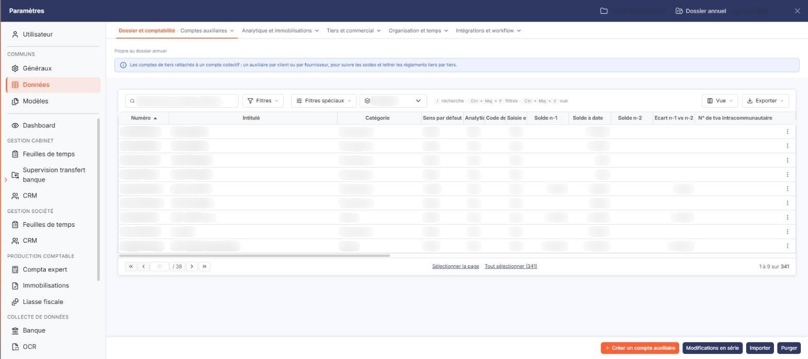

# Comptes auxiliaires


**Où le trouver :** Panneau **Paramètres** › **Données** › **Dossier et comptabilité** › **Comptes auxiliaires**



**En bref** — Cet écran permet de créer et de compléter les comptes auxiliaires (clients, fournisseurs, salariés, divers) que vos règles de traduction désignent en contrepartie.

* Pour créer un tiers : bouton \[Nouveau], choisissez le « Compte collectif », renseignez « Numéro » et « Intitulé », puis bouton \[Enregistrer].
* Pour compléter une fiche à partir du Siren : saisissez le « N° de Siren », puis bouton \[Lire Siren].
* Pour joindre un document à un tiers : rubrique « Documents », puis bouton \[Nouveau doc depuis mon poste].


Cette option permet d'administrer les **comptes auxiliaires** du dossier annuel en cours — vos clients, vos fournisseurs, vos salariés et vos tiers divers. Chaque compte auxiliaire est rattaché à un compte général collectif.

<figure><figcaption>
Écran « Comptes auxiliaires » de la nouvelle interface
</figcaption></figure>

Vous accédez à cet écran depuis ce module pour créer ou compléter les tiers que vos règles de traduction désignent en contrepartie, sans avoir à changer de module.

La suppression d'un compte n'est possible qu'à la condition qu'aucune écriture n'ait été passée sur l'exercice pour le compte concerné.

**a) Les filtres au-dessus de la liste**

Une barre de filtre coiffe la liste :

* **N° de compte** : restreint la liste aux comptes dont le numéro correspond à votre saisie.
* **Catégorie** : _Tous_, _Divers_, _Clients_, _Fournisseurs_ ou _Salariés_.
* un groupe de **deux** boutons : _Tous les comptes_ et _Comptes mouvementés_. Contrairement à l'écran du plan comptable, il n'existe pas ici de choix « Comptes non mouvementés ».

Le bouton **\[Filtrer]** applique vos critères. Un bouton **\[Annuler les filtres]** apparaît alors à côté de lui : il rétablit la liste complète et disparaît de nouveau.

**b) La liste des comptes auxiliaires**

La liste est très large — vingt-quatre colonnes — et se fait **défiler horizontalement** : plus de la moitié d'entre elles ne sont pas visibles à l'ouverture, et rien ne vous signale qu'elles existent. Dans l'ordre :

**Numéro** (tri initial croissant) · **Intitulé** · **Catégorie** · **Sens par défaut** · **Analytique** · **Code devise** · **Saisie en devise** · **Solde n-1** · **Solde à date** · **Solde n-2** · **Ecart n-1 vs n-2** · **N° de tva intracommunautaire** · **N° de siren** · **Capital** · **Code Naf** · **Soumis TVA autoliquidée** · **Contrepartie (Accélérateur)** · **Code TVA (Accélérateur)** · **N° de compte TVA (Accélérateur)** · **Gérer les échéances** · **Unité 1** · **Mode de règlement** · **Code DGFIP** · **Code juridique usuel**.

Toutes sont triables, à l'exception de **Ecart n-1 vs n-2** : c'est une colonne calculée, elle n'est ni triable ni utilisable comme critère de filtre.

💡 Servez-vous du pictogramme « Engrenage » de l'en-tête pour masquer les colonnes qui ne vous servent pas et remonter celles qui vous intéressent : sur cet écran, c'est le seul moyen de rendre la liste réellement lisible.

L'en-tête de la première colonne, sans intitulé, porte cinq commandes : une case à cocher qui sélectionne toutes les lignes de la page, une seconde case orange qui étend la sélection à toutes les pages, le pictogramme « Engrenage » (personnalisation des colonnes), le pictogramme « Entonnoir » (fenêtre de filtres) et le pictogramme « Imprimante » (impression de la liste).

Chaque ligne porte quatre commandes : la **case à cocher** de sélection, le pictogramme « Crayon » pour ouvrir la fiche, le pictogramme « Croix verte » pour supprimer le compte, et un dernier pictogramme dont l'infobulle est « Dupliquer ».

**c) Les boutons de bas d'écran**

* bouton **\[Nouveau]** : ouvre une fiche de compte auxiliaire vierge.
* bouton **\[Modifications en série]** : applique une même modification à tous les comptes sélectionnés.
* bouton **\[Réaffectation]** : reporte les écritures d'un compte auxiliaire sur un autre.
* bouton **\[Importer]** : reprend des comptes auxiliaires depuis un fichier.
* bouton **\[Purger]** : 🛑 supprime des comptes auxiliaires en masse. Ce bouton a la même apparence que les précédents : n'y touchez qu'en connaissance de cause.
* bouton **\[Supprimer]** : supprime les comptes dont vous avez coché la case de sélection.

Il n'y a pas de bouton d'export sur cet écran, contrairement à celui du plan comptable.

**d) La fiche : des rubriques qui dépendent de la catégorie**

La fiche d'un compte auxiliaire est riche, et **toutes ses rubriques ne s'affichent pas pour tous les comptes**. Deux rubriques, _Prestataire_ et _Approbation_, ne concernent que les comptes de catégorie _Fournisseurs_ et n'apparaissent pas du tout sur un compte client. Le champ **Soumis à TVA autoliquidée** obéit à la même règle.

Une rubrique _Multi établissement_ existe également, mais elle **n'est pas affichée lorsque vous ouvrez la fiche depuis ce module**.

Les rubriques se présentent dans l'ordre suivant : _Informations générales_, _Adresses_, _Propriétés_, _Accélérateur de saisie_, _Échéances_, _Quantités_, _Gestion analytique_, _Prestataire_, _Coordonnées bancaires_, _Devises_, _Approbation_, _Soldes_ et _Documents_.

**e) Rubrique « Informations générales »**

* **Compte collectif** : champ obligatoire. C'est le compte général auquel le compte auxiliaire est rattaché. Son **Intitulé compte collectif** s'affiche à côté, en lecture seule.
* **Numéro** : il n'est **pas modifiable** après création du compte, et doit être unique. Son infobulle rappelle : _« Les caractères autorisés sont les lettres majuscules et les chiffres. »_
* **Intitulé** : champ obligatoire. Il peut être repris automatiquement dans les libellés d'écritures, et reste modifiable à tout moment.
* **Catégorie** : non modifiable. Elle est déduite du compte collectif auquel vous avez rattaché le compte. Le logiciel gère quatre catégories : clients, fournisseurs, salariés et divers.
* **Observations** : une zone de saisie libre sur plusieurs lignes.
* **Créé le** / **Par**, et **Modifié le** / **Par** : non modifiables. La seconde ligne n'apparaît que si le compte a effectivement été modifié depuis sa création.
* **N° de TVA intracommunautaire** : ce numéro, propre à chaque entreprise, est obligatoire sur les factures, pour l'émetteur comme pour le destinataire. Le logiciel s'en sert aussi pour reconnaître les fournisseurs dans le module OCR.
* **N° de Siren** : facultatif. Le bouton **\[Lire Siren]** placé à côté interroge, à partir de ce numéro, un service externe d'informations sur les entreprises, et complète la fiche avec les informations d'identité qu'il renvoie. Le numéro doit avoir été saisi au préalable ; si la recherche échoue, un message s'affiche et la fiche n'est pas modifiée.
* **Forme juridique** : facultatif, avec une loupe de recherche.
* **Capital** : facultatif.
* **Code DGFIP** et **Code juridique usuel** : en lecture seule.
* **Code NAF** : en lecture seule, présenté en deux parties, le code puis son libellé.
* **Mode de règlement** : facultatif. C'est le mode de règlement par défaut du tiers, repris en différents endroits du logiciel. ⚠️ La liste comporte, à côté des modes usuels, quelques modes techniques créés par le logiciel pour ses propres imports comptables : n'en choisissez aucun.
* **Soumis à TVA autoliquidée :comptes fournisseurs uniquement**. Cinq choix : _Non soumis_, _Acquisitions intracommunautaires de biens_, _Prestations de services intracommunautaires_, _Importations hors EU_ et _Sous-traitance BTP_. Ce champ sert notamment à générer les écritures d'autoliquidation de la TVA.

**f) Rubrique « Adresses »**

Un tableau recense les adresses du tiers, avec leur **Intitulé**, leur **Contact** et l'indication **Adresse par défaut**. Chaque ligne se modifie, se supprime ou se duplique par ses pictogrammes, et le bouton **\[Nouveau]**, sous le tableau, ajoute une adresse.

**g) Rubrique « Propriétés »**

Elle ne contient qu'un réglage, **Sens par défaut :**, à choisir entre _Débit_ et _Crédit_. Son infobulle en donne l'utilité : _« Permettra, lors de la saisie d'écritures, de positionner directement le curseur sur la cellule définie. »_ En pratique, il vaut _Débit_ sur un compte client et _Crédit_ sur un compte fournisseur.

**h) Rubrique « Accélérateur de saisie »**

Cette rubrique prépare la saisie d'écritures sur le tiers.

* **Contrepartie** : le compte de charge ou de produit habituellement mouvementé avec ce tiers, avec une loupe de recherche. Son **Intitulé** s'affiche à côté, en lecture seule.
* **Code TVA** : son infobulle indique : _« Indiquez un code TVA si vous souhaitez générer automatiquement une ligne de TVA. »_ Le **Taux de TVA** correspondant s'affiche à côté, en lecture seule.
* **N° de compte** : le compte de TVA à utiliser, à choisir dans une liste. Son **Intitulé** s'affiche à côté, en lecture seule. ⚠️ Cette liste ne propose que des comptes de TVA **déductible** : vous ne pouvez donc pas paramétrer d'accélérateur de TVA collectée, même sur un compte client.

**i) Rubriques « Échéances », « Quantités » et « Gestion analytique »**

Chacune de ces trois rubriques ne présente qu'une question, à laquelle vous répondez par oui ou par non : **Gérer les échéances pour ce compte :**, **Gérer les quantités pour ce compte :** et **Gérer ce compte analytiquement :**. Répondre « Oui » active la gestion correspondante pour ce tiers.

**j) Rubrique « Prestataire »** _(comptes fournisseurs uniquement)_

| Champ                                          | Ce qu'il faut savoir                                                                                                                                |
| ---------------------------------------------- | --------------------------------------------------------------------------------------------------------------------------------------------------- |
| **Prestataire de services au sens de la DAS2** | Répondez « Oui » si les sommes versées à ce tiers doivent figurer dans la déclaration DAS2.                                                         |
| **Prestataire de services au sens de la TVA**  | Son infobulle précise le cas d'emploi : _« A activer uniquement pour les prestataires de services qui n'ont pas opté pour la TVA sur les débits. »_ |

**k) Rubrique « Coordonnées bancaires »**

Vous pouvez enregistrer autant de coordonnées bancaires que nécessaire pour un tiers. Le tableau en présente l'**Intitulé**, l'**Iban** et l'indication **Défaut** ; le bouton **\[Nouveau]**, sous le tableau, en ajoute une.

L'intitulé doit être unique : c'est lui qui vous permet de distinguer les banques du tiers entre elles. Celle qui porte l'indication de défaut est celle que le logiciel vous proposera systématiquement pour ce tiers.

**l) Rubrique « Devises »**

Elle ne présente qu'une question, **Autoriser la saisie en devises :**.

**m) Rubrique « Approbation »** _(comptes fournisseurs uniquement)_

Elle ne présente qu'une question : **Les factures de ce fournisseurs doivent-elles être approuvées automatiquement ? :**. Son infobulle en donne le cas d'emploi : _« Si vous répondez "Oui", les factures prises en charge se verront attribuer le statut électronique "Approuvée" automatiquement. Cette option est faite par exemple pour des fournisseurs tels qu'EDF. »_

**n) Rubrique « Soldes »**

Cette rubrique est entièrement en **lecture seule** : elle restitue la situation du compte et ne se saisit pas. Elle présente le **Solde à date**, le **Solde n-1**, l'indication **Mouvementé en n-1**, l'**Ecart n vs n-1**, le **Solde n-2** et l'**Ecart n-1 vs n-2**. Ces montants peuvent être vides si l'exercice concerné n'existe pas dans le dossier.

**o) Rubrique « Documents »**

Vous pouvez rattacher des documents au tiers — un contrat, un relevé d'identité bancaire, un justificatif. Le tableau en présente la **Description**, le **Nom du fichier**, la **Date** et l'auteur (**Créé par**).

Trois boutons, sous le tableau, correspondent aux trois provenances possibles : bouton **\[Nouveau doc depuis mon poste]**, bouton **\[Nouveau doc depuis la GED]** et bouton **\[Nouveau doc depuis l'OCR]**.

La fiche se termine par les bouton **\[Enregistrer]** et bouton **\[Retour]**.
