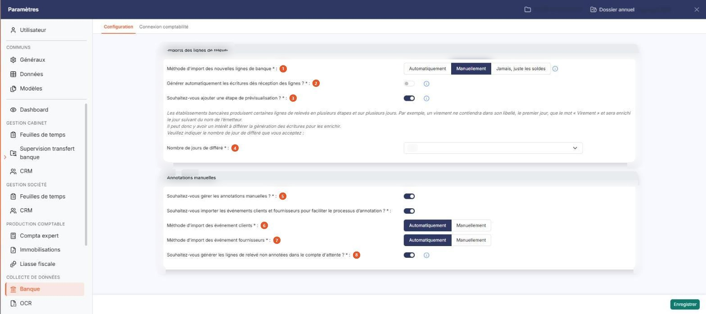
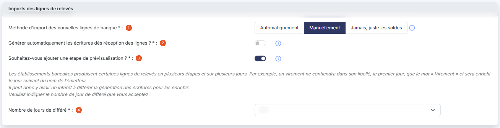
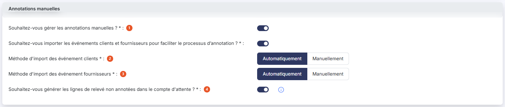

# Configuration


**Où le trouver :** Panneau **Paramètres** › **Banque** › **Configuration**



**En bref** — Cet écran règle le fonctionnement du module : arrivée des lignes de relevés, génération des écritures, étape de prévisualisation et annotations manuelles.

* Pour choisir comment les lignes arrivent : réglez « Méthode d'import des nouvelles lignes de banque », puis bouton \[Enregistrer].
* Pour contrôler les écritures avant leur départ en comptabilité : répondez « Oui » à « Souhaitez-vous ajouter une étape de prévisualisation ? », puis bouton \[Enregistrer].


Cette option, que l'on ouvre dans le panneau « Paramètres » (rubrique « Banque », onglet « Configuration »), rassemble les paramètres qui commandent le fonctionnement du module : la façon dont les lignes de relevés bancaires vous parviennent, le moment où les écritures sont générées, et la gestion des annotations manuelles.

<figure><figcaption>
Écran « Configuration » de la nouvelle interface
</figcaption></figure>

L'écran est un formulaire de deux rubriques, « Imports des lignes de relevés » et « Annotations manuelles ». Il n'y a ni liste ni filtre. Le seul bouton, en bas à droite du panneau, est bouton **\[Enregistrer]** : il n'y a ni bouton de retour ni bouton d'annulation, et vous quittez l'écran en changeant d'onglet ou en fermant le panneau.

Plusieurs des questions posées ici en commandent d'autres : selon votre réponse, le logiciel affiche ou masque les paramètres qui en dépendent. Les questions auxquelles on répond par Oui ou Non sont des interrupteurs sans texte : activé correspond à « Oui », désactivé à « Non ». Les paragraphes ci-dessous le précisent champ par champ.

## Rubrique « Imports des lignes de relevés »

<figure><figcaption>
Rubrique « Imports des lignes de relevés »
</figcaption></figure>

| Champ                                                                   | Ce qu'il faut savoir                                                                                                                                                                                                                                                                                                                                                                                                                                                                                                                                                                                                                                                                                                                  |
| ----------------------------------------------------------------------- | ------------------------------------------------------------------------------------------------------------------------------------------------------------------------------------------------------------------------------------------------------------------------------------------------------------------------------------------------------------------------------------------------------------------------------------------------------------------------------------------------------------------------------------------------------------------------------------------------------------------------------------------------------------------------------------------------------------------------------------- |
| 1. **Méthode d'import des nouvelles lignes de banque**                  | Trois choix vous sont proposés.                                                                                                                                                                                                                                                                                                                                                                                                                                                                                                                                                                                                                                                                                                       |
| 2. **Générer automatiquement les écritures dès réception des lignes ?** | Si vous répondez « Oui », dès réception des lignes de relevés bancaires, les écritures sont générées. Si vous répondez « Non », vous devrez déclencher la génération d'écritures manuellement dans le menu « Relevés bancaires ».                                                                                                                                                                                                                                                                                                                                                                                                                                                                                                     |
| 3. **Souhaitez-vous ajouter une étape de prévisualisation ?**           | 
Si vous répondez « Oui », les écritures sont tout d'abord générées dans le menu « Prévisualisations » pour contrôle. Si vous répondez « Non », les écritures seront directement générées dans le module de comptabilité ou dans le menu « Ecritures » pour un export ultérieur vers un autre logiciel — selon ce que vous avez indiqué dans l'onglet « Connexion comptabilité » de la rubrique « Banque » du panneau « Paramètres ». La prévisualisation vous permet notamment de mesurer l'efficacité de vos règles de traduction, de les corriger, puis de relancer la génération des écritures. Elle est donc utile au début de l'utilisation du module, et vous pouvez vous en passer une fois le paramétrage maîtrisé.
 |
| 4. **Nombre de jours de différé**                                       | Le logiciel affiche au-dessus de ce champ le rappel suivant : les établissements bancaires produisent certaines lignes de relevés en plusieurs étapes et sur plusieurs jours ; par exemple, un virement ne contiendra dans son libellé, le premier jour, que le mot « Virement » et sera enrichi le jour suivant du nom de l'émetteur. Il peut donc y avoir un intérêt à différer la génération des écritures pour les enrichir.                                                                                                                                                                                                                                                                                                      |
| **Automatiquement**                                                     | Les nouvelles lignes de relevés bancaires seront ajoutées quotidiennement sans opération de votre part, pour tous les comptes bancaires paramétrés.                                                                                                                                                                                                                                                                                                                                                                                                                                                                                                                                                                                   |
| **Manuellement**                                                        | Vous devrez vous rendre dans le menu « Relevés bancaires » et y déclencher l'import vous-même.                                                                                                                                                                                                                                                                                                                                                                                                                                                                                                                                                                                                                                        |
| **Jamais, juste les soldes**                                            | Les lignes de relevés bancaires ne sont pas importées ; seuls les soldes quotidiens le sont. C'est le choix le plus lourd de conséquences, puisque le module ne reçoit alors aucune ligne à traduire en écritures.                                                                                                                                                                                                                                                                                                                                                                                                                                                                                                                    |

Choisissez dans la liste le différé que vous acceptez : **Aucun différé**, **J+1**, **J+2**, **J+3**, **J+4** ou **J+5**.

Ce champ et le texte qui le précède restent affichés quelles que soient vos réponses aux trois questions précédentes, y compris lorsque vous n'importez que les soldes ou que vous ne générez pas les écritures automatiquement.

## Rubrique « Annotations manuelles »

<figure><figcaption>
Rubrique « Annotations manuelles »
</figcaption></figure>

| Champ                                                                                      | Ce qu'il faut savoir                                                                                                                                                                                                                                                                                                                                                                                                                                                                                                                                                                                                                                                                                                                                                                            |
| ------------------------------------------------------------------------------------------ | ----------------------------------------------------------------------------------------------------------------------------------------------------------------------------------------------------------------------------------------------------------------------------------------------------------------------------------------------------------------------------------------------------------------------------------------------------------------------------------------------------------------------------------------------------------------------------------------------------------------------------------------------------------------------------------------------------------------------------------------------------------------------------------------------- |
| 1. **Souhaitez-vous gérer les annotations manuelles ?**                                    | 
La gestion des annotations manuelles permet de traiter les lignes de relevés auxquelles aucune règle de traduction n'a été associée : une ligne de relevé peut alors être associée soit à une affectation, soit à un événement client ou fournisseur. Si vous répondez « Non », la rubrique se réduit à cette seule question : tous les paramètres qui suivent disparaissent. <strong>Souhaitez-vous importer les événements clients et fournisseurs pour faciliter le processus d'annotation ? :</strong> obligatoire, affiché si vous avez répondu « Oui » à la question précédente. Si vous répondez « Oui », vous pourrez importer les événements clients et fournisseurs — factures et avoirs — issus des autres modules du logiciel et les associer à des lignes de relevés.
 |
| 2. **Méthode d'import des événement clients**                                              | Affiché si vous avez répondu « Oui » aux deux questions précédentes. Choisissez **Automatiquement**, et les événements clients du jour seront importés chaque nuit ; ou **Manuellement**, et vous devrez les importer vous-même depuis le menu « Evénements ».                                                                                                                                                                                                                                                                                                                                                                                                                                                                                                                                  |
| 3. **Méthode d'import des événement fournisseurs**                                         | Affiché dans les mêmes conditions que le paramètre précédent, et de même effet pour les événements fournisseurs.                                                                                                                                                                                                                                                                                                                                                                                                                                                                                                                                                                                                                                                                                |
| 4. **Souhaitez-vous générer les lignes de relevé non annotées dans le compte d'attente ?** | Affiché si vous gérez les annotations manuelles. Lorsque les écritures comptables sont générées, vous pouvez décider de générer simultanément dans le compte d'attente les écritures correspondant aux lignes qui n'ont reçu aucune annotation. Si vous répondez « Non », les lignes seront conservées tant qu'elles n'auront pas été annotées ou que le délai de conservation maximum n'aura pas été atteint.                                                                                                                                                                                                                                                                                                                                                                                  |

**Indiquez le nombre de jours au-delà duquel les lignes des relevés bancaires non annotées doivent être exportées automatiquement :** obligatoire, affiché uniquement si vous avez répondu « Non » à la question précédente. Saisissez le délai maximum de conservation, de sorte que les lignes de relevés ne restent pas indéfiniment dans le module ; passé ce délai, elles généreront automatiquement des écritures dans le compte d'attente.

bouton **\[Enregistrer]**

Enregistre le paramétrage. C'est le seul bouton de l'écran : tant que vous n'avez pas cliqué dessus, vos modifications ne sont pas conservées.
