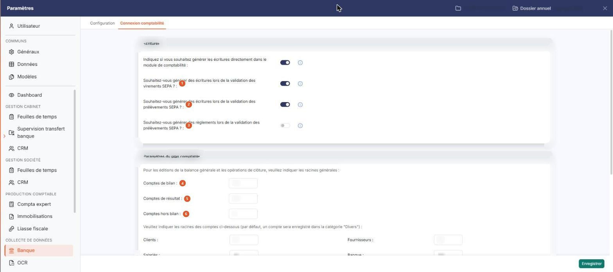
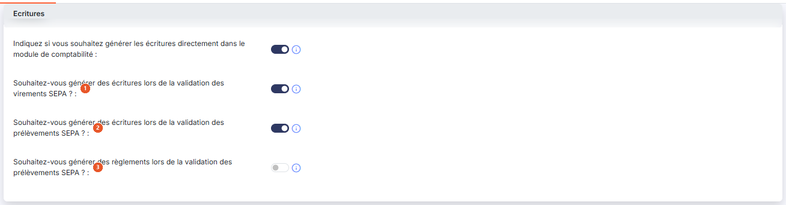
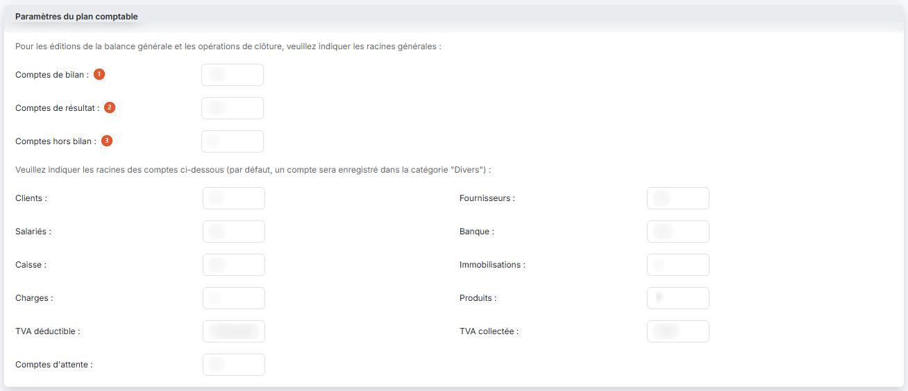
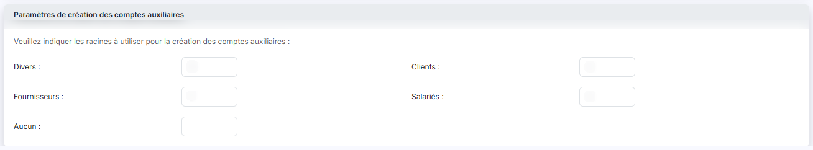

# Connexion comptabilité


**Où le trouver :** Panneau **Paramètres** › **Banque** › **Connexion comptabilité**



**En bref** — Cet écran indique où partent les écritures du module et quelles racines de comptes le logiciel utilise pour les construire et pour créer les comptes auxiliaires.

* Pour envoyer les écritures directement en comptabilité : activez « Indiquez si vous souhaitez générer les écritures directement dans le module de comptabilité », puis bouton \[Enregistrer].
* Pour renseigner une racine de compte : saisissez-la dans le champ voulu (par exemple 41 pour les clients), puis bouton \[Enregistrer].


Cette option règle la liaison entre le module « Banque » et votre comptabilité : où partent les écritures produites par le module, et quelles racines de comptes le logiciel utilise pour les construire et pour créer les comptes auxiliaires.

<figure><figcaption>
Écran « Connexion comptabilité » de la nouvelle interface
</figcaption></figure>

Cet écran s'ouvre dans le panneau « Paramètres », rubrique « Banque », onglet « Connexion comptabilité ». Il se compose de trois rubriques. **Aucun champ n'y est obligatoire** et son contenu ne varie pas : quelle que soit la position du premier interrupteur (activé ou désactivé), les trois rubriques et tous leurs champs restent affichés.

## Rubrique « Ecritures »

<figure><figcaption>
Rubrique « Ecritures »
</figcaption></figure>

**Indiquez si vous souhaitez générer les écritures directement dans le module de comptabilité :** c'est ce paramètre qui détermine la destination des écritures de banque.

Si l'interrupteur est activé, dès qu'une écriture bancaire est générée depuis le module « Banque », elle est automatiquement créée dans le journal idoine de votre comptabilité, sans autre manipulation. Le menu « Ecritures » du module n'affiche alors plus de grille, mais le message « Vous avez indiqué que vous utilisez le module comptabilité. Pour visualiser les écritures, veuillez vous rendre dans ce module. »

Si l'interrupteur est désactivé, les écritures générées restent dans le module, dans le menu « Ecritures », en attente d'être exportées vers un autre logiciel de comptabilité.

| Champ                                                                                      | Ce qu'il faut savoir                                                                                                                                                                                                                  |
| ------------------------------------------------------------------------------------------ | ------------------------------------------------------------------------------------------------------------------------------------------------------------------------------------------------------------------------------------- |
| 1. **Souhaitez-vous générer des écritures lors de la validation des virements SEPA ?**     | Si vous activez cette option, les écritures de règlements sont générées lors de la validation des paiements. Si les écritures sont déversées dans la comptabilité, un lettrage est effectué automatiquement sur les comptes de tiers. |
| 2. **Souhaitez-vous générer des écritures lors de la validation des prélèvements SEPA ?**  | Même principe que le champ précédent, appliqué cette fois aux ordres de prélèvement.                                                                                                                                                  |
| 3. **Souhaitez-vous générer des règlements lors de la validation des prélèvements SEPA ?** | Si vous activez cette option, les règlements sont générés lors de la validation des paiements.                                                                                                                                        |

Ces trois derniers paramètres commandent ce qui se produit lorsque vous cliquez sur bouton **\[Valider les paiements]** depuis le menu « Paiements », sous-option « Paiements à valider ».

## Rubrique « Paramètres du plan comptable »

<figure><figcaption>
Rubrique « Paramètres du plan comptable »
</figcaption></figure>

Les racines saisies dans cette rubrique disent au logiciel à quelle catégorie appartient un compte, d'après les premiers chiffres de son numéro. Elles servent aux éditions de la balance générale, aux opérations de clôture, et aux propositions que le logiciel vous fait quand vous devez renseigner un numéro de compte.

Si vous utilisez la comptabilité du logiciel, ces paramètres sont partagés avec elle : toute modification faite ici y est immédiatement disponible, et réciproquement.

**Comment saisir une racine**

Une racine est le début d'un numéro de compte : la racine « 41 » désigne tous les comptes dont le numéro commence par 41. Vous disposez de deux écritures, que vous pouvez employer ensemble dans un même champ :

* l'**énumération**, avec un point-virgule : **4452;4456** désigne les comptes commençant par 4452 et ceux commençant par 4456 ;
* l'**intervalle**, avec un tiret : **1-5** désigne toutes les racines de 1 à 5, c'est-à-dire les classes 1, 2, 3, 4 et 5. Un intervalle n'a que deux bornes : écrivez 1-5, jamais 1-5-6.

Les deux écritures se combinent : **401;404-406** est une saisie valable. N'employez que des chiffres, le point-virgule et le tiret — ni espace, ni virgule, ni lettre. Un compte qui ne correspond à aucune des racines indiquées est rattaché à la catégorie « Divers ».

Le premier texte affiché dans la rubrique demande les racines générales, pour les éditions de la balance générale et les opérations de clôture. **Ces trois champs doivent être renseignés**, bien qu'ils ne portent pas l'astérisque d'obligation, et **une même racine ne peut pas figurer dans deux d'entre eux** : le logiciel refuse alors l'enregistrement avec le message « Il existe des racines en double dans le paramétrage. »

| Champ                      | Ce qu'il faut savoir                                             |
| -------------------------- | ---------------------------------------------------------------- |
| 1. **Comptes de bilan**    | Racines des classes de bilan (par exemple 1-5).                  |
| 2. **Comptes de résultat** | Racines des classes de charges et de produits (par exemple 6-7). |
| 3. **Comptes hors bilan**  | Racines des comptes hors bilan (par exemple 8).                  |

Le second texte de la rubrique demande ensuite les racines par nature de compte : « Veuillez indiquer les racines des comptes ci-dessous (par défaut, un compte sera enregistré dans la catégorie "Divers") ». Un compte dont le numéro ne correspond à aucune des racines indiquées est donc rattaché à la catégorie « Divers ».

Les champs sont présentés sur deux colonnes et se lisent ligne par ligne, de gauche à droite : **Clients**, **Fournisseurs**, **Salariés**, **Banque**, **Caisse**, **Immobilisations**, **Charges**, **Produits**, **TVA déductible**, **TVA collectée** et **Comptes d'attente**.

Indiquez pour chacun la ou les racines de votre plan comptable — par exemple 41 pour les clients, 40 pour les fournisseurs, 512 pour la banque, ou 4452;4456 pour la TVA déductible si vous employez plusieurs comptes.

## Rubrique « Paramètres de création des comptes auxiliaires »

<figure><figcaption>
Rubrique « Paramètres de création des comptes auxiliaires »
</figcaption></figure>

Cette rubrique s'ouvre sur le texte « Veuillez indiquer les racines à utiliser pour la création des comptes auxiliaires ». Il ne s'agit plus ici des comptes généraux mais des **comptes auxiliaires**, dont la racine est le plus souvent une lettre.

Cinq champs, présentés sur deux colonnes et lus ligne par ligne : **Divers**, **Clients**, **Fournisseurs**, **Salariés** et **Aucun**. Indiquez pour chacun la racine que le logiciel emploiera lorsqu'il créera un compte auxiliaire de cette nature — par exemple C pour les clients, F pour les fournisseurs, S pour les salariés et D pour les divers.

La saisie n'obéit pas ici aux mêmes règles que dans la rubrique précédente : une racine de compte auxiliaire se compose de **lettres et de chiffres, quatre caractères au maximum**, et n'admet ni tiret, ni point-virgule, ni aucun autre signe. Vous pouvez laisser un champ vide.

Ne confondez pas ces cinq champs avec ceux de la rubrique précédente : « Clients », « Fournisseurs » et « Salariés » y figurent aussi, mais pour désigner des comptes généraux, avec des valeurs de nature toute différente.

bouton **\[Enregistrer]**

Il enregistre les trois rubriques. C'est le seul bouton de l'écran, en bas à droite du panneau : il n'y a ni bouton de retour, ni bouton d'annulation. Pour quitter sans enregistrer, changez d'onglet du panneau : si vous avez modifié un champ, le logiciel affiche la fenêtre « Modifications non enregistrées » (« Attention, vous avez des modifications non enregistrées. Souhaitez-vous continuer ? ») avec les boutons \[Continuer sans enregistrer] et \[Enregistrer et quitter].

Ce bouton n'apparaît que si votre profil vous autorise à enregistrer ce paramétrage. S'il est absent, l'écran reste consultable mais vos modifications ne peuvent pas être conservées.
