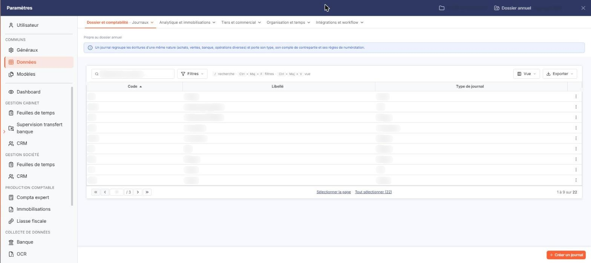
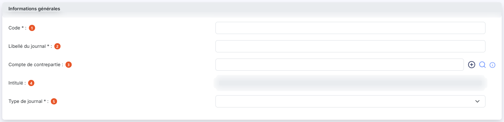
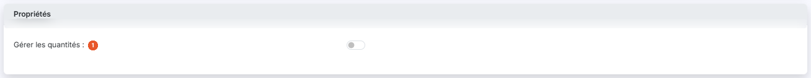

# Journaux


**Où le trouver :** Panneau **Paramètres** › **Données** › **Dossier et comptabilité** › **Journaux**



**En bref** — Cet écran gère les journaux de comptabilisation, partagés avec les autres modules : code, libellé, compte de contrepartie, type de journal et gestion des quantités.

* Pour créer un journal : bouton \[Nouveau], saisissez « Code » et « Libellé du journal », choisissez le « Type de journal », puis bouton \[Enregistrer].
* Pour quitter la fiche sans enregistrer : bouton \[Retour].


Cette option vous permet d'administrer les journaux utilisés pour la comptabilisation des opérations. Vous pouvez créer autant de journaux que nécessaire.

<figure><figcaption>
Écran « Journaux » de la nouvelle interface
</figcaption></figure>

Les journaux sont partagés avec les autres modules comptables du logiciel : un journal créé ici est immédiatement disponible ailleurs, et inversement.

L'écran affiche la liste des journaux du dossier annuel sur lequel vous êtes positionné, classée par ordre croissant de code. Trois colonnes sont présentées : **Code**, **Libellé** et **Type de journal**. Chacune peut servir de critère de tri : cliquez sur son en-tête.

En haut de la colonne de gauche, vous disposez d'une case à cocher qui sélectionne toutes les lignes de la page affichée, d'une seconde case qui étend la sélection à toutes les pages, du pictogramme « Engrenage » qui ouvre la personnalisation des colonnes, du pictogramme « Entonnoir » qui ouvre la fenêtre « Filtres », et du pictogramme « Imprimante » qui lance l'impression de la liste.

Sur chaque ligne, vous disposez d'une case à cocher « Sélectionner », du pictogramme « Crayon » qui ouvre la fiche du journal en modification, du pictogramme « Croix » qui le supprime et du pictogramme « Ajout » qui le duplique. Ces trois commandes sont proposées sur toutes les lignes, y compris sur les journaux structurants du dossier tels que le journal d'à-nouveaux ou le journal de banque : le logiciel ne les distingue pas des autres à l'écran.

bouton **\[Nouveau]**

Ouvre la fiche de création d'un journal, tous les champs vides.

bouton **\[Supprimer]**

Supprime les journaux que vous avez cochés dans la liste.

La fiche d'un journal, en création comme en modification, présente deux rubriques depuis le module Banque : « Informations générales » et « Propriétés ».

## Rubrique « Informations générales »

<figure><figcaption>
Rubrique « Informations générales »
</figcaption></figure>

| Champ                         | Ce qu'il faut savoir                                                                                                                                                                                                                                                                                                                                   |
| ----------------------------- | ------------------------------------------------------------------------------------------------------------------------------------------------------------------------------------------------------------------------------------------------------------------------------------------------------------------------------------------------------ |
| 1. **Code**                   | À la création, où il est saisissable. Chaque journal porte un code qui l'identifie. Une fois le journal créé, ce code n'est plus modifiable : il s'affiche en grisé sur la fiche.                                                                                                                                                                      |
| 2. **Libellé du journal**     | Le libellé sous lequel le journal est présenté dans les écrans du logiciel. Il est marqué obligatoire sur la fiche de création ; il ne l'est pas sur la fiche d'un journal existant.                                                                                                                                                                   |
| 3. **Compte de contrepartie** | Il s'agit du compte utilisé pour solder l'écriture en saisie. Saisissez directement le numéro de compte, ou recherchez-le avec le pictogramme « Loupe » ; le pictogramme vert « Plus » ouvre la création d'un compte. Par exemple, pour un journal de banque, vous pouvez indiquer le compte de banque afin de solder rapidement les lignes du relevé. |
| 4. **Intitulé**               | L'intitulé du compte de contrepartie. Ce champ est présenté en grisé : il est restitué par le logiciel et ne se saisit pas.                                                                                                                                                                                                                            |
| 5. **Type de journal**        | Il indique la nature des opérations enregistrées dans le journal. Choisissez dans la liste : **Achat**, **Vente**, **OD**, **Banque**, **Caisse**, **Reprise de balance**, **Divers** ou **A-nouveaux**. Le choix du type ne fait apparaître ni disparaître aucun champ de la fiche.                                                                   |

## Rubrique « Propriétés »

<figure><figcaption>
Rubrique « Propriétés »
</figcaption></figure>

| Champ                          | Ce qu'il faut savoir                                                                                                                                                                        |
| ------------------------------ | ------------------------------------------------------------------------------------------------------------------------------------------------------------------------------------------- |
| 1. **Gérer les quantités**     | Répondez « Oui » si les écritures de ce journal doivent porter des quantités en plus des montants.                                                                                          |
| **Nombre de champs de saisie** | Ce champ n'apparaît que si vous avez répondu « Oui » à la question précédente. Indiquez si la saisie comporte **1 champ** ou **2 champs** de quantité ; **1 champ** est proposé par défaut. |

bouton **\[Enregistrer]**

Enregistre la fiche du journal.

bouton **\[Retour]**

Quitte la fiche sans enregistrer et vous ramène à la liste.

Le pictogramme « Entonnoir » ouvre la fenêtre « Filtres », qui vous permet de restreindre la liste. Vous y retrouvez d'abord les trois colonnes affichées — **Code**, **Libellé**, **Type de journal** — puis les colonnes masquées par défaut, que vous pouvez également utiliser comme critères : **Contrepartie**, **Type écriture**, **Saisie en folio**, **Mode de saisie**, **Accélérateurs de saisie**, **Modèles d'écriture**, **Gestion des échéances**, **Gestion des quantités**, **Nombre de champs QTE**, **Gestion des devises**, **Affichage du numéro d'écriture**, **Affichage du type d'écriture**, **Journal interdit**, **Renseigner le libellé** et **Comptes interdits**.

Chaque critère se compose d'un opérateur et d'une valeur, que vous pouvez combiner par « Et » ou « Ou » avec un second couple. La fenêtre offre cinq boutons : bouton **\[Filtrer]** applique les critères à la liste, bouton **\[Mémoriser les paramètres]** conserve la sélection de critères, bouton **\[Charger les paramètres]** la rappelle, bouton **\[Vider les filtres]** efface les critères saisis et bouton **\[Fermer]** referme la fenêtre.

Vous remarquerez que certains de ces critères portent sur des paramètres de saisie du journal — mode de saisie, modèles d'écriture, gestion des échéances, gestion des devises, comptes interdits. Ces paramètres existent bien, mais la rubrique qui les porte n'est pas affichée depuis le module Banque : ils se renseignent depuis le module de comptabilité.

## Autres vues de l'écran

<figure><figcaption>
Bouton [Nouveau]
</figcaption></figure>
