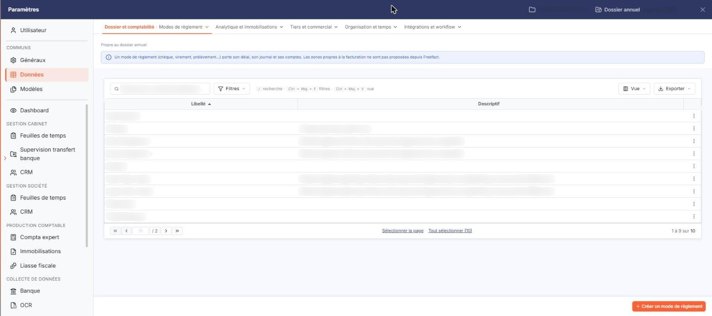
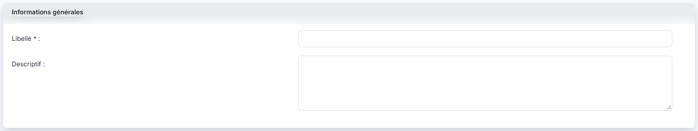
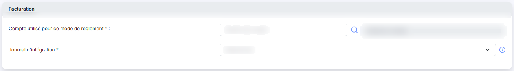
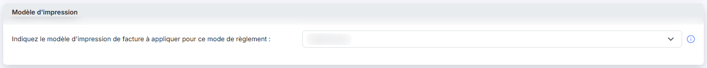
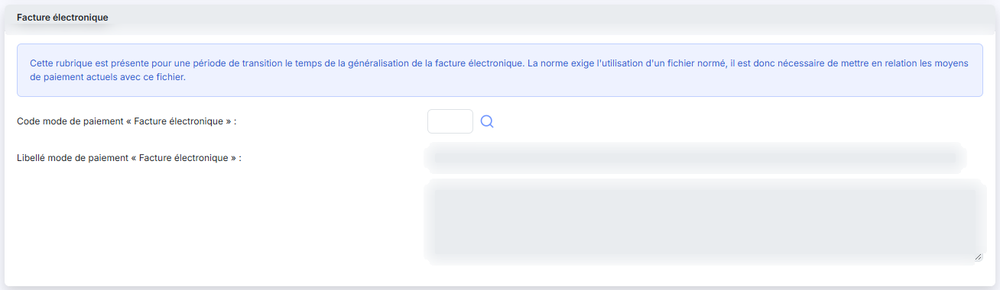

# Modes de règlement


**Où le trouver :** Panneau **Paramètres** › **Données** › **Dossier et comptabilité** › **Modes de règlement**



**En bref** — Cet écran rassemble les modes de règlement du dossier (chèque, virement, prélèvement…), avec le compte et le journal dans lesquels chacun est comptabilisé.

* Pour créer un mode de règlement : bouton \[Nouveau], renseignez « Libellé », le compte et le « Journal d'intégration », puis bouton \[Enregistrer].
* Pour appliquer vos modes à d'autres sociétés du cabinet : cochez-les, puis bouton \[Exporter].


Cette option rassemble les **modes de règlement** du dossier : chèque, virement, carte bancaire, prélèvement, espèces… Chaque mode porte le compte et le journal dans lesquels le logiciel comptabilise les règlements qui s'y rattachent, et, si vous le souhaitez, le modèle d'impression de facture à lui appliquer.

<figure><figcaption>
Écran « Modes de règlement » de la nouvelle interface
</figcaption></figure>

C'est une liste de référence, partagée avec les autres modules du logiciel : vous la mettez en place une fois, puis vous n'y revenez qu'à l'occasion. Elle vous est proposée ici pour que vous puissiez vérifier ce paramétrage sans quitter le module, notamment lorsque vous préparez vos paiements.

**a) La liste des modes de règlement**

L'écran se réduit à un seul tableau : il n'y a ni onglet, ni rubrique de filtre au-dessus de la liste.

Deux colonnes sont affichées :

* **Libellé** : le nom du mode de règlement. C'est le tri initial de la liste, par ordre croissant.
* **Descriptif** : le commentaire saisi dans la fiche. Il peut être vide, et il est **tronqué** dans la liste lorsqu'il est long : ouvrez la fiche pour le lire en entier.

Six colonnes supplémentaires existent mais ne sont pas affichées par défaut : « Compte de règlement », « Journal d'intégration », « Modèle d'impression », « Code "Facture élec." », « Libellé "Facture élec." » et « Suite libellé "Facture élec." ». Vous les faites apparaître par le pictogramme « Engrenage » de l'en-tête. Ce sont les champs de la fiche, décrits au paragraphe f) ci-dessous.

Le bas du tableau indique le nombre de modes de règlement et vous permet de passer d'une page à l'autre.

**b) Les modes de règlement créés par le logiciel**

Votre liste ne contient pas que les modes que vous avez créés. Le logiciel y ajoute des modes qui lui servent à **importer les règlements enregistrés en comptabilité**, lorsque ces règlements ne peuvent pas être rattachés à l'un de vos propres modes :

* **Ecart de règlement -** et **Ecart de règlement + :** « Mode de règlement utilisé lors des imports des règlements de la comptabilité. »
* **Import règl. compta** et **Import remb. compta :** « Mode de règlement générique utilisé lors des imports des règlements de la comptabilité qui ne peuvent être différenciés. »

Leur descriptif, reproduit ci-dessus, est le seul élément qui les distingue : rien à l'écran ne les signale autrement — ni couleur, ni statut, ni verrouillage. **Ne les supprimez pas** : l'import des règlements de la comptabilité s'appuie sur eux.

**c) Les commandes de l'en-tête du tableau**

La première colonne du tableau, sans intitulé, porte cinq commandes dans son en-tête :

* une case à cocher qui sélectionne toutes les lignes de la page affichée ;
* une seconde case, orange, qui étend la sélection à toutes les pages de la liste ;
* le pictogramme « Engrenage », qui ouvre la fenêtre « Personnalisation de colonnes » : vous y choisissez les colonnes visibles et vous les réordonnez ;
* le pictogramme « Entonnoir », qui ouvre la fenêtre « Filtres » — voir le paragraphe e) ci-dessous ;
* le pictogramme « Imprimante », qui imprime la liste telle qu'elle est affichée.

**d) Les commandes de chaque ligne et les boutons de bas d'écran**

Chaque ligne porte trois commandes : une **case à cocher** de sélection ; le pictogramme « Crayon », qui ouvre la fiche ; et le pictogramme « Croix verte », qui supprime la ligne. Aucune de ces trois commandes ne porte d'infobulle.

Il n'y a pas de commande « Dupliquer » sur cet écran.

bouton **\[Nouveau]**

Il ouvre la fiche d'un nouveau mode de règlement, vierge.

bouton **\[Exporter]**

Il ne produit pas de fichier : il **recopie les modes de règlement que vous avez cochés vers d'autres sociétés gérées** du cabinet. C'est ainsi que vous appliquez d'un coup, à plusieurs dossiers, un paramétrage mis au point sur l'un d'eux.

bouton **\[Supprimer]**

Il supprime les modes de règlement dont vous avez coché la case de sélection.

**Un mode de règlement déjà utilisé n'est pas supprimé.** Le logiciel ne conserve que les modes qui ne sont rattachés à aucun règlement : si l'un de ceux que vous avez cochés est employé quelque part, il reste dans la liste. Aucun message ne vous en avertit — c'est donc à vous de vérifier, après coup, quelles lignes ont réellement disparu. La même règle s'applique au pictogramme « Croix verte » de la ligne.

**e) La fenêtre « Filtres »**

Le pictogramme « Entonnoir » de l'en-tête ouvre une fenêtre « Filtres » qui vous permet de restreindre la liste. Pour chaque colonne, vous choisissez un opérateur et une valeur, et vous pouvez combiner deux conditions par « Et » ou par « Ou ».

Les critères proposés reprennent les deux colonnes affichées, « Libellé » et « Descriptif », ainsi que les six colonnes masquées citées au paragraphe a).

Les boutons de la fenêtre sont bouton **\[Filtrer]**, bouton **\[Mémoriser les paramètres]**, bouton **\[Charger les paramètres]**, bouton **\[Vider les filtres]** et bouton **\[Fermer]**.

**f) La fiche d'un mode de règlement**

La fiche s'organise en quatre rubriques, présentées ci-dessous dans leur ordre d'affichage.

### Rubrique « Informations générales »

| Champ          | Ce qu'il faut savoir                                                                                                       |
| -------------- | -------------------------------------------------------------------------------------------------------------------------- |
| **Libellé**    | Le nom du mode de règlement, obligatoire. C'est lui qui vous sera proposé partout où vous choisissez un mode de règlement. |
| **Descriptif** | Un commentaire libre, sur plusieurs lignes. Il n'est pas obligatoire.                                                      |

### Rubrique « Facturation »

| Champ                                        | Ce qu'il faut savoir                                                                                                                                                                                                                                                                                       |
| -------------------------------------------- | ---------------------------------------------------------------------------------------------------------------------------------------------------------------------------------------------------------------------------------------------------------------------------------------------------------- |
| **Compte utilisé pour ce mode de règlement** | Vous saisissez directement le numéro de compte, ou vous le cherchez par le pictogramme « Loupe ». L'intitulé du compte s'affiche à côté, en lecture seule, ce qui vous permet de contrôler votre saisie. Il n'y a pas de bouton de création de compte sur cet écran : le compte doit exister au préalable. |
| **Journal d'intégration**                    | Vous le choisissez dans la liste des journaux du dossier, présentés sous la forme « code - libellé ». L'infobulle du pictogramme « (i) » précise son rôle : « Journal utilisé pour comptabiliser les règlements issus de la facturation. »                                                                 |

### Rubrique « Modèle d'impression »

**Indiquez le modèle d'impression de facture à appliquer pour ce mode de règlement** : vous le choisissez dans la liste des modèles du dossier. Ce choix n'est pas obligatoire ; laissé sur « Sélectionnez », aucun modèle particulier ne s'applique.

L'infobulle du pictogramme « (i) » explique à quoi sert ce paramètre : « Cette fonctionnalité permet d'avoir un modèle d'impression par mode de règlement. Ainsi, pour les clients en prélèvement automatique, par exemple, vous pourrez affecter un modèle qui contient toutes les informations nécessaires et spécifiques à ce type de paiement. Si vous avez aussi indiqué un modèle d'impression de facture par défaut c'est le modèle d'impression du mode de règlement qui s'appliquera en priorité. »

### Rubrique « Facture électronique »

Cette rubrique s'ouvre par le texte suivant, affiché à l'écran : _« Cette rubrique est présente pour une période de transition le temps de la généralisation de la facture électronique. La norme exige l'utilisation d'un fichier normé, il est donc nécessaire de mettre en relation les moyens de paiement actuels avec ce fichier. »_

Vous y rattachez votre mode de règlement au moyen de paiement normalisé qui lui correspond.

| Champ                                               | Ce qu'il faut savoir                                                                            |
| --------------------------------------------------- | ----------------------------------------------------------------------------------------------- |
| **Code mode de paiement "Facture électronique"**    | Le code normalisé. Vous le cherchez par le pictogramme « Loupe ».                               |
| **Libellé mode de paiement "Facture électronique"** | Le libellé du code retenu. Il est en lecture seule : le logiciel le renseigne à partir du code. |

Une troisième zone, sur plusieurs lignes et elle aussi en lecture seule, complète le libellé lorsque celui-ci est long. Elle n'a pas d'intitulé à l'écran ; c'est la donnée que la fenêtre « Filtres » nomme « Suite libellé "Facture élec." ».

### Les boutons de bas d'écran de la fiche

bouton **\[Enregistrer]** conserve le mode de règlement. bouton **\[Retour]** revient à la liste sans conserver vos modifications.

## Autres vues de l'écran

<figure><figcaption>
Bouton [Nouveau]
</figcaption></figure>

<figure><figcaption>
Informations générales
</figcaption></figure>

<figure><figcaption>
Facturation
</figcaption></figure>

<figure><figcaption>
Modèle d'impression
</figcaption></figure>

<figure><figcaption>
Facture électronique
</figcaption></figure>
