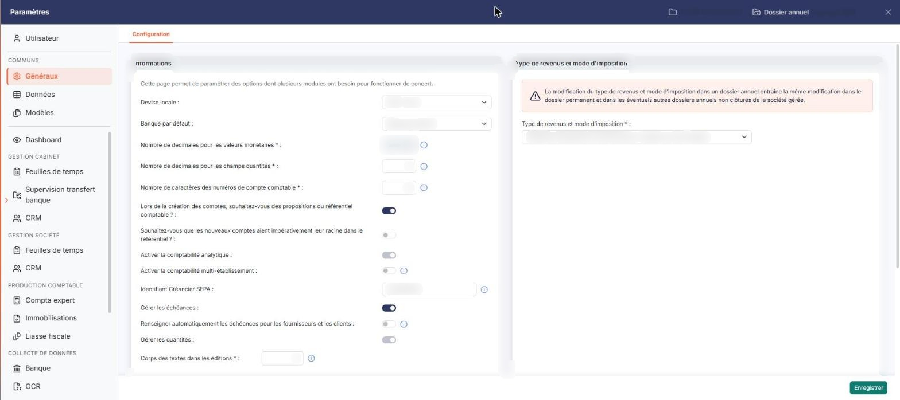
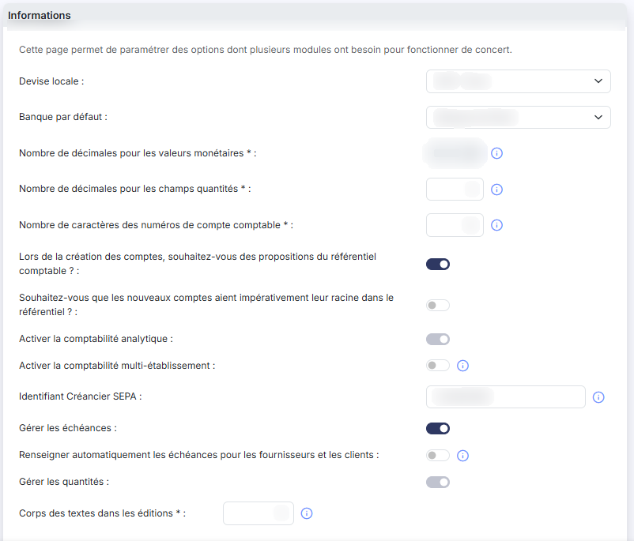
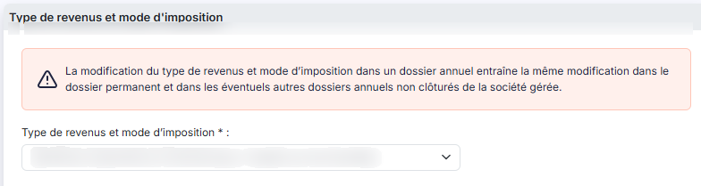

# Multimodules


**Où le trouver :** Panneau **Paramètres** › **Généraux** › **Configuration**



**En bref** — Cet écran regroupe des paramètres partagés par plusieurs modules : décimales, longueur des comptes, échéances, analytique, devise, banque par défaut, identifiant créancier SEPA et type de revenus.

* Pour générer des prélèvements SEPA : renseignez « Identifiant Créancier SEPA », fourni par votre banque, puis bouton \[Enregistrer].
* Pour choisir la banque proposée par défaut : liste « Banque par défaut », puis bouton \[Enregistrer].


La page « Multimodules » est ainsi nommée car elle rassemble des paramètres utilisés par plusieurs modules du logiciel. Le logiciel affiche d'ailleurs cette phrase en tête de l'écran : « Cette page permet de paramétrer des options dont plusieurs modules ont besoin pour fonctionner de concert. »

<figure><figcaption>
Écran « Multimodules » de la nouvelle interface
</figcaption></figure>

Ce que vous modifiez ici est donc pris en compte immédiatement ailleurs : un paramètre modifié depuis la banque l'est aussi pour la comptabilité, la facturation ou les feuilles de temps. La plupart de ces paramètres n'ont pas de rapport direct avec la banque ; seuls l'identifiant créancier SEPA et la banque par défaut lui sont propres.

L'écran se compose de deux rubriques. Les champs suivis d'un astérisque sont obligatoires.

## Rubrique « Paramètres - Informations relevant de plusieurs modules »

<figure><figcaption>
Rubrique « Paramètres - Informations relevant de plusieurs modules »
</figcaption></figure>

| Champ                                                                                                | Ce qu'il faut savoir                                                                                                                                                                                                                                                                                                                                                                                                                                                                                                                                                                                                                                                                                                                                                                                                                                                                                    |
| ---------------------------------------------------------------------------------------------------- | ------------------------------------------------------------------------------------------------------------------------------------------------------------------------------------------------------------------------------------------------------------------------------------------------------------------------------------------------------------------------------------------------------------------------------------------------------------------------------------------------------------------------------------------------------------------------------------------------------------------------------------------------------------------------------------------------------------------------------------------------------------------------------------------------------------------------------------------------------------------------------------------------------- |
| 
<strong>Nombre de décimales pour les valeurs monétaires</strong> <em>Obligatoire</em>
      | Il détermine avec combien de décimales sont saisies et affichées toutes les valeurs monétaires du logiciel. Il peut prendre les valeurs 0, 1, 2, 3 et 4, mais **vous ne pouvez pas le saisir vous-même** : le champ est en lecture seule. Pour le modifier, prenez contact avec le service technique.                                                                                                                                                                                                                                                                                                                                                                                                                                                                                                                                                                                                   |
| 
<strong>Nombre de décimales pour les champs quantités</strong> <em>Obligatoire</em>
        | Il détermine avec combien de décimales sont saisies et affichées toutes les quantités, dans les pièces commerciales comme dans les écritures comptables. Sa valeur va de 0 à 4.                                                                                                                                                                                                                                                                                                                                                                                                                                                                                                                                                                                                                                                                                                                         |
| 
<strong>Nombre de caractères des numéros de compte comptable</strong> <em>Obligatoire</em>
 | 
Il s'agit du nombre de caractères que comportent tous les comptes de votre plan comptable. La valeur doit être comprise entre 6 et 12 caractères. Attention : la modification ne porte pas que sur l'exercice ouvert. Le logiciel l'applique <strong>sur le dossier annuel en cours et sur les deux dossiers annuels précédents</strong>, afin de conserver les possibilités de comparaison d'un exercice à l'autre. <strong>Lors de la création des comptes, souhaitez-vous des propositions du référentiel comptable ? :</strong> répondez « Oui » pour que le logiciel vous propose les comptes du référentiel comptable quand vous créez un compte. <strong>Souhaitez-vous que les nouveaux comptes aient impérativement leur racine dans le référentiel ? :</strong> répondez « Oui » pour n'autoriser la création d'un compte que si sa racine figure dans le référentiel comptable.
 |
| **Identifiant Créancier SEPA**                                                                       | L'identifiant créancier SEPA (ICS) est obligatoire si vous souhaitez générer des ordres de prélèvements SEPA depuis le menu « Paiements ». Cette information est à récupérer auprès de votre banque.                                                                                                                                                                                                                                                                                                                                                                                                                                                                                                                                                                                                                                                                                                    |
| **Gérer les échéances**                                                                              | Répondez « Oui » pour gérer les échéances de règlement. Ce paramètre commande l'affichage du champ suivant : si vous répondez « Non », la ligne « Renseigner automatiquement les échéances pour les fournisseurs et les clients » disparaît de l'écran.                                                                                                                                                                                                                                                                                                                                                                                                                                                                                                                                                                                                                                                 |
| **Renseigner automatiquement les échéances pour les fournisseurs et les clients**                    | L'échéance est renseignée automatiquement pour les comptes dont les échéances sont gérées.                                                                                                                                                                                                                                                                                                                                                                                                                                                                                                                                                                                                                                                                                                                                                                                                              |
| **Activer la comptabilité analytique**                                                               | Répondez « Oui » pour tenir une comptabilité analytique. Le champ apparaît parfois **grisé et non modifiable**, sans qu'aucun message ne l'explique : c'est le cas lorsque l'analytique est déjà activée **et déjà utilisée** dans le dossier. Vous ne pouvez donc plus la désactiver tant que des axes analytiques sont employés.                                                                                                                                                                                                                                                                                                                                                                                                                                                                                                                                                                      |
| **Activer la comptabilité multi-établissement**                                                      | En activant cette option, vous devrez affecter les écritures à un établissement. Les établissements doivent être créés dans le module « Dossier permanent », menu « Social », option « Etablissements ».                                                                                                                                                                                                                                                                                                                                                                                                                                                                                                                                                                                                                                                                                                |
| **Gérer les quantités**                                                                              | Répondez « Oui » pour saisir des quantités. Comme le champ « Activer la comptabilité analytique », il apparaît parfois **grisé et non modifiable** sans explication affichée : c'est le cas lorsque la gestion des quantités est activée **et qu'au moins un journal gère les quantités**. Pour pouvoir la désactiver, retirez d'abord la gestion des quantités des journaux concernés (menu « Fichiers », sous-option « Journaux »).                                                                                                                                                                                                                                                                                                                                                                                                                                                                   |
| **Devise locale**                                                                                    | Choisissez la devise dans laquelle votre comptabilité est tenue. La liste propose les devises reconnues par le logiciel, sous la forme « code - libellé » (par exemple « EUR - Euro »).                                                                                                                                                                                                                                                                                                                                                                                                                                                                                                                                                                                                                                                                                                                 |
| **Banque par défaut**                                                                                | Choisissez, parmi les banques de votre société, celle que le logiciel proposera par défaut. La liste reprend les banques créées dans le menu « Fichiers », sous-option « Banques ».                                                                                                                                                                                                                                                                                                                                                                                                                                                                                                                                                                                                                                                                                                                     |
| 
<strong>Corps des textes dans les éditions</strong> <em>Obligatoire</em>
                   | Ce paramètre détermine la taille d'affichage des textes standards dans les éditions ; sa valeur doit être comprise entre 8 et 18.                                                                                                                                                                                                                                                                                                                                                                                                                                                                                                                                                                                                                                                                                                                                                                       |

## Rubrique « Type de revenus et mode d'imposition »

<figure><figcaption>
Rubrique « Type de revenus et mode d'imposition »
</figcaption></figure>

Cette rubrique s'ouvre sur un avertissement affiché en rouge : « La modification du type de revenus et mode d'imposition dans un dossier annuel entraîne la même modification dans le dossier permanent et dans les éventuels autres dossiers annuels non clôturés de la société gérée. » Autrement dit, ce choix ne concerne pas seulement l'exercice sur lequel vous travaillez.

**Type de revenus et mode d'imposition** \* : choisissez le régime de la société gérée. La liste propose : « Bénéfices Agricoles », « Bénéfices Industriels et Commerciaux / Impôts sur le Revenu », « Bénéfices Industriels et Commerciaux / Impôts sur les Sociétés », « Bénéfices Non Commerciaux », « Non imposable », « Nouvelle-Calédonie », « Revenus Fonciers », « Revenus Fonciers Professionnels » et « Revenus Fonciers professionnels et non professionnels ».

bouton **\[Enregistrer]**

Il enregistre les deux rubriques. C'est le seul bouton de l'écran : il n'y a ni bouton de retour, ni bouton d'annulation. Pour quitter sans enregistrer, passez par le menu — le logiciel ne vous avertit pas que vous perdez vos modifications.
