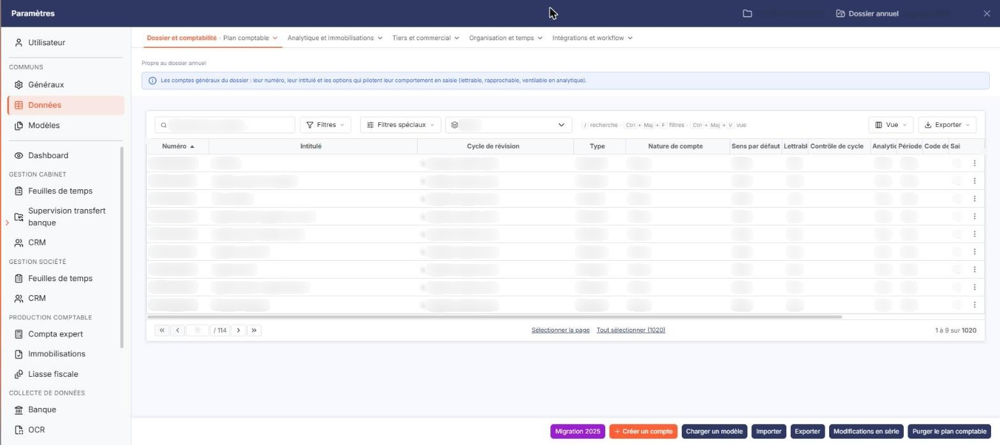
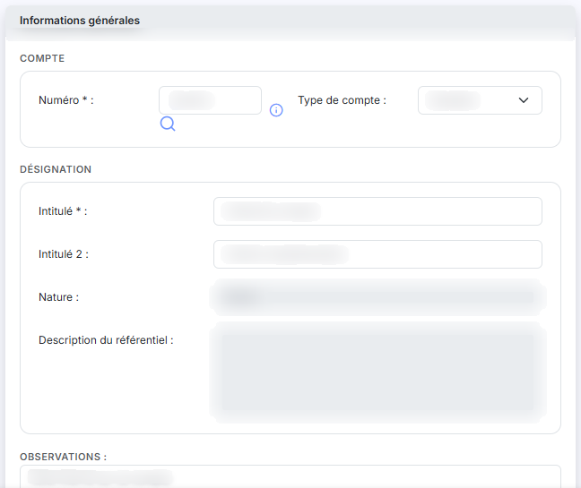
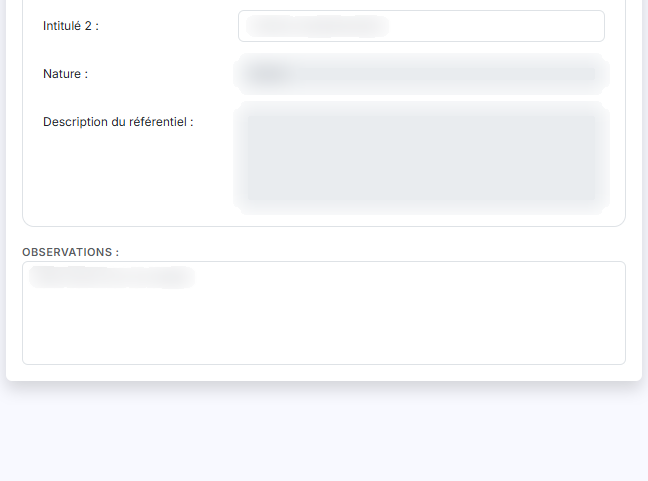
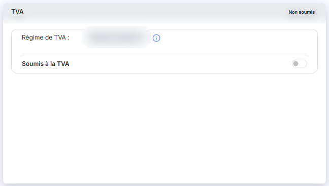

# Plan comptable


**Où le trouver :** Panneau **Paramètres** › **Données** › **Dossier et comptabilité** › **Plan comptable**



**En bref** — Cet écran permet de créer ou compléter les comptes généraux du plan comptable, notamment ceux dont vos règles de traduction ont besoin (compte d'attente, frais bancaires).

* Pour créer un compte : bouton \[Nouveau], renseignez « Numéro » et « Intitulé », puis bouton \[Enregistrer].
* Pour retrouver un compte : saisissez son numéro dans « N° de compte », puis bouton \[Filtrer].
* Pour reprendre un plan comptable modèle : bouton \[Charger un modèle].


Cette option permet d'administrer les **comptes généraux** du plan comptable du dossier annuel en cours. Le plan comptable est commun à tous les modules qui l'utilisent : un compte créé ici est aussitôt disponible ailleurs.

<figure><figcaption>
Écran « Plan comptable » de la nouvelle interface
</figcaption></figure>

Vous accédez à cet écran depuis ce module afin de créer ou de compléter les comptes dont vous avez besoin pour vos règles de traduction — un compte d'attente, un compte de frais bancaires — sans avoir à changer de module. **Depuis ici, la fiche d'un compte n'affiche qu'une partie de ses rubriques** : voir le paragraphe f) ci-dessous.

La suppression d'un compte n'est possible qu'à la condition qu'aucune écriture n'ait été passée sur l'exercice pour le compte concerné.

**a) Les filtres au-dessus de la liste**

Une barre de filtre coiffe la liste :

* **N° de compte** : ⚠️ ce champ cherche **« contient »** et non « commence par », contrairement à ce que son intitulé laisse attendre. La saisie _606_ ramène bien les comptes commençant par 606, mais aussi tout compte dont le numéro comporte cette suite de chiffres ailleurs — un compte 486060000000, par exemple.
* **Cycle** : restreint la liste à un cycle de révision. La valeur _Tous_ ne restreint rien.
* un groupe de trois boutons : _Tous les comptes_ (proposé par défaut), _Comptes mouvementés_ et _Comptes non mouvementés_.

Le bouton **\[Filtrer]** applique vos critères. Un bouton **\[Annuler les filtres]** apparaît alors à côté de lui : il rétablit la liste complète et disparaît de nouveau.

**b) La liste des comptes**

La liste est large : elle comporte quinze colonnes et se fait **défiler horizontalement**. Les colonnes de droite, qui portent les soldes, ne sont pas visibles à l'ouverture. Dans l'ordre :

**Numéro** (tri initial croissant) · **Intitulé** · **Cycle de révision** · **Type** · **Nature de compte** · **Sens par défaut** · **Lettrable** · **Contrôle de cycle** · **Analytique** · **Période d'effet** · **Code devise** · **Saisie en devise** · **Solde n-1** · **Solde n-2** · **Ecart n-1 vs n-2**.

Toutes ces colonnes sont triables, à l'exception de la dernière, **Ecart n-1 vs n-2** : c'est une colonne calculée, elle n'est ni triable ni utilisable comme critère de filtre.

L'en-tête de la première colonne, sans intitulé, porte cinq commandes : une case à cocher qui sélectionne toutes les lignes de la page, une seconde case orange qui étend la sélection à toutes les pages, le pictogramme « Engrenage » (personnalisation des colonnes), le pictogramme « Entonnoir » (fenêtre de filtres) et le pictogramme « Imprimante » (impression de la liste).

La fenêtre de filtres est bien plus riche que la barre de filtre décrite ci-dessus : elle porte sur les quatorze colonnes affichées et sur une trentaine d'autres informations du compte — intitulé 2, dates et auteurs de création et de modification, paramètres de TVA, d'échéances, de quantités, observations, etc.

Chaque ligne porte quatre commandes : la **case à cocher** de sélection, le pictogramme « Crayon » pour ouvrir la fiche, le pictogramme « Croix verte » pour supprimer le compte, et un dernier pictogramme dont l'infobulle est « Dupliquer ».

**c) Les boutons de bas d'écran**

🛑 **Cet écran porte dix boutons, dont sept déclenchent un traitement portant sur l'ensemble du plan comptable.** Prenez garde : ils sont tous rendus de la même façon, et rien ne distingue visuellement une simple navigation d'une suppression de masse — **\[Purger le plan comptable]** a exactement l'apparence de bouton **\[Nouveau]**.

* bouton **\[Nouveau]** : ouvre une fiche de compte vierge.
* bouton **\[Charger un modèle]** : reprend un plan comptable modèle, parmi ceux fournis avec le logiciel ou ceux que votre cabinet a créés. Les comptes que vous avez déjà créés sont conservés lors du chargement.
* bouton **\[Importer]** : reprend un plan comptable depuis un fichier. Le compte rendu de l'import s'affiche ensuite sous forme de liste, une ligne par anomalie rencontrée.
* bouton **\[Exporter]** : produit un fichier reprenant le plan comptable.
* bouton **\[Modifications en série]** : applique une même modification à tous les comptes sélectionnés.
* bouton **\[Réaffectation]** : reporte les écritures d'un compte sur un autre.
* bouton **\[Auxiliariser]** : transforme des comptes généraux en comptes auxiliaires rattachés à un compte collectif.
* bouton **\[Purger le plan comptable]** : 🛑 supprime des comptes en masse. À n'employer qu'en connaissance de cause.
* bouton **\[Supprimer]** : supprime les comptes dont vous avez coché la case de sélection.
* bouton **\[Migration 2025]** : il fait migrer le plan comptable du dossier vers le plan comptable général de 2025. 🛑 C'est une opération exceptionnelle et non réversible, qui supprime notamment les comptes n'appartenant plus au référentiel et vous demande de leur choisir un compte de remplacement. Ne l'employez pas dans le cadre de votre travail courant sur les relevés bancaires : conduisez-la depuis le module de comptabilité, où elle est décrite en détail.

**d) Rubrique « Informations générales » de la fiche**

| Champ              | Ce qu'il faut savoir                                                                                                                                                                                                                                                                                                                                                                                                                 |
| ------------------ | ------------------------------------------------------------------------------------------------------------------------------------------------------------------------------------------------------------------------------------------------------------------------------------------------------------------------------------------------------------------------------------------------------------------------------------ |
| **Numéro**         | Il n'est **pas modifiable** après création du compte, et doit être unique. Son infobulle rappelle la règle de composition : _« Les caractères autorisés sont les lettres majuscules et les chiffres. Le numéro doit commencer par 3 chiffres. »_                                                                                                                                                                                     |
| **Intitulé**       | Champ obligatoire. Il peut être repris automatiquement dans les libellés d'écritures, et reste modifiable à tout moment.                                                                                                                                                                                                                                                                                                             |
| **Intitulé 2**     | C'est un second intitulé libre.                                                                                                                                                                                                                                                                                                                                                                                                      |
| **Type de compte** | 
Un compte est soit <em>Standard</em>, soit <em>Collectif</em>. Il n'est pas possible d'en changer si des écritures ont été passées sur le compte. • <strong>Compte collectif</strong> : il regroupe des comptes auxiliaires qui lui sont rattachés, et l'un d'eux doit obligatoirement être renseigné lors de la saisie d'une écriture. • <strong>Compte standard</strong> : il admet la saisie sans compte auxiliaire.
 |
| **Nature**         | Non modifiable. La nature du compte est déterminée automatiquement par le logiciel.                                                                                                                                                                                                                                                                                                                                                  |
| **Observations**   | Une zone de saisie libre sur plusieurs lignes.                                                                                                                                                                                                                                                                                                                                                                                       |

**Créé le** ou **Modifié le**, et **Par** : non modifiables. La fiche n'affiche **qu'une seule** de ces deux informations, celle de la dernière opération intervenue sur le compte, et elle change son intitulé en conséquence : un compte jamais modifié depuis sa création affiche _Créé le_, un compte modifié depuis affiche _Modifié le_. Vous ne pouvez donc pas connaître les deux dates depuis cette fiche.

**e) Les autres rubriques de la fiche**

**Rubrique « TVA »**

Cette rubrique ne contient aucun champ. Elle affiche seulement le renvoi suivant : _« Pour modifier les paramètres concernant la gestion de la TVA, veuillez vous rendre dans le menu "Paramètres", option "Paramètres généraux", rubrique "Régime de TVA". »_

**Rubrique « Devises »**

Elle ne présente d'abord qu'une question, **Autoriser la saisie en devises :**. Si vous répondez « Oui », un champ **Devise par défaut pour ce compte :** apparaît, dans lequel vous choisissez une devise parmi celles paramétrées pour le dossier.

**Rubrique « Soldes »**

Cette rubrique est entièrement en **lecture seule** : elle restitue la situation du compte et ne se saisit pas. Elle présente le **Solde à date**, le **Solde n-1**, l'indication **Mouvementé en n-1**, l'**Ecart n vs n-1**, le **Solde n-2** et l'**Ecart n-1 vs n-2**. Ces montants peuvent être vides si l'exercice concerné n'existe pas dans le dossier.

La fiche se termine par les bouton **\[Enregistrer]** et bouton **\[Retour]**.

**f) Les rubriques non affichées depuis ce module**

La fiche d'un compte général comporte d'autres rubriques — _Propriétés_, _Accélérateur de saisie_, _Gestion analytique_, _Échéances_ et _Quantités_ — qui **ne sont pas affichées lorsque vous ouvrez la fiche depuis ce module**. Elles ne sont pas absentes du logiciel : pour les consulter et les modifier, ouvrez le même compte depuis le module de comptabilité.

Vous pouvez toutefois rencontrer les informations qu'elles portent dans la fenêtre de filtres de la liste : celle-ci propose des critères — gestion des échéances, délai de règlement, gestion des quantités, paramètres de TVA du compte — qui correspondent à ces rubriques. Vous pouvez donc filtrer sur des propriétés que la fiche ne vous montre pas ici.

## Autres vues de l'écran

<figure><figcaption>
Bouton [Nouveau]
</figcaption></figure>

<figure><figcaption>
Informations générales
</figcaption></figure>

<figure><figcaption>
Informations générales
</figcaption></figure>

<figure><figcaption>
TVA
</figcaption></figure>
