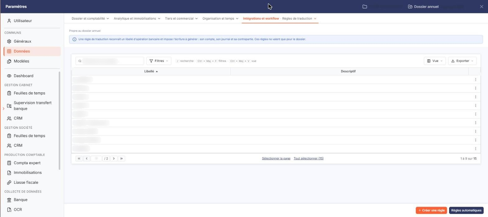
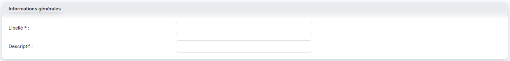
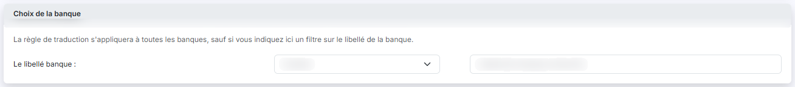
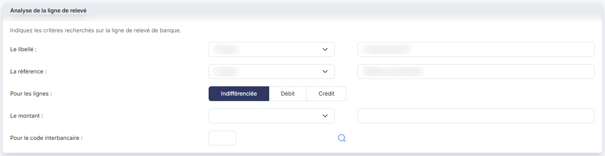
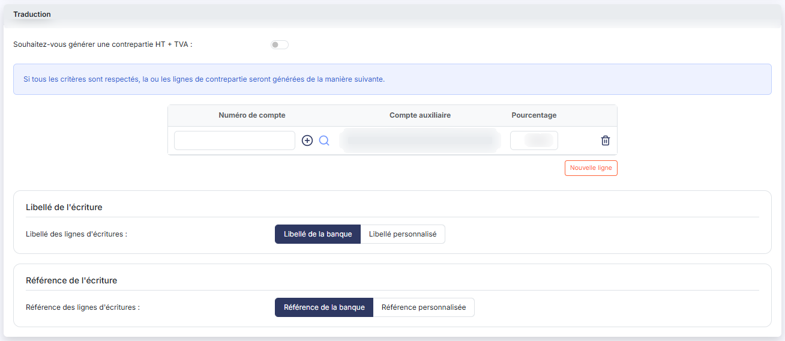

# Règles de traduction


**Où le trouver :** Panneau **Paramètres** › **Données** › **Intégrations et workflow** › **Règles de traduction**



**En bref** — Cet écran gère les règles qui déterminent, pour chaque ligne de relevé bancaire, l'écriture comptable et le compte de contrepartie à générer.

* Pour créer une règle : bouton \[Créer une règle], renseignez le libellé, les critères et la contrepartie, puis bouton \[Enregistrer].
* Pour créer une règle par client ou fournisseur : bouton \[Règles automatiques], puis choisissez Clients, Fournisseurs ou Les deux.
* Pour décliner une règle proche d'une règle existante : menu « Autres actions » de la ligne, puis « Dupliquer ».


Les règles de traduction sont le cœur du module. Chacune d'elles répond à deux questions :

<figure><figcaption>
Écran « Règles de traduction » de la nouvelle interface
</figcaption></figure>

1. **à quelles lignes de relevé bancaire s'applique-t-elle ?** — c'est l'objet des rubriques « Choix de la banque » et « Analyse de la ligne de relevé » ;
2. **quelle écriture comptable en découle ?** — c'est l'objet de la rubrique « Traduction ».

Lors de la génération des écritures, chaque ligne de relevé bancaire est comparée aux règles de traduction. Pour chaque ligne, le logiciel écrit une ligne d'écriture dans le compte de la banque — paramétré dans le panneau « Paramètres » (« Données », catégorie « Dossier et comptabilité », « Banques ») — et la ou les lignes de contrepartie décrites par la règle qui s'applique. Les lignes qu'aucune règle ne reconnaît sont ventilées dans le **compte d'attente** de la banque, et vous les reclassez ensuite en comptabilité.

**🛑 Deux règles du jeu à connaître avant de commencer**

**1. Une ligne de relevé n'est reconnue que par UNE seule règle : la première qui l'attrape.**

Le logiciel passe les règles en revue et, à chaque fois, il n'affecte que les lignes **qui ne sont pas déjà prises** par une autre règle. Une ligne déjà reconnue n'est donc jamais reprise par une règle suivante, même si celle-ci lui correspondait mieux.

Il en découle deux conséquences pratiques :

* vous ne pouvez **pas choisir l'ordre** dans lequel vos règles sont examinées : l'écran ne propose aucune priorité, et il n'y en a pas. Si deux de vos règles peuvent reconnaître la même ligne, vous ne savez pas laquelle l'emportera ;
* la parade est donc d'écrire des règles **qui ne se recouvrent pas** : ajoutez des critères (le sens, le montant, le code interbancaire) jusqu'à ce qu'une ligne donnée ne puisse satisfaire qu'une seule de vos règles ;
* les règles définies au niveau du cabinet, communes à vos dossiers, sont examinées **avant** celles du dossier : à recouvrement, ce sont elles qui l'emportent.

**2. Une règle dont les pourcentages de contrepartie ne totalisent pas exactement 100 est ignorée, silencieusement.**

Elle reste affichée dans la liste comme les autres, mais elle n'est jamais appliquée et aucun message ne vous en avertit. Vérifiez toujours que le total des lignes de contrepartie fait 100.

**a) La liste des règles**

Le tableau ne comporte que deux colonnes, **Libellé** (tri initial croissant) et **Descriptif**. **Il ne montre rien du contenu des règles** : ni le critère recherché, ni le compte de contrepartie, ni la banque visée. Pour savoir ce que fait une règle, vous devez ouvrir sa fiche. Soignez donc les libellés que vous donnez à vos règles, et servez-vous du descriptif — c'est le seul endroit où vous pouvez laisser une trace de ce qu'elles font.

Un bandeau d'information « Propre au dossier annuel » s'affiche au-dessus de la liste. La barre de la liste regroupe le champ « Rechercher une règle… », le bouton \[Filtres] et les boutons \[Vue] et \[Exporter] ; il n'y a plus de case à cocher ni de pictogrammes en tête de colonne. Le bouton \[Vue] ouvre « Mes vues » et « Colonnes affichées » ; le bouton \[Exporter] ouvre « Aperçu édition HTML », « Imprimer », « Exporter en Excel », « Exporter en PDF » et « Envoyer la liste par e-mail ». Sous le tableau, les liens « Sélectionner la page » et « Tout sélectionner » (suivi du nombre de règles) sélectionnent des règles.

Le menu \[Filtres], par sa liste « + Ajouter un critère sur… », donne accès à toute la matière des règles : le filtre sur le libellé de banque et son contenu de comparaison, le type de ligne, l'opérateur, la valeur de référence, le code interbancaire, le libellé d'écriture, le nombre de lignes, le numéro de compte, le compte auxiliaire et le compte de TVA. C'est le moyen de retrouver, par exemple, toutes les règles qui alimentent un compte donné.

Chaque ligne porte un seul pictogramme visible, « Autres actions » (trois points), dont le menu propose trois commandes. Un clic sur une ligne la sélectionne : un bandeau de sélection affiche alors « 1 règle sélectionnée », « Tout désélectionner » et le bouton \[Supprimer]. Les commandes du menu :

* « Modifier », qui ouvre la règle en modification ;
* « Supprimer », qui la supprime ;
* « Dupliquer » : cette commande vous évite de ressaisir une règle proche d'une règle existante. C'est la bonne méthode pour décliner une même traduction sur plusieurs banques ou sur plusieurs fourchettes de montants.

Une règle ne porte aucun statut : elle n'est ni activable ni désactivable. Une règle qui existe s'applique.

**b) Les boutons de bas d'écran**

bouton **\[Créer une règle]**

Il ouvre une fiche de règle vierge.

bouton **\[Supprimer]**

Il apparaît dans le bandeau de sélection et supprime les règles que vous avez sélectionnées.

**c) Rubrique « Informations générales »**

| Champ                                | Ce qu'il faut savoir                                                                                                                                                                                                                                                                                                                                                                                                                                                                                                                                                                                                                                                                                                                                                                                                                                                                                                                                                                                                                                                                                                                                                                                                                                                                                                                                                                                                                                                                                                                                                                                                                                                                                                                                                                                                                                                                                                                                                                                                                                                                                                                                                                                                                                                                                                                                                                                                                                                                                                                                                                                                                                                                                                                                                                                                                                                                                                                                                                                                                                                                                                                                                                                                                                                                                                                                                                                              |
| ------------------------------------ | ----------------------------------------------------------------------------------------------------------------------------------------------------------------------------------------------------------------------------------------------------------------------------------------------------------------------------------------------------------------------------------------------------------------------------------------------------------------------------------------------------------------------------------------------------------------------------------------------------------------------------------------------------------------------------------------------------------------------------------------------------------------------------------------------------------------------------------------------------------------------------------------------------------------------------------------------------------------------------------------------------------------------------------------------------------------------------------------------------------------------------------------------------------------------------------------------------------------------------------------------------------------------------------------------------------------------------------------------------------------------------------------------------------------------------------------------------------------------------------------------------------------------------------------------------------------------------------------------------------------------------------------------------------------------------------------------------------------------------------------------------------------------------------------------------------------------------------------------------------------------------------------------------------------------------------------------------------------------------------------------------------------------------------------------------------------------------------------------------------------------------------------------------------------------------------------------------------------------------------------------------------------------------------------------------------------------------------------------------------------------------------------------------------------------------------------------------------------------------------------------------------------------------------------------------------------------------------------------------------------------------------------------------------------------------------------------------------------------------------------------------------------------------------------------------------------------------------------------------------------------------------------------------------------------------------------------------------------------------------------------------------------------------------------------------------------------------------------------------------------------------------------------------------------------------------------------------------------------------------------------------------------------------------------------------------------------------------------------------------------------------------------------------------------- |
| **Libellé**                          | Champ obligatoire, limité à 50 caractères. C'est lui qui identifie la règle dans la liste.                                                                                                                                                                                                                                                                                                                                                                                                                                                                                                                                                                                                                                                                                                                                                                                                                                                                                                                                                                                                                                                                                                                                                                                                                                                                                                                                                                                                                                                                                                                                                                                                                                                                                                                                                                                                                                                                                                                                                                                                                                                                                                                                                                                                                                                                                                                                                                                                                                                                                                                                                                                                                                                                                                                                                                                                                                                                                                                                                                                                                                                                                                                                                                                                                                                                                                                        |
| **Descriptif**                       | 
Limité lui aussi à 50 caractères et à une seule ligne. Utilisez-le pour rappeler l'intention de la règle : c'est la seule information que la liste affiche en plus du libellé. <strong>d) Rubrique « Choix de la banque »</strong> La rubrique s'ouvre sur la phrase : <em>« La règle de traduction s'appliquera à toutes les banques, sauf si vous indiquez ici un filtre sur le libellé de la banque. »</em> Autrement dit, <strong>ne remplissez cette rubrique que si vous voulez restreindre la règle</strong> à une partie de vos banques. Le filtre ne porte pas sur une liste de banques à cocher, mais sur une <strong>comparaison de texte avec le libellé</strong> de la banque tel qu'il figure dans le panneau « Paramètres » (« Données », catégorie « Dossier et comptabilité », « Banques »).
                                                                                                                                                                                                                                                                                                                                                                                                                                                                                                                                                                                                                                                                                                                                                                                                                                                                                                                                                                                                                                                                                                                                                                                                                                                                                                                                                                                                                                                                                                                                                                                                                                                                                                                                                                                                                                                                                                                                                                                                                                                                                                                                                                                                                                                                                                                                                                                                                                                                                                                                                                                     |
| **Le libellé banque**                | Choisissez l'opérateur — _Contient_, _Commence par_ ou _Finit par_. _Contient_ est proposé par défaut.                                                                                                                                                                                                                                                                                                                                                                                                                                                                                                                                                                                                                                                                                                                                                                                                                                                                                                                                                                                                                                                                                                                                                                                                                                                                                                                                                                                                                                                                                                                                                                                                                                                                                                                                                                                                                                                                                                                                                                                                                                                                                                                                                                                                                                                                                                                                                                                                                                                                                                                                                                                                                                                                                                                                                                                                                                                                                                                                                                                                                                                                                                                                                                                                                                                                                                            |
| **Contenu de comparaison**           | 
Le texte recherché, jusqu'à 50 caractères. Laissé vide, il ne restreint rien : la règle vaut pour toutes les banques. <strong>e) Rubrique « Analyse de la ligne de relevé »</strong> La rubrique s'ouvre sur la phrase : <em>« Indiquez les critères recherchés sur la ligne de relevé de banque. »</em> Vous disposez de cinq critères, que vous pouvez combiner. <strong>Les critères renseignés se cumulent</strong> : la ligne de relevé doit satisfaire tous ceux que vous avez remplis pour que la règle s'applique. Plus vous en remplissez, plus la règle est précise — et moins elle risque d'attraper une ligne qui ne la concerne pas. - <strong>Le libellé</strong> : l'opérateur à appliquer au libellé de la ligne de relevé — <em>Contient</em>, <em>Commence par</em> ou <em>Finit par</em>. Puis <strong>Contenu de comparaison :</strong> le texte recherché, jusqu'à 50 caractères. Par exemple, opérateur <em>Contient</em> et contenu <em>Frais de virement</em> : la ligne est reconnue si son libellé comporte ce texte, qu'il y ait ou non autre chose avant ou après. - <strong>La référence</strong> : même principe appliqué à la référence de la ligne de relevé, avec les mêmes opérateurs et un champ <strong>Référence de comparaison :</strong> de 50 caractères. - <strong>Pour les lignes</strong> : trois choix — <em>Indifférenciée</em>, <em>Débit</em> ou <em>Crédit</em>. <strong>Attention : débit et crédit s'entendent ici au sens bancaire, pas au sens comptable.</strong> Un prélèvement, qui vous retire de l'argent, est un débit sur le relevé. <em>Indifférenciée</em>, proposé par défaut, ne restreint rien. - <strong>Le montant</strong> : l'opérateur de comparaison — <em>Egal =</em>, <em>Inférieur ou égal &#x3C;=</em>, <em>Supérieur ou égal >=</em>, <em>Strictement inférieur &#x3C;</em> ou <em>Strictement supérieur ></em> — puis <strong>Valeur de comparaison :</strong> le montant recherché. <strong>Il n'existe pas d'opérateur d'intervalle</strong> : pour viser une fourchette (« entre 100 et 200 »), il vous faut deux règles, ou combiner ce critère avec d'autres. - <strong>Pour le code interbancaire</strong> : le code interbancaire est une information normalisée fournie par la banque. Le pictogramme « Loupe » ouvre la fenêtre « Recherche de codes », qui présente les codes et leur signification (par exemple <em>01 — Chèques payés</em>, <em>05 — Virements reçus</em>, <em>08 — Prélèvements et TIP domiciliés</em>). La liste des codes (colonnes <strong>Code</strong> et <strong>Opération</strong>) s'affiche dès l'ouverture de la fenêtre, sans bouton [Afficher] ; le champ <strong>Code</strong> permet de chercher, et vous cliquez sur la ligne voulue pour la sélectionner. <strong>f) Rubrique « Traduction »</strong> C'est ici que vous décrivez l'écriture. La rubrique affiche la phrase : <em>« Si tous les critères sont respectés, la ou les lignes de contrepartie seront générées de la manière suivante. »</em> Tout dépend d'abord de la question <strong>Souhaitez-vous générer une contrepartie HT + TVA :</strong>, qui commande deux présentations très différentes. <strong>f.1) Interrupteur désactivé — une contrepartie libre</strong> Un tableau vous laisse répartir la contrepartie sur autant de lignes que vous voulez. Chaque ligne comporte :
 |
| **Numéro de compte**                 | Le compte général de la ligne de contrepartie, sur 12 caractères. Le bouton **\[+]** permet de créer le compte s'il n'existe pas encore, la loupe de le rechercher.                                                                                                                                                                                                                                                                                                                                                                                                                                                                                                                                                                                                                                                                                                                                                                                                                                                                                                                                                                                                                                                                                                                                                                                                                                                                                                                                                                                                                                                                                                                                                                                                                                                                                                                                                                                                                                                                                                                                                                                                                                                                                                                                                                                                                                                                                                                                                                                                                                                                                                                                                                                                                                                                                                                                                                                                                                                                                                                                                                                                                                                                                                                                                                                                                                               |
| **Compte auxiliaire**                | À renseigner uniquement si le compte général est un compte collectif. Ce champ reste **grisé tant que le numéro de compte n'est pas saisi**.                                                                                                                                                                                                                                                                                                                                                                                                                                                                                                                                                                                                                                                                                                                                                                                                                                                                                                                                                                                                                                                                                                                                                                                                                                                                                                                                                                                                                                                                                                                                                                                                                                                                                                                                                                                                                                                                                                                                                                                                                                                                                                                                                                                                                                                                                                                                                                                                                                                                                                                                                                                                                                                                                                                                                                                                                                                                                                                                                                                                                                                                                                                                                                                                                                                                      |
| **Pourcentage**                      | 
La part de la ligne de relevé affectée à cette ligne de contrepartie. Sur une contrepartie à une seule ligne, il vaut 100. <strong>Le total des lignes doit impérativement faire 100</strong> : à défaut, la règle est ignorée sans message, comme indiqué en tête de page. Le bouton <strong>[Nouvelle ligne]</strong>, sous le tableau, ajoute une ligne de contrepartie ; la corbeille en fin de chaque ligne (infobulle « Supprimer ») la supprime. En création, une première ligne vous attend déjà, avec un pourcentage de 100. <strong>f.2) Interrupteur activé — une contrepartie HT + TVA</strong> Le tableau libre <strong>disparaît entièrement</strong> et laisse place à une présentation figée à deux lignes, précédée du champ <strong>Indiquez le code TVA :</strong>. Choisissez d'abord le code de TVA. C'est lui qui commande tout le reste : dès qu'il est choisi, le logiciel calcule les deux pourcentages — la part hors taxes et la part de TVA — et il alimente la liste des comptes de TVA disponibles, qui reste vide tant qu'aucun code n'est sélectionné. Le tableau comporte alors trois colonnes, <strong>Type de ligne</strong>, <strong>Numéro de compte</strong> et <strong>Pourcentage</strong>, sur deux lignes imposées : - la ligne <em>Ligne de HT</em>, dont vous saisissez le numéro de compte (avec le bouton <strong>[+]</strong> et la loupe) ; - la ligne <em>Ligne de TVA</em>, dont vous choisissez le compte dans une liste alimentée par les comptes de TVA du dossier. Les deux <strong>Pourcentage</strong> sont <strong>calculés et non saisissables</strong>, il n'y a ni colonne de compte auxiliaire, ni bouton d'ajout de ligne, ni suppression de ligne. ⚠️ <strong>Ne confondez pas les deux « Type de ligne » de cet écran.</strong> Dans ce tableau, <strong>Type de ligne</strong> distingue la ligne de HT de la ligne de TVA. Dans le menu [Filtres] de la liste, un critère porte le même nom <strong>Type de ligne</strong> mais désigne tout autre chose : le sens de la ligne de relevé recherchée (<em>Indifférenciée</em>, <em>Débit</em>, <em>Crédit</em>), c'est-à-dire le critère <strong>Pour les lignes</strong> de la rubrique « Analyse de la ligne de relevé ». <strong>f.3) Libellé et référence des lignes d'écritures</strong> Ces deux réglages, communs aux deux cas ci-dessus, ferment la rubrique.
                                                                                                                                                                                                                                                                                                                                                                                                                                                                                                                                                                                                                                                                                                                                                                                                                                                                                                                                                                                       |
| **Libellé des lignes d'écritures**   | Deux choix. _Libellé de la banque_ reprend le libellé tel qu'il figure sur la ligne de relevé. _Libellé personnalisé_ fait apparaître un composeur.                                                                                                                                                                                                                                                                                                                                                                                                                                                                                                                                                                                                                                                                                                                                                                                                                                                                                                                                                                                                                                                                                                                                                                                                                                                                                                                                                                                                                                                                                                                                                                                                                                                                                                                                                                                                                                                                                                                                                                                                                                                                                                                                                                                                                                                                                                                                                                                                                                                                                                                                                                                                                                                                                                                                                                                                                                                                                                                                                                                                                                                                                                                                                                                                                                                               |
| **Référence des lignes d'écritures** | Même principe, entre _Référence de la banque_ et _Référence personnalisée_, avec son propre composeur, identique au précédent.                                                                                                                                                                                                                                                                                                                                                                                                                                                                                                                                                                                                                                                                                                                                                                                                                                                                                                                                                                                                                                                                                                                                                                                                                                                                                                                                                                                                                                                                                                                                                                                                                                                                                                                                                                                                                                                                                                                                                                                                                                                                                                                                                                                                                                                                                                                                                                                                                                                                                                                                                                                                                                                                                                                                                                                                                                                                                                                                                                                                                                                                                                                                                                                                                                                                                    |

Le bouton **\[Enregistrer]** se trouve en bas à droite de la fiche ; pour la quitter, utilisez le chevron « Retour » à gauche de la barre des catégories du panneau.

## Autres vues de l'écran

<figure><figcaption>
Bouton [Créer une règle]
</figcaption></figure>

<figure><figcaption>
Informations générales
</figcaption></figure>

<figure><figcaption>
Choix de la banque
</figcaption></figure>

<figure><figcaption>
Analyse de la ligne de relevé
</figcaption></figure>

<figure><figcaption>
Traduction
</figcaption></figure>
