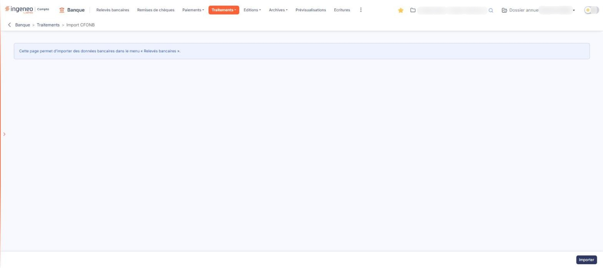
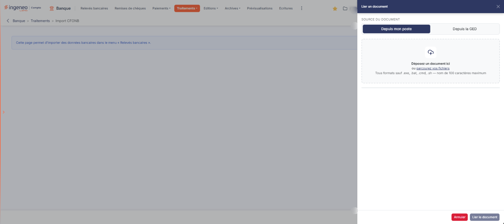

# Import CFONB


**Où le trouver :** Menu **Traitements › Import CFONB**



**En bref** — Cette option charge dans le module un relevé bancaire au format CFONB 120, fourni par votre banque ; les opérations alimentent l'écran « Relevés bancaires ».

* Pour importer un relevé : bouton \[Importer], déposez le fichier, puis bouton \[Lier le document].
* Pour effacer le compte rendu du dernier import : bouton \[Purger le rapport].


Cette option vous permet de charger dans le logiciel un relevé bancaire au format **CFONB 120**, celui que votre banque met à votre disposition sur son espace en ligne. Les opérations qu'il contient viennent alimenter l'option « Relevés bancaires » du module, où vous les traduisez ensuite en écritures comptables.

<figure><figcaption>
Écran « Import CFONB » de la nouvelle interface
</figcaption></figure>

C'est ce que rappelle l'unique phrase affichée à l'écran : _« Cette page permet d'importer des données bancaires dans le menu « Relevés bancaires ». »_

**a) L'écran**

Tant qu'aucun import n'a été réalisé, l'écran se limite à cette phrase et à un bouton. Vous n'y trouvez ni champ, ni liste de banques, ni rubrique de paramétrage — tout se passe dans le volet qu'ouvre le bouton. Une fois un import effectué, l'écran présente en plus le compte rendu de ce dernier import, décrit au paragraphe d) ci-dessous.

bouton **\[Importer]**

Il ouvre le volet « Lier un document », décrit ci-dessous.

**b) Le volet « Lier un document »**

Ce volet s'ouvre sur le côté droit de l'écran. Vous n'y choisissez ni banque, ni compte, ni modèle d'import : le logiciel les détermine à partir du contenu du fichier.

**Source du document** : deux onglets, « Depuis mon poste » (affiché à l'ouverture) et « Depuis la GED ». Sous « Depuis mon poste », une zone invite à « Déposer un document ici ou parcourir vos fichiers » : le fichier se dépose dans cette zone ou se choisit dans le sélecteur de fichiers de votre poste. L'onglet « Depuis la GED » ouvre un second volet « Sélection d'un document » : non vérifié, onglet non ouvert le 27/10/2026.

Vous ne pouvez sélectionner **qu'un seul fichier à la fois**.

Le volet **ne filtre pas sur l'extension** : il annonce « Tous formats sauf .exe, .bat, .cmd, .sh — nom de 100 caractères maximum » et ne nomme aucun format CFONB. C'est voulu — les banques livrent leurs relevés sous des extensions très diverses, et le logiciel n'en refuse que quelques-unes. En contrepartie, rien ne vous empêche de choisir un fichier que le logiciel ne saura pas lire : voyez le paragraphe c) pour savoir ce qu'il attend.

bouton **\[Lier le document]**

Placé en pied du volet, il reste grisé tant qu'aucun fichier n'est choisi ; il lance l'import du fichier choisi. Retrouvez ensuite les opérations importées dans l'option « Relevés bancaires ».

bouton **\[Annuler]** : il ferme le volet sans rien importer et vous ramène à l'écran. Si vous l'avez ouvert par erreur, c'est par ce bouton que vous en sortez.

**c) Le fichier attendu**

Le logiciel attend un relevé bancaire au format **CFONB 120**, la norme française d'échange de relevés de compte. C'est le format que proposent les espaces en ligne des banques, en général sous l'appellation « relevé au format bancaire », « fichier CFONB » ou « relevé normalisé ». Ce n'est **pas un fichier Excel** : pour celui-là, servez-vous de l'option « Import Excel » du menu « Traitements », qui propose par ailleurs l'option « Import OFX » pour les fichiers au format OFX.

Trois précisions utiles :

* **L'extension n'a pas d'importance.** Selon la banque, le fichier vous parviendra avec l'extension .txt, .dat, .cfonb ou une autre : le logiciel ne les distingue pas et lit le contenu.
* **Plusieurs relevés d'un coup.** Si vous avez plusieurs fichiers à charger, regroupez-les dans un fichier compressé au format .zip et choisissez ce fichier compressé : le logiciel traite chacun des relevés qu'il contient.
* **Un fichier CFONB ne se retouche pas.** Chacune de ses lignes fait exactement 120 caractères. Ouvrir le fichier dans un éditeur de texte pour y corriger quelque chose en modifie presque toujours la longueur, et le logiciel le refuse alors.

**d) Le rapport du dernier import**

Une fois un import effectué, l'écran affiche la date du dernier import, le nom du fichier importé et le compte rendu du traitement, où sont signalées les anomalies rencontrées.

Ce rapport est celui du **dernier import seulement** : chaque nouvel import remplace le précédent.

bouton **\[Purger le rapport]**

Il n'apparaît, à côté du bouton **\[Importer]**, qu'une fois un import réalisé. Il efface le compte rendu affiché,.

**e) Ne confondez pas cette option avec « Import OFX »**

Le menu « Traitements » propose une seconde option d'import de relevés, « Import OFX », qui attend un autre format de fichier. **Les deux écrans sont identiques à l'œil** : même phrase d'introduction, même bouton, même volet « Lier un document », et la phrase de l'écran ne nomme pas le format attendu. Le fil d'Ariane (« Banque > Traitements > Import CFONB ») et le titre de l'onglet du navigateur nomment en revanche l'option, et le volet de l'« Import OFX » annonce ses formats (.ofx, .qfx) alors que celui-ci n'en annonce aucun.

Rien dans la phrase de l'écran ne vous dit lequel des deux vous avez sous les yeux : **seule l'option de menu par laquelle vous êtes passé, rappelée par le fil d'Ariane, les distingue**. Vérifiez-la avant de lancer l'import, et choisissez celle qui correspond au format du fichier fourni par votre banque.

## Autres vues de l'écran

<figure><figcaption>
Bouton [Lier le document]
</figcaption></figure>
