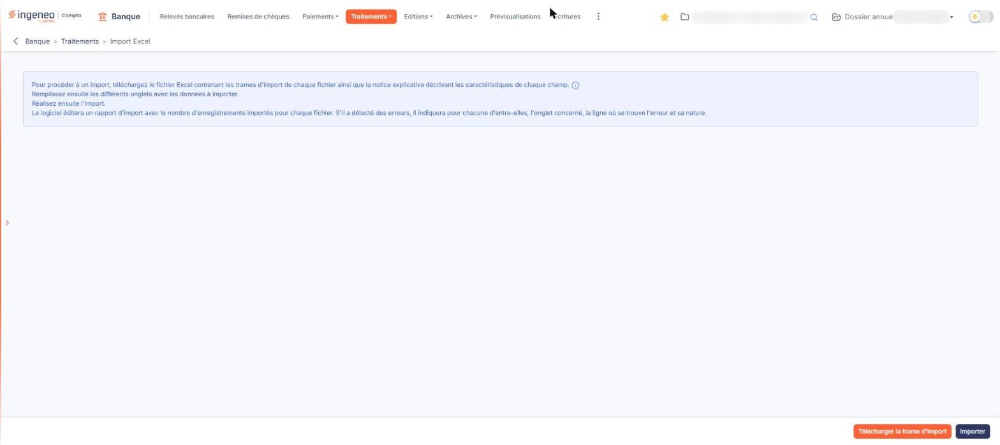
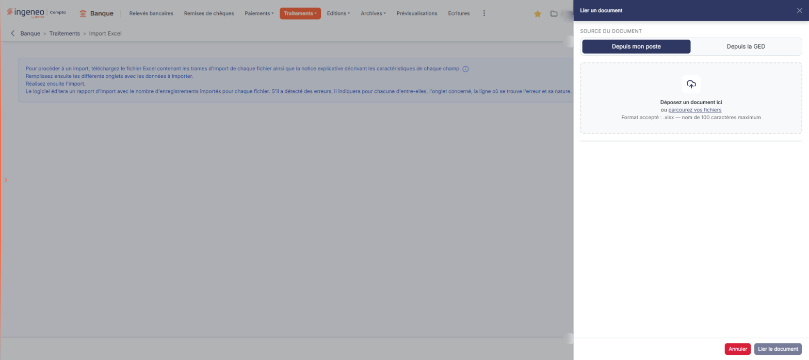

# Import Excel


**Où le trouver :** Menu **Traitements › Import Excel**



**En bref** — Cette option alimente le module à partir d'un classeur Excel que vous remplissez dans une trame fournie par le logiciel.

* Pour préparer l'import : bouton \[Télécharger la trame d'import], puis remplissez le classeur.
* Pour importer le classeur : bouton \[Importer], déposez le fichier .xlsx, puis bouton \[Lier le document].
* Pour effacer le rapport du dernier import : bouton \[Purger le rapport].


Cette option vous permet d'alimenter le module à partir d'un classeur Excel que vous remplissez vous-même. Elle est prévue pour les données que vous n'obtenez pas par un fichier au format bancaire : vous les reportez dans une trame fournie par le logiciel, puis vous importez ce classeur.

<figure><figcaption>
Écran « Import Excel » de la nouvelle interface
</figcaption></figure>

L'écran ne comporte aucun champ de saisie : il se limite à un texte explicatif, à une infobulle et à des boutons. Toute la préparation se fait dans le classeur Excel, hors du logiciel.

## Le texte affiché à l'écran

Le haut de l'écran rappelle la marche à suivre, en quatre phrases :

* télécharger le classeur Excel qui contient les trames d'import ainsi que la notice explicative décrivant les caractéristiques de chaque champ ;
* remplir les différents onglets avec les données à importer ;
* réaliser l'import ;
* le logiciel édite alors un rapport d'import indiquant le nombre d'enregistrements importés pour chaque fichier. S'il a détecté des erreurs, il indique pour chacune d'elles l'onglet concerné, la ligne où se trouve l'erreur et sa nature.

Le mot « onglets » employé par ce texte désigne **les feuilles du classeur Excel**, et non des onglets de l'écran : l'écran, lui, n'en comporte aucun.

Un pictogramme « Information » est placé en fin de première ligne. Son infobulle indique la nature des données importables :

_« Cette option permet d'importer les fichiers suivants : - Relevés. »_

C'est le seul endroit de l'écran qui le précise. Le texte principal parle de « chaque fichier » au pluriel parce que le même écran sert à plusieurs modules du logiciel, où la liste est plus longue ; depuis le module « Banque », l'infobulle est celle qui fait foi.

## Les boutons de bas d'écran

L'écran porte deux boutons, présentés dans cet ordre : **\[Télécharger la trame d'import]** puis **\[Importer]**. C'est aussi l'ordre d'utilisation : vous téléchargez d'abord la trame, vous la remplissez, puis vous l'importez. Un troisième bouton, **\[Purger le rapport]**, n'apparaît qu'une fois un import réalisé — voir le paragraphe d).

bouton **\[Télécharger la trame d'import]**

Il vous remet le classeur Excel à remplir. Ce classeur contient les trames d'import — les colonnes attendues, avec un astérisque sur celles qui sont obligatoires — ainsi qu'une notice qui décrit, champ par champ, la longueur maximale, le caractère obligatoire et les valeurs autorisées.

Les relevés se reportent au choix dans l'un des deux onglets prévus : celui où le montant tient en **une seule colonne signée**, ou celui où il est réparti en deux colonnes **Débit** et **Crédit**, comme le proposent de nombreuses banques dans leurs exports. Vous ne remplissez que les onglets qui vous intéressent.

Dans tous les cas, chaque ligne doit permettre au logiciel de retrouver la banque concernée : c'est le rôle des colonnes d'identification de la banque, qui reprennent des banques déjà déclarées dans le panneau « Paramètres », rubrique « Données », catégorie « Dossier et comptabilité », onglet « Banques ». Une valeur qui n'existe pas dans le logiciel est signalée comme une erreur dans le rapport d'import.

Téléchargez la trame à nouveau plutôt que de réutiliser un ancien classeur : elle est celle de la version en cours du logiciel, et elle évolue.

bouton **\[Importer]**

Il ouvre le volet « Lier un document », décrit au paragraphe c) ci-dessous.

## Le volet « Lier un document »

<figure><figcaption>
Rubrique « c) Le volet « Lier un document » »
</figcaption></figure>

Ce volet s'ouvre sur le côté droit de l'écran. Il est volontairement sommaire : il ne comporte aucune liste de banque, de compte ni de modèle d'import. Le classeur porte lui-même toute l'information nécessaire.

Son titre, « Lier un document », ne nomme ni le module ni le format : c'est bien ici que s'importe le classeur Excel.

**Source du document** : deux onglets, « Depuis mon poste » (affiché à l'ouverture) et « Depuis la GED ». Sous « Depuis mon poste », une zone invite à « Déposer un document ici ou parcourir vos fichiers » : le classeur à importer se dépose dans cette zone ou se choisit dans le sélecteur de fichiers de votre poste. Le volet annonce « Format accepté : .xlsx — nom de 100 caractères maximum ». **Le sélecteur ne propose que les fichiers au format .xlsx** : un classeur enregistré à l'ancien format .xls, ou un fichier .csv, n'y apparaîtra pas. Si votre fichier ne s'affiche pas, réenregistrez-le au format Excel .xlsx.

Vous ne pouvez sélectionner **qu'un seul fichier à la fois**.

L'onglet « Depuis la GED » ouvre un second volet « Sélection d'un document » : non vérifié, onglet non ouvert le 27/10/2026.

bouton **\[Lier le document]**

Il reste grisé tant qu'aucun fichier n'est choisi. Il envoie le classeur au logiciel et lance l'import. Le logiciel édite ensuite le rapport d'import annoncé par le texte de l'écran.

bouton **\[Annuler]**

Il ferme le volet sans rien importer et vous ramène à l'écran.

## Le rapport du dernier import

Tant qu'aucun import n'a été réalisé, l'écran se limite au texte et aux deux boutons décrits ci-dessus.

Une fois un import effectué, l'écran affiche en plus la **date du dernier import** et le **nom du fichier** importé, puis la liste des anomalies rencontrées.

Ce rapport est celui du **dernier import seulement** : chaque nouvel import remplace le précédent.

bouton **\[Purger le rapport]**

Il efface le rapport affiché.
