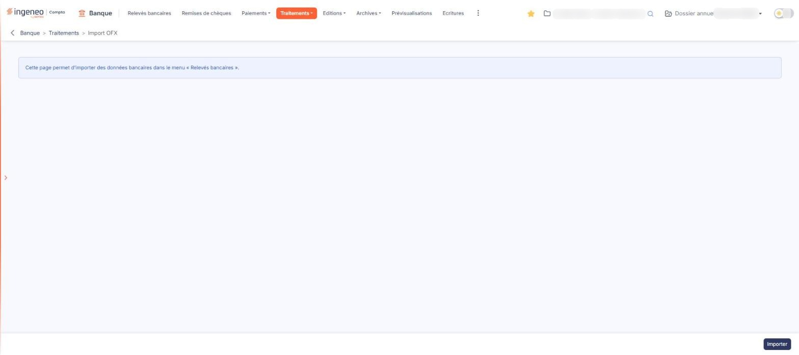
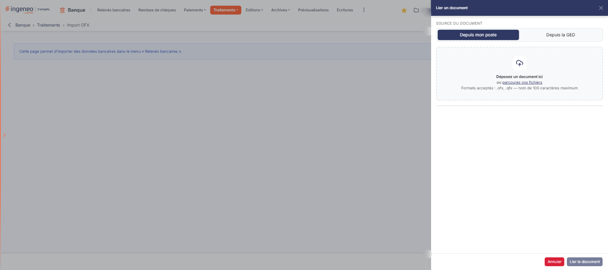

# Import OFX


**Où le trouver :** Menu **Traitements › Import OFX**



**En bref** — Cette option charge dans le module un fichier d'opérations bancaires au format OFX, téléchargé depuis le site de votre banque ; les opérations alimentent l'écran « Relevés bancaires ».

* Pour importer un fichier : bouton \[Importer], déposez le fichier .ofx ou .qfx, puis bouton \[Lier le document].
* Pour effacer le compte rendu du dernier import : bouton \[Purger le rapport].


Cette option vous permet de charger dans le module un fichier d'opérations bancaires au format OFX, tel que vous l'obtenez en le téléchargeant depuis le site de votre banque.

<figure><figcaption>
Écran « Import OFX » de la nouvelle interface
</figcaption></figure>

L'écran affiche une seule phrase : _« Cette page permet d'importer des données bancaires dans le menu « Relevés bancaires ». »_ Elle indique où retrouver le résultat : les opérations importées viennent alimenter le menu « Relevés bancaires », où vous les traduisez ensuite en écritures comptables.

L'écran ne comporte ni champ de saisie, ni liste de banques, ni rubrique, ni grille : tout se passe dans le volet d'import.

## Avant d'importer : la banque doit être déclarée

Un fichier OFX peut contenir les opérations de **plusieurs comptes**. Pour chacun, le logiciel lit dans le fichier les éléments qui identifient le compte, puis il cherche la banque correspondante parmi celles que vous avez déclarées dans le panneau « Paramètres », rubrique « Données », catégorie « Dossier et comptabilité », onglet « Banques ». C'est ce rapprochement qui détermine où seront versées les opérations.

Un compte que le logiciel ne reconnaît pas ne peut pas être importé, et l'anomalie est signalée dans le rapport d'import. Déclarez donc au préalable, dans l'option « Banques », chacun des comptes dont vous importez les opérations.

Certains fichiers OFX contiennent non pas un compte bancaire mais un **relevé de carte bancaire** : le compte y est identifié par le numéro de la carte, et non par un numéro de compte. Pour que ces opérations trouvent leur banque, renseignez le numéro de carte dans le champ « Numéro de carte bancaire associé » de la fiche de la banque, dans l'option « Banques ».

## Le bouton de bas d'écran

bouton **\[Importer]**

Il ouvre le volet « Lier un document », décrit au paragraphe c) ci-dessous. C'est le seul bouton de l'écran tant qu'aucun import n'a été réalisé.

Contrairement à l'option « Import Excel » du même menu, cet écran ne propose pas de trame à télécharger : le fichier n'est pas à composer, il vous est remis par votre banque.

## Le volet « Lier un document »

<figure><figcaption>
Rubrique « c) Le volet « Lier un document » »
</figcaption></figure>

Ce volet s'ouvre sur le côté droit de l'écran. Il ne propose ni liste de banque, ni liste de compte, ni modèle d'import.

**Source du document** : deux onglets, « Depuis mon poste » (affiché à l'ouverture) et « Depuis la GED ». Sous « Depuis mon poste », une zone invite à « Déposer un document ici ou parcourir vos fichiers » : le fichier remis par votre banque se dépose dans cette zone ou se choisit dans le sélecteur de fichiers de votre poste. Vous ne pouvez sélectionner **qu'un seul fichier à la fois**. L'onglet « Depuis la GED » ouvre un second volet « Sélection d'un document » : non vérifié, onglet non ouvert.

Le volet annonce « Formats acceptés : .ofx, .qfx — nom de 100 caractères maximum » et **le sélecteur ne propose que les fichiers de ces deux extensions**. Vérifiez donc, avant de cliquer, que le fichier sélectionné est bien celui que vous avez téléchargé depuis votre banque au format OFX.

bouton **\[Lier le document]**

Il reste grisé tant qu'aucun fichier n'est choisi. Il envoie le fichier au logiciel et lance l'import. Les opérations chargées sont ensuite consultables dans le menu « Relevés bancaires ».

Le logiciel accepte aussi bien les fichiers OFX récents que ceux produits dans les anciennes versions du format, encore diffusées par beaucoup de banques. Vous n'avez rien à préciser : il reconnaît de lui-même la forme du fichier.

bouton **\[Annuler]** : il ferme le volet sans rien importer et vous ramène à l'écran. Utilisez-le si vous souhaitez renoncer à l'import.

## Le rapport du dernier import

Tant qu'aucun import n'a été réalisé, l'écran se limite à sa phrase et à son bouton.

Une fois un import effectué, l'écran affiche en plus la **date du dernier import**, le **nom du fichier** importé et la liste des anomalies rencontrées, par exemple un compte du fichier qui ne correspond à aucune banque déclarée.

Ce rapport est celui du **dernier import seulement** : chaque nouvel import remplace le précédent.

bouton **\[Purger le rapport]**

Il n'apparaît, à côté du bouton **\[Importer]**, qu'une fois un import réalisé. Il efface le compte rendu affiché,.

## Ne confondez pas cette option avec « Import CFONB »

Le menu « Traitements » propose deux options d'import de fichiers bancaires, « Import CFONB » et « Import OFX », qui correspondent à deux formats de fichier différents. **Les deux écrans sont identiques** : même phrase, même bouton, même volet « Lier un document ». La phrase de l'écran ne nomme pas le format attendu. Le fil d'Ariane (« Banque > Traitements > Import OFX ») et le titre de l'onglet du navigateur nomment en revanche l'option, et le volet de l'« Import OFX » annonce ses formats (.ofx, .qfx) alors que celui de l'« Import CFONB » n'en annonce aucun.

Rien dans la phrase de l'écran ne vous indique donc lequel des deux imports vous êtes en train d'utiliser : **seule l'entrée de menu par laquelle vous êtes arrivé, rappelée par le fil d'Ariane, le détermine**. Prenez l'habitude de vérifier l'option choisie dans le menu avant de sélectionner votre fichier, et assurez-vous que le format du fichier remis par votre banque correspond bien à l'option employée.
