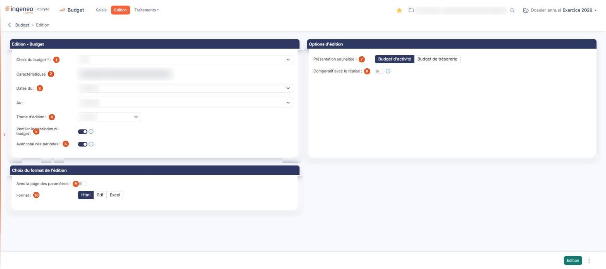
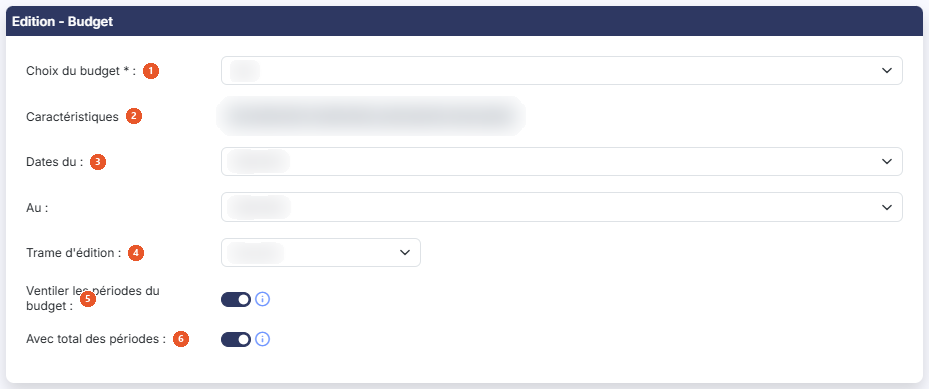
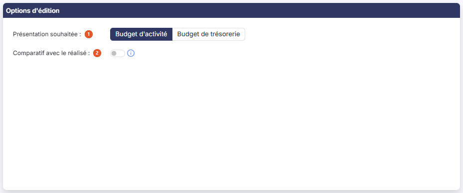
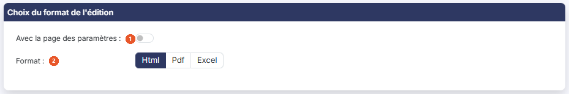

# Edition


**Où le trouver :** Menu **Edition**



**En bref** — Cet écran vous permet d'éditer un budget : vous choisissez le budget, les périodes, la présentation et le format du document, puis vous lancez l'édition.

* Pour éditer un budget : choisissez-le dans « Choix du budget », réglez les options et le format, puis bouton \[Edition].
* Pour réutiliser vos réglages : menu « Autres actions », entrée \[Mémoriser les paramètres], puis plus tard entrée \[Charger des paramètres].


Cette option vous permet d'éditer un budget. Vous choisissez le budget, l'étendue des périodes à éditer, la présentation souhaitée et le format du document, puis vous lancez l'édition.

<figure><figcaption>
Écran « Edition » de la nouvelle interface
</figcaption></figure>

L'écran présente les rubriques « Edition - Budget », « Options d'édition » et « Choix du format de l'édition » ; une rubrique « Analytique » peut s'y ajouter selon le paramétrage analytique du dossier. Les champs y apparaissent au fur et à mesure de vos choix.

## Rubrique « Edition - Budget »

<figure><figcaption>
Rubrique « Edition - Budget »
</figcaption></figure>

| Champ                                  | Ce qu'il faut savoir                                                                                                                                                                                                                                                                                                                                                                    |
| -------------------------------------- | --------------------------------------------------------------------------------------------------------------------------------------------------------------------------------------------------------------------------------------------------------------------------------------------------------------------------------------------------------------------------------------- |
| 1. **Choix du budget**                 | Le sélecteur présente les budgets du dossier ; il est vide à l'ouverture de l'écran. Tant qu'aucun budget n'est choisi, les trois champs suivants ne sont pas affichés.                                                                                                                                                                                                                 |
| 2. **Caractéristiques**                | Non modifiable. Le logiciel rappelle la période et la périodicité du budget choisi, sous la forme « De 08/2025 à 08/2026, périodicité mensuelle. ».                                                                                                                                                                                                                                     |
| 3. **Dates du**                        | **Au :** ces deux sélecteurs délimitent les périodes du budget à éditer. Ils présentent les périodes du budget choisi, telles que sa période et sa ventilation les découpent ; le logiciel propose la première et la dernière. Si vous indiquez une date de début postérieure à la date de fin, le logiciel affiche le message « La date du début doit être antérieure à la date fin ». |
| 4. **Trame d'édition**                 | Vous choisissez le modèle d'état financier selon lequel le budget sera présenté. Le sélecteur propose « Aucune », puis les modèles de type « Compte de résultat » et de type « SIG » paramétrés dans le panneau Paramètres, rubrique « Modèles » > « Documents » > « Etats financiers », réunis dans une seule liste ; les modèles de type « Indicateur » n'y figurent pas.             |
| 5. **Ventiler les périodes du budget** | Le logiciel propose « Oui ». Si vous indiquez « Oui », une colonne par période de votre budget figurera dans l'édition ; si vous indiquez « Non », l'édition portera sur le cumul des périodes.                                                                                                                                                                                         |
| 6. **Avec total des périodes**         | Proposé seulement si vous avez répondu « Oui » au champ précédent ; le logiciel propose « Oui ». Si vous indiquez « Oui », une colonne totalisera l'ensemble des périodes éditées.                                                                                                                                                                                                      |
| **Avec détail des comptes**            | Proposé dès que vous avez retenu une trame d'édition ; le logiciel propose « Non ». Vous indiquez si l'édition doit détailler les comptes qui composent chaque ligne de la trame.                                                                                                                                                                                                       |
| **Intitulé des comptes**               | Proposé si vous avez répondu « Oui » au champ précédent. Vous choisissez lequel des deux intitulés du compte figure dans l'édition, « Intitulé 1 » ou « Intitulé 2 ».                                                                                                                                                                                                                   |

## Rubrique « Options d'édition »

<figure><figcaption>
Rubrique « Options d'édition »
</figcaption></figure>

| Champ                                              | Ce qu'il faut savoir                                                                                                                                                                                                                                                                                                  |
| -------------------------------------------------- | --------------------------------------------------------------------------------------------------------------------------------------------------------------------------------------------------------------------------------------------------------------------------------------------------------------------- |
| 1. **Présentation souhaitée**                      | Vous choisissez entre le « Budget d'activité » et le « Budget de trésorerie ». Le logiciel propose « Budget d'activité ».                                                                                                                                                                                             |
| 2. **Comparatif avec le réalisé**                  | Le logiciel propose « Non ». Si vous indiquez « Oui », une colonne affichant le montant du réalisé sera insérée pour chaque période du budget, et les deux champs suivants apparaissent.                                                                                                                              |
| **Avec le récapitulatif des soldes de trésorerie** | Proposé pour la seule présentation « Budget de trésorerie », avec « Oui » par défaut. Si vous indiquez « Oui », un tableau récapitulatif du total des mouvements et des soldes de trésorerie sera affiché en fin d'édition. Ce récapitulatif est bâti sur les comptes de trésorerie indiqués dans la fiche du budget. |
| **Avec écart en valeur**                           | Ajoute à l'édition l'écart entre le budget et le réalisé, exprimé en montant.                                                                                                                                                                                                                                         |
| **Avec écart en %**                                | Ajoute à l'édition ce même écart, exprimé en pourcentage.                                                                                                                                                                                                                                                             |

## Rubrique « Analytique »

Cette rubrique n'est proposée que si la gestion analytique est activée dans le panneau Paramètres, rubrique « Généraux » > « Configuration ».

Le champ **Avec détail analytique** se règle par « Oui » ou « Non ». Les deux champs suivants ne sont proposés que si vous répondez « Oui » à **Avec détail analytique** : **Axe analytique**, un sélecteur d'axes, et **Inclure les écritures non ventilées**, un choix « Oui » ou « Non ».

## Rubrique « Choix du format de l'édition »

<figure><figcaption>
Rubrique « Choix du format de l'édition »
</figcaption></figure>

| Champ                              | Ce qu'il faut savoir                                                                                                                                                                                                                                        |
| ---------------------------------- | ----------------------------------------------------------------------------------------------------------------------------------------------------------------------------------------------------------------------------------------------------------- |
| 1. **Avec la page des paramètres** | Le logiciel propose « Non ». Si vous indiquez « Oui », le logiciel joint à l'édition une page rappelant les paramètres que vous avez retenus.                                                                                                               |
| 2. **Format**                      | Vous choisissez le format du document produit, « Html », « Pdf » ou « Excel ». Le logiciel propose « Html ». Les deux champs suivants ne sont proposés que pour le format « Pdf » ; ils disparaissent dès que vous revenez au format « Html » ou « Excel ». |
| **Orientation**                    | « Portrait » ou « Paysage » ; le logiciel propose « Portrait ».                                                                                                                                                                                             |
| **Largeur**                        | « Fixe » ou « Ajustée » ; le logiciel propose « Ajustée ». Le choix « Ajustée » ajuste la taille si la largeur des colonnes dépasse la largeur de la page.                                                                                                  |

## Les boutons de l'écran

bouton **\[Edition]** : placé en bas à droite de l'écran, il lance l'édition du budget avec les paramètres que vous avez retenus, dans le format choisi. À sa droite, le menu « Autres actions » (trois points verticaux) porte les deux entrées suivantes.

**Entrée \[Mémoriser les paramètres]** du menu « Autres actions » : elle enregistre le paramétrage en cours afin que vous puissiez le retrouver lors d'une prochaine édition.

**Entrée \[Charger des paramètres]** du menu « Autres actions » : elle ouvre la fenêtre « Chargement des paramètres », qui liste sous une colonne **Libellé** les paramétrages que vous avez mémorisés, et reprend dans l'écran celui que vous retenez. Si vous n'en avez encore mémorisé aucun, la fenêtre affiche « Aucun élément à afficher. ». Le bouton « Fermer » la referme.
