# Saisie


**Où le trouver :** Menu **Saisie**



**En bref** — Cet écran vous permet de créer et de tenir vos budgets : la liste des budgets du dossier, la fiche qui en porte les caractéristiques, puis la grille où vous inscrivez les montants prévus.

* Pour créer un budget : bouton \[Créer un budget], renseignez la fiche (libellé, période, trame de saisie), puis bouton \[Enregistrer].
* Pour ajouter un poste budgétaire : dans la grille de saisie, bouton \[Nouvelle ligne], saisissez les montants période par période, puis bouton \[Enregistrer].
* Pour répartir un montant sur les périodes vides : cliquez dans la cellule du montant, puis bouton \[Lisser la valeur].


Cette option vous permet de créer et de tenir vos budgets. Vous pouvez créer plusieurs budgets pour un même dossier, chacun sur sa propre période et sa propre périodicité.

<figure>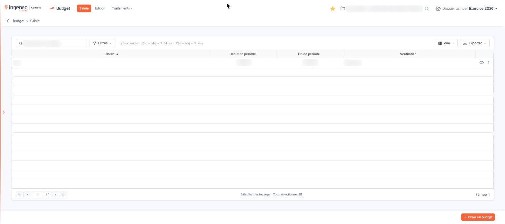<figcaption>
Écran « Saisie » de la nouvelle interface
</figcaption></figure>

L'option se parcourt en trois temps : la liste des budgets du dossier, la fiche d'un budget qui en porte les caractéristiques, et la grille de saisie dans laquelle vous inscrivez les montants prévus.

## La liste des budgets

<figure>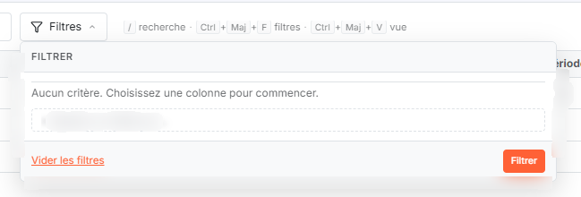<figcaption>
Bouton [Filtres]
</figcaption></figure>

<figure>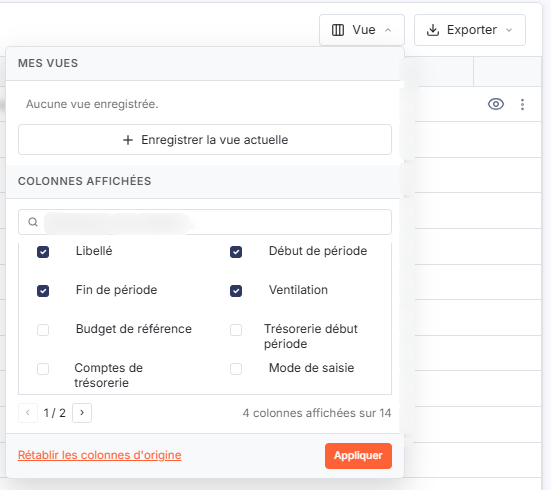<figcaption>
Bouton [Vue]
</figcaption></figure>

<figure>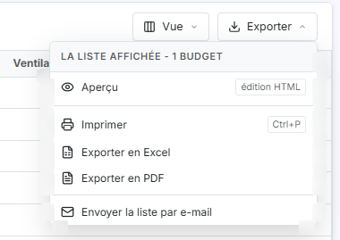<figcaption>
Bouton [Exporter]
</figcaption></figure>

Au-dessus de la liste, une barre « Rechercher un budget… » filtre les budgets à mesure de la saisie, et trois boutons ouvrent chacun un menu. bouton **\[Filtres]** : il permet d'ajouter des critères de filtre sur les colonnes de la liste, mais aussi sur des caractéristiques du budget que la liste n'affiche pas (Budget de référence, Trésorerie début période, Comptes de trésorerie, Mode de saisie, Gérer la TVA, Avec les décimales, Etat financier, Délai de règlement par défaut, Afficher le solde N-1 et N-2). bouton **\[Vue]** : il permet de choisir les colonnes affichées parmi les quatorze disponibles, d'enregistrer la vue et de rétablir les colonnes d'origine. bouton **\[Exporter]** : il propose, pour la liste affichée, « Aperçu édition HTML », « Imprimer », « Exporter en Excel », « Exporter en PDF » et « Envoyer la liste par e-mail » ; pour le PDF, un volet permet de choisir l'orientation (Portrait ou Paysage), la largeur (Ajustée ou Fixe) et de masquer les en-têtes et pieds de page, puis bouton **\[Lancer l'édition]**.

La liste présente quatre colonnes : **Libellé**, **Début de période**, **Fin de période** et **Ventilation**. Elle est triée par défaut sur le libellé, par ordre croissant.

La liste ne comporte pas de case à cocher : un clic sur une ligne la sélectionne. Au pied de la liste, « Sélectionner la page » sélectionne toutes les lignes de la page affichée et « Tout sélectionner (N) » étend la sélection à toutes les pages ; un bandeau en bas de l'écran rappelle alors le nombre de budgets sélectionnés et porte le bouton \[Supprimer]. La personnalisation des colonnes se fait par le **bouton \[Vue]**.

Au survol d'une ligne, trois commandes apparaissent à droite, suivies d'un menu « Autres actions » (trois points) :

le pictogramme « Modifier » ouvre la fiche du budget ;

le pictogramme suivant, dont l'infobulle indique « Afficher l'aperçu », ouvre la grille de saisie des montants du budget, décrite au paragraphe d) ci-dessous. Malgré son infobulle, cette commande ouvre bien un écran de saisie, et non un écran de consultation ;

le pictogramme « Dupliquer » ouvre une fiche préremplie à partir du budget de la ligne. Vous pouvez y ajuster les caractéristiques, période de fin comprise, avant d'enregistrer le nouveau budget ;

le menu « Autres actions » porte l'entrée « Supprimer », qui supprime le budget de la ligne.

bouton **\[Créer un budget]**, en bas à droite de l'écran : il ouvre une fiche de budget vierge.

bouton **\[Supprimer]**, qui apparaît dans le bandeau de sélection en bas de l'écran : il supprime les budgets que vous avez sélectionnés dans la liste.

## La fiche d'un budget, en création

<figure>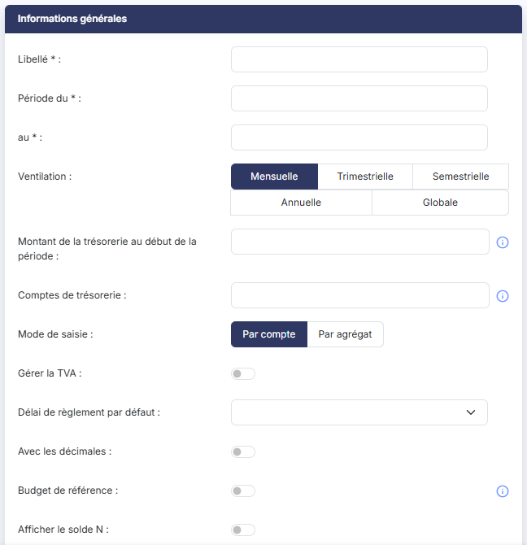<figcaption>
Rubrique « Informations générales »
</figcaption></figure>

<figure>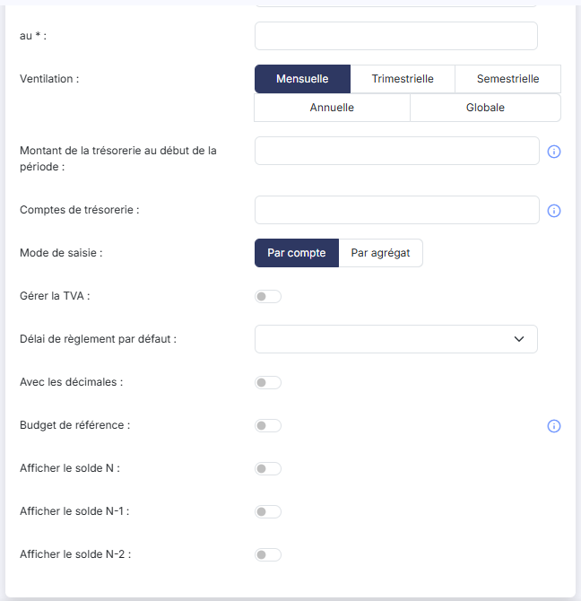<figcaption>
Rubrique « Informations générales »
</figcaption></figure>

<figure>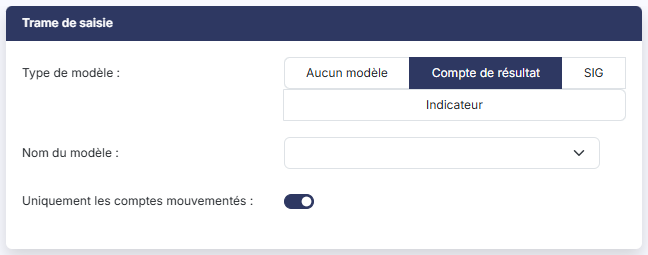<figcaption>
Rubrique « Trame de saisie »
</figcaption></figure>

<figure>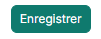<figcaption>
Bouton [Enregistrer]
</figcaption></figure>

La fiche comporte deux rubriques : « Informations générales », qui porte les caractéristiques du budget, et « Trame de saisie », qui détermine les lignes que le logiciel crée au départ.

### Rubrique « Informations générales »

| Champ                                                                 | Ce qu'il faut savoir                                                                                                                                                                                                                                                                                                                                  |
| --------------------------------------------------------------------- | ----------------------------------------------------------------------------------------------------------------------------------------------------------------------------------------------------------------------------------------------------------------------------------------------------------------------------------------------------- |
| **Libellé**                                                           | Vingt-cinq caractères au plus. C'est sous ce libellé que le budget apparaît dans la liste et dans les sélecteurs des éditions. Il doit être unique : si le libellé est déjà porté par un autre budget, le logiciel affiche « Ce libellé est déjà utilisé, veuillez en choisir un autre. ».                                                            |
| **Période du**                                                        | Indiquez le mois et l'année de début du budget, à la saisie sous la forme MM/AAAA ou par le sélecteur de calendrier.                                                                                                                                                                                                                                  |
| **au**                                                                | Indiquez de la même façon le mois et l'année de fin du budget. Le début de période ne peut pas être postérieur à la fin de période.                                                                                                                                                                                                                   |
| **Ventilation**                                                       | C'est le découpage de la période du budget, et donc le nombre de valeurs que vous aurez à saisir par ligne. Vous avez le choix entre « Mensuelle », « Trimestrielle », « Semestrielle », « Annuelle » et « Globale » ; le logiciel propose « Mensuelle ». Avec la ventilation « Globale », vous ne saisissez qu'une seule valeur par ligne de budget. |
| **Montant de la trésorerie au début de la période**                   | Indiquez le solde de la trésorerie au début de la période afin que le logiciel puisse calculer la trésorerie prévisionnelle.                                                                                                                                                                                                                          |
| **Comptes de trésorerie**                                             | Indiquez les racines des comptes de trésorerie, afin que les éditions puissent comparer la prévision de trésorerie à la trésorerie réelle. Séparez plusieurs racines par des points-virgules, par exemple 512;519. Vous pouvez également indiquer un intervalle de racines par un tiret, la fin de l'intervalle devant être supérieure à son début.   |
| **Mode de saisie**                                                    | Vous choisissez de construire le budget « Par compte », soit une ligne par numéro de compte, ou « Par agrégat », soit une ligne par agrégat de comptes. Le logiciel propose « Par compte ».                                                                                                                                                           |
| **Gérer la TVA**                                                      | Indiquez si vous souhaitez gérer la TVA dans ce budget. Ce champ n'est proposé que si le mode de saisie est « Par compte ».                                                                                                                                                                                                                           |
| **Délai de règlement par défaut**                                     | Le sélecteur reprend les délais du fichier « Délais de règlement » du dossier. Le délai que vous retenez ici s'applique aux lignes de budget dont le compte ne porte pas lui-même de délai de règlement.                                                                                                                                              |
| **Avec les décimales**                                                | Indiquez si les montants du budget se saisissent avec ou sans décimales.                                                                                                                                                                                                                                                                              |
| **Budget de référence**                                               | Cette option permet, si vous utilisez le module Vision, d'afficher les données du budget dans les graphiques pour lesquels un comparatif budgétaire a été paramétré. Il ne peut y avoir qu'un seul budget de référence.                                                                                                                               |
| **Afficher le solde N :Afficher le solde N-1 :Afficher le solde N-2** | Ces trois options portent sur les colonnes « Solde N », « Solde N-1 » et « Solde N-2 » de la grille de saisie des montants, qui vous servent de repères pour construire le budget.                                                                                                                                                                    |

### Rubrique « Trame de saisie »

| Champ                                  | Ce qu'il faut savoir                                                                                                                                                                                                                                                                                                                                                                                                                                                                                                               |
| -------------------------------------- | ---------------------------------------------------------------------------------------------------------------------------------------------------------------------------------------------------------------------------------------------------------------------------------------------------------------------------------------------------------------------------------------------------------------------------------------------------------------------------------------------------------------------------------- |
| **Type de modèle**                     | 
Vous indiquez si vous souhaitez partir d'un modèle d'état financier, et de quel type. Les valeurs proposées sont « Aucun modèle », « Compte de résultat », « SIG » et « Indicateur » ; le logiciel propose « Compte de résultat ». Les modèles de type « Bilan », qui existent dans le panneau Paramètres, rubrique « Modèles » > « Documents » > « Etats financiers », ne sont pas proposés ici. Avec « Aucun modèle », les deux champs suivants disparaissent : vous construirez alors vous-même les lignes du budget.
 |
| **Nom du modèle**                      | Le sélecteur présente les modèles du type choisi, tels qu'ils sont paramétrés dans le panneau Paramètres, rubrique « Modèles » > « Documents » > « Etats financiers ». Pour le type « Indicateur », la liste dépend du paramétrage de votre cabinet ; un modèle dont une formule fait référence à un exercice précédent est refusé à l'enregistrement, avec le message « Le modèle ne doit pas contenir de formule référençant des exercices précédents. ».                                                                        |
| **Uniquement les comptes mouvementés** | Vous indiquez si le budget doit reprendre tous les comptes du modèle ou seulement ceux qui ont été mouvementés ; le logiciel propose « Oui ». Ce champ n'est proposé que si le mode de saisie est « Par compte ».                                                                                                                                                                                                                                                                                                                  |

bouton **\[Enregistrer]**, en bas à droite de l'écran : il enregistre le budget.

**Flèche « Revenir en arrière »**, à gauche du fil d'Ariane : elle revient à la liste des budgets sans enregistrer.

## La fiche d'un budget, en modification

<figure>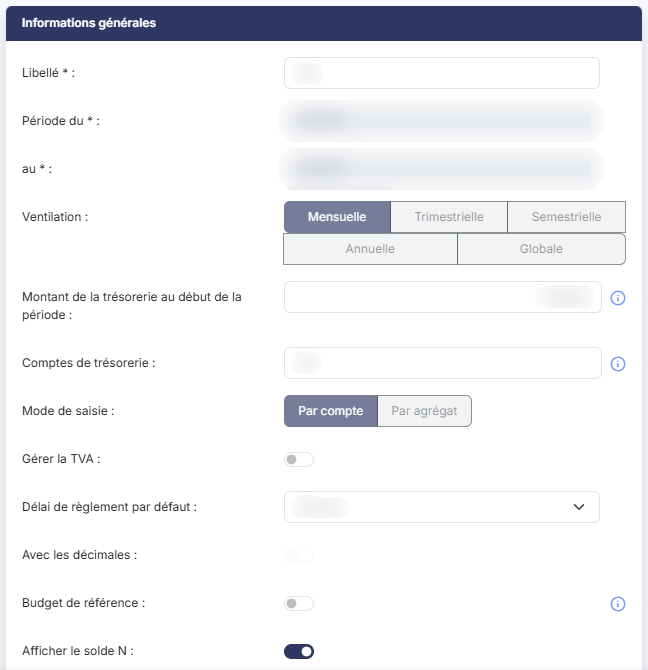<figcaption>
Rubrique « c) La fiche d'un budget, en modification »
</figcaption></figure>

<figure>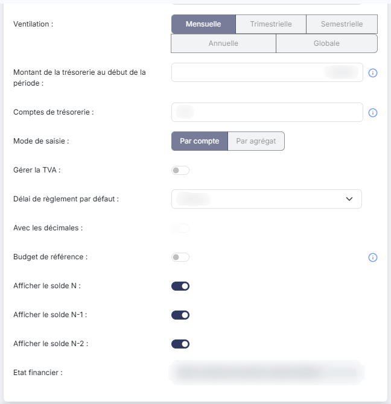<figcaption>
Rubrique « c) La fiche d'un budget, en modification »
</figcaption></figure>

La fiche ouverte depuis le pictogramme « Modifier » ne présente que la rubrique « Informations générales » : la rubrique « Trame de saisie » n'y figure pas, la trame ne servant qu'à la création du budget. En fin de rubrique, un champ **Etat financier**, non modifiable, rappelle le modèle retenu à la création.

Les champs **Période du**, **au** et **Etat financier** ne sont pas modifiables.

Les champs **Ventilation** et **Mode de saisie** se présentent grisés, mais ils restent cliquables : ne les modifiez pas, ce sont eux qui déterminent la structure des lignes déjà créées.

Le champ **Avec les décimales** se présente grisé lui aussi, et il est réellement inactif : l'interrupteur ne réagit pas au clic.

Si vous devez changer l'une de ces trois caractéristiques, créez un nouveau budget.

Les autres champs restent modifiables : **Libellé**, **Montant de la trésorerie au début de la période**, **Comptes de trésorerie**, **Gérer la TVA**, **Délai de règlement par défaut**, **Budget de référence** et les trois options d'affichage des soldes.

## La grille de saisie des montants

<figure>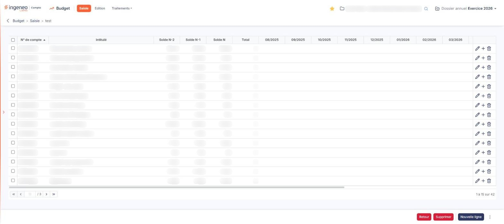<figcaption>
Rubrique « d) La grille de saisie des montants »
</figcaption></figure>

<figure><figcaption>
Bouton [Nouvelle ligne]
</figcaption></figure>

<figure>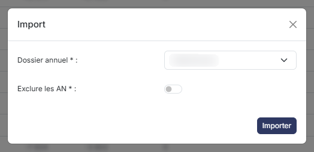<figcaption>
Rubrique « d) La grille de saisie des montants »
</figcaption></figure>

<figure>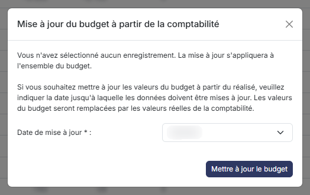<figcaption>
Rubrique « d) La grille de saisie des montants »
</figcaption></figure>

Cette grille s'ouvre depuis la commande « Afficher l'aperçu » de la ligne du budget. Le titre de la page et le fil d'Ariane rappellent le libellé du budget en cours.

Chaque ligne de la grille est un poste budgétaire. Les colonnes se lisent en trois groupes :

l'identification de la ligne, avec les colonnes **N° de compte** et **Intitulé** ;

les repères de construction, avec les colonnes **Solde N-2**, **Solde N-1** et **Solde N**, et la colonne **Total**, qui totalise les montants de la ligne ;

les montants budgétés, avec une colonne par période du budget. Leur nombre et leur libellé dépendent de la période et de la ventilation du budget : un budget mensuel allant de 08/2025 à 08/2026 présente ainsi treize colonnes, de « 08/2025 » à « 08/2026 ».

Les deux dernières colonnes, **Impact trésorerie** et **Délai de règlement**, portent les informations utilisées pour la prévision de trésorerie. Une ligne déclarée comme ayant un impact sur la trésorerie doit porter un délai de règlement, à moins que le budget lui-même n'en propose un par défaut.

La grille étant large, elle se parcourt à l'aide de la barre de défilement horizontal placée sous elle.

Chaque ligne porte trois commandes : « Modifier », qui ouvre la ligne en saisie, « Supprimer », et « Créer », qui crée une ligne au-dessus de la ligne courante.

bouton **\[Nouvelle ligne]** : il ajoute un poste budgétaire au budget.

**Entrée « Import »** du menu « Autres actions » (trois points, à droite du bouton \[Nouvelle ligne]) : elle ouvre la fenêtre « Import », qui alimente les montants du budget en cours à partir de la comptabilité d'un autre dossier annuel de la société. Vous y renseignez :

| Champ              | Ce qu'il faut savoir                                                                          |
| ------------------ | --------------------------------------------------------------------------------------------- |
| **Dossier annuel** | Le sélecteur présente les exercices de la société.                                            |
| **Exclure les AN** | Indiquez si les écritures d'à-nouveaux du dossier choisi doivent être écartées de la lecture. |

Le bouton « Importer » lance la reprise. Les périodes sont décalées du nombre d'années qui sépare les deux dossiers. Tous les montants déjà saisis dans le budget en cours sont supprimés au préalable.

**Entrée « Mise à jour à partir du réalisé »** du même menu : elle ouvre la fenêtre « Mise à jour du budget à partir de la comptabilité », qui remplace les montants du budget par les montants réellement comptabilisés. Vous y indiquez la **Date de mise à jour**, obligatoire, c'est-à-dire la période jusqu'à laquelle les données doivent être mises à jour ; le sélecteur présente les périodes du budget. Le bouton « Mettre à jour le budget » lance le traitement.

La fenêtre rappelle en tête le périmètre du traitement : « Vous avez sélectionné N enregistrement. » si vous avez sélectionné des lignes, la mise à jour ne portant alors que sur elles, ou « Vous n'avez sélectionné aucun enregistrement. La mise à jour s'appliquera à l'ensemble du budget. » dans le cas contraire.

**Entrée « Appliquer un coefficient »** du même menu : elle ouvre le volet latéral « Appliquer un coefficient », qui rappelle le nombre de lignes de budget sélectionnées et où vous saisissez le **Coefficient**, obligatoire, par lequel leurs montants sont multipliés ; le bouton « Valider » l'applique et le bouton « Annuler » referme le volet sans rien modifier. Par exemple, saisissez 1,1 pour majorer les valeurs de 10 %, ou -1 pour en inverser le signe.

**Entrée « Modification groupée »** du même menu : elle ouvre le volet latéral « Modification groupée », qui modifie en une seule fois les lignes que vous avez sélectionnées. Le volet présente le champ **Impact trésorerie** ; en le positionnant sur « Oui », le logiciel affiche également le champ **Délai de règlement**, obligatoire. Le bouton « Enregistrer » applique la modification, le bouton « Annuler » ferme le volet sans rien modifier.

Ces deux entrées exigent une sélection : si aucune ligne n'est sélectionnée, le logiciel affiche « Veuillez sélectionner au moins une ligne de saisie de budget. ».

**Entrée « Recalculer soldes N-1 et N-2 »** du même menu : elle met à jour les colonnes de soldes des exercices antérieurs à partir des dossiers annuels précédents. Cette entrée n'est proposée que si le budget affiche le solde N-1 ou le solde N-2, et son libellé ne mentionne que les soldes affichés.

bouton **\[Supprimer]** : il supprime les lignes que vous avez sélectionnées.

bouton **\[Retour]** : il revient à la liste des budgets.

## Le volet de saisie d'une ligne de budget

<figure>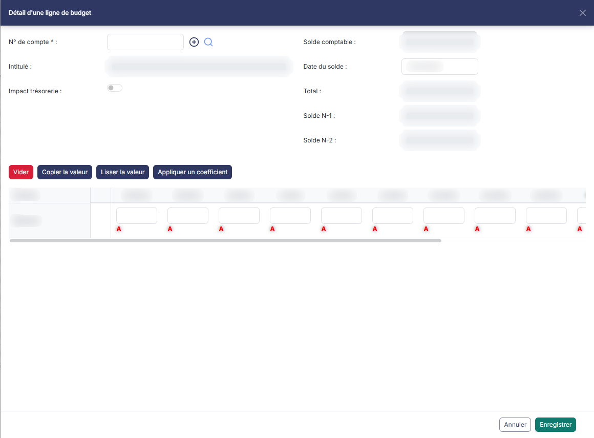<figcaption>
Rubrique « e) Le volet de saisie d'une ligne de budget »
</figcaption></figure>

Ce volet latéral, intitulé « Détail d'une ligne de budget », s'ouvre depuis le bouton \[Nouvelle ligne] et depuis les commandes « Modifier » et « Créer » d'une ligne. C'est là que se saisissent les montants d'une ligne, période par période. Les champs se présentent en deux colonnes. **Colonne de gauche :**

| Champ                 | Ce qu'il faut savoir                                                                                                                                                                                                                                                                                                                                                                                                                                                                   |
| --------------------- | -------------------------------------------------------------------------------------------------------------------------------------------------------------------------------------------------------------------------------------------------------------------------------------------------------------------------------------------------------------------------------------------------------------------------------------------------------------------------------------- |
| **N° de compte**      | À droite du champ, un bouton « Créer » permet de créer le compte et une commande de recherche d'en choisir un.                                                                                                                                                                                                                                                                                                                                                                         |
| **Intitulé**          | L'intitulé du compte, non modifiable.                                                                                                                                                                                                                                                                                                                                                                                                                                                  |
| **Impact trésorerie** | 
Indiquez si la ligne doit être prise en compte dans la prévision de trésorerie. En activant cet interrupteur, le logiciel affiche le champ <strong>Délai de règlement :</strong>, obligatoire, dont le sélecteur propose « Par défaut », et le champ <strong>Par défaut :</strong>, non modifiable, qui rappelle le délai porté par le budget ; il ajoute également une ligne <strong>Date de règlement</strong> au tableau des périodes. <strong>Colonne de droite</strong>
 |
| **Solde comptable**   | **Date du solde :** le solde du compte en comptabilité à la date indiquée ; le logiciel propose la date de fin de l'exercice.                                                                                                                                                                                                                                                                                                                                                          |
| **Total**             | , **Solde N-1 :** et **Solde N-2 :** non modifiables. Le total se recalcule à mesure de votre saisie.                                                                                                                                                                                                                                                                                                                                                                                  |

Sous ces champs, quatre boutons agissent sur les montants de la ligne.

bouton **\[Vider]** : il vide tous les montants de la ligne et remet le total à zéro.

bouton **\[Copier la valeur]** : il recopie le montant de la cellule qui a le focus dans toutes les autres périodes.

bouton **\[Lisser la valeur]** : il répartit le montant de la cellule qui a le focus sur cette période et sur toutes celles restées vides. Un montant de 1 300 lissé sur treize périodes vides donne ainsi 100 par période.

Ces deux derniers boutons n'agissent que si une cellule de montant a le focus : cliquez d'abord dans la cellule qui porte la valeur, puis sur le bouton.

bouton **\[Appliquer un coefficient]** : il ouvre le volet « Appliquer un coefficient » pour la seule ligne en cours.

Sous ces boutons, un tableau présente une colonne par période du budget, avec une ligne **Période** et une ligne **Montant** où vous inscrivez les montants. Le tableau se parcourt à l'aide de sa barre de défilement horizontal.

Sur certaines lignes, une commande « A », dont l'infobulle indique « Saisie analytique », figure sous chaque montant et donne accès à sa ventilation analytique. Elle est proposée sur le volet ouvert pour une nouvelle ligne, et ne l'est pas sur toutes les lignes existantes.

Le pied du volet porte deux boutons : bouton **\[Annuler]**, qui ferme le volet sans enregistrer, et bouton **\[Enregistrer]**, qui enregistre la ligne.
