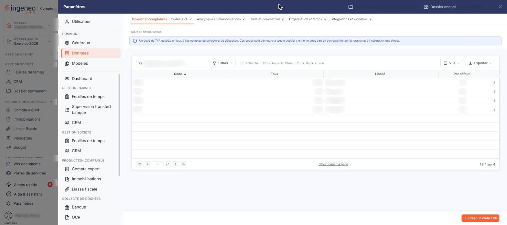
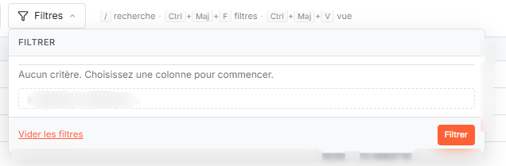
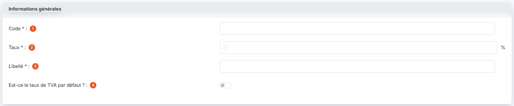
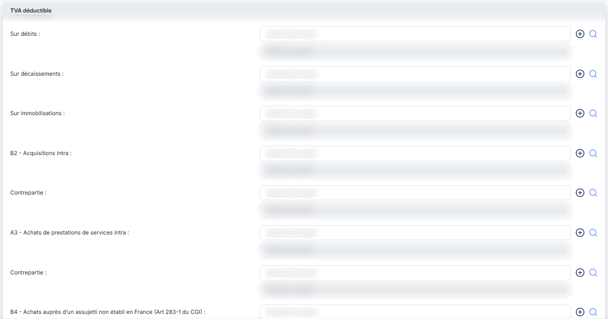
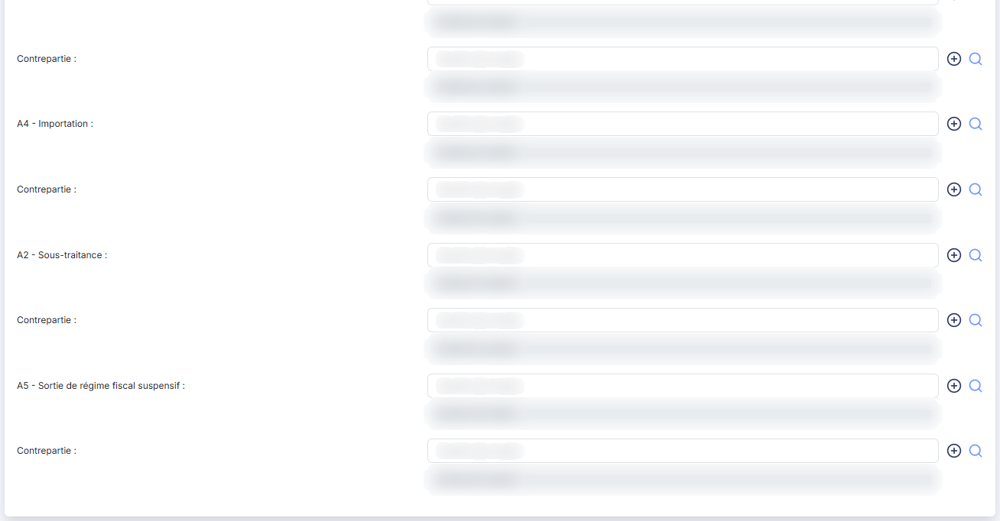
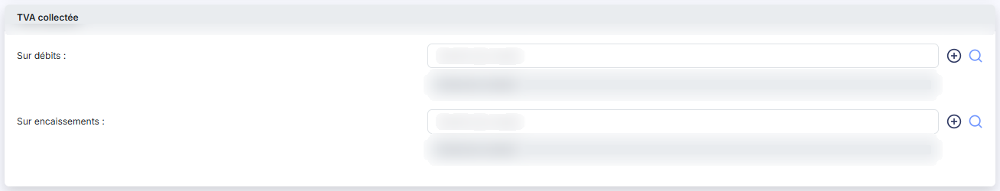

# Codes TVA


**Où le trouver :** Panneau **Paramètres** › **Données** › **Dossier et comptabilité** › **Codes TVA**



**En bref** — Cet écran administre les codes TVA du dossier, leur taux et leurs comptes ; dans un budget, ils permettent de calculer la TVA. Toute modification vaut aussi pour les autres modules.

* Pour créer un code TVA : bouton \[Nouveau], renseignez la fiche, puis bouton \[Enregistrer].
* Pour filtrer la liste : pictogramme en forme d'entonnoir, saisissez vos critères, puis bouton \[Filtrer].


Cette option permet d'administrer les codes TVA du dossier : le taux de chacun et les comptes de TVA à utiliser pour la génération des écritures. Dans un budget, ce sont ces codes qui permettent de calculer la TVA et de la restituer dans les éditions.

<figure><figcaption>
Écran « Codes TVA » de la nouvelle interface
</figcaption></figure>

Les codes TVA sont utilisés par plusieurs modules du logiciel ; toute modification faite ici est donc immédiatement visible dans les autres modules.

L'écran présente la liste des codes TVA du dossier, avec les colonnes **Code**, **Taux**, **Libellé** et **Par défaut**. Un clic sur l'en-tête d'une colonne trie la liste.

La colonne de gauche porte, pour chaque ligne, une case à cocher « Sélectionner » puis les pictogrammes « Modifier », « Supprimer » et « Dupliquer ». Dans l'en-tête de cette colonne, la case à cocher sélectionne toutes les lignes de la page affichée, et les trois pictogrammes suivants ouvrent la personnalisation des colonnes, la fenêtre « Filtres » et le choix d'impression ou d'export de la liste.


Notez que cet écran ne propose aucune action portant sur une sélection de lignes : les cases à cocher n'ont pas d'emploi ici, et la suppression d'un code TVA se fait ligne par ligne, par le pictogramme « Supprimer ».


Un code TVA utilisé n'est pas supprimé : le logiciel revient à la liste, où le code figure toujours. Sont concernés un compte général ou auxiliaire qui porte ce code, un article ou un prix de vente qui s'appuie sur lui.

## La fenêtre « Filtres »

<figure><figcaption>
Bouton [Nouveau]
</figcaption></figure>

<figure><figcaption>
Rubrique « a) La fenêtre « Filtres » »
</figcaption></figure>

Le pictogramme en forme d'entonnoir, dans l'en-tête de la colonne de gauche, ouvre la fenêtre « Filtres ». Chaque ligne y porte le nom d'une donnée, un opérateur à choisir (« Égal », « Contient », « Est vide »…) et la valeur à comparer ; deux critères peuvent être combinés par « Et » ou par « Ou ».

Les critères ne portent pas seulement sur les colonnes affichées : quelques comptes de TVA de la fiche y figurent également, mais pas tous. À côté de **Code**, **Taux**, **Libellé** et **Par défaut**, la fenêtre propose sept critères de comptes : quatre pour la TVA déductible et trois pour la TVA collectée. Les autres lignes de la fiche — celles des opérations autoliquidées autres que les acquisitions intra, ainsi que toutes les zones **Contrepartie :** — n'ont pas de critère. Trois points méritent votre attention.

* Les libellés des critères ne reprennent pas toujours ceux de la fiche : ainsi le critère « Déductible - Sur encaissements » désigne le champ que la fiche nomme **Sur décaissements :**.
* Le critère « Déductible - Sur acquisitions intra » désigne le champ que la fiche nomme **B2 - Acquisitions intra :**.
* Le critère « Collectée - Sur acquisitions intra » ne correspond à aucun champ de la fiche : un filtre posé sur lui ne ramènera aucune ligne.

Le bouton **\[Filtrer]** applique vos critères, le bouton **\[Vider les filtres]** les efface, le bouton **\[Fermer]** referme la fenêtre. Le bouton **\[Mémoriser les paramètres]** conserve le jeu de critères saisi et le bouton **\[Charger les paramètres]** le rappelle.

bouton **\[Nouveau]**

Ce bouton ouvre la fiche d'un nouveau code TVA, décrite ci-dessous. C'est le seul bouton de bas d'écran.

La fiche d'un code TVA s'ouvre par le bouton **\[Nouveau]** ou par le pictogramme « Modifier » d'une ligne. Le bouton **\[Enregistrer]** valide votre saisie et le bouton **\[Retour]** revient à la liste sans enregistrer.

## Rubrique « Informations générales »

<figure><figcaption>
Rubrique « Informations générales »
</figcaption></figure>

| Champ                                     | Ce qu'il faut savoir                                                                                                                                                                                                                          |
| ----------------------------------------- | --------------------------------------------------------------------------------------------------------------------------------------------------------------------------------------------------------------------------------------------- |
| 1. **Code**                               | Unique, six caractères au plus. Il identifie le code TVA et n'est plus modifiable après la création : le champ passe en lecture seule à la modification, sans perdre pour autant sa marque de champ obligatoire.                              |
| 2. **Taux**                               | Exprimé en pourcentage. Il doit être supérieur à 0 et inférieur à 100. Il est proposé à 0 à la création : vous devez donc le renseigner.                                                                                                      |
| 3. **Libellé**                            | Douze caractères au plus.                                                                                                                                                                                                                     |
| 4. **Est-ce le taux de TVA par défaut ?** | Positionnez cet interrupteur sur « Oui » pour que ce code TVA soit celui proposé par le logiciel lorsqu'un code TVA est demandé. Un seul code TVA peut porter cette marque : en la donnant à un code, vous la retirez à celui qui la portait. |

## Rubrique « TVA déductible »

<figure><figcaption>
Rubrique « TVA déductible »
</figcaption></figure>

<figure><figcaption>
Rubrique « TVA déductible »
</figcaption></figure>

Indiquez ici les comptes à utiliser lors de la génération des écritures de TVA déductible pour ce code TVA. Une ligne est prévue par nature d'opération : les trois premières correspondent aux modes d'exigibilité (**Sur débits :**, **Sur décaissements :**, **Sur immobilisations :**) ; les suivantes correspondent aux opérations dont la TVA est autoliquidée, désignées par leur repère sur la déclaration — ainsi **B2 - Acquisitions intra :** ou **A4 - Importation :**. Ces dernières portent en plus un champ **Contrepartie :**, où vous indiquez le compte de la TVA due au titre de l'opération.

Chaque ligne se saisit de la même manière : tapez le numéro de compte dans la zone **Numéro de compte**, ou cliquez sur la loupe pour le rechercher dans le plan comptable ; le logiciel affiche alors l'intitulé du compte à côté, en lecture seule. Le bouton « + » vert crée un compte qui n'existerait pas encore dans le plan comptable. Un numéro qui ne correspond à aucun compte est refusé à l'enregistrement.

Aucun de ces comptes n'est obligatoire. En revanche, vous ne pouvez pas vider un compte de TVA déjà repris par des comptes généraux ou auxiliaires : le logiciel refuse l'enregistrement.

## Rubrique « TVA collectée »

<figure><figcaption>
Rubrique « TVA collectée »
</figcaption></figure>

Indiquez ici, de la même manière, les comptes à utiliser lors de la génération des écritures de TVA collectée pour ce code TVA : **Sur débits :** et **Sur encaissements :**. Ces deux comptes ne sont pas obligatoires, et la même règle s'applique : un compte déjà repris par des comptes généraux ou auxiliaires ne peut pas être vidé.
