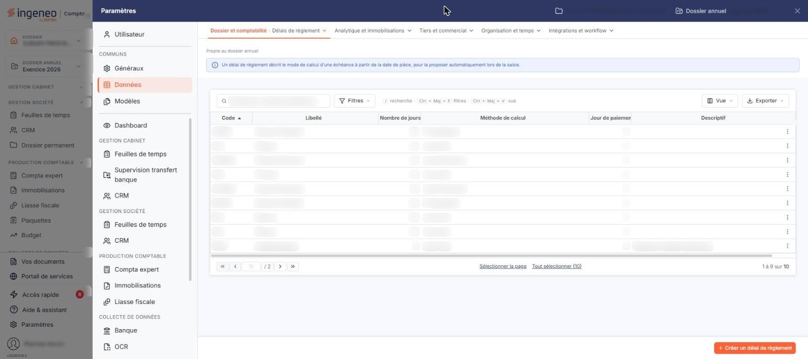
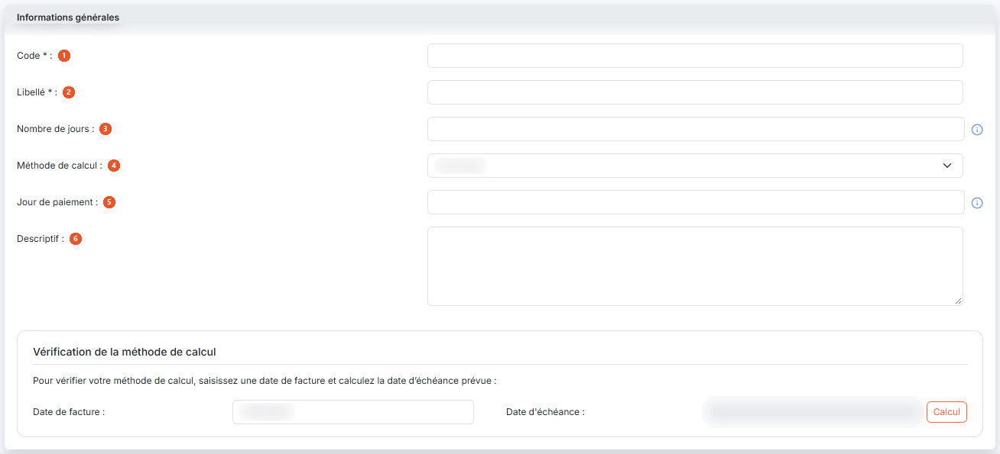
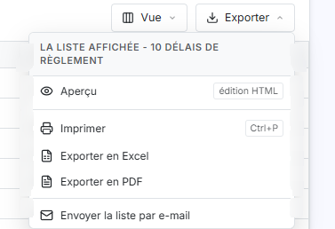

# Délais de règlement


**Où le trouver :** Panneau **Paramètres** › **Données** › **Dossier et comptabilité** › **Délais de règlement**



**En bref** — Cet écran définit les délais de règlement qui calculent une date d'échéance à partir de la date d'une pièce ; dans un budget, ils déterminent la période d'encaissement ou de décaissement attendue.

* Pour créer un délai de règlement : bouton \[Nouveau], renseignez le code, le libellé, le nombre de jours et la méthode de calcul, puis bouton \[Enregistrer].
* Pour supprimer des délais inutilisés : sélectionnez-les dans la liste, puis bouton \[Supprimer].


Cette option permet de définir les délais de règlement qui servent à calculer une date d'échéance à partir de la date d'une pièce. Dans un budget, c'est le délai de règlement retenu — celui du compte, ou celui choisi par défaut à la création du budget — qui détermine la période où l'encaissement ou le décaissement est attendu.

<figure><figcaption>
Écran « Délais de règlement » de la nouvelle interface
</figcaption></figure>

L'écran présente la liste des délais de règlement du dossier, avec les colonnes **Code**, **Libellé**, **Nombre de jours**, **Méthode de calcul**, **Jour de paiement** et **Descriptif** — c'est-à-dire les critères de calcul de chaque délai. Un clic sur l'en-tête d'une colonne trie la liste.

La colonne de gauche porte, pour chaque ligne, une case à cocher « Sélectionner » puis les pictogrammes « Modifier » et « Supprimer ». Dans l'en-tête de cette colonne, la case à cocher sélectionne toutes les lignes de la page affichée, la case voisine étend la sélection à toutes les pages, et les trois pictogrammes suivants ouvrent la personnalisation des colonnes, les filtres par colonne et le choix d'impression ou d'export de la liste.

Un délai de règlement ne peut pas être supprimé s'il est utilisé : le logiciel vous en avertit et conserve le délai. Sont concernés un compte général, un compte auxiliaire de client, de fournisseur, de salarié ou divers, un devis, une facture de vente ou une facture d'achat qui s'appuient sur ce délai.

bouton **\[Nouveau]**

Ce bouton ouvre la fiche d'un nouveau délai de règlement, décrite ci-dessous.

bouton **\[Exporter]**

Ce bouton exporte la liste des délais de règlement dans un fichier.

bouton **\[Supprimer]**

Ce bouton supprime les délais de règlement sélectionnés dans la liste. Le pictogramme « Supprimer » d'une ligne supprime le seul délai de cette ligne.

La fiche d'un délai de règlement s'ouvre par le bouton **\[Nouveau]** ou par le pictogramme « Modifier » d'une ligne. Le bouton **\[Enregistrer]** valide votre saisie et le bouton **\[Retour]** revient à la liste sans enregistrer.

## Rubrique « Informations générales »

<figure><figcaption>
Rubrique « Informations générales »
</figcaption></figure>

| Champ                    | Ce qu'il faut savoir                                                                                                                                                                                                                                                                                                                                                                                                                                                                                                                                                                                                                                                                                                                                                                                                                                                                                                                                                                                                                                    |
| ------------------------ | ------------------------------------------------------------------------------------------------------------------------------------------------------------------------------------------------------------------------------------------------------------------------------------------------------------------------------------------------------------------------------------------------------------------------------------------------------------------------------------------------------------------------------------------------------------------------------------------------------------------------------------------------------------------------------------------------------------------------------------------------------------------------------------------------------------------------------------------------------------------------------------------------------------------------------------------------------------------------------------------------------------------------------------------------------- |
| 1. **Code**              | Unique, six caractères au plus. Il identifie le délai de règlement et n'est plus modifiable après la création : le champ passe en lecture seule à la modification, sans perdre pour autant sa marque de champ obligatoire.                                                                                                                                                                                                                                                                                                                                                                                                                                                                                                                                                                                                                                                                                                                                                                                                                              |
| 2. **Libellé**           | Unique, trente caractères au plus.                                                                                                                                                                                                                                                                                                                                                                                                                                                                                                                                                                                                                                                                                                                                                                                                                                                                                                                                                                                                                      |
| 3. **Nombre de jours**   | Nombre de jours ajouté à la date de la pièce. Ce nombre est converti en mois entiers et en jours : ainsi 30 jours ajoutent un mois fixe, et 45 jours ajoutent un mois et quinze jours. Si le champ est laissé vide ou à zéro, la méthode de calcul s'applique directement à la date de la pièce. Le champ n'accepte que trois chiffres, et le logiciel refuse une valeur négative en affichant « Le nombre de jours doit être positif. ».                                                                                                                                                                                                                                                                                                                                                                                                                                                                                                                                                                                                               |
| 4. **Méthode de calcul** | 
Précise comment la date obtenue est reportée. Six méthodes sont proposées. • <strong>Jours nets</strong> : la date obtenue est retenue telle quelle. Exemple : 30 jours nets pour une pièce du 15/02 donnent le 15/03. • <strong>Jours fin de mois</strong> : la date obtenue est reportée au dernier jour de son mois. Exemple : 20 jours fin de mois pour une pièce du 15/03 donnent le 30/04. • <strong>Fin de décade</strong> : la date obtenue est reportée à la fin de la tranche de dix jours dans laquelle elle tombe, soit le 10, le 20 ou le dernier jour du mois. • <strong>Fin de mois + N jours</strong> : le nombre de jours est ajouté non pas à la date de la pièce, mais au dernier jour de son mois. Exemple : fin de mois + 20 jours pour une pièce du 15/03 donnent le 20/04. • <strong>Fin de trimestre</strong> : la date obtenue est reportée au dernier jour de son trimestre. • <strong>Fin de trimestre + N jours</strong> : le nombre de jours est ajouté au dernier jour du trimestre de la pièce.
 |
| 5. **Jour de paiement**  | Définit un jour fixe dans le mois, de 1 à 31. La date obtenue par les deux champs précédents est alors reportée au prochain jour portant ce rang : au même mois si ce rang n'est pas encore passé, au mois suivant sinon. Si le mois est plus court que le rang indiqué, le dernier jour du mois est retenu. Laissez le champ à zéro pour ne pas appliquer de jour de paiement.                                                                                                                                                                                                                                                                                                                                                                                                                                                                                                                                                                                                                                                                         |
| 6. **Descriptif**        | 
C'est une zone de commentaire libre. Les trois champs suivants définissent la manière dont l'échéance est calculée, et ils se combinent entre eux.
                                                                                                                                                                                                                                                                                                                                                                                                                                                                                                                                                                                                                                                                                                                                                                                                                                                                                            |

## Vérifier votre méthode de calcul

Le bas de la fiche permet de contrôler les critères saisis sur un exemple.

**Date de facture** : proposée à la date du jour, elle est modifiable ; le pictogramme voisin ouvre le calendrier. Ce champ doit rester renseigné pour que la fiche puisse être enregistrée.

Cliquez sur le bouton **\[Calcul]** : le logiciel renseigne le champ **Date d'échéance :**, en lecture seule, en appliquant les critères de la fiche. Cette simulation n'enregistre rien.

## Autres vues de l'écran

<figure><figcaption>
Bouton [Nouveau]
</figcaption></figure>

<figure><figcaption>
Bouton [Exporter]
</figcaption></figure>
