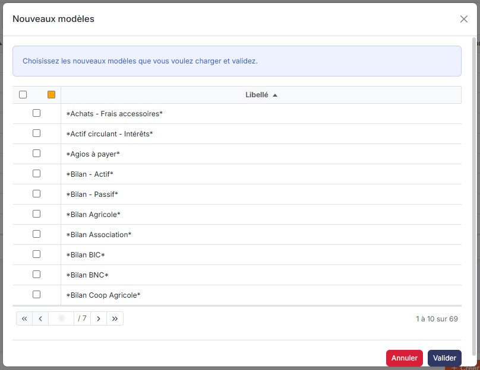
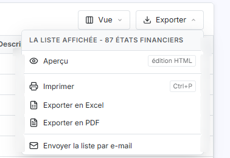
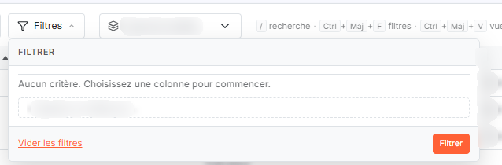
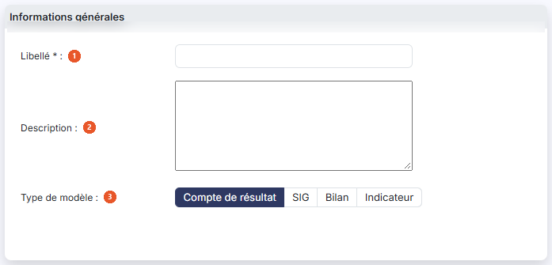
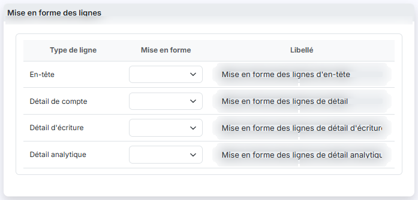
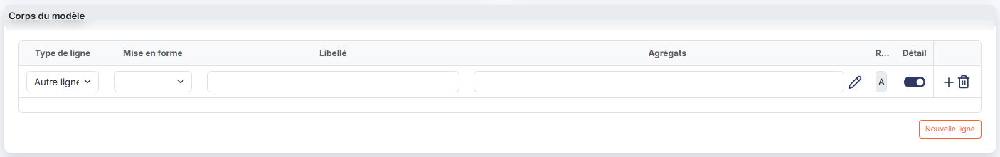
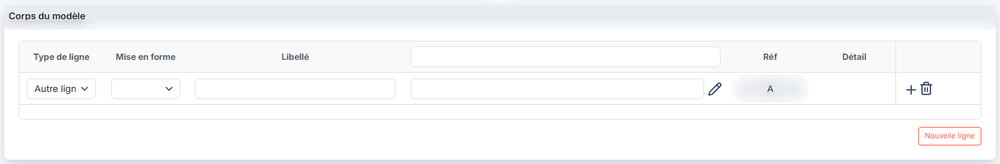
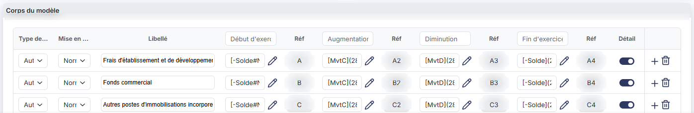

# Etats financiers


**Où le trouver :** Panneau **Paramètres** › **Modèles** › **Documents** › **Etats financiers**



**En bref** — Cet écran administre les modèles d'états financiers (compte de résultat, SIG, bilan, indicateur) qui servent de trame pour construire les lignes d'un budget et pour l'éditer.

* Pour créer un modèle : bouton \[Nouveau], ou pictogramme « Dupliquer » d'un modèle existant, puis bouton \[Enregistrer].
* Pour récupérer les modèles mis à votre disposition : bouton \[Charger les nouveaux modèles], cochez les modèles voulus, puis validez.
* Pour recopier des modèles vers d'autres sociétés gérées : sélectionnez-les, puis bouton \[Exporter].


Cette option vous permet d'administrer les modèles d'états financiers. Ce sont eux qui servent de trame, aussi bien pour construire les lignes d'un budget que pour l'éditer.

<figure><figcaption>
Écran « Etats financiers » de la nouvelle interface
</figcaption></figure>

Les modèles sont de quatre types : « Compte de résultat », « SIG », « Bilan » et « Indicateur ». Le type détermine la façon dont le corps du modèle se présente. Vous pouvez créer vos propres modèles, soit à partir d'une fiche vierge, soit en dupliquant un modèle existant.

## La liste des modèles

<figure><figcaption>
Bouton [Nouveau]
</figcaption></figure>

<figure><figcaption>
Bouton [Charger les nouveaux modèles]
</figcaption></figure>

<figure><figcaption>
Bouton [Exporter]
</figcaption></figure>

Au-dessus de la liste, le sélecteur **Type de modèle** restreint l'affichage à un seul type. Il propose « Tous », « Compte de résultat », « SIG », « Bilan » et « Indicateur » ; le logiciel propose « Tous ». Il n'y a pas de bouton à valider : la liste se rafraîchit dès que vous changez la valeur.

La liste présente trois colonnes : **Libellé**, **Type de modèle** et **Description**. Elle est triée par défaut sur le libellé, par ordre croissant. La colonne **Description** est un texte libre ; lorsqu'il est long, il est tronqué à l'affichage.

L'en-tête de la colonne de commandes porte une case à cocher qui sélectionne toutes les lignes de la page affichée, une case à cocher qui étend la sélection à toutes les pages, un pictogramme de personnalisation des colonnes, un pictogramme « Entonnoir » qui ouvre la fenêtre des filtres et un pictogramme « Imprimante » qui imprime la liste.

Chaque ligne porte trois commandes : le pictogramme « Modifier », qui ouvre la fiche du modèle, le pictogramme « Supprimer », et le pictogramme « Dupliquer », qui ouvre une fiche de création reprenant le contenu du modèle de la ligne. C'est le moyen le plus simple de bâtir un modèle à partir de ceux qui vous sont fournis.

bouton **\[Nouveau]** : il ouvre une fiche de modèle vierge.

bouton **\[Charger les nouveaux modèles]** : il ouvre la fenêtre « Nouveaux modèles », qui vous invite à « choisir les nouveaux modèles que vous voulez charger » et présente, sous une colonne **Libellé**, les modèles mis à votre disposition, à cocher un par un. Le bouton « Valider » lance le chargement, le bouton « Annuler » ferme la fenêtre. Le logiciel les ajoute à votre dossier, ou met à jour ceux qui s'y trouvent déjà, puis vous indique le nombre de modèles chargés et le nombre de modèles mis à jour.

bouton **\[Exporter]** : il ouvre la fenêtre « Exporter », qui recopie les modèles que vous avez sélectionnés vers d'autres sociétés gérées. La fenêtre rappelle le nombre d'enregistrements sélectionnés, puis vous fait choisir entre « Toutes les sociétés », c'est-à-dire toutes celles auxquelles vous avez accès, et « Autres », où vous désignez vous-même les sociétés dans une liste présentant leur **Code client**, leur **Raison sociale** et un interrupteur **Accès autorisé** ; le champ **Société** et le bouton « Afficher » y restreignent la liste. En bas de la fenêtre, le champ **Souhaitez-vous remplacer les enregistrements ayant le même libellé ?** décide du sort des modèles homonymes déjà présents dans les sociétés destinataires. Le bouton « Valider » lance l'export, le bouton « Fermer » ferme la fenêtre.

La copie n'est pas immédiate : le logiciel l'annonce dans la fenêtre même, elle « se fera lors de la prochaine utilisation de la société gérée concernée », par exemple en la sélectionnant dans le menu ou à la connexion d'un utilisateur. Ne vous étonnez donc pas de ne pas voir aussitôt les modèles dans la société destinataire.

bouton **\[Supprimer]** : il supprime les modèles que vous avez sélectionnés dans la liste.

## La fenêtre « Filtres »

<figure><figcaption>
Rubrique « La fenêtre « Filtres » »
</figcaption></figure>

Le pictogramme en forme d'entonnoir, dans l'en-tête de la colonne de commandes, ouvre la fenêtre « Filtres ». Chaque ligne y porte le nom d'une donnée, un opérateur à choisir (« Est vide », « N'est pas vide », « Égal », « Différent », « Contient », « Ne contient pas », « Commence par », « Termine par », « Est avant », « Est avant ou égal », « Est après » et « Est après ou égal ») et la valeur à comparer ; deux critères peuvent être combinés par « Et » ou par « Ou ».

Les critères proposés sont **Libellé**, **Type de modèle**, **Description**, **Date de création**, **Date de modification**, **Modèle éditeur** et **Compte de rattachement**. Les quatre derniers ne correspondent à aucune colonne de la liste ni à aucun champ de la fiche : vous pouvez donc restreindre la liste sur une donnée que vous ne voyez nulle part, et obtenir une grille vide sans en comprendre la raison.

Le bouton **\[Filtrer]** applique vos critères, le bouton **\[Vider les filtres]** les efface, le bouton **\[Fermer]** referme la fenêtre. Le bouton **\[Mémoriser les paramètres]** conserve le jeu de critères saisi et le bouton **\[Charger les paramètres]** le rappelle.

Dès qu'un filtre est actif, un bouton **\[Annuler le filtre]** apparaît à côté du sélecteur **Type de modèle**, au-dessus de la liste : il remet la liste complète et disparaît.

## Rubrique « Informations générales »

<figure><figcaption>
Rubrique « Informations générales »
</figcaption></figure>

| Champ                  | Ce qu'il faut savoir                                                                                                                                                                                                                                                                                                                                                                                                                                                                                                                                                              |
| ---------------------- | --------------------------------------------------------------------------------------------------------------------------------------------------------------------------------------------------------------------------------------------------------------------------------------------------------------------------------------------------------------------------------------------------------------------------------------------------------------------------------------------------------------------------------------------------------------------------------- |
| 1. **Libellé**         | C'est ce libellé qui apparaît dans la liste et dans les sélecteurs de trame des écrans de saisie et d'édition d'un budget.                                                                                                                                                                                                                                                                                                                                                                                                                                                        |
| 2. **Description**     | Zone de texte libre, sur plusieurs lignes, que vous pouvez utiliser pour dater ou commenter le modèle.                                                                                                                                                                                                                                                                                                                                                                                                                                                                            |
| 3. **Type de modèle**  | 
« Compte de résultat », « SIG », « Bilan » ou « Indicateur » ; le logiciel propose « Compte de résultat ». C'est lui qui détermine la constitution du corps du modèle, et il ne se choisit qu'à la création. Sur un modèle déjà enregistré, les quatre choix se présentent grisés, mais ils restent cliquables : si vous en changez, le logiciel reconstruit immédiatement le corps du modèle selon le nouveau type, et vous perdez son contenu. Ne les touchez pas. Si vous vous êtes trompé, quittez la fiche par [Retour] sans enregistrer : le modèle reste intact.
 |
| **Nombre de colonnes** | Proposé pour le seul type « Indicateur ». Vous indiquez, de 1 à 15, le nombre de colonnes de montants du modèle. Sur un modèle déjà enregistré, ce champ est inactif : à la différence du type de modèle, il ne réagit pas au clic.                                                                                                                                                                                                                                                                                                                                               |

## Rubrique « Corps du modèle »

<figure><figcaption>
Rubrique « Le tableau des mises en forme par type de ligne »
</figcaption></figure>

<figure><figcaption>
Rubrique « Corps du modèle »
</figcaption></figure>

<figure><figcaption>
Rubrique « Les modèles « Indicateur » »
</figcaption></figure>

<figure><figcaption>
Rubrique « Les colonnes du tableau »
</figcaption></figure>

Un modèle est composé de lignes. Chaque ligne porte un libellé, une mise en forme et une formule de calcul appelée agrégat.

Le corps du modèle se présente sous trois formes différentes selon le type retenu : ce n'est pas seulement l'affichage qui change, c'est la structure du tableau.

### Les modèles « Compte de résultat » et « SIG »

Ces deux types se présentent de la même façon : un seul tableau, dont les colonnes sont **Type de ligne**, **Mise en forme**, **Libellé**, **Agrégats**, **Réf** et **Détail**.

### Les modèles « Bilan »

Le corps du modèle est scindé en deux tableaux, présentés l'un au-dessus de l'autre : « Actif » puis « Passif ». Les lignes de chaque tableau portent leurs propres lettres de référence.

Le tableau « Actif » porte **deux** colonnes d'agrégats, **Agrégats 1** et **Agrégats 2**, chacune suivie de sa colonne **Réf** : chaque ligne de l'actif se calcule donc par deux formules distinctes.

Le tableau « Passif » ne porte qu'une seule colonne **Agrégats**, suivie de sa colonne **Réf**.

### Les modèles « Indicateur »

Le tableau porte, comme celui des autres formes, une colonne **Type de ligne**. Ses colonnes sont **Type de ligne**, **Mise en forme**, **Libellé**, puis autant de couples de colonnes qu'il y a de colonnes de montants - chaque couple étant formé de la formule et de sa **Réf** - et enfin **Détail**.

L'en-tête de chaque colonne de montant est lui-même une zone de saisie : c'est là que vous donnez son nom à la colonne.

Le nombre de couples affichés est celui du champ **Nombre de colonnes** de la rubrique « Informations générales ».

### Les colonnes du tableau

| Champ                 | Ce qu'il faut savoir                                                                                                                                                                                                                                                                                                                                                                                                                                                                                                                                                                                                                                                                                                                                                                                                                                                                                                                                                                                                                                                                                                                                                                                                                                                                                                                                                                                                                                                                                                                                                                                                                                                                                                                                                                                                                                                                                           |
| --------------------- | -------------------------------------------------------------------------------------------------------------------------------------------------------------------------------------------------------------------------------------------------------------------------------------------------------------------------------------------------------------------------------------------------------------------------------------------------------------------------------------------------------------------------------------------------------------------------------------------------------------------------------------------------------------------------------------------------------------------------------------------------------------------------------------------------------------------------------------------------------------------------------------------------------------------------------------------------------------------------------------------------------------------------------------------------------------------------------------------------------------------------------------------------------------------------------------------------------------------------------------------------------------------------------------------------------------------------------------------------------------------------------------------------------------------------------------------------------------------------------------------------------------------------------------------------------------------------------------------------------------------------------------------------------------------------------------------------------------------------------------------------------------------------------------------------------------------------------------------------------------------------------------------------------------- |
| **Type de ligne**     | 
Il permet d'indiquer si la ligne est une ligne particulière, pour laquelle un traitement, un contrôle ou un comparatif spécifique est prévu, ou une ligne ordinaire. « Autre ligne » désigne la ligne ordinaire. Le contenu du sélecteur dépend du type de modèle, et du tableau pour un bilan : • modèle « Compte de résultat » : « Autre ligne », « Chiffre d'affaires », « Résultat », « Ligne sans contrôle », « Total 1 (solde mis en évidence) » et « Total 2 (sous-total) » ; • modèle « SIG » : « Autre ligne », « CA marchandises », « CA production », « Chiffre d'affaires », « Marchandises », « Production », « Résultat », « Ligne sans contrôle », « Total 1 (solde mis en évidence) » et « Total 2 (sous-total) » ; • modèle « Bilan », tableau « Actif » : « Autre ligne », « Total actif », « Ligne sans contrôle », « Total 1 (solde mis en évidence) » et « Total 2 (sous-total) » ; • modèle « Bilan », tableau « Passif » : « Autre ligne », « Total passif », « Ligne sans contrôle », « Total 1 (solde mis en évidence) » et « Total 2 (sous-total) » ; • modèle « Indicateur » : « Autre ligne », « Total 1 (solde mis en évidence) » et « Total 2 (sous-total) ». « Total 1 » et « Total 2 » sont deux lignes de totaux : en dehors des synthèses du tableau de bord, elles se comportent comme une « Autre ligne », et elles peuvent figurer plusieurs fois dans un modèle.
                                                                                                                                                                                                                                                                                                                                                                                                                                                                                |
| **Mise en forme**     | Vous choisissez la présentation que prendra la ligne à l'édition. Elle permet de faire ressortir la construction du modèle - totaux, sous-totaux - et de personnaliser l'aspect de vos états.                                                                                                                                                                                                                                                                                                                                                                                                                                                                                                                                                                                                                                                                                                                                                                                                                                                                                                                                                                                                                                                                                                                                                                                                                                                                                                                                                                                                                                                                                                                                                                                                                                                                                                                  |
| **Libellé**           | C'est le libellé de la ligne tel qu'il apparaîtra à l'édition.                                                                                                                                                                                                                                                                                                                                                                                                                                                                                                                                                                                                                                                                                                                                                                                                                                                                                                                                                                                                                                                                                                                                                                                                                                                                                                                                                                                                                                                                                                                                                                                                                                                                                                                                                                                                                                                 |
| **Agrégats**          | C'est la formule de calcul de la valeur portée par la ligne. Elle se construit sur des racines de comptes ou sur les lettres de référence d'autres lignes du modèle, par exemple **\[Solde]\(201)** pour une racine de compte, ou **\[Valeur]\(!A;!B;!C;!D;!E;!F)** pour la somme des lignes référencées A à F - une lettre de référence se cite précédée d'un point d'exclamation. Le pictogramme « Crayon » de la colonne ouvre l'éditeur de formule.                                                                                                                                                                                                                                                                                                                                                                                                                                                                                                                                                                                                                                                                                                                                                                                                                                                                                                                                                                                                                                                                                                                                                                                                                                                                                                                                                                                                                                                        |
| **Écrire un agrégat** | 
Une formule est faite de termes que l'on combine avec les opérateurs +, -, * et /. Un terme de compte s'écrit entre crochets, suivi entre parenthèses des racines de comptes concernées : • <strong>[Solde]</strong> : le solde des comptes, c'est-à-dire le débit moins le crédit ; <strong>[SoldeD]</strong> ne retient que les comptes dont le solde est débiteur, <strong>[SoldeC]</strong> que ceux dont le solde est créditeur ; • <strong>[MvtD]</strong> : le total des mouvements au débit ; <strong>[MvtC]</strong> : le total des mouvements au crédit ; • un tiret placé devant le nom, comme dans <strong>[-Solde](201)</strong>, inverse le signe du résultat. Dans les parenthèses, plusieurs racines se séparent par un point-virgule, par exemple <strong>[Solde](201;203)</strong>, et un intervalle s'écrit avec un tiret, par exemple <strong>[Solde](201-205)</strong> ; les deux bornes sont comprises. Une racine désigne tous les comptes dont le numéro commence par elle. Une ligne peut aussi reprendre le résultat d'autres lignes du modèle avec <strong>[Valeur]</strong> : les lettres de référence, précédées d'un point d'exclamation, se séparent par un point-virgule, par exemple <strong>[Valeur](!A;!B)</strong>. Une ligne ne peut citer qu'une ligne placée plus haut dans le même tableau ; sinon le logiciel refuse l'enregistrement du modèle et indique que l'agrégat « référence un agrégat qui n'existe pas ou lui est postérieur ». Un même compte ne peut pas être repris par plusieurs lignes d'un même tableau : le logiciel refuse l'enregistrement et indique que « les comptes de racines » concernés « sont présents plusieurs fois ». Un compte peut seulement figurer à la fois dans un terme <strong>[SoldeD]</strong> et dans un terme <strong>[SoldeC]</strong>. Ce contrôle ne s'applique pas aux modèles « Indicateur ».
 |
| **Réf**               | Non modifiable. Le logiciel affecte à chaque ligne une lettre de référence, dans l'ordre alphabétique. C'est cette lettre que vous reprenez dans les formules des autres lignes.                                                                                                                                                                                                                                                                                                                                                                                                                                                                                                                                                                                                                                                                                                                                                                                                                                                                                                                                                                                                                                                                                                                                                                                                                                                                                                                                                                                                                                                                                                                                                                                                                                                                                                                               |
| **Détail**            | Vous indiquez si les comptes qui composent la ligne peuvent être détaillés à l'édition, lorsque celle-ci est demandée avec le détail des comptes.                                                                                                                                                                                                                                                                                                                                                                                                                                                                                                                                                                                                                                                                                                                                                                                                                                                                                                                                                                                                                                                                                                                                                                                                                                                                                                                                                                                                                                                                                                                                                                                                                                                                                                                                                              |

Chaque ligne porte deux commandes : le pictogramme « Insérer », en forme de flèche, qui ajoute une ligne au-dessus d'elle, et la « Croix », dont l'infobulle indique « Effacer », qui la retire du modèle.

### Le tableau des mises en forme par type de ligne

Sous le tableau principal, et quel que soit le type de modèle, un second tableau vous permet de fixer la mise en forme et le libellé des lignes que le logiciel ajoute lui-même à l'édition. Il comporte quatre lignes : « En-tête », « Détail de compte », « Détail d'écriture » et « Détail analytique ».

bouton **\[Nouveau]** : placé sous le tableau des lignes, il ajoute une ligne à la fin de ce tableau. Un modèle « Bilan » en porte donc deux, un sous le tableau « Actif » et un sous le tableau « Passif ».

bouton **\[Enregistrer]** : il enregistre le modèle.

bouton **\[Retour]** : il revient à la liste des modèles sans enregistrer.
