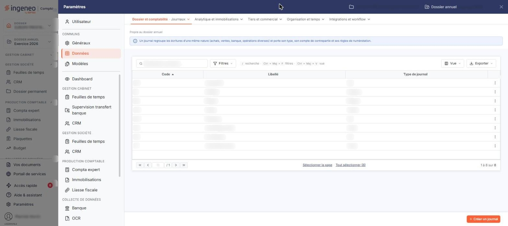
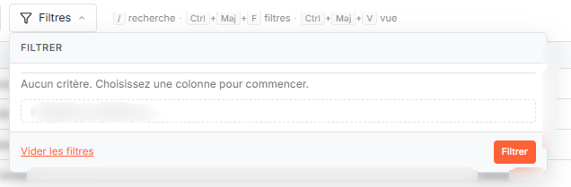
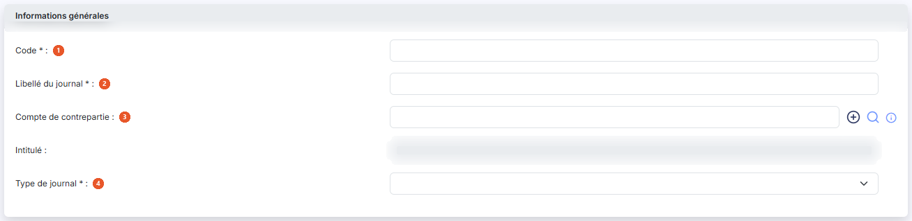
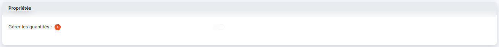

# Journaux


**Où le trouver :** Panneau **Paramètres** › **Données** › **Dossier et comptabilité** › **Journaux**



**En bref** — Cet écran administre les journaux du dossier. Les formules d'un budget pouvant inclure ou exclure des journaux, vous pouvez y créer le journal qui vous manque sans quitter le module.

* Pour créer un journal : bouton \[Nouveau], renseignez le code et le libellé du journal, puis bouton \[Enregistrer].
* Pour supprimer des journaux inutilisés : sélectionnez-les dans la liste, puis bouton \[Supprimer].


Cette option permet d'administrer les journaux du dossier : les consulter, en créer, les modifier, les dupliquer ou les supprimer. Vous en avez besoin ici parce que les formules d'un budget peuvent inclure ou exclure des journaux : vous pouvez donc créer le journal qui vous manque sans quitter le module.

<figure><figcaption>
Écran « Journaux » de la nouvelle interface
</figcaption></figure>

L'écran présente la liste des journaux du dossier, avec les colonnes **Code**, **Libellé** et **Type de journal**. Un clic sur l'en-tête d'une colonne trie la liste.

La colonne de gauche porte, pour chaque ligne, une case à cocher « Sélectionner » puis les pictogrammes « Modifier », « Supprimer » et « Dupliquer ». Dans l'en-tête de cette colonne, la case à cocher sélectionne toutes les lignes de la page affichée, la case voisine étend la sélection à toutes les pages, et les trois pictogrammes suivants ouvrent la personnalisation des colonnes, la fenêtre « Filtres » et le choix d'impression ou d'export de la liste.

Un journal n'est supprimé que s'il n'est utilisé nulle part. Le logiciel refuse la suppression et vous en indique le motif : des écritures sont présentes sur le journal, ou bien un autre élément s'appuie sur lui — un mode de règlement, un paramétrage, un dossier de révision, un modèle d'import d'écritures, un emprunt, un crédit-bail… Il vous faut alors traiter la cause indiquée avant de recommencer.

## La fenêtre « Filtres »

<figure><figcaption>
Bouton [Nouveau]
</figcaption></figure>

<figure><figcaption>
Rubrique « a) La fenêtre « Filtres » »
</figcaption></figure>

Le pictogramme en forme d'entonnoir, dans l'en-tête de la colonne de gauche, ouvre la fenêtre « Filtres ». Chaque ligne y porte le nom d'une donnée, un opérateur à choisir (« Égal », « Contient », « Est vide »…) et la valeur à comparer ; deux critères peuvent être combinés par « Et » ou par « Ou ».

Les critères proposés ne se limitent pas aux trois colonnes affichées : ils couvrent l'ensemble des paramètres d'un journal. Deux points méritent votre attention.

* La plupart de ces paramètres ne sont pas affichés sur la fiche du journal dans ce module : vous pouvez donc filtrer la liste sur des réglages que vous n'y verrez pas, et obtenir une grille vide sans en comprendre la raison.
* Les critères ne reprennent pas les libellés de la fiche : ainsi le critère « Contrepartie » désigne le champ **Compte de contrepartie :**, et le critère « Gestion des quantités » désigne le champ **Gérer les quantités :**.

Le bouton **\[Filtrer]** applique vos critères, le bouton **\[Vider les filtres]** les efface, le bouton **\[Fermer]** referme la fenêtre. Le bouton **\[Mémoriser les paramètres]** conserve le jeu de critères saisi et le bouton **\[Charger les paramètres]** le rappelle.

bouton **\[Nouveau]**

Ce bouton ouvre la fiche d'un nouveau journal, décrite ci-dessous.

bouton **\[Supprimer]**

Ce bouton supprime les journaux sélectionnés dans la liste, aux conditions rappelées plus haut. Le pictogramme « Supprimer » d'une ligne supprime le seul journal de cette ligne.

La fiche d'un journal s'ouvre par le bouton **\[Nouveau]** ou par le pictogramme « Modifier » d'une ligne. Le bouton **\[Enregistrer]** valide votre saisie et le bouton **\[Retour]** revient à la liste sans enregistrer.

## Rubrique « Informations générales »

<figure><figcaption>
Rubrique « Informations générales »
</figcaption></figure>

| Champ                         | Ce qu'il faut savoir                                                                                                                                                                                                                                                                                                                         |
| ----------------------------- | -------------------------------------------------------------------------------------------------------------------------------------------------------------------------------------------------------------------------------------------------------------------------------------------------------------------------------------------- |
| 1. **Code**                   | Unique, quatre caractères au plus. Il identifie le journal et n'est plus modifiable après la création : le champ est alors grisé.                                                                                                                                                                                                            |
| 2. **Libellé du journal**     | Unique, vingt-cinq caractères au plus. Notez qu'à la modification, le champ perd la marque qui signale un champ obligatoire, alors qu'il reste exigé : le logiciel refusera l'enregistrement s'il est vide.                                                                                                                                  |
| 3. **Compte de contrepartie** | Compte utilisé pour solder l'écriture en saisie. Tapez son numéro, ou cliquez sur la loupe pour le rechercher dans le plan comptable ; le bouton « + » vert crée un compte qui n'existerait pas encore. Le logiciel affiche l'intitulé du compte retenu dans le champ **Intitulé :**, en lecture seule. Seul un compte standard est accepté. |
| 4. **Type de journal**        | Choisissez la nature des opérations enregistrées dans ce journal : « Achat », « Vente », « OD », « Banque », « Caisse », « Reprise de balance », « Divers » ou « A-nouveaux ».                                                                                                                                                               |

Le type retenu peut rendre le compte de contrepartie obligatoire : un journal de banque exige un compte de contrepartie de nature banque, un journal de caisse un compte de nature caisse, et ce compte ne doit pas déjà servir à un autre journal du même type.


Attention : la liste ne propose pas le type « Situation », que la colonne **Type de journal** de la liste affiche pourtant pour certains journaux. À l'ouverture de la fiche d'un tel journal, le champ **Type de journal :** apparaît vide et vous devrez retenir l'un des types proposés pour pouvoir enregistrer. Si vous ne souhaitez pas changer le type du journal, quittez la fiche par le bouton **\[Retour]**.


Le logiciel refuse par ailleurs de changer le type d'un journal qui porte déjà un paramétrage lié à son type : paramétrage de caisse, paramétrage de banque, ou paramétrage sur un dossier de révision pour un journal de situation.

## Rubrique « Propriétés »

<figure><figcaption>
Rubrique « Propriétés »
</figcaption></figure>

**Gérer les quantités** : indique si des quantités peuvent être saisies sur les lignes d'écriture de ce journal.

Cet interrupteur est grisé lorsque la gestion des quantités n'est pas activée pour le dossier. Ce réglage se trouve dans les paramètres multi-modules du dossier.
