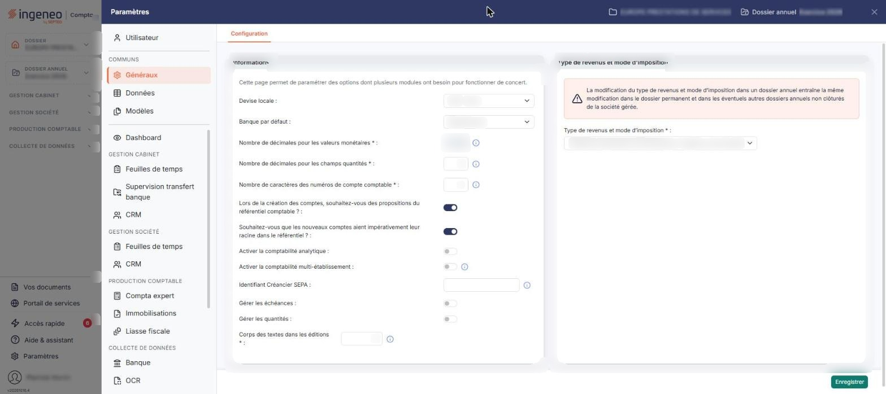
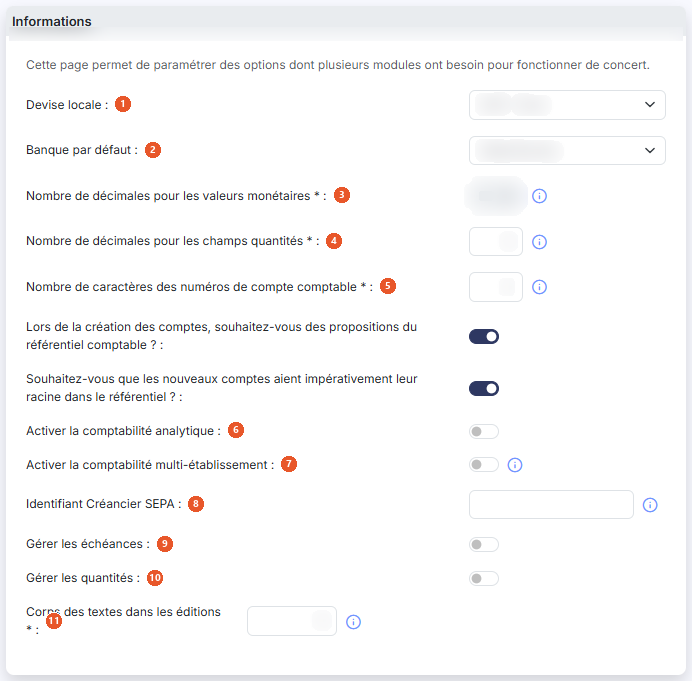
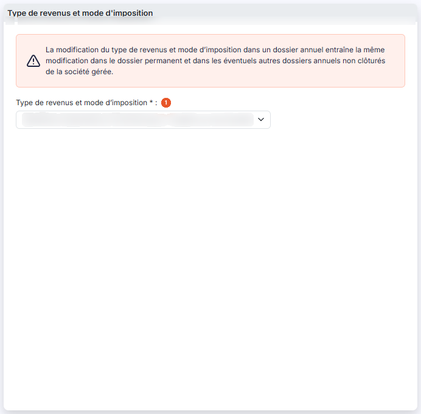

# Multimodules


**Où le trouver :** Panneau **Paramètres** › **Généraux** › **Configuration**



**En bref** — Cet écran regroupe les paramètres partagés par plusieurs modules : décimales, longueur des numéros de compte, échéances, identifiant créancier SEPA, type de revenus. Vos modifications valent aussi pour le Budget.

* Pour activer la gestion des échéances : répondez « Oui » à « Gérer les échéances », puis bouton \[Enregistrer].
* Pour valider vos modifications : bouton \[Enregistrer], seul bouton de l'écran.


Cette option regroupe des paramètres dont plusieurs modules du logiciel ont besoin pour fonctionner de concert : ce que vous modifiez ici vaut donc aussi bien pour le Budget que pour les autres modules de votre abonnement. Le logiciel affiche en tête de page la phrase « Cette page permet de paramétrer des options dont plusieurs modules ont besoin pour fonctionner de concert. »

<figure><figcaption>
Écran « Multimodules » de la nouvelle interface
</figcaption></figure>

L'écran se compose de deux rubriques et d'un seul bouton, en bas de page. Il ne comporte ni onglet, ni grille. Certaines questions n'apparaissent que selon la réponse donnée à celle qui les précède : le nombre de champs affichés varie donc d'un dossier à l'autre.

## Rubrique « Paramètres - Informations relevant de plusieurs modules »

<figure><figcaption>
Rubrique « Paramètres - Informations relevant de plusieurs modules »
</figcaption></figure>

| Champ                                                                             | Ce qu'il faut savoir                                                                                                                                                                                                                                                                                                                                                                                                                                                                                                                                                                                                                                                                                                                                                                                                                                                                                                                                                                                                                  |
| --------------------------------------------------------------------------------- | ------------------------------------------------------------------------------------------------------------------------------------------------------------------------------------------------------------------------------------------------------------------------------------------------------------------------------------------------------------------------------------------------------------------------------------------------------------------------------------------------------------------------------------------------------------------------------------------------------------------------------------------------------------------------------------------------------------------------------------------------------------------------------------------------------------------------------------------------------------------------------------------------------------------------------------------------------------------------------------------------------------------------------------- |
| 1. **Devise locale**                                                              | Désignez la devise dans laquelle la société gérée tient ses comptes. La liste propose les devises reconnues par le logiciel, désignées par leur code et leur nom — par exemple « EUR - Euro ».                                                                                                                                                                                                                                                                                                                                                                                                                                                                                                                                                                                                                                                                                                                                                                                                                                        |
| 2. **Banque par défaut**                                                          | Indiquez celle des banques enregistrées pour la société gérée que le logiciel proposera par défaut chaque fois que nécessaire. La liste dépend donc de votre dossier.                                                                                                                                                                                                                                                                                                                                                                                                                                                                                                                                                                                                                                                                                                                                                                                                                                                                 |
| 3. **Nombre de décimales pour les valeurs monétaires**                            | Ce paramètre détermine avec combien de décimales toutes les valeurs monétaires sont saisies et affichées. Il peut prendre les valeurs 0, 1, 2, 3 et 4, mais **la zone est en lecture seule** : vous ne pouvez pas la modifier vous-même, malgré l'astérisque qui la signale comme obligatoire. Pour la faire changer, prenez contact avec le service technique.                                                                                                                                                                                                                                                                                                                                                                                                                                                                                                                                                                                                                                                                       |
| 4. **Nombre de décimales pour les champs quantités**                              | Ce paramètre détermine avec combien de décimales les champs de quantité sont saisis et affichés. Il peut prendre les valeurs 0 à 4.                                                                                                                                                                                                                                                                                                                                                                                                                                                                                                                                                                                                                                                                                                                                                                                                                                                                                                   |
| 5. **Nombre de caractères des numéros de compte comptable**                       | 
Il s'agit du nombre de caractères que comportent tous les comptes de votre plan comptable. La valeur doit être comprise entre 6 et 12 caractères. Afin de conserver les possibilités de comparaison, la modification est effectuée sur le dossier annuel en cours et sur les deux dossiers annuels précédents. <strong>Lors de la création des comptes, souhaitez-vous des propositions du référentiel comptable ? :</strong> à <strong>Oui</strong>, le logiciel vous fait des propositions issues du référentiel comptable lorsque vous créez un compte, en fonction des premiers caractères que vous saisissez. <strong>Souhaitez-vous que les nouveaux comptes aient impérativement leur racine dans le référentiel ? :</strong> cette question n'est affichée que si vous avez répondu <strong>Oui</strong> à la précédente ; si vous repassez celle-ci à <strong>Non</strong>, la question disparaît. À <strong>Oui</strong>, elle impose que la racine des nouveaux comptes figure dans le référentiel comptable.
 |
| 6. **Activer la comptabilité analytique**                                         | À **Oui**, la comptabilité analytique est activée pour la société gérée. Cette option ne fait apparaître aucun champ supplémentaire sur cette page.                                                                                                                                                                                                                                                                                                                                                                                                                                                                                                                                                                                                                                                                                                                                                                                                                                                                                   |
| 7. **Activer la comptabilité multi-établissement**                                | En activant cette option, vous devrez affecter les écritures à un établissement. Les établissements doivent être créés dans le module « Dossier permanent », menu « Social », option « Etablissements ».                                                                                                                                                                                                                                                                                                                                                                                                                                                                                                                                                                                                                                                                                                                                                                                                                              |
| 8. **Identifiant Créancier SEPA**                                                 | L'Identifiant Créancier SEPA (ICS) est obligatoire si vous souhaitez générer des ordres de prélèvements SEPA. Cette information est à récupérer auprès de votre banque.                                                                                                                                                                                                                                                                                                                                                                                                                                                                                                                                                                                                                                                                                                                                                                                                                                                               |
| 9. **Gérer les échéances**                                                        | À **Oui**, la gestion des échéances est activée et le logiciel affiche une question supplémentaire, juste en dessous.                                                                                                                                                                                                                                                                                                                                                                                                                                                                                                                                                                                                                                                                                                                                                                                                                                                                                                                 |
| 10. **Gérer les quantités**                                                       | 
À <strong>Oui</strong>, la gestion des quantités est activée pour la société gérée. Ces deux options — <strong>Activer la comptabilité analytique</strong> et <strong>Gérer les quantités</strong> — ne se manipulent plus dès lors que la fonction est déjà utilisée dans le dossier : l'interrupteur affiche alors sa valeur mais n'est plus modifiable. <strong>Activer la comptabilité analytique</strong> se verrouille lorsque l'option est à <strong>Oui</strong> et qu'au moins un axe analytique est utilisé ; <strong>Gérer les quantités</strong> se verrouille lorsque l'option est à <strong>Oui</strong> et qu'au moins un journal admet la saisie des quantités. Tant que la fonction n'est pas utilisée, les deux options se modifient librement.
                                                                                                                                                                                                                                                           |
| 11. **Corps des textes dans les éditions**                                        | Ce paramètre détermine la taille d'affichage des textes standards dans les éditions ; sa valeur doit être comprise entre 8 et 18.                                                                                                                                                                                                                                                                                                                                                                                                                                                                                                                                                                                                                                                                                                                                                                                                                                                                                                     |
| **Renseigner automatiquement les échéances pour les fournisseurs et les clients** | Cette question n'est affichée que si **Gérer les échéances** est à **Oui**. À **Oui**, l'échéance est renseignée automatiquement pour les comptes dont les échéances sont gérées, et le logiciel affiche la mention « Pour les comptes dont les paramètres d'échéances ne sont pas définis, les paramètres ci-dessous s'appliquent. », puis deux listes supplémentaires.                                                                                                                                                                                                                                                                                                                                                                                                                                                                                                                                                                                                                                                              |
| **Délai de règlement par défaut des fournisseurs**                                | **Délai de règlement par défaut des clients :** si aucun délai de règlement n'a été défini sur un fournisseur ou sur un client, c'est celui que vous indiquez ici qui s'applique. Ces deux listes sont alimentées par les délais enregistrés dans le panneau Paramètres, rubrique « Données » > « Dossier et comptabilité » > « Délais de règlement » : leur contenu dépend donc de votre dossier, et il faut avoir défini ces délais au préalable.                                                                                                                                                                                                                                                                                                                                                                                                                                                                                                                                                                                   |

## Rubrique « Type de revenus et mode d'imposition »

<figure><figcaption>
Rubrique « Type de revenus et mode d'imposition »
</figcaption></figure>

Le logiciel affiche en tête de rubrique cet avertissement : « La modification du type de revenus et mode d'imposition dans un dossier annuel entraîne la même modification dans le dossier permanent et dans les éventuels autres dossiers annuels non clôturés de la société gérée. »

**Type de revenus et mode d'imposition** : obligatoire. Cette liste indique à quel régime est soumise la société gérée. Elle propose neuf régimes — par exemple les bénéfices agricoles, les bénéfices industriels et commerciaux à l'impôt sur le revenu ou à l'impôt sur les sociétés, ou encore les revenus fonciers. L'information est déterminante dans plusieurs modules, et sa modification peut avoir de nombreuses conséquences sur vos paramétrages.

bouton **\[Enregistrer]**

Enregistre vos paramètres. C'est le seul bouton de l'écran.
