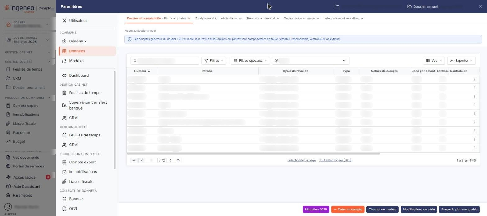
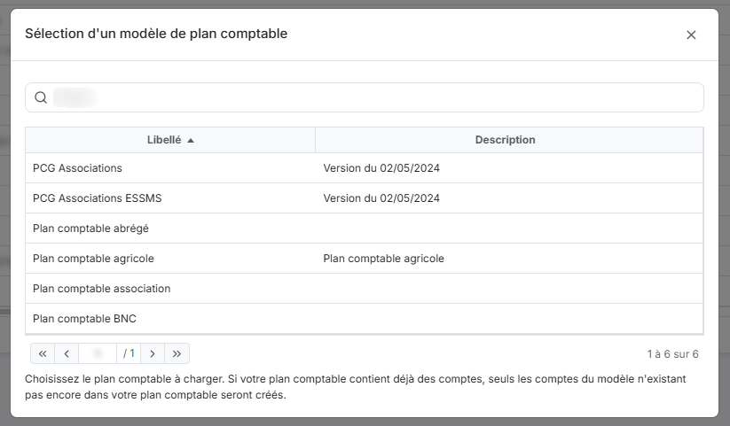
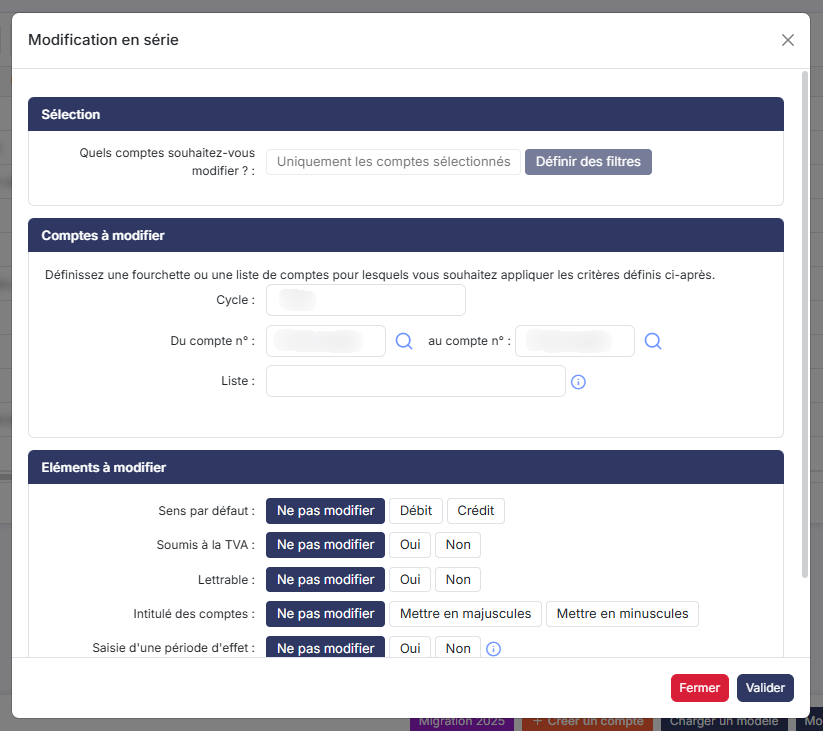
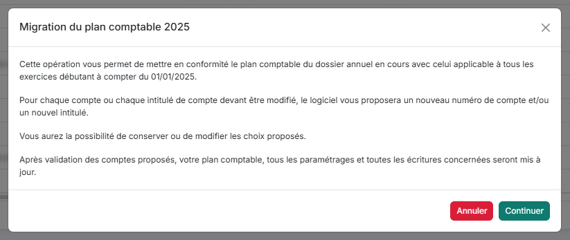
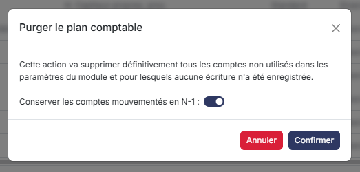
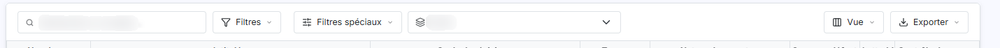
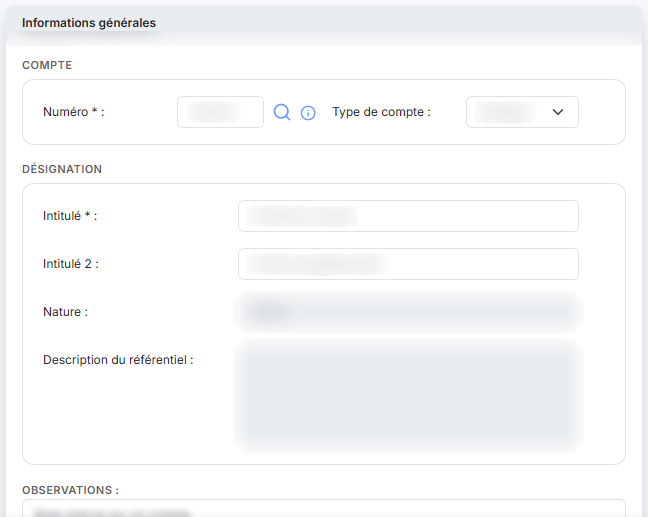
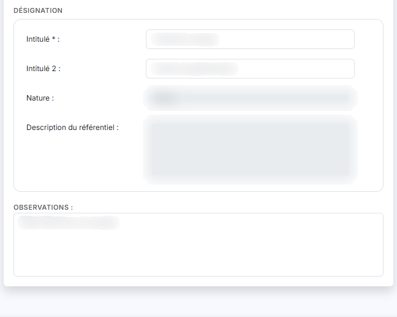
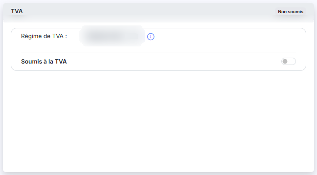

# Plan comptable


**Où le trouver :** Panneau **Paramètres** › **Données** › **Dossier et comptabilité** › **Plan comptable**



**En bref** — Cet écran administre les comptes généraux du plan comptable du dossier, ceux que vous retrouvez dans la saisie et les éditions de vos budgets : consultation, création, modification, duplication et suppression.

* Pour créer un compte : bouton \[Nouveau], renseignez la fiche, puis bouton \[Enregistrer].
* Pour reprendre un plan comptable type : bouton \[Charger un modèle], puis choisissez le modèle à charger.
* Pour modifier plusieurs comptes d'un coup : bouton \[Modifications en série], désignez les comptes, puis indiquez les paramètres à modifier.


Cette option permet d'administrer les comptes généraux du plan comptable du dossier : les consulter, en créer, les modifier, les dupliquer ou les supprimer. C'est ce plan comptable que vous retrouvez dans la saisie et dans les éditions de vos budgets.

<figure><figcaption>
Écran « Plan comptable » de la nouvelle interface
</figcaption></figure>

L'écran présente la liste des comptes du dossier. La colonne de gauche porte, pour chaque ligne, une case à cocher « Sélectionner » puis les pictogrammes « Modifier », « Supprimer » et « Dupliquer ».

Les colonnes affichées décrivent le compte (**Numéro**, **Intitulé**, **Cycle de révision**, **Type**, **Nature de compte**), son comportement en saisie (**Sens par défaut**, **Lettrable**, **Contrôle de cycle**, **Analytique**, **Période d'effet**, **Code devise**, **Saisie en devise**) et ses soldes (**Solde n-1**, **Solde n-2**, **Ecart n-1 vs n-2**). Un clic sur l'en-tête d'une colonne trie la liste, à l'exception de la colonne **Ecart n-1 vs n-2**.

Le choix et l'ordre des colonnes vous appartiennent : le pictogramme de personnalisation, dans l'en-tête de la colonne de gauche, ouvre la fenêtre de sélection des colonnes. Les deux pictogrammes voisins ouvrent la fenêtre de filtres par colonne et le choix d'impression ou d'export de la liste. La case à cocher de l'en-tête sélectionne toutes les lignes de la page affichée, la case voisine étend la sélection à toutes les pages.

La suppression d'un compte n'est possible qu'à trois conditions : qu'aucune écriture n'ait été passée sur ce compte, qu'il ne soit pas utilisé dans une saisie en cours, et qu'il ne soit repris dans aucun paramétrage. Dans ce dernier cas, le logiciel vous indique quel paramétrage l'utilise.

## Filtrer la liste

<figure><figcaption>
Bouton [Charger un modèle]
</figcaption></figure>

<figure><figcaption>
Bouton [Modifications en série]
</figcaption></figure>

<figure><figcaption>
Bouton [Migration 2025]
</figcaption></figure>

<figure><figcaption>
Bouton [Purger le plan comptable]
</figcaption></figure>

<figure><figcaption>
Rubrique « a) Filtrer la liste »
</figcaption></figure>

Une ligne de filtres est placée au-dessus de la liste.

| Champ            | Ce qu'il faut savoir                                                                                                                                                                                                       |
| ---------------- | -------------------------------------------------------------------------------------------------------------------------------------------------------------------------------------------------------------------------- |
| **N° de compte** | Saisissez tout ou partie d'un numéro de compte.                                                                                                                                                                            |
| **Cycle**        | Choisissez un cycle de révision pour ne conserver que les comptes qui lui sont rattachés. La liste proposée est celle des cycles de révision définis pour le dossier : elle n'est donc pas la même d'un dossier à l'autre. |

Trois boutons complètent la ligne : « Tous les comptes », actif par défaut, « Comptes mouvementés » et « Comptes non mouvementés ».

Cliquez sur le bouton **\[Filtrer]** pour appliquer vos critères. Le bouton **\[Annuler les filtres]** n'apparaît qu'une fois un critère renseigné ; il vide les filtres et réaffiche la liste complète.

bouton **\[Nouveau]**

Ce bouton ouvre la fiche d'un nouveau compte, décrite ci-dessous.

bouton **\[Charger un modèle]**

Ce bouton ouvre la fenêtre « Sélection d'un modèle de plan comptable », qui présente les modèles disponibles avec leur **Libellé** et leur **Description**. Le champ **Modèle :** et le bouton **\[Afficher]** permettent de restreindre cette liste.

Choisissez le plan comptable à charger. Si votre plan comptable contient déjà des comptes, seuls les comptes du modèle n'existant pas encore dans votre plan comptable seront créés. Le logiciel vous indique ensuite combien de comptes ont été chargés.

bouton **\[Modifications en série]**

Ce bouton ouvre la fenêtre « Modification en série », qui applique les mêmes modifications à un ensemble de comptes.

Commencez par désigner les comptes concernés : le champ **Quels comptes souhaitez-vous modifier ? :** propose « Uniquement les comptes sélectionnés » ou « Définir des filtres ». Dans le second cas, définissez une fourchette (**Du compte n° :** et **au compte n° :**), une **Liste :** de comptes, ou un **Cycle :**. Les critères se combinent : un compte doit satisfaire chacun d'eux pour être modifié.

Indiquez ensuite les paramètres à modifier. Chacun offre le choix « Ne pas modifier », retenu par défaut, et les valeurs à appliquer : c'est le cas par exemple de **Sens par défaut :**, de **Lettrable :** ou de **Intitulé des comptes :**, qui met les intitulés en majuscules ou en minuscules. Selon la valeur retenue, des champs complémentaires apparaissent : ainsi **Soumis à la TVA :** positionné sur « Oui » demande le code et le compte de TVA à utiliser.

Le bouton **\[Valider]** applique les modifications, le bouton **\[Fermer]** abandonne.


Notez que cette fenêtre permet de modifier des paramètres du compte que la fiche n'affiche pas dans ce module, comme le détail en réouverture, la gestion analytique, les échéances, les quantités ou le code TVA : vous ne pourrez donc pas relire ici, compte par compte, le résultat de ces modifications.


bouton **\[Auxiliariser]**

Ce bouton transforme les comptes généraux sélectionnés dans la liste en comptes auxiliaires rattachés à un compte collectif que vous désignez. Les écritures déjà passées sur ces comptes sont reportées sur le compte collectif et le compte général d'origine est supprimé.

Sélectionnez donc au préalable les comptes concernés : le logiciel affiche le message « Veuillez sélectionner au moins un compte. » si aucune ligne n'est cochée.

Un compte qui porte au moins une écriture validée, ou qui est utilisé dans une saisie non encore enregistrée, n'est pas auxiliarisé ; un compte collectif ne l'est pas non plus. À la fin du traitement, le logiciel indique combien de comptes ont été auxiliarisés et, pour ceux qui n'ont pas été traités, le motif du refus.

bouton **\[Purger le plan comptable]**

Cette action permet de supprimer les comptes en série, par exemple pour charger ensuite un autre modèle de plan comptable. Le bouton ouvre une fenêtre de confirmation : « Cette action va supprimer définitivement tous les comptes non utilisés dans les paramètres du module et pour lesquels aucune écriture n'a été enregistrée. »

**Conserver les comptes mouvementés en N-1** : positionnez cet interrupteur sur « Oui » pour épargner les comptes qui portent des écritures sur l'exercice précédent. Cette option suppose que les soldes N-1 et N-2 des comptes ont déjà été calculés ; sinon, le logiciel refuse la purge et vous invite à lancer ce calcul au préalable.

bouton **\[Migration 2025]**

Ce bouton ouvre la fenêtre « Migration du plan comptable 2025 », qui met le plan comptable du dossier annuel en cours en conformité avec celui applicable aux exercices débutant à compter du 01/01/2025. La fenêtre annonce que, pour chaque compte ou chaque intitulé devant être modifié, le logiciel proposera un nouveau numéro de compte ou un nouvel intitulé, que vous pourrez conserver ou modifier, et qu'après validation des comptes proposés le plan comptable, les paramétrages et les écritures concernées seront mis à jour.

Le bouton **\[Continuer]** poursuit vers la liste des comptes à migrer, le bouton **\[Annuler]** y renonce.

Ce bouton n'apparaît que si la migration est encore à faire sur le dossier annuel ouvert.

bouton **\[Supprimer]**

Ce bouton supprime les comptes sélectionnés dans la liste, aux conditions rappelées plus haut. Le pictogramme « Supprimer » d'une ligne supprime le seul compte de cette ligne.

La fiche d'un compte s'ouvre par le bouton **\[Nouveau]** ou par le pictogramme « Modifier » d'une ligne. Elle se compose des rubriques suivantes ; le bouton **\[Enregistrer]** valide votre saisie et le bouton **\[Retour]** revient à la liste sans enregistrer.

## Rubrique « Informations générales »

<figure><figcaption>
Rubrique « Informations générales »
</figcaption></figure>

<figure><figcaption>
Rubrique « Informations générales »
</figcaption></figure>

| Champ                          | Ce qu'il faut savoir                                                                                                                                                                                                                                                                                                                                                                                                                                                                            |
| ------------------------------ | ----------------------------------------------------------------------------------------------------------------------------------------------------------------------------------------------------------------------------------------------------------------------------------------------------------------------------------------------------------------------------------------------------------------------------------------------------------------------------------------------- |
| **Numéro**                     | À la création. Les caractères autorisés sont les lettres majuscules et les chiffres, et le numéro doit commencer par 3 chiffres. La loupe placée à côté du champ ouvre la recherche dans le référentiel comptable. Le logiciel complète le numéro par des zéros à droite pour atteindre la longueur de numéro de compte retenue pour le dossier : c'est pourquoi la liste affiche des numéros plus longs que ceux que vous saisissez. Une fois le compte créé, ce numéro n'est plus modifiable. |
| **Intitulé**                   | —                                                                                                                                                                                                                                                                                                                                                                                                                                                                                               |
| **Intitulé 2**                 | Il complète l'intitulé du compte.                                                                                                                                                                                                                                                                                                                                                                                                                                                               |
| **Description du référentiel** | En création seulement, cette zone en lecture seule reprend la description issue du référentiel comptable.                                                                                                                                                                                                                                                                                                                                                                                       |
| **Type de compte**             | « Standard » ou « Collectif ». Un compte collectif regroupe les comptes auxiliaires qui lui sont rattachés, et qui doivent être renseignés lors de la saisie ; un compte standard admet la saisie sans compte auxiliaire. Ce choix n'est plus modifiable après la création du compte.                                                                                                                                                                                                           |
| **Nature**                     | En lecture seule, la nature est déterminée par le logiciel d'après le numéro du compte.                                                                                                                                                                                                                                                                                                                                                                                                         |
| **Observations**               | Zone de commentaire libre.                                                                                                                                                                                                                                                                                                                                                                                                                                                                      |
| **Créé le**                    | **Par :** en lecture seule, ces deux champs indiquent la date de création du compte et son auteur. Ils n'apparaissent que si cette date est connue : sur un compte du plan comptable livré avec le dossier, ils sont absents.                                                                                                                                                                                                                                                                   |
| **Modifié le**                 | **Par :** en lecture seule, ces deux champs indiquent la date de la dernière modification du compte et son auteur. Ils n'apparaissent que si le compte a déjà été modifié.                                                                                                                                                                                                                                                                                                                      |


Notez que le cycle de révision du compte, lisible en colonne dans la liste, n'est pas affiché sur la fiche depuis ce module : inutile de l'y chercher.


## Rubrique « TVA »

<figure><figcaption>
Rubrique « TVA »
</figcaption></figure>

Cette rubrique n'apparaît que pour un compte de type « Standard ».

| Champ               | Ce qu'il faut savoir                                                                                                                                                              |
| ------------------- | --------------------------------------------------------------------------------------------------------------------------------------------------------------------------------- |
| **Régime de TVA**   | En lecture seule. Si vous souhaitez modifier le régime de TVA, veuillez vous rendre dans le menu « Paramètres », sous-option « Paramètres généraux », rubrique « Régime de TVA ». |
| **Soumis à la TVA** | Indiquez si le compte est relatif à des opérations soumises à la TVA.                                                                                                             |

## Rubrique « Devises »

Cette rubrique apparaît à la modification d'un compte de type « Standard ».

**Autoriser la saisie en devises** : positionnez cet interrupteur sur « Oui » pour saisir des montants en devise sur ce compte. Le logiciel affiche alors le champ **Devise par défaut pour ce compte :**, où vous choisissez la devise proposée en saisie.

## Rubrique « Soldes »

Cette rubrique apparaît à la modification d'un compte de type « Standard ». Elle est entièrement en lecture seule et rappelle la situation du compte : **Solde à date :**, **Solde n-1 :**, **Mouvementé en n-1 :**, **Ecart n vs n-1 :**, **Solde n-2 :** et **Ecart n-1 vs n-2 :**.
