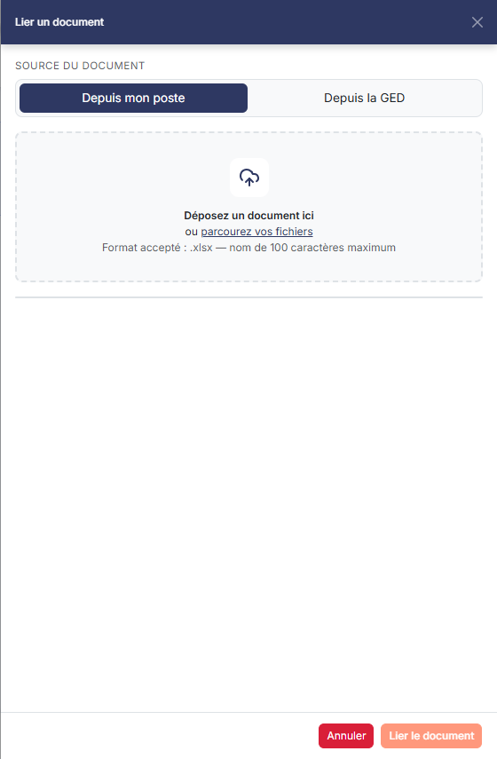

# Import


**Où le trouver :** Menu **Traitements › Import**



**En bref** — Cet écran vous permet d'importer le détail d'un budget préparé hors du logiciel, à partir d'une trame Excel que vous remplissez puis lui remettez.

* Pour obtenir le classeur à remplir : bouton \[Télécharger la trame d'import].
* Pour importer votre classeur rempli : bouton \[Importer], choisissez le fichier .xlsx, puis bouton \[Lier le document].


Cette option vous permet de reprendre dans le logiciel des données préparées en dehors de lui. Depuis le Budget, elle sait importer **un seul fichier** : le détail d'un budget. Le logiciel vous fournit pour cela une trame sous la forme d'un classeur Excel, que vous remplissez avec vos données avant de le lui remettre.

<figure><figcaption>
Écran « Import » de la nouvelle interface
</figcaption></figure>

Tant qu'aucun import n'a été réalisé, l'écran ne comporte aucun champ : il vous rappelle la marche à suivre en quatre temps — téléchargez le classeur contenant la trame d'import et la notice explicative décrivant les caractéristiques de chaque champ, remplissez-le avec vos données, réalisez l'import, puis lisez le rapport. Le texte annonce que le logiciel éditera un rapport d'import avec le nombre d'enregistrements importés et, s'il détecte des erreurs, l'onglet concerné, la ligne où se trouve l'erreur et sa nature.

Le pictogramme d'information placé au bout de la première ligne porte une infobulle qui énumère les fichiers que cette option sait importer : depuis le Budget, elle n'en annonce qu'un, « Détail d'un budget. ».

Ce texte de présentation est commun à tous les modules qui proposent un import, et il est rédigé au pluriel : il parle des « trames d'import de chaque fichier » et des « différents onglets » à remplir. Depuis le Budget, il n'y a qu'un fichier importable : ne cherchez pas plusieurs trames.

bouton **\[Télécharger la trame d'import]**

Vous remet le classeur Excel à remplir, celui que le texte de l'écran vous invite à télécharger avant toute chose. Il comporte l'onglet de saisie « Budget détail », dans lequel vous copiez vos données, et un onglet « Notes » qui tient la notice : celle-ci indique, champ par champ, s'il est obligatoire, sa longueur maximale et les valeurs admises, et rappelle qu'une valeur devant exister dans un autre fichier du logiciel provoque une erreur si elle n'y figure pas. Chaque onglet de données porte enfin la question « Cet onglet est-il à importer ? » : répondez-y, sans quoi son contenu n'est pas repris.

Deux règles de cette notice méritent votre attention, parce qu'elles gouvernent le résultat de l'import. Le montant que vous indiquez sur une ligne est **lissé sur l'ensemble des périodes du budget** : vous saisissez une valeur globale, le logiciel la répartit. Et la nature du compte attendu dépend du mode de saisie du budget que vous alimentez : le numéro de compte est obligatoire pour un budget saisi par compte, le libellé d'agrégat l'est pour un budget saisi par agrégat.

bouton **\[Importer]**

Ouvre le volet latéral « Lier un document », qui sert à désigner le classeur que vous avez rempli. Le volet propose d'abord la **Source du document** : « Depuis mon poste » ou « Depuis la GED ». Il invite ensuite à déposer un document ou à parcourir vos fichiers, et précise le format accepté : **.xlsx**, avec un nom de 100 caractères au maximum. Le classeur doit donc être un fichier Excel au format .xlsx, et un seul à la fois.

Le pied du volet porte deux boutons : le bouton **\[Annuler]**, qui referme le volet sans rien faire, comme la croix de sa barre de titre, et le bouton **\[Lier le document]**, qui valide le choix du classeur et lance l'import. Les erreurs rencontrées s'affichent dans une barre rouge en haut de l'écran.

Deux refus à connaître : un classeur protégé par un mot de passe ne peut pas être lu, le logiciel vous l'indique et l'import n'a pas lieu ; et le rapport de l'import précédent est remplacé par celui du nouvel import, vous ne conservez donc que le dernier.

## Autres vues de l'écran

<figure><figcaption>
Bouton [Importer]
</figcaption></figure>
