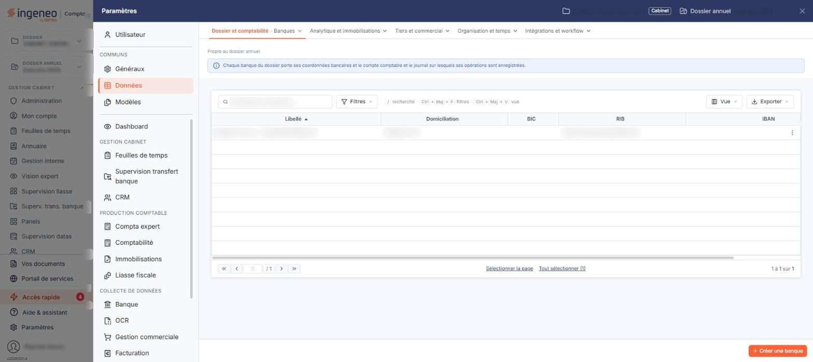
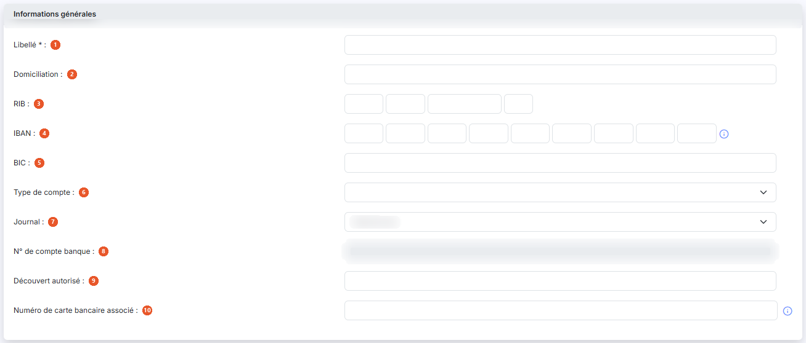
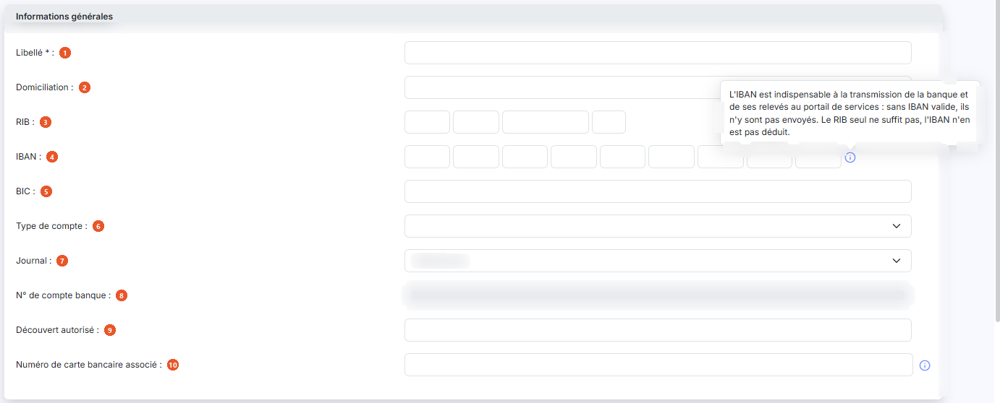
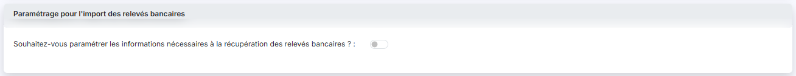
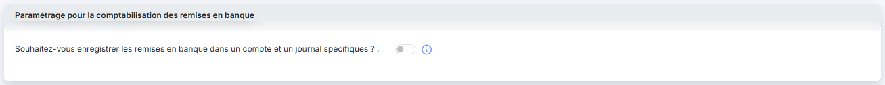
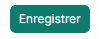

# Banques


**Où le trouver :** Panneau **Paramètres** › **Données** › **Dossier et comptabilité** › **Banques**



**En bref** — Cet écran gère vos comptes bancaires : coordonnées, journal et compte rattachés, récupération des relevés et comptabilisation des remises en banque.

* Pour créer une banque : bouton \[Créer une banque], saisissez le « Libellé », le RIB ou l'IBAN et le « Journal », puis bouton \[Enregistrer].
* Pour éviter de comptabiliser deux fois une remise : répondez « Oui » à « Souhaitez-vous enregistrer les remises en banque dans un compte et un journal spécifiques ? », indiquez le compte de transit et le journal, puis bouton \[Enregistrer].


Cette option vous permet de gérer vos comptes bancaires : leurs coordonnées, le compte comptable et le journal auxquels ils sont rattachés, et le paramétrage de la récupération des relevés bancaires.

<figure><figcaption>
Écran « Banques » de la nouvelle interface
</figcaption></figure>

Le fichier des banques est partagé avec les autres modules du logiciel et sert à plusieurs usages — remises en banque, virements SEPA, récupération automatique des écritures : toute modification faite ici est donc immédiatement visible dans les autres modules.

Une banque peut être créée manuellement depuis cet écran, ou automatiquement lors du paramétrage d'un compte bancaire dont vous souhaitez récupérer les écritures. Dans ce second cas, plusieurs informations de la fiche sont déjà renseignées.

L'écran ne comporte pas de zone de filtres : il est constitué de la seule liste des banques, avec cinq colonnes — « Libellé », « Domiciliation », « BIC », « RIB » et « IBAN ». Chacune est triable par un clic sur son en-tête ; la liste est présentée par défaut dans l'ordre croissant des libellés.

Sur chaque ligne, vous disposez de deux pictogrammes, dont l'infobulle vous rappelle le rôle : « Modifier » et « Supprimer ».

En bas de la liste, le pagineur vous permet de vous déplacer d'une, de dix ou de cent pages, ou d'aller directement à la première ou à la dernière ; le décompte des banques est affiché à sa droite.

## Barre de la liste

La liste présente aussi une barre de recherche, bouton **\[Filtres]**, bouton **\[Vue]** et bouton **\[Exporter]**. Leur fonctionnement, commun à toutes les listes — dont le choix des colonnes affichées —, est décrit dans la page commune « Les listes ».

## Rubrique « Informations générales »

<figure><figcaption>
Rubrique « Informations générales »
</figcaption></figure>

<figure><figcaption>
Rubrique « Informations générales »
</figcaption></figure>

| Champ                                    | Ce qu'il faut savoir                                                                                                                                                                                                                                                                                                                                                                  |
| ---------------------------------------- | ------------------------------------------------------------------------------------------------------------------------------------------------------------------------------------------------------------------------------------------------------------------------------------------------------------------------------------------------------------------------------------- |
| 1. **Libellé**                           | Il permet de différencier vos banques entre elles : il doit donc être unique.                                                                                                                                                                                                                                                                                                         |
| 2. **Domiciliation**                     | Il s'agit de la ville de l'agence.                                                                                                                                                                                                                                                                                                                                                    |
| 3. **RIB**                               | Il se saisit en quatre zones — code banque, code guichet, numéro de compte et clé. S'il est saisi, le logiciel en vérifie la validité à l'aide de la clé.                                                                                                                                                                                                                             |
| 4. **IBAN**                              | Il se saisit en neuf zones. S'il est saisi, le logiciel en vérifie la validité. Un pictogramme d'information, à droite des cases de l'IBAN, rappelle par son infobulle que l'IBAN est indispensable à la transmission de la banque et de ses relevés au portail de services : sans IBAN valide, ils n'y sont pas envoyés, et le RIB seul ne suffit pas, l'IBAN n'en étant pas déduit. |
| 5. **BIC**                               | —                                                                                                                                                                                                                                                                                                                                                                                     |
| 6. **Type de compte**                    | Le sélecteur vous propose « Article 83 », « Assurance Vie », « Carte bancaire », « Compte chèque », « Compte de dépôt », « Compte épargne », « Compte joint », « Compte titres », « Emprunt », « Plan Épargne Entreprise », « Plan Épargne Retraite » et « Réserve spéciale de participation ».                                                                                       |
| 7. **Journal**                           | Le sélecteur propose les journaux de type banque existants. Le journal n'est nécessaire que si la banque doit donner lieu à des écritures — récupération des relevés bancaires, règlements de la facturation, remises en banque.                                                                                                                                                      |
| 8. **N° de compte banque**               | Il s'agit du compte banque associé au journal que vous avez retenu. Vous ne pouvez pas le saisir : le logiciel le reprend du fichier des journaux, et le champ apparaît grisé.                                                                                                                                                                                                        |
| 9. **Découvert autorisé**                | Ce montant peut être repris dans les indicateurs et dans les alertes du module « Vision Expert », qui signale un dépassement de découvert.                                                                                                                                                                                                                                            |
| 10. **Numéro de carte bancaire associé** | Un pictogramme d'information en rappelle l'intérêt : ce numéro est notamment utile en cas d'import de fichier OFX.                                                                                                                                                                                                                                                                    |
| **Date de création**                     | , **Créée par :**, **Date de modification :** et **Modifiée par :** vous rappellent qui a créé la banque et qui l'a modifiée pour la dernière fois. Le logiciel les renseigne seul et vous ne pouvez pas les saisir.                                                                                                                                                                  |

## Rubrique « Paramétrage pour l'import des relevés bancaires »

<figure><figcaption>
Rubrique « Paramétrage pour l'import des relevés bancaires »
</figcaption></figure>

La rubrique s'ouvre sur une seule question : **Souhaitez-vous paramétrer les informations nécessaires à la récupération des relevés bancaires ? :**. Tant que l'interrupteur est sur « Non », la rubrique ne contient rien d'autre. Si les relevés de ce compte bancaire sont récupérés automatiquement, positionnez-le sur « Oui » : le logiciel vous présente alors les champs suivants.

| Champ                                  | Ce qu'il faut savoir                                                                                                                                                                                                                                                                                                                                                                                                                                                                                                                    |
| -------------------------------------- | --------------------------------------------------------------------------------------------------------------------------------------------------------------------------------------------------------------------------------------------------------------------------------------------------------------------------------------------------------------------------------------------------------------------------------------------------------------------------------------------------------------------------------------- |
| **Compte d'attente**                   | Indiquez le compte qui sera affecté à toutes les lignes de contrepartie des lignes d'écritures de banque pour lesquelles aucune règle de traduction n'a été prévue. Les écritures seront ainsi générées malgré tout, et il vous restera à les reclasser. Ce compte doit être différent du « N° de compte banque » de la rubrique « Informations générales » : le logiciel refuse l'enregistrement si les deux sont identiques. Saisissez le numéro de compte, créez-le par le pictogramme « Plus » vert, ou recherchez-le par la loupe. |
| **Référence par défaut des écritures** | Indiquez la référence qui sera affectée à toutes les écritures ventilées dans le compte d'attente.                                                                                                                                                                                                                                                                                                                                                                                                                                      |
| **Date de début de récupération**      | **Date de dernière récupération :** vous sont présentées en lecture seule, accompagnées chacune d'un pictogramme d'information. La première est la date que vous avez indiquée lors du premier import pour cette banque ; la seconde est la date de la dernière récupération automatique d'écritures, ou celle de la dernière demande d'import manuel. Ces deux dates ne vous sont présentées qu'en modification : elles n'existent pas encore lorsque vous créez la banque.                                                            |

## Rubrique « Paramétrage pour la comptabilisation des remises en banque »

<figure><figcaption>
Rubrique « Paramétrage pour la comptabilisation des remises en banque »
</figcaption></figure>

La rubrique s'ouvre elle aussi sur une seule question : **Souhaitez-vous enregistrer les remises en banque dans un compte et un journal spécifiques ? :**, accompagnée d'un pictogramme d'information.

Sur « Non », les remises en banque saisies dans la saisie de caisse et les paiements SEPA sont enregistrés dans le compte et le journal de la banque, et la rubrique ne contient rien d'autre. Sur « Oui », vous paramétrez le compte comptable et le journal dans lesquels ces opérations seront comptabilisées.

C'est utile lorsque les relevés de cette banque sont récupérés automatiquement : sans cela, vous récupéreriez une seconde fois l'écriture de remise en banque et la comptabiliseriez deux fois. En paramétrant ici un compte de transit et un journal, la validation d'une remise crédite les comptes clients et débite le compte de transit ; lorsque l'écriture de remise en banque vous revient par la récupération automatique, sa contrepartie est enregistrée dans ce même compte de transit.

| Champ            | Ce qu'il faut savoir                                                                                                |
| ---------------- | ------------------------------------------------------------------------------------------------------------------- |
| **N° de compte** | Saisissez le numéro du compte de transit, créez-le par le pictogramme « Plus » vert, ou recherchez-le par la loupe. |
| **Journal**      | Le sélecteur propose les journaux du dossier annuel sous la forme « code - libellé ».                               |

## Fenêtre « Recherche » d'un compte

La loupe qui accompagne un champ de compte ouvre une fenêtre « Recherche ». Saisissez ce que vous cherchez dans la zone **Contenu recherché :** puis utilisez le Bouton \[Rechercher] : le logiciel présente les comptes correspondants dans une liste à deux colonnes, « Numéro » et « Intitulé », l'une et l'autre triables. Cliquez sur une ligne pour reprendre le compte dans la fiche, comme le rappelle la mention affichée sous la liste. Le Bouton \[Nouveau] de cette fenêtre vous permet de créer un compte que vous n'avez pas trouvé. Un pictogramme d'information vous rappelle les raccourcis clavier disponibles.

## Bouton \[Créer une banque]

<figure><figcaption>
Bouton [Créer une banque]
</figcaption></figure>

Il ouvre une fiche vierge. Les trois rubriques et les mêmes champs vous y sont présentés, avec trois différences : les quatre champs de création et de modification ne sont pas affichés, le « N° de compte banque » est grisé et vide, et les deux interrupteurs de paramétrage sont positionnés sur « Non ».

## Bouton \[Supprimer]

Il supprime les banques que vous avez sélectionnées dans la liste. Vous pouvez aussi supprimer une banque isolée par le pictogramme de suppression de sa ligne.

## Bouton \[Enregistrer]

<figure><figcaption>
Bouton [Enregistrer]
</figcaption></figure>

Il enregistre la fiche et vous ramène à la liste des banques.

## Bouton \[Retour]

Il vous ramène à la liste des banques sans enregistrer les modifications que vous auriez faites dans la fiche.
