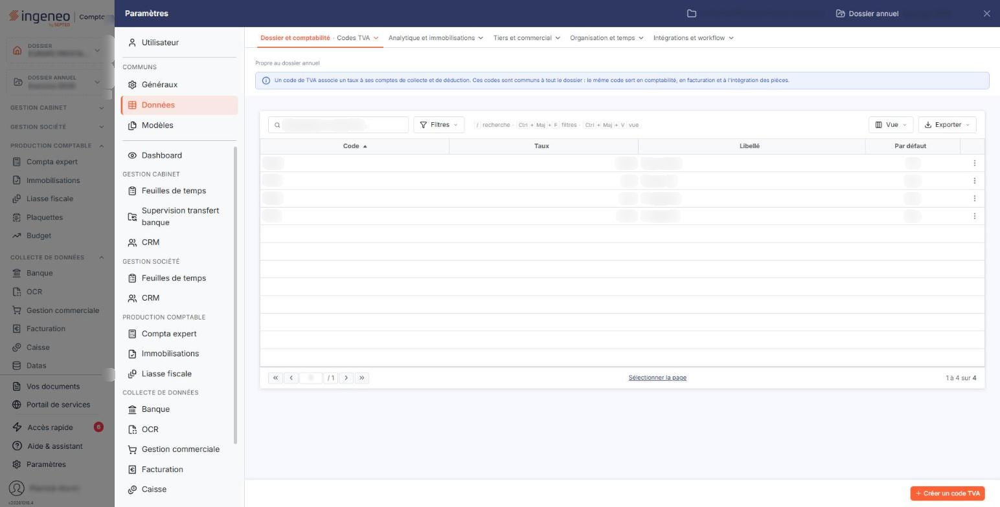
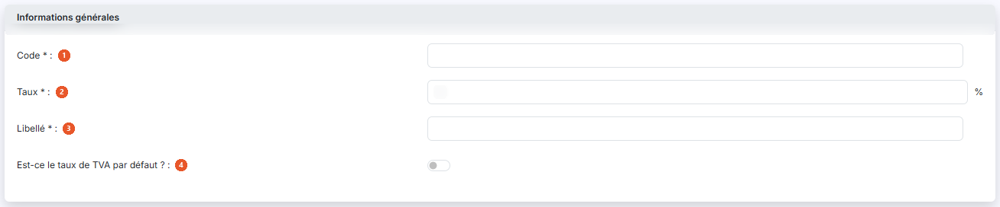
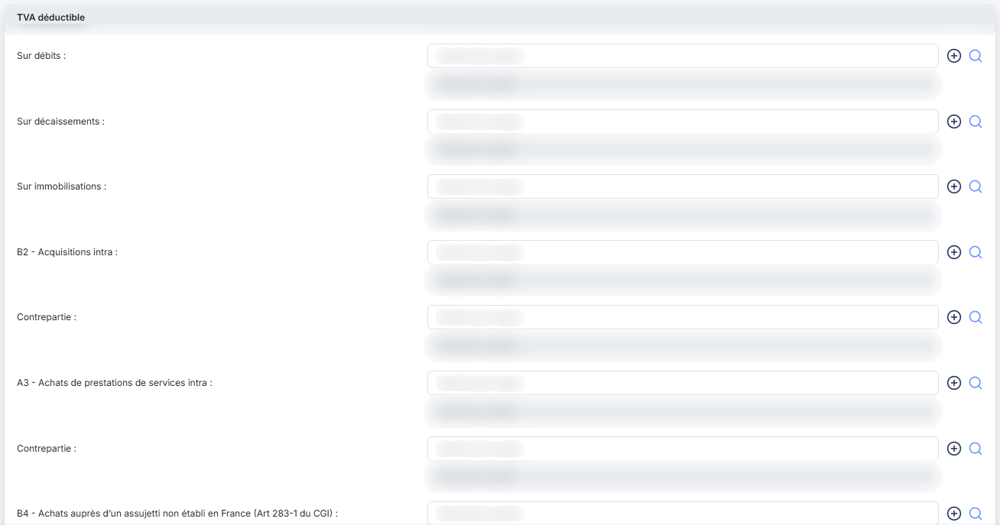
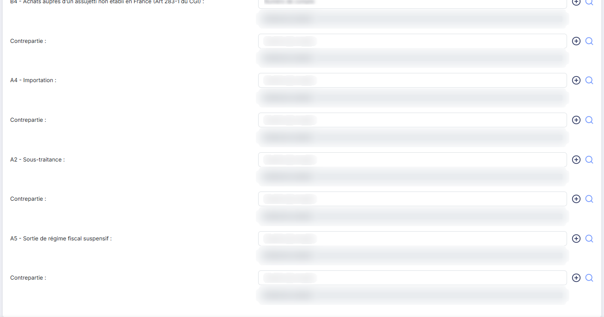
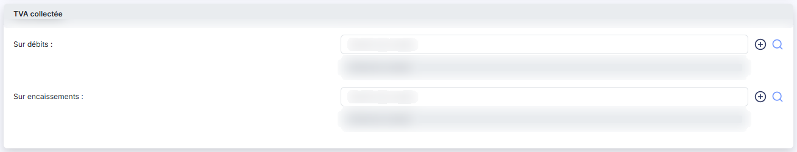
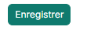

# Codes TVA


**Où le trouver :** Panneau **Paramètres** › **Données** › **Dossier et comptabilité** › **Codes TVA**



**En bref** — Cet écran gère les codes TVA : leur taux et les comptes dans lesquels la TVA déductible et collectée sera enregistrée lors de la génération des écritures.

* Pour créer un code TVA : bouton \[Créer un code TVA], renseignez « Code », « Taux » et « Libellé », indiquez les comptes utiles, puis bouton \[Enregistrer].
* Pour en faire le code proposé partout : activez « Est-ce le taux de TVA par défaut ? », puis bouton \[Enregistrer].


Cette option vous permet de gérer les codes TVA, c'est-à-dire les taux de TVA et les comptes comptables dans lesquels la TVA sera enregistrée lors de la génération des écritures.

<figure><figcaption>
Écran « Codes TVA » de la nouvelle interface
</figcaption></figure>

Les codes TVA sont utilisés par plusieurs modules du logiciel : toute modification faite ici est donc immédiatement visible dans les autres modules.


Remarque : un code TVA ne peut pas être supprimé s'il est utilisé, par exemple dans un compte, un article ou une pièce commerciale.


L'écran ne comporte pas de zone de filtres : il est constitué de la seule liste des codes TVA, avec quatre colonnes — « Code », « Taux », « Libellé » et « Par défaut ». Chacune est triable par un clic sur son en-tête ; la colonne « Par défaut » affiche « Oui » ou « Non ».

Sur chaque ligne, vous disposez de trois pictogrammes, dont l'infobulle vous rappelle le rôle : « Modifier », « Supprimer » et « Dupliquer ».

En bas de la liste, le pagineur vous permet de vous déplacer d'une, de dix ou de cent pages, ou d'aller directement à la première ou à la dernière ; le décompte des codes TVA est affiché à sa droite.

## Barre de la liste

La liste présente aussi une barre de recherche, bouton **\[Filtres]**, bouton **\[Vue]** et bouton **\[Exporter]**. Leur fonctionnement, commun à toutes les listes — dont le choix des colonnes affichées —, est décrit dans la page commune « Les listes ».

## Rubrique « Informations générales »

<figure><figcaption>
Rubrique « Informations générales »
</figcaption></figure>

| Champ                                     | Ce qu'il faut savoir                                                                                                              |
| ----------------------------------------- | --------------------------------------------------------------------------------------------------------------------------------- |
| 1. **Code**                               | Il doit être unique. Une fois le code TVA créé, il n'est plus modifiable : le champ apparaît alors en lecture seule.              |
| 2. **Taux**                               | Vous saisissez le taux en pourcentage, le signe « % » étant affiché à la suite de la zone de saisie.                              |
| 3. **Libellé**                            | Il désigne le code TVA partout où celui-ci vous est présenté.                                                                     |
| 4. **Est-ce le taux de TVA par défaut ?** | Activez cet interrupteur pour que ce code TVA soit proposé chaque fois qu'un code TVA est demandé. Un seul code TVA joue ce rôle. |

## Rubrique « TVA déductible »

<figure><figcaption>
Rubrique « TVA déductible »
</figcaption></figure>

<figure><figcaption>
Rubrique « TVA déductible »
</figcaption></figure>

Indiquez ici les comptes qui devront être utilisés lors de la génération des écritures liées à ce code TVA pour la TVA déductible. Aucun de ces comptes n'est obligatoire : vous ne renseignez que les cas que vous rencontrez.

Les comptes vous sont demandés dans cet ordre : « Sur débits », « Sur décaissements », « Sur immobilisations », « B2 - Acquisitions intra », « A3 - Achats de prestations de services intra », « B4 - Achats auprès d'un assujetti non établi en France (Art 283-1 du CGI) », « A4 - Importation », « A2 - Sous-traitance » et « A5 - Sortie de régime fiscal suspensif ».

Chaque ligne se compose de la même façon : une zone de saisie du numéro de compte, un pictogramme « Plus » vert qui vous permet de créer le compte sans quitter la fiche, une loupe qui ouvre une fenêtre de recherche parmi vos comptes, puis l'intitulé du compte, que le logiciel reprend du plan comptable et que vous ne pouvez pas saisir.

Les six derniers cas — de « B2 - Acquisitions intra » à « A5 - Sortie de régime fiscal suspensif » — relèvent de l'autoliquidation : ils sont donc accompagnés, à droite, d'un champ **Contrepartie :** dans lequel vous indiquez le compte de contrepartie pour la TVA collectée. Ce champ se compose d'une zone de saisie du numéro de compte, d'une loupe de recherche et de l'intitulé du compte en lecture seule ; il n'a pas de pictogramme de création de compte.

## Rubrique « TVA collectée »

<figure><figcaption>
Rubrique « TVA collectée »
</figcaption></figure>

Indiquez ici les comptes qui devront être utilisés lors de la génération des écritures liées à ce code TVA pour la TVA collectée. Deux comptes vous sont demandés, « Sur débits » et « Sur encaissements », l'un et l'autre facultatifs, et présentés comme ceux de la rubrique précédente.

## Bouton \[Créer un code TVA]

<figure><figcaption>
Bouton [Créer un code TVA]
</figcaption></figure>

Il ouvre une fiche vierge. Les trois rubriques et les mêmes champs vous y sont présentés, avec trois différences : le « Code » est saisissable, le « Taux » est prérenseigné à 0 et l'interrupteur « Est-ce le taux de TVA par défaut ? » est désactivé.

## Bouton \[Enregistrer]

<figure><figcaption>
Bouton [Enregistrer]
</figcaption></figure>

Il enregistre la fiche et vous ramène à la liste des codes TVA.

## Bouton \[Retour]

Il vous ramène à la liste des codes TVA sans enregistrer les modifications que vous auriez faites dans la fiche.
